# OmniaCLI

<p align="center"></p>

Manage many Odoo instances from a single web interface.

OmniaCLI is a small web service, behind a login page, that deploys and
operates Odoo instances from git. Each **server** has a **production** and/or
a **test** instance. An instance has one or more git working copies, a
database, an Odoo config file, a log file and a systemd service, an init.d
script, or an Odoo that OmniaCLI starts itself.

- **Servers**: every machine, this one and the linked ones, as a card or a
  row of a list with its state, CPU, memory, disk and instances; a machine's page with its
  instances and stagings, its load (the last hour live, or up to 14 days) and
  its databases, which it tunes. **Instances** and **Backups**: one list of
  every machine's, with the productions that have no scheduled backup and the
  automatic backups that did not succeed.
- **Dashboard**: every server with the state of its Odoo, Start / Stop /
  Restart, its CPU, and the CPU, network and disks of the machine, with the
  day each disk will be full.
- **Stagings**: a dated, neutralized copy of a production, on this machine
  or on a linked one, rebuilt with the data or with data and code; the mail
  its Odoo sends is caught and read on its page, and a person writes to it
  as an outside sender.
- **Addresses** of an instance (other names, redirects), its **modules**
  added from the catalog of the OCA, and its configuration of Odoo.
- **Published through another machine**: a machine behind NAT has its
  instances answer at their names on a machine of yours with a public
  address, through an SSH tunnel it opens itself (no port opened).
- **Deploy**: git pull (submodules included), update of the changed or chosen
  modules, restart; auto update in a time window; merge of what was tested
  into production, after a backup.
- **Backups** of database and filestore, to download or delete; automatic
  ones every day, kept by a rotation (so many days, weeks and months); one
  before every update when the instance asks for it; **copy of production
  into test**, neutralized.
- **Schedules**: at the times of a crontab expression, a backup, a git pull,
  a copy of a linked instance's database and a Python script on an instance.
- **Jobs** shown live; an administrator stops one that hangs.
- **Logs** in the browser, with an "errors only" filter.
- **Links**: operate the OmniaCLI of other machines from your own.
- **Shell** of the server in the browser, and **Claude Code** opened in an
  instance's folder.
- **MCP**: AI clients (Claude Code and others) read, update test instances
  and back them up through a token.
- Users with roles (user, developer, admin), an access log (kept a year,
  chained, also sent to a SIEM: what NIS 2 asks), and a Help page.
- The pages in English or Italian, light or dark; every question asked in
  the page's own dialog, never the browser's.

## Quick start

On Debian 11–13 or Ubuntu 22.04/24.04 (amd64 or arm64):

```bash
wget https://github.com/OmniaGit/OmniaCLI/releases/latest/download/OmniaCLI.deb
sudo apt install ./OmniaCLI.deb
sudo cat /etc/omniacli/initial-admin-password     # the password of user admin
```

OmniaCLI listens on `127.0.0.1:8090`: put an HTTPS reverse proxy in front of
it (see [Login and security](#login-and-security)), open it, log in as
`admin`, and add your servers on the **Servers** page.

Step by step, from the package to the first job: [Quickstart](docs/quickstart.md).

## Screenshots

The screenshots show demo data, on two test machines (`lab1`, `lab2`),
each seen from its own OmniaCLI and the other through their link.

**Login**, in English or Italian.

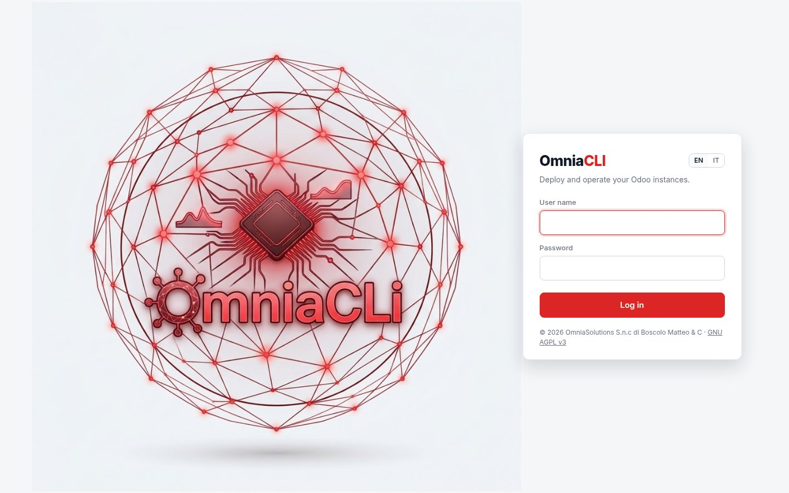

**Servers**: every machine as a card or as a row of a list (**Kanban |
List**), this one and the linked ones, with its state, CPU, memory, disk,
instances and OmniaCLI's version; **+ Add a server** prepares a new one (see
[Machines](#machines)).

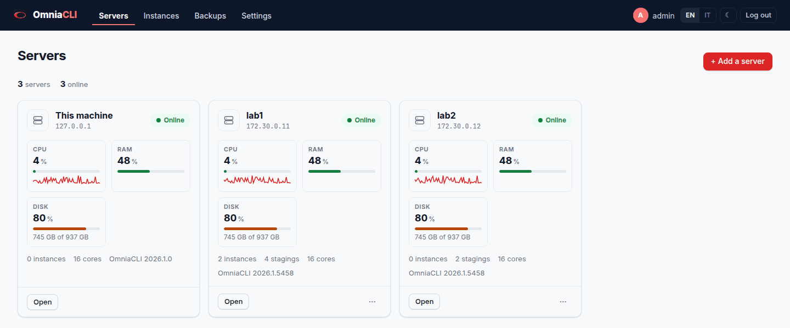

**A machine's page**: its instances, each staging right under its
production, the free space and the load; the tabs Monitoring and Database
(below).

**This machine** (the logo, or its card in Servers) opens on three numbers
— its Odoo instances, their stagings, the free space — and the load of now
as three bars (CPU, RAM, disk); under them its instances, each staging right
under its production, with a search box and **+ New instance**. The tabs
**Monitoring** and **Database** are described below; **Disks**, top right,
opens the history of every disk.
Every disk is recorded once a day (kept three years, in
`<data>/disk_history.json`): **Disks** (`/disks`) charts each disk's used
space and says when it will be full, from the trend of the last 90 days (at
least 7 days of data). The workspaces' disks are recorded the same way (the
file system inside each, as `df` on its mount says it; the space its image
takes when it is not mounted, full at its `disk_gb`), and **Disks** charts
them too.

Every page that shows a disk shows it with one widget
(`templates/_disk.html`): Workspaces (each workspace's disk, the real
disk under its storage with what the workspaces were promised there), a
workspace's page, a puller's page, and Disks. Each
reads the same: used, free and size, a bar that turns orange under 15% free
and red under 5%, and the estimate (the day it is full, the growth a day, or
why there is none yet), orange within 90 days of full and red within 30.


**Monitoring** of a machine: the last hour live, or a point every 5 minutes
over 24 hours, 7 or 14 days (here 24 hours, the history twenty hours old).

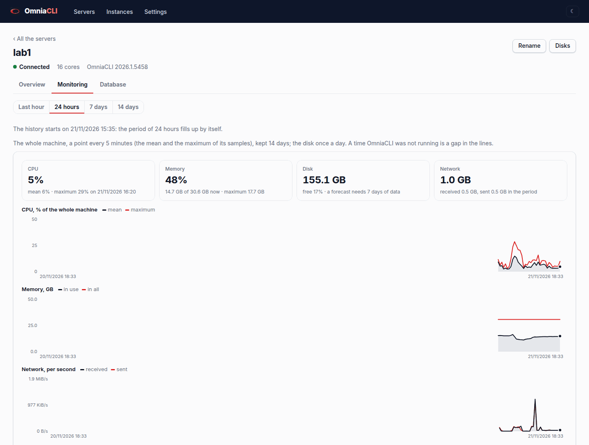

**Database** of a machine (its admins): the machine's cluster with the
instances it serves and its read replica on another machine (here on `lab1`),
then each instance's own database; its size, connections, tuning and recovery
at a minute; **Propose the values…** computes the values for the memory the
machine has.


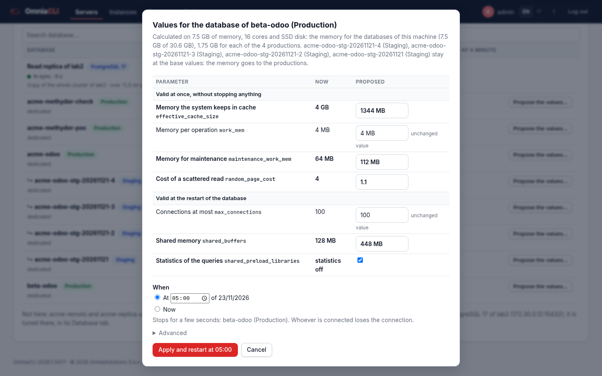

**Instances** (its **List** tab) and **Backups** of every machine: the
stagings under their production, the productions without a scheduled backup (a filter), each
backup with its machine, its kind and its outcome.

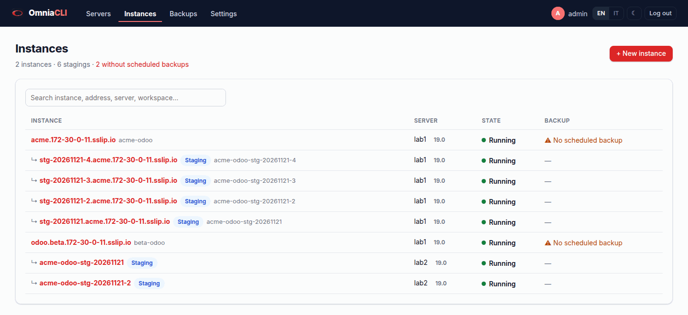

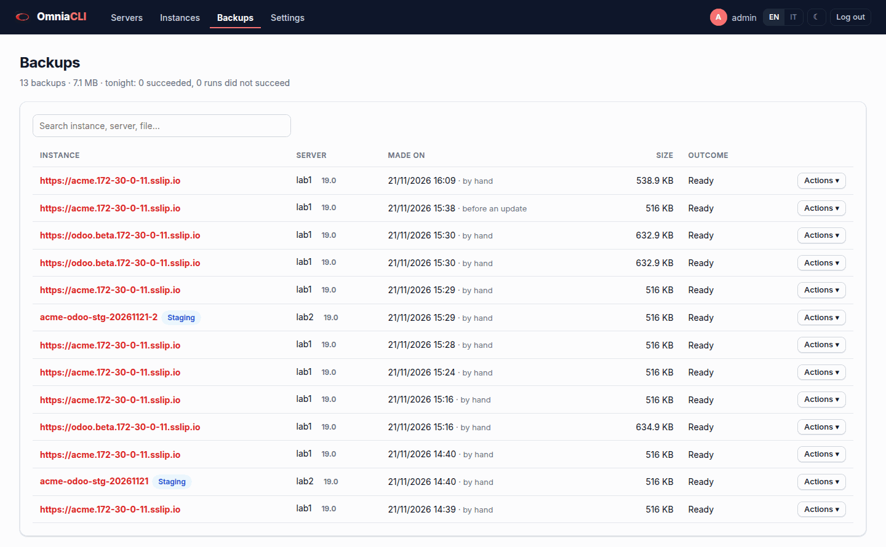

**The map** (the **Map** tab of Instances): the same instances as a diagram,
where each thing configured is
(the machines and their links, the workspaces, the names, the databases,
where the backups go) and what moves now (the jobs, a transfer). It reads
only.


**Disks** (Settings › Disks, or **Disks** on a machine's page): each disk's
used space by day and the estimate of the day it is full, with the dashed
forecast once there are seven days of history (here two: no forecast yet);
the workspaces' disks come after the machine's.

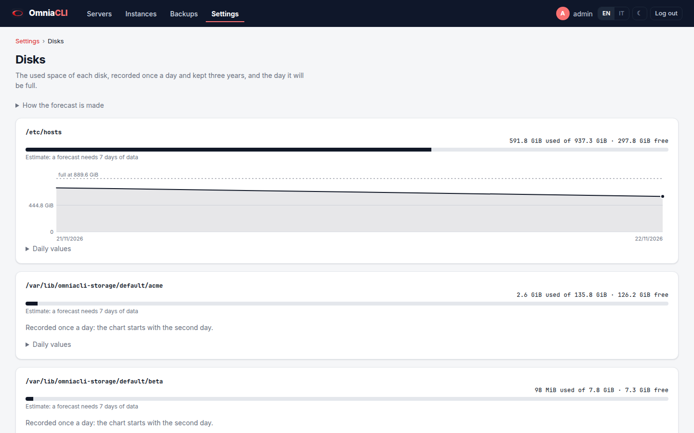

**An instance**: its address and state in the head (a problem with its
names is said under the title: a name out of DNS, no certificate yet), with
Open Odoo, Log in as…, Update and More; the tabs Overview (its Odoo
version, whether it answers, and its environments: production, test and
stagings, also those on another machine), Backups, Log, Monitoring, Modules,
Settings.

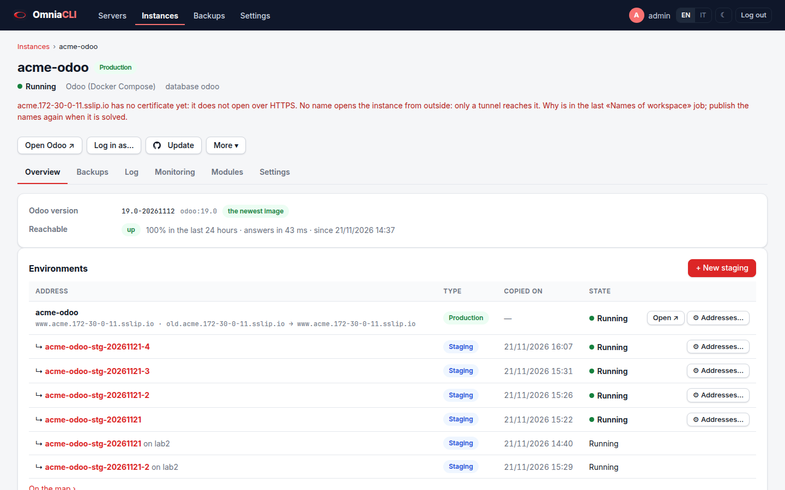

**New staging**: a copy of production as it is now, on this machine or on a
linked one with the same template; **Rebuild…** makes a staging again with
the data only, or with data and code.


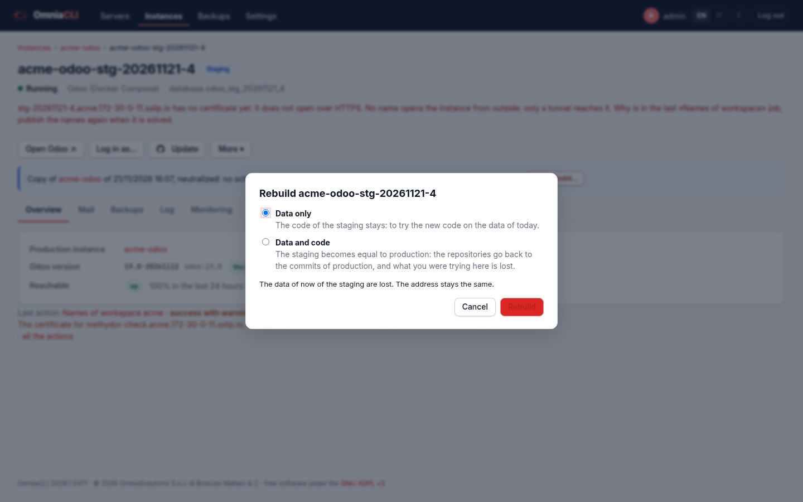

**Mail** of a staging: what its Odoo sent, caught here, by mailbox; **Write
as…** sends it a message as an outside sender, which its Odoo reads as it
reads a real mailbox.


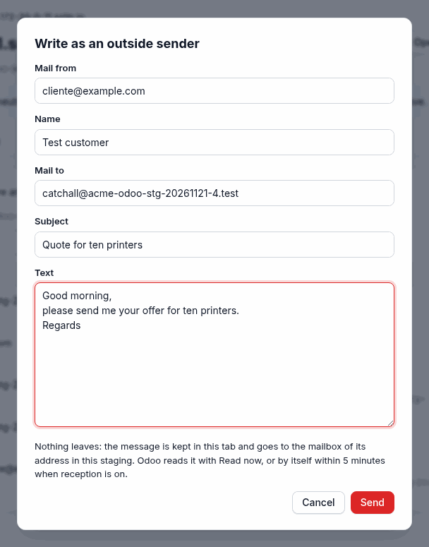

**Addresses…** of an environment: other names and redirects, with where the
DNS of each name points.


**Modules**: the repositories of the instance and the catalogs of modules for
its version of Odoo (the OCA's, and the GitHub users or organisations the
machine's admins add), searched by name or by what a module does.

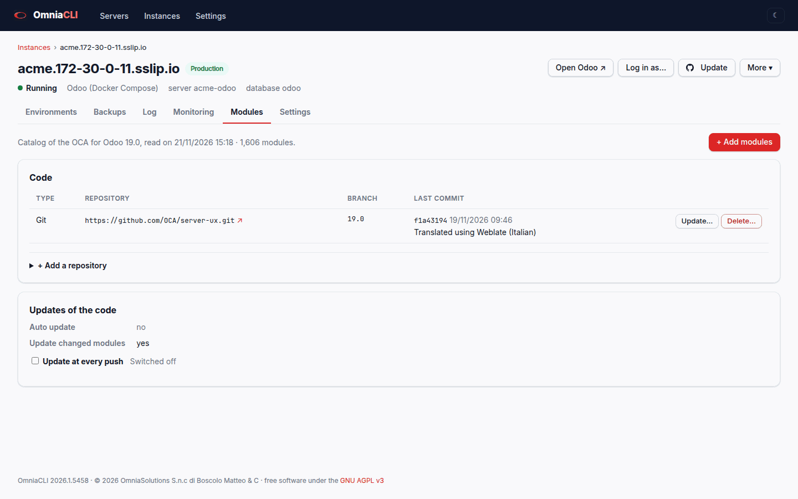

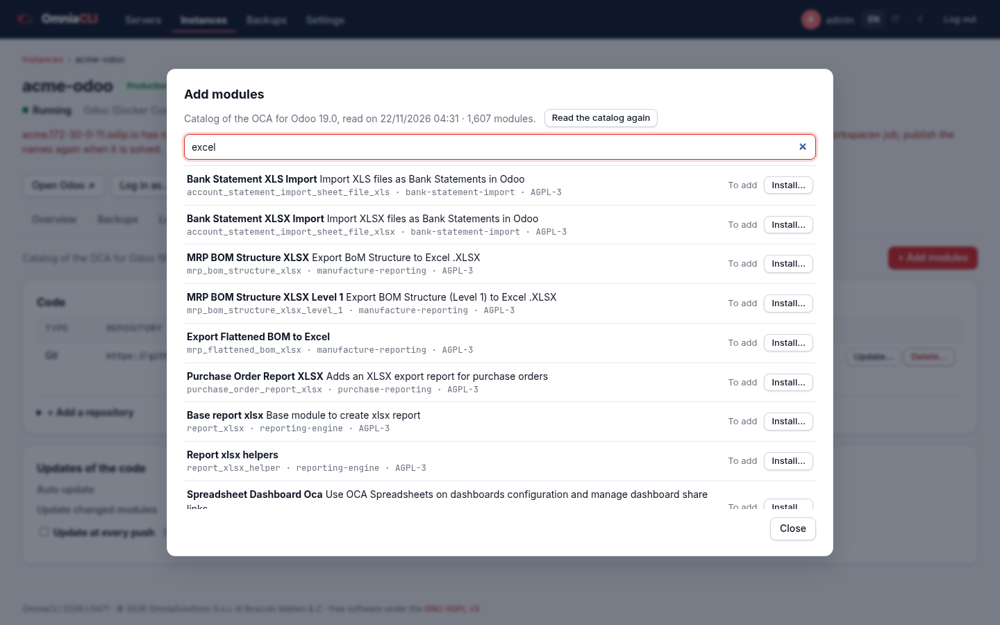

**Update modules**: the changed modules or chosen ones. The last choices of
modules of the instance come back as buttons (*Recent*). Each module shows the
version installed in the database and the one on disk the update brings
(`19.0.1.2 → 19.0.1.3`); an installed module with a newer version on disk is
red. The versions are read after the list, by the instance's Python with
Odoo's own `adapt_version` and `parse_version`. A Docker Compose instance,
as here, takes the modules typed, or the changed ones when left empty.

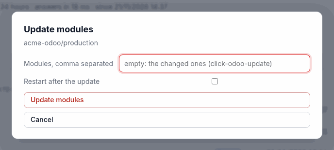

**Backup**: what goes in the zip, its weight, and whether its restore fits
(a Docker Compose instance, as here, has no room check of a restore).


**A question of the page**: every action that cannot be undone asks in the
page's own dialog, its verb on the button (red for what stops or deletes),
Cancel or Esc for no.


**Copy production to test** (in More, on the test of an instance that has
one): a new backup of production, or one already made; a Docker Compose
instance, as here, makes a new one and asks what test's filestore becomes
(shared with production, a copy of it, none).

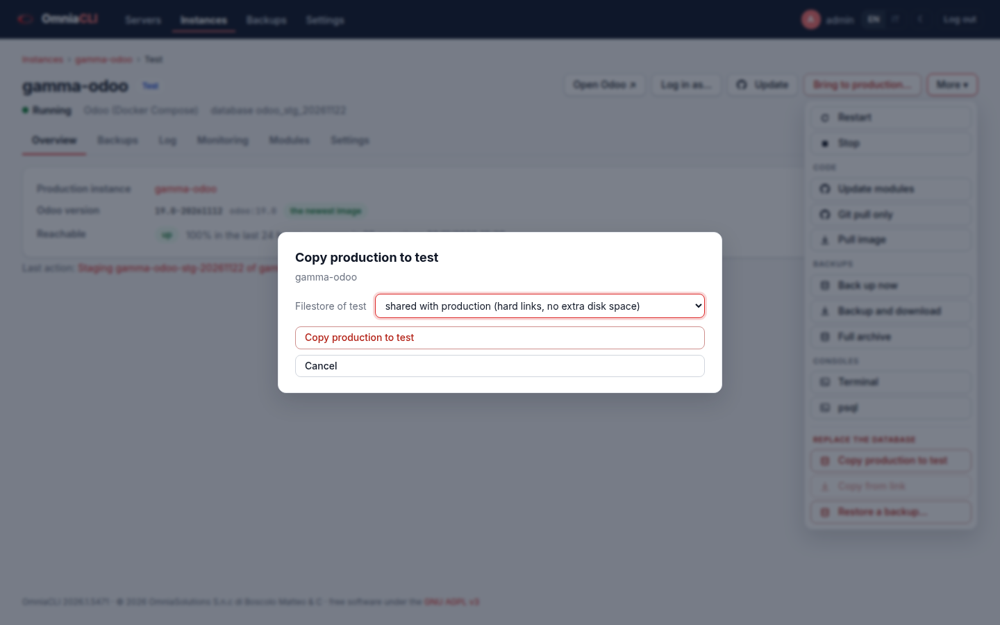

**Copy from link**: a backup made on a linked instance (a new one or one
already there), transferred here and restored; the job page follows each
step, the transfer with its size, speed and time left (here its last step,
the restore).


**A job**, and **Settings › Servers by hand**, where servers are added,
discovered, tested and activated.

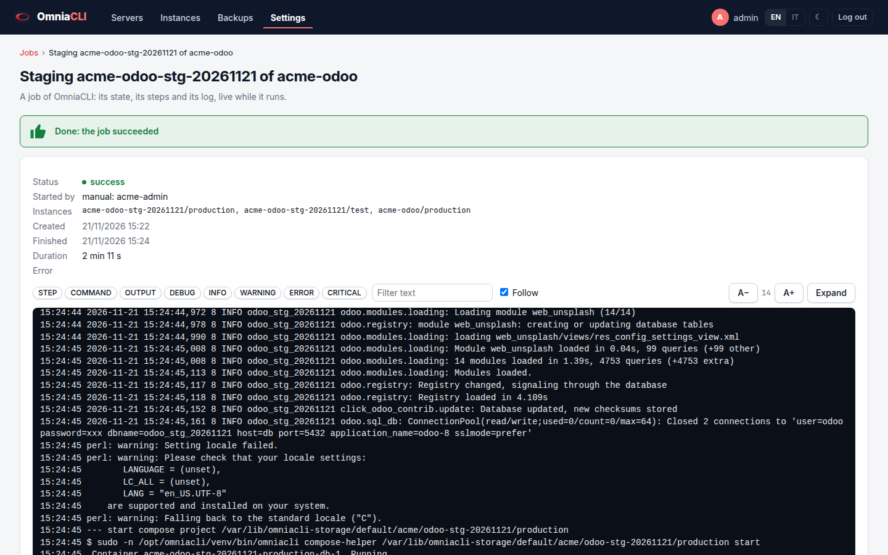

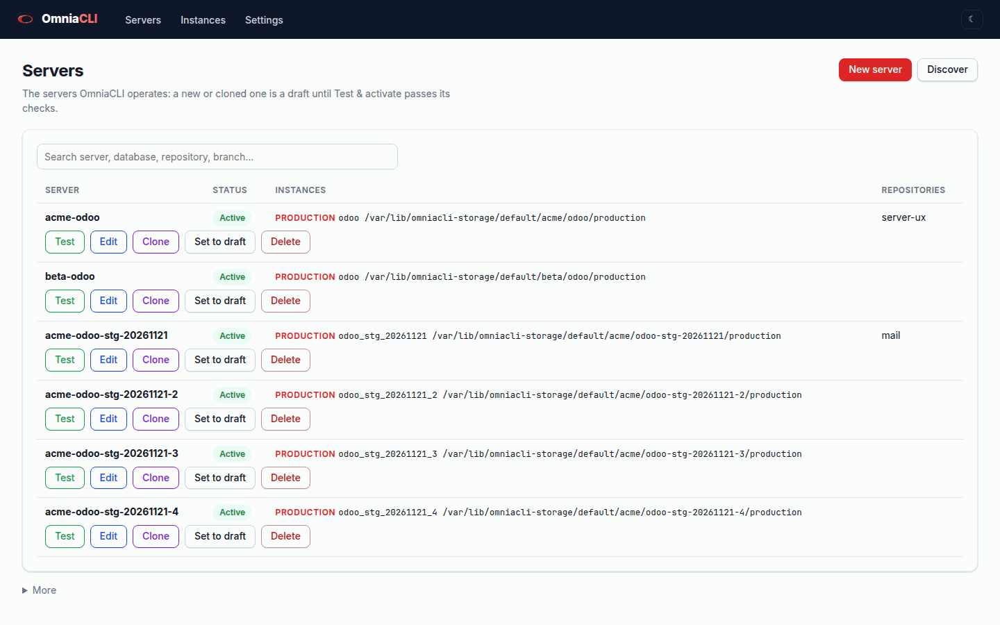

**A job stopped by an administrator**: a module update that never ended,
stopped with *Stop job*.


**Access log**: who did what, kept at least a year, its entries chained;
filters and exports for an auditor.

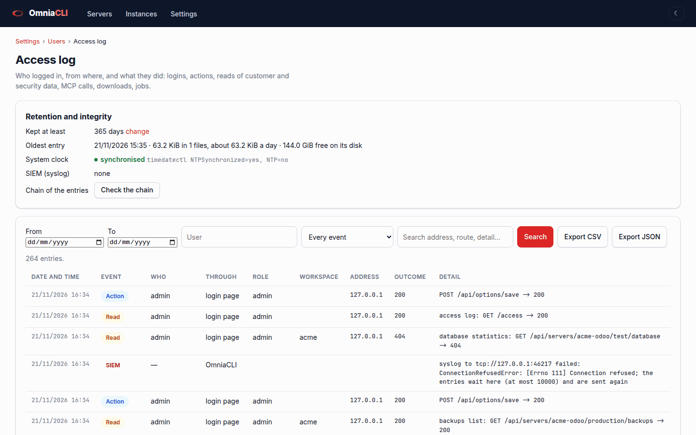

## What it does

| Action | Production | Test | What runs |
|---|---|---|---|
| Git pull | ✓ | ✓ | `git pull --ff-only <remote> <branch>` in every repository, then `git submodule update --init --recursive` in those with submodules. With more than one repository (or a package) a dialog lists them, with the commits each would bring (a `git fetch`), ticked when there are some: **Pull selected** pulls the ticked ones, **Pull all** every one, **Select all** ticks them all |
| Git pull + restart | ✓ | ✓ | pull, `click-odoo-update` (only the changed modules), restart |
| Update modules | ✓ | ✓ | a popup asks: the changed modules (`click-odoo-update`) or chosen ones (`odoo-bin -u … --stop-after-init --workers=0`), and whether to restart after. On a neutralized database, the scheduled actions that were off are off again after every update, also the update of a pull or of a restore: an update switches on those whose XML says `active=True`; one you switched on by hand stays on. The last 5 choices of modules of each instance are offered again; they are kept in the browser (`localStorage`), so each browser has its own |
| Restart | ✓ | ✓ | the instance's systemd or init.d restart, `docker compose up -d` then `restart` of a compose project (a type that runs in one, through the root helper `compose-helper`), or OmniaCLI's own start of `odoo-bin` (see below) |
| Start, Stop | ✓ | ✓ | `systemctl start`/`stop` of a systemd service (each needs its sudoers line, the **Start/Stop permission** check prints them), `docker compose up -d`/`stop` of a compose project (the helper's line), or OmniaCLI's own Odoo; a stopped Odoo stays stopped for the auto update |
| Backup | ✓ | ✓ | `click-odoo-backupdb` → `<backup_dir>/<server>/<role>/<db>_<timestamp>.zip`, database and filestore (the backups are OmniaCLI's own: `<backup_dir>/<server>` and `<server>/<role>` are made mode 700 and every zip there 600, made, downloaded from a link or a relay, or uploaded; a folder or file of another user is left as it is); with **Without filestore** checked, the database only (`--no-filestore`), `<db>_<timestamp>_nofilestore.zip`. With **Without binary columns** checked, the binary fields kept in the database (`bytea` columns: previews and printouts of older PLM databases) are left empty: the dialog lists every one that holds data, the biggest first, with its size, and ticks those of at least **Ticked from (MB)** (10); the dialog always shows the weight of the backup and whether a restore into the same instance fits on this machine (see **Weight and room** below). The dump is made by `omniacli/odoo/binary_dump.py` in the instance's venv: `pg_dump --section` pre-data, data (`--exclude-table-data` of the tables with an emptied column) and post-data on one exported snapshot, the rows of those tables copied with the column `NULL` (`''` where `NOT NULL`), into the same zip (`dump.sql`, `manifest.json`, `filestore/`), `<db>_<timestamp>_nobinaries.zip`, restored as any other; Odoo 10 to 19 (Python 2.7 and 3). The dialog opens with the instance's last choice (`<backup_dir>/<server>/<role>/.backup_choices.json`): a column ticked or left unticked then keeps it, a column new since is ticked by its size; the backups without the dialog (Copy production to test, Copy from link, schedules, MCP) take those ticks. The backup before a merge always has the filestore and every column |
| Backup before an update | ✓ | ✓ | with **Backup before an update** in the instance's settings (on for the production of an instance made by **New instance**): a backup (the last Backup dialog's choices) before a pull that brings commits (Pull and restart, the auto update, a schedule's pull, a repository's **Update…** in the Modules tab), before **Update modules** and **Pull image**; named `pre-update_<file>.zip`, the last 3 kept. A pull that brings nothing makes none. When the backup fails, nothing is pulled or updated |
| Delete a backup | ✓ | ✓ | the Backups tab lists each zip with its kind (automatic, before an update, by hand) and a **Delete** button: an admin's for a production, a developer's for a test; refused while a job works on the instance; in the access log |
| pip requirements | ✓ | ✓ | `<venv_bin>/python -m pip install -r` the `requirements.txt` next to `odoo-bin` and that of every repository having one, in one call |
| pip click-odoo | ✓ | ✓ | `<venv_bin>/python -m pip install click-odoo-contrib`, the scripts OmniaCLI runs in the venv |
| Merge test to production | | ✓ | (the button **Bring to production…**, on the test's page) backup production, merge, push, update modules, restart production |
| Weight and room | ✓ | ✓ | the Backup, Copy production to test and Copy from link dialogs show, for a new backup, its weight (the database on disk less the binary columns left out, its dump: that size plus once more the binary rows kept, which pg_dump writes in hex, the filestore when it is in the backup) and, disk by disk, whether its restore fits on the instance that receives it: the zip in its backup folder, the backup unpacked (Odoo's restore unpacks it first: beside the zip, see **Restore**; with `run_as` in `/var/tmp`), PostgreSQL's data folder (`SHOW data_directory`; not a superuser: `pg_lsclusters` by the port; PostgreSQL on another machine: not checked, and said so) and the filestore, against the room free there plus the database and filestore the restore drops first. The estimates are on the high side (the zip is not counted compressed); the dialogs warn, they do not refuse. Copy from link asks the weight to the OmniaCLI there through the link (an older one, or a puller, tells none) |
| Copy production to test | ✓ → | ✓ | a popup asks which backup of production: a new one (**shared with production** by default, see below; or with the filestore; or without it, test has no attachments) or one already made; then stop test, `click-odoo-restoredb --copy --force --neutralize` into the test database (drops it and its filestore first; `--neutralize` from Odoo 16: no scheduled actions, no outgoing mail), `click-odoo-update`, start test. **Without binary columns** empties, in the new backup, the columns ticked in production's last Backup dialog (none chosen yet: those of at least 10 MB). **Filestore shared with production**: the backup is made without filestore, and after the restore test's filestore (`<data_dir>/filestore/<db>`) is a tree of hard links to production's files, made by the test's venv python as its `run_as` user: no extra disk space, test reads every attachment, and what test writes or deletes does not touch production's files (Odoo never rewrites a filestore file, it only writes new ones and unlinks). Refused, before anything is touched, when an Odoo config sets no `data_dir` or the two filestores are not on the same filesystem, or the test user may not link production's files (`fs.protected_hardlinks`). Refused when production and test run different Odoo versions, and on Odoo 20+ (click-odoo-restoredb refuses it). A systemd test needs its Start/Stop sudoers lines; an init.d one is not stopped, it is restarted at the end |
| Copy from link | ✓ (admin) | ✓ | for an instance with a **Database from link**: a popup asks which backup of that instance of the linked OmniaCLI: a new one, made there now (with or without the filestore; an OmniaCLI there older than 2026.1.12 makes it with the filestore), or one already there; whether to neutralize; whether to set every user's password to `admin` (off by default: **Log in as**, below, opens the copy as any of its users with their passwords kept; when ticked, after the restore `click-odoo` runs `odoo/reset_passwords.py`, which writes the pbkdf2_sha512 hash in SQL, so no password policy refuses it; in `password` from Odoo 12, in `password_crypt` on Odoo 10 and 11 with auth_crypt; refused before anything is touched when the Odoo version is unknown); whether to **only load the database** (off by default, for development: the instance is not stopped, its modules are not updated and it is not restarted; Odoo's drop of the database ends its connections); and for a production its database name, typed. The zip is downloaded into this instance's backups as `<link>_<file>` (through `<file>.part`: a cut download leaves nothing), then restored as above: stop, `click-odoo-restoredb --copy --force [--neutralize]`, the passwords, `click-odoo-update`, start. Refused, before anything is touched, when the backup's `manifest.json` names another Odoo version than the instance's. What comes from the other machine is checked before anything is touched: a file that is no backup fails the job, also in a schedule, with the instance and its database intact |
| Restore | ✓ (admin) | ✓ (admin) | for a type that can restore, an admin who logs in: a popup asks for a zip from this computer (uploaded into the instance's backups through a `.part` file; refused when it is not a zip, or a file of that name is there, or less than 1 GiB would stay free) or one of the instance's backups, with the choices of Copy from link and, for a production, its database name typed. Refused before anything is touched when the zip has no `dump.sql`. Then as Copy from link: stop, `click-odoo-restoredb --copy --force [--neutralize]`, the passwords, `click-odoo-update`, start. Odoo unpacks the zip before loading it: OmniaCLI gives `click-odoo-restoredb` a `TMPDIR` on the disk of the backups, a folder `.restore-…` (mode 700) beside the zip, not `/tmp` on the system's disk; with `run_as`, the private folder in `/var/tmp` where the zip is staged. Removed at the end, failed or not. A zip without `manifest.json` (an Odoo.sh one) is not compared with the instance's Odoo version: the job warns. Not on native Odoo 20 and later (click-odoo-restoredb refuses it). An admin's because a `dump.sql` goes through `psql`, whose `\!` runs commands as the instance's user **A plain SQL dump** (`pg_dump --format=plain`, type `odoo`): the popup also takes one, of any name (`17.11.2026.bck`), told by its head (`-- PostgreSQL database dump`; a custom-format dump or a `pg_dumpall` one is refused), kept in the backups as `<name>.sql` (mode 600), listed with the backups. Its restore replaces only the database, the **filestore stays as it is**: stop, `omniacli/odoo/load_sql.py` in the instance's venv as its `run_as` user (the dump on its standard input, no copy): the database dropped and made again by Odoo's `_create_empty_database`, the dump loaded by `psql` (Odoo's `find_pg_tool` and `exec_pg_environ`: the connection of the Odoo config), with **Neutralize** Odoo's own `neutralize_database` (what `odoo-bin neutralize` runs: from Odoo 16; on an older Odoo the job warns and does not neutralize), then what Odoo's restore of a copy does: a new `database.uuid`, `database.secret`, `database.create_date`, and `web.base.url` set to the instance's address (its domain, else `http://localhost:<port>`); then the passwords, `click-odoo-update`, start. `psql` goes past an SQL error, as Odoo's restore and `psql < dump` do: each error is in the job log and the job warns with their count (a dump of PostgreSQL 16 loaded into 12 fails on `CREATE OR REPLACE VIEW` of three report views, which the update of their modules makes again); the job fails when `psql` itself does. The `\restrict` / `\unrestrict` lines of pg_dump's releases since August 2025 are left out (an older `psql` takes them for an unknown command). A SQL dump names no Odoo version: not compared, the job warns. Not on Odoo 20 and later (not verified). The `docker` type takes zips only |
| Log | ✓ | ✓ | `tail -F` of the Odoo log in the browser, with an "errors only" filter; of a compose instance, `docker compose logs` of its service (see below) |

The two pip buttons are also next to the **Venv bin** field of the server
form (admins), as soon as it is set: they run on the venv, odoo-bin and
repository folders typed there, saved or not, so a draft's venv can be
prepared before Test & activate. The job's log opens in a new tab.

- **Dashboard**: one row per live server, with the CPU of production and
  test over the last 15 minutes. The server's name opens its page, for the
  maintenance. **Open Odoo** opens the instance itself in a new tab, at its
  **Domain name** (server form) or at `http://localhost:<its port>`; the same
  link is in the card of now of each environment in Environments and deploys.
- **The instance's page**: a head with its address, its state, its type,
  server and database, and the actions of every day (Open Odoo, Log in as…,
  **Update**: a git pull and restart, Start when it is stopped; More for the
  rest: Restart, Stop, Update modules, the backups, the consoles, the
  database replaced or the instance deleted), then five tabs:
  **Overview**, whose **Environments and deploys** lists production, its
  test and its stagings (also those on another machine, with **+ New
  staging**) with their last deploys as cards (below), **Backups** (the list, the
  automatic backups, the copies out, the recovery at a minute), **Log**,
  **Monitoring** (CPU and memory of the last hour, the database's health),
  **Modules** (the repositories, the updates of the code, the catalog of the
  OCA) and **Settings** (the Odoo options, the technical details). A staging
  has **Overview** in place of Environments and, when its mail is caught,
  **Mail**. The tabs a role may not use are not there. *Merge test to
  production* is the test's **Bring to production…**.
- **The page's own dialogs**: every question (Restart?, Stop?, Delete…) is
  asked in a dialog of the page, the action's verb on its button (red for
  what deletes or stops), Cancel and Esc for no; deleting an instance or a
  staging asks its name typed. No page calls the browser's `alert`,
  `confirm` or `prompt` (a test checks every template).
- **Load**: every 5 seconds OmniaCLI samples each live instance. A systemd
  instance is measured on its unit's cgroup (cgroup v2): CPU of the main
  process and every worker, memory as the resident size of its processes. An
  init.d instance is measured on the processes started with `-c <its Odoo
  config>`. CPU is in percent of one core.
- **Test** (server form): runs the same checks on what the form holds, saves
  nothing and leaves the form open, to fix and test again. **Branches** (a
  repository row) reads the remote's branches (`git ls-remote --heads`) and
  turns the Branch cell into a list of them. The page **Settings › Servers by hand** (`/config`)
  has a search field: every word typed, in a server's name, status,
  database, repository names or branches.
- **Discover** (Settings › Servers by hand, admins): for a machine where OmniaCLI is new.
  It finds the Odoo instances there, from the processes running (an
  `odoo-bin`, `odoo` or `openerp-server` started by a python) and from the
  systemd units that start one, stopped ones too. For each it shows what it
  read and fills in the instance:
  - the Odoo config (`-c`) and, from it, the database, the log file and the
    git repositories of the `addons_path`, each with its branch and remote;
  - what the command line sets wins over the config: `-d`, `--logfile`,
    `--http-port`, `--addons-path`;
  - odoo-bin, also when it was started as a bare `odoo-bin` from its
    folder: through the process's working directory, the unit's
    `WorkingDirectory`, or the repositories. It is checked: the file exists
    and `odoo/release.py` next to it gives the Odoo version. Its repository
    is added when the `addons_path` does not name it;
  - the venv's bin folder (the python of the command; a python outside a
    venv is noted);
  - the user it runs as, as `run_as` when it is not OmniaCLI's own;
  - the service: the unit the process runs in, only when that unit's
    `MainPID` is the process (an Odoo started by hand from a shell of
    another service runs inside that service's unit). Started by hand, it is
    noted, with restart type `process` proposed when it runs as OmniaCLI's
    user.

  What it could not find is listed as a note to complete by hand (a config
  OmniaCLI's user cannot read, with the `adduser` that fixes it). Odoo in a
  container, Odoo's gevent server and its workers are skipped; an instance
  OmniaCLI already has is marked. Each one chosen gets a server name and a
  role, and is saved as a **draft**: two with the same name are the
  production and the test of one server. Nothing on the machine is changed.
- **Draft and Test & activate**: a new or cloned server is a draft (no page,
  no actions, no auto update). *Test & activate* runs real checks as the
  OmniaCLI user and makes it live only when no check fails: Odoo config,
  addons path, log file, click-odoo scripts and an `import click_odoo, odoo`
  with the instance's python, the database (connected with the Odoo config's
  credentials: a database that does not exist yet, or an empty one, is only
  a warning, it is **Start** and **Restart** that refuse it until a backup is
  restored), odoo-bin, every repository (branch, no local change, remote
  reachable), the service and `sudo -n -l` for its restart command, separate
  folders and databases for production and test, the backup folder. Saving
  a live server runs the same checks: if they fail nothing is saved and it
  stays live. `omniacli check-config` runs them from the command line.
- **Kind of machine**: `machine: server` or `machine: development` in the
  main configuration, which root writes and the service only reads. Without
  that line a service with `OMNIACLI_USER` is a development machine, any other
  a server; upgrades do not add the line, so an installation upgraded from an
  earlier version without `OMNIACLI_USER` becomes a server and loses Shell and
  Claude until root adds `machine: development`. On a server nobody, admins
  included, opens a shell of OmniaCLI's own user: no **Shell**, no **Claude**,
  and **psql** only where it runs as another user (`run_as`, Docker). The page
  and the WebSocket refuse them too, also through a link: the machine the
  shell would run on decides. The kind is on the Options page and in
  OmniaCLI's log at every start. On a development machine nothing changes.
  Closing the shells does not close what runs as that user by itself, so on a
  server the checks warn (**Isolation**): Odoo with restart type `process` or
  a module update without `run_as` run a module's code as that user, and a
  repository the `run_as` user may write lets it plant a hook or a git option
  that git runs as that user at the next pull. The warning prints the `chown`
  and `chmod`. It reads owner, group and mode of the repository, its git folder,
  `hooks` and `config`: not ACLs, not submodules.
- **Shell** (developers and admins, a button on each instance, development
  machines only): a page with
  a terminal (xterm.js) running a login shell of the user OmniaCLI runs as
  (`omniacli`, or the one of `OMNIACLI_USER`; bash when its own shell is
  `nologin`), in the instance's first repository. It runs on a
  pseudo-terminal joined to the page by a WebSocket, and ends when the page
  closes: its whole session is hung up (SIGHUP, SIGKILL after 3 seconds).
  The shell of a linked instance's server opens through the link, with the
  lower of the link's role and the user's. Every shell opened and closed is
  in the access log, with who and for how long. It is the access of that
  system user, as SSH would give it: give the developer role accordingly.
  **A−** and **A+** change the text size for that page, **Full screen**
  fills the screen with the terminal (Esc leaves it); the size it opens
  with is on the Options page.
  **Files dropped on the terminal** (shell, Claude, psql; up to 100 MiB
  each) are uploaded into `~/.omniacli-drops/<server>/<role>/` in the home
  of that system user, and their paths are typed in the terminal, quoted,
  as a local terminal does: Claude reads a mail (`.eml`) or a spreadsheet
  from there. A file keeps its name (`name-1.ext` when it is taken), the
  files older than 7 days go at the next upload, every upload is in the
  access log. The upload follows the shell's rules: who may open it, where
  it opens, through a link to the linked server. A mail dragged straight
  from a mail program may reach the browser as a link, not as a file: save
  it as `.eml`, then drop that.
- **Options** (admins, `/options`): the options of the whole instance, in
  `options.yaml` next to the servers file (`options_file` in the main
  configuration): the text size every console opens with (8-40 pixels,
  default 14).
- **The head of an instance's Environments tab** (developers and admins):
  the Odoo it runs (Docker: the image's build, and whether Docker Hub has a
  newer image of its tag, with Pull image; a venv: `odoo/release.py`, and
  the repository holding `odoo-bin` with its commits not yet pulled), its
  workers, its database, and each repository with its branch, the commit
  checked out and its subject, and **Update now (N commits)** (a pull of
  that repository, the backup before an update when asked, the changed
  modules updated, a restart) with the page of the differences. Read after
  the page: a `git fetch` of each repository and the registry take a while.
- **Paths and shell commands** (the machine's admins, an instance's
  Environments tab): where the instance lives and the commands of a shell of
  the machine over ssh, each with Copy. Docker Compose: the project, its
  addons and `odoo.conf`, then `docker compose` logs, `odoo shell`, update
  all modules, pip, psql, bash in the container; a venv: the source, the
  config, the python, the log, the data folder, then `odoo-bin shell`, the
  update of all modules and pip as the user Odoo runs as.
- **Consoles**: every log (an instance's, OmniaCLI's own, a job's) and every
  terminal (shell, Claude, psql) is the same widget (`templates/_console.html`)
  with the same bar: A− and A+ for the text size, kept in the browser for
  each kind of console, and Expand, which fills the browser window (Esc
  leaves it in a log; F11 makes the browser full screen). A log also has
  tags, combined: the levels of its records (a traceback goes with its
  record), and for a job its steps, commands and their output; no tag
  chosen shows every line. A text filter and Follow complete it.
- **Tunnels** (every user who logs in, `/tunnels`; the menu names it to
  developers and administrators only): a port of this machine
  that reaches the web interface of an instance of a linked OmniaCLI, for
  when this OmniaCLI reaches it and the browser does not. Every connection
  to the port travels in a WebSocket of its own through the link; the
  other side connects only to that instance's own ports (Odoo: its web
  port, and its gevent port for `/websocket` when it runs workers; before
  Odoo 16 `/longpolling` and `longpolling_port`). The web interface is at
  the root of its own address, as Odoo needs (its pages call root paths:
  they cannot be served under `/links/<name>/`). Options: the address the
  ports listen on (`127.0.0.1` by default: only a browser on this machine
  reaches them; `0.0.0.0` and a firewall rule for a server), the ports
  (`18000-18099`, the first free one is taken) and the hours without
  traffic after which a tunnel closes (4). Who opened a tunnel, or an
  admin, closes it; OmniaCLI stopping closes them all. The port has no
  login of its own: whoever reaches it reaches the instance's login. The
  browser keeps cookies by address, not by port: two tunnels open at once
  share Odoo's session. An admin logging in to Odoo through a tunnel
  makes Odoo set `web.base.url` to the tunnel's address, unless the
  instance has the system parameter `web.base.url.freeze`. Both instances
  need a version with tunnels.
- **Claude** (same roles, development machines only, a button on an instance
  with a **Claude folder** in the server form): the same shell, opened in that folder, that runs
  `claude` first (found by the login shell's `PATH`; Claude Code's installer
  puts it in `~/.local/bin`) and stays open when it ends. Claude Code must be
  installed and logged in for the user OmniaCLI runs as.
- **psql** (same roles, Odoo instances; on a server only with `run_as`, and
  on Docker instances, where it runs as `postgres` in the database's
  container): the same page running `psql` on
  the instance's database, connected as Odoo connects (`db_host`,
  `db_port`, `db_user`, `db_password` of its Odoo config, given in the
  `PG*` environment, not on the command line); it ends when psql ends.
  `psql` must be installed (Debian: `postgresql-client`). It runs as the
  user OmniaCLI runs as, or with `run_as` as that user (`sudo -n -u <user>
  --preserve-env=PG… psql`), so that an Odoo config without `db_host`
  passes PostgreSQL's `peer` login on the local socket as Odoo does. That
  needs a sudoers line for psql, with `SETENV` for the `PG*` variables;
  the **psql** check (a warning) prints it.
- **Auto update**: per instance, every `interval_minutes` within `window`,
  OmniaCLI fetches every repository. When there are new commits it runs
  *git pull + restart* as an `auto` job. Only on a test or a staging: a
  production is updated by hand only (its form refuses the auto update, one
  set before does not run, *Productions updated by hand only* below), and
  it stops while the instance's CI is switched off (Deploys, below).
- **Jobs**: every action is a job. Its output, its status and its error are
  shown live in the web page, and the last 500 are kept in `jobs_dir`.
- Only one job runs on an instance at a time; the others wait.
- **Stop job** (admins, on the page of a queued or running job): for a job
  that hangs or loops. The program it runs gets SIGTERM, with its whole
  process group (pip's builds, Odoo's workers), and SIGKILL after 10 seconds.
  The job ends as `stopped`, "stopped by <user>"; the steps after the stopped
  one do not run (a stopped module update is not followed by the restart),
  and what the job did before stays done. The instance is free for the next
  job at once. With `run_as` the SIGKILL reaches only `sudo`: a program of
  that user that ignores SIGTERM keeps running.

### Rules the actions follow

- A pull is **fast-forward only**. A repository on a branch other than the
  configured one, or with uncommitted changes, stops the job: OmniaCLI never
  creates merge commits or throws away local work on a pull.
- Except on a **test instance without auto update**, where someone may be
  working: its uncommitted changes are kept (a warning in the checks, not an
  error), and a pull goes on unless git would have to overwrite them.
  **Merge test to production** still refuses them: what runs on test must be
  a commit.
- The **submodules** of a repository follow it: after a pull, a merge or the
  rollback of a merge, `git submodule update --init --recursive` checks them
  out at the commits the repository records (a submodule left behind counts
  as an uncommitted change). Local changes inside a submodule make git
  refuse: the job stops, the repository itself already pulled, the changes
  kept. Their remotes must be readable by OmniaCLI's user without a prompt.
- **Merge test to production** merges the commit **checked out on the test
  server**, not the tip of the test branch, so production gets exactly what
  was tested. That commit must already be on the remote. Test and production
  repositories are paired by `name`. If any repository conflicts, the merge
  is aborted, every production repository is reset to the commit it had
  before, and nothing is pushed: the conflict is for a person to resolve.
- If a module update fails, the instance is **not** restarted.

## Install from the Debian package

Supported: Debian 11, 12, 13 and Ubuntu 22.04, 24.04 (amd64 or arm64); Ubuntu 20.04 only as a server that already has Odoo (Add a server › a server with Odoo: OmniaCLI alone, on the Python 3.12 the package downloads, since the system's is 3.8). OmniaCLI needs
Python 3.10 or newer: the package uses the system `python3` when it is 3.10+,
otherwise (Debian 11, Python 3.9) a local `python3.10`+ already installed (in
the `PATH` or `/usr/local/bin`, the newest first), otherwise it downloads a
Python 3.12 (python-build-standalone, checked against its sha256) into
`/opt/omniacli/python`.

Every [release](https://github.com/OmniaGit/OmniaCLI/releases) has the
package as `omniacli_<version>_all.deb`, and as `OmniaCLI.deb`, whose link
always gives the latest one.

```bash
sudo apt install ./omniacli_<version>_all.deb
sudo cat /etc/omniacli/initial-admin-password     # password of user admin
```

An upgrade is the same `apt install` of a newer package: the configuration,
the servers, the users, the jobs and the backups stay.

The package:

- creates the system user `omniacli` and runs the service `omniacli` as that
  user, on `127.0.0.1:8090` (change it in `/etc/default/omniacli`);
- runs it as another user when `OMNIACLI_USER` is set in
  `/etc/default/omniacli` (see below);
- builds `/opt/omniacli/venv` at installation with that Python and the
  dependency versions locked for it (`packaging/debian/requirements`).
  **The machine must reach PyPI while installing**, and also `github.com`
  when the Python 3.12 has to be downloaded. After an upgrade or a removal of
  the Python the venv was built on (a distribution upgrade, a local Python
  removed), rebuild it with `sudo dpkg-reconfigure omniacli`;
- creates `/etc/omniacli/omniacli.yaml` once, with a random password for
  `admin`; upgrades never change it;
- keeps the servers file, the jobs and the backups in `/var/lib/omniacli`;
- installs `/etc/sudoers.d/omniacli`, all comments, to be completed;
- on purge, deletes configuration and jobs but keeps the backups.

### First setup on a machine where Odoo already runs

The usual case: Odoo installed as the system user `odoo`, its configs and
logs readable by group `odoo` only, a systemd service per instance. After
`apt install`, as root:

1. **Let OmniaCLI read the Odoo configs and logs.** Add `omniacli` to the
   group `odoo`, but only if that group exists: `adduser` to a missing group
   fails (checked on Debian 11, 12 and Ubuntu 22.04, 24.04). The service gets
   the new group only when it starts again:

   ```bash
   getent group odoo && sudo adduser omniacli odoo
   sudo systemctl restart omniacli
   sudo -u omniacli head -c 1 /etc/odoo/odoo.conf; echo " $?"   # 0: readable
   ```

   Without a group `odoo` (configs owned by another user), give read access
   to each file with an ACL instead (see Configuration cases below).

2. **Let OmniaCLI run the venv's programs as `odoo`** (`run_as: odoo`:
   click-odoo, `odoo-bin -u`, pip, the database checks), in
   `/etc/sudoers.d/omniacli`. Either one line per venv, which is what the
   **Run as** check prints:

   ```
   omniacli ALL=(odoo) NOPASSWD:SETENV: /opt/odoo/venvs/odoo18/bin/
   ```

   or one line for every venv of the machine, including the ones made later:

   ```
   omniacli ALL=(odoo) NOPASSWD:SETENV: ALL
   ```

   The second one gives no more than the first in practice, because the
   venv's `python` runs any code it is given. With either, OmniaCLI acts as
   `odoo`, never as root. A line naming `odoo` can be written before that
   user exists, for example before Odoo is installed: `visudo` accepts it,
   the other sudo rules keep working, and `sudo -u odoo` answers
   `unknown user odoo` until the user is created, then works (checked on
   Debian 11, 12, 13 and Ubuntu 22.04, 24.04, sudo 1.9.5 to 1.9.16).

3. **Let OmniaCLI restart, start and stop each Odoo service**: one exact
   line per service and action, as root. No wildcard: `systemctl restart *`
   would let OmniaCLI restart any service of the machine, `ssh` included.
   The **Restart permission** and **Start/Stop permission** checks print the
   lines missing:

   ```
   omniacli ALL=(root) NOPASSWD: /usr/bin/systemctl --no-ask-password restart odoo-prod
   omniacli ALL=(root) NOPASSWD: /usr/bin/systemctl --no-ask-password start odoo-prod
   omniacli ALL=(root) NOPASSWD: /usr/bin/systemctl --no-ask-password stop odoo-prod
   ```

   Check the file after every change: `sudo visudo -cf /etc/sudoers.d/omniacli`
   (a broken sudoers file can stop every `sudo` of the machine).

4. **Give OmniaCLI the repositories and a git key**: git runs as
   `omniacli`, which must own the repositories and reach their remotes
   without a prompt (see "dubious ownership" and the deploy key under
   Configuration cases below).

5. **Add the servers**: on the web interface, **Servers → Discover** finds
   every Odoo running, and every systemd unit that starts one, and saves
   the chosen ones as drafts. Complete what its notes say, then run
   **Test & activate** on each: its checks say which of the steps above is
   still missing, with the line or the command to add.

### The service as another user (OMNIACLI_USER)

On a development workstation the repositories, the Odoo configs and the logs
are the developer's, often in a folder other users cannot enter: the service
user `omniacli` cannot read them (`cannot read .../odoo.conf: Permission
denied`). Run the whole service as that user instead:

```bash
echo OMNIACLI_USER=devuser | sudo tee -a /etc/default/omniacli
sudo dpkg-reconfigure omniacli
```

Everything OmniaCLI does itself then runs as that user, in group `omniacli`:
git (with that user's git configuration and credentials), reading the
configs and logs, its files in `/var/lib/omniacli` (given to that user, and
kept so by upgrades). The sudoers lines name that user
(`devuser ALL=(root) NOPASSWD: ...`). Not root. Remove the line and run
`dpkg-reconfigure` again to go back to `omniacli`. On a server keep
`omniacli`, with `run_as` for the programs of an Odoo venv: `OMNIACLI_USER`
makes the machine a development one, with no restriction on the shells, unless
the main configuration says `machine: server`.

### Update OmniaCLI

A machine's page says its OmniaCLI's version, and next to it the version
published when it is newer (**2026.1.5502 available**): its admins get
**Update OmniaCLI…**. The Servers list, the Workspaces list and the upload of
a backup say the same of the linked machines and open their page with the
dialog (`#omniacli-update` in the address); through a link the machine
updates itself, asked by a person who is an admin there (never by the
central alone).

The dialog says from which version to which, the notes of every version in
between (the GitHub releases of the source), what does not change (Odoo, its
databases, its containers and the sites of nginx: only OmniaCLI restarts, and
for how long the panel is away, measured at the last update: about 20 s on an
Ubuntu 24.04 that reaches PyPI, where the install rebuilds the venv), and that the
package of the version installed now is kept: **Back to the version
before…** installs it again for 14 days. A machine that serves productions
asks its name, typed, as for a deletion. The page then follows the job while
OmniaCLI restarts and comes back.

What it does, and what makes it safe:

- **The source is root's**: `self_update` of `/etc/omniacli/omniacli.yaml`
  (commented in the file): `url`, an https address of the OmniaCLI `.deb`
  (by default the latest release of this fork, `OMNIACLI_PACKAGE_URL` of the
  environment otherwise); `public_key`, the key its signature must verify
  with (default: `plugins.public_key`); `version_url` (one version's
  package, `{version}` in it) and `releases` (the notes, GitHub's API), both
  derived from a GitHub release address. Only https, redirects included.
- **Signed or not installed**: next to the package its signed manifest,
  `OmniaCLI.deb.json` and `.json.sig` (`omniacli package-sign`, as for the
  plugins): a package whose manifest does not verify with the machine's key,
  or that is not the file the manifest signs (size, sha256, its own name and
  version), is refused with the reason, and nothing is installed. The
  release workflow signs `OmniaCLI.deb` when the repository has the secrets
  `OMNIACLI_PACKAGE_KEY` (the private key of `omniacli package-key`) and
  `OMNIACLI_KEY_PASSPHRASE`; without them a release has no manifest and the
  dialog says it cannot be installed from here.
- **Root does it, in a unit of its own**: `omniacli self-update`, allowed to
  the service's user by `/etc/sudoers.d/omniacli-self-update` (written by
  every install), downloads and verifies the package into
  `/var/lib/omniacli-self-update/packages/<version>/` (root's), keeps the
  installed version's package (its signed one, or the release's package
  checked file by file against what dpkg installed: files, links,
  maintainer scripts, configuration files as installed; one that differs is
  not kept, and then nothing is updated), then starts the install with
  `systemd-run` in the unit `omniacli-self-update-<job>`, which outlives
  OmniaCLI's own restart. That unit (the system's `python3`, never
  OmniaCLI's venv, which the install rebuilds) writes the facts before and
  after (OmniaCLI's version and state, `nginx -t` and a digest of its files,
  the start times of the running Odoo, PostgreSQL and nginx units and of the
  containers, the login page), how long the panel did not answer, and the
  outcome; if the install fails, or OmniaCLI does not answer within 5
  minutes, it installs the version before again from its kept package.
- **The job ends where it began**: the restarted OmniaCLI reads the outcome
  and finishes the job, «Update OmniaCLI 2026.1.5477 → 2026.1.5502»; a
  start time that changed (a container restarted meanwhile) is a warning.
- **The access log** (NIS 2) has the update asked (who, from which panel),
  downloaded and verified (its sha256), installed, gone back, or failed.

An OmniaCLI older than the update from the panel updates itself once by hand
(`sudo apt install ./OmniaCLI.deb`), and from the panel from then on. The
packages kept and the runs go with `apt purge`.

### Build and test the package

```bash
packaging/debian/build_deb.sh                  # test build -> ARTEFACTS, omniacli_<year>.1.<n>_all.deb
packaging/debian/build_deb.sh --release        # release build of branch <year> -> ARTEFACTS, OmniaCLI.deb
packaging/debian/build_deb.sh --check DIR      # the working tree, into DIR, no tag
packaging/debian/build_deb.sh --ci VERSION DIR # the checked out commit with VERSION, into DIR (the CI)
packaging/debian/test_deb.sh <deb> [image ...] # install and check it in Docker, systemd included
packaging/debian/make_locks.sh                 # regenerate the dependency locks, with the tests
```

The package is built from a commit (`git archive`), never from uncommitted
files, except with `--check`. Its version is `<year>.1.<n>`. The test and
release builds number `n` one above every `omniacli-v<year>.1.*` tag and every
package already in `ARTEFACTS`, and tag the built commit. `ARTEFACTS` (where
the package goes, `dist/` by default) and `PYTHON` (the Python that builds the
wheel, `python3` by default) come from the environment or from
`packaging/debian/build.local.sh`, a file of the build machine that is not
versioned.

### Releases on GitHub

Publishing a GitHub release builds its package
(`.github/workflows/release.yml`):

1. tag the commit to release with its version, `omniacli-v<year>.1.<n>`, and
   publish a release on that tag;
2. the workflow runs the tests, builds the package with
   `build_deb.sh --ci <version>` and attaches `omniacli_<version>_all.deb`
   and `OmniaCLI.deb` to the release, and with the secrets
   `OMNIACLI_PACKAGE_KEY` and `OMNIACLI_KEY_PASSPHRASE` its signed manifest
   (`OmniaCLI.deb.json`, `.json.sig`, `.sha256`), which Update OmniaCLI
   needs;
3. it then installs the package in Debian 12 and Ubuntu 24.04 containers with
   systemd and checks it end to end (`test_deb.sh`). A failure there marks
   the run as failed: the package is already attached, so delete it from the
   release, or publish a fixed release.

## Install by hand

```bash
python3.11 -m venv /opt/omniacli/venv
/opt/omniacli/venv/bin/pip install git+https://github.com/OmniaGit/OmniaCLI.git
```

The `click-odoo-*` scripts import the instance's own `odoo` package. So
`click-odoo-contrib` must be installed **in the venv that runs each Odoo**,
not in OmniaCLI's venv. `venv_bin` in the config points to it.

```bash
/opt/odoo/venvs/odoo18/bin/pip install click-odoo-contrib
```

`click-odoo-update` keeps a hash of every installed module in the database.
On a database it has never seen, it would update every module. So run this
once per database, when you know the modules are up to date:

```bash
/opt/odoo/venvs/odoo18/bin/click-odoo-update -c odoo.conf -d DB --only-compute-hashes
```

## Configure

The configuration has six files and a folder:

- the **main config** (`omniacli.yaml`): the users set by hand, `backup_dir`,
  `jobs_dir`, `servers_file` and, when not in their default place, the paths
  of the files below (`users_file`, `links_file`, `groups_file`,
  `schedules_file`) and of the scripts folder (`scripts_dir`). It is edited by hand and the
  web interface never writes it.
- the **users file** (`users_file`, by default `users.yaml` next to the
  servers file): the users, links and MCP tokens managed from the web
  interface (**Users** page, admins only), written readable by its owner
  only. Every change applies at once: a changed or deleted password stops
  working at the next request.
- the **links file** (`links_file`, by default `links.yaml` next to the
  servers file): the other OmniaCLI instances this one operates (**Links**
  page, admins only), with their tokens in clear, so written readable by its
  owner only.
- the **groups file** (`groups_file`, by default `groups.yaml` next to the
  servers file): the headings of the Dashboard (**Edit groups**, admins).
- the **schedules file** (`schedules_file`, by default `schedules.yaml` next
  to the servers file): the scheduled actions (**Schedules** page, admins;
  see Scheduled actions).
- the **scripts folder** (`scripts_dir`, by default `scripts` next to the
  servers file, `/var/lib/omniacli/scripts` in the package): the Python
  scripts a scheduled action may run, put there by hand.
- the **servers file** (`servers_file`, see `servers.example.yaml`): the
  servers and their instances. It is edited from the web interface
  (**Settings › Servers by hand**: new, edit, clone, delete), so the user running
  OmniaCLI must be able to write it. Every save is validated like the file at
  startup, the previous version is kept as `<file>.bak`, and the auto update
  loops restart with the new settings. Clone copies a server's configuration
  only (no database, no files). A server with a running job cannot be edited or
  deleted.

```bash
cp config.example.yaml omniacli.yaml
omniacli hash-password            # paste the result under auth.users
omniacli check-config -c omniacli.yaml
```

`check-config` checks that every path is readable, that the click-odoo
scripts exist and that every repository is on its configured branch.

### Roles

Every user has a role:

| Role | May |
|---|---|
| `user` | watch: servers, load, logs, jobs, the backup list; and restart, start and stop Odoo |
| `developer` | also act on the servers: pull, update, backup and the download of a backup, pip, the shell, Claude |
| `admin` | everything: also the configuration pages (servers, users, links, schedules) and the merge of test into production |
| `workspace` | none of the above on the machine: the servers of its workspaces only, with its role in each, or a custom role of the workspace and some of its instances only (see Workspaces, Custom roles of a workspace) |

```yaml
auth:
  users:
    admin: "pbkdf2_sha256$..."                 # a bare hash: an admin
    anna: {password: "pbkdf2_sha256$...", role: developer}
    luca: {password: "pbkdf2_sha256$...", role: user}
```

The pages show only what the role allows, and the server refuses the rest
(403).

The **Users** page adds users, changes their role, sets a new password and
deletes them. The users of the main config are shown there too but are
changed only in the file: they are the way in that a mistake on the page
cannot lock out. Nobody can change their own role or delete themselves, and
the last admin cannot be demoted or deleted. Every user who logs in with a
password changes it from their own page (their name, top right), unless it is
set in the main config.

The **Help** page (menu Help, developers and admins) explains step by step
how to create a link, how to connect an MCP client and every field of the
server form, with example data only.

The **Access log** (Settings › Users › Access log, admins) lists the logins
with date, time and address: a user's login is the login form; a link or an
MCP token, which send their token with every request, log in with their
first request after 30 minutes without requests from the same address.
Logouts are listed, and so is every call to `/mcp`, with its JSON-RPC method
and tool, every shell opened and closed, every **action** of whoever passed
the login (every request that changes something, POST, PUT or DELETE, so a
route added later is logged by itself: the request, its answer and the name,
role, host, server or kind it names, never a password or a token), every
**download** of a backup, every **read** of customer or security data (an
instance's log, its database statistics, the caught mail of a staging and its
mailboxes, the lists of backups and archives, an Odoo config, the users of a
database for Log in as, the access log itself and its exports, OmniaCLI's
log, the git credentials: the same page by the same person from the same
address once in 10 minutes), and the end of every **job** with its outcome.
Each entry has the local time and UTC, who (and on whose behalf, through a
link), the role and the workspace in effect, the address, the method, the
route's template (`/servers/{server}/{role}/restart`), the server, the
environment, the HTTP code and the jobs it started. The reads logged are
listed in one place, `audit.py` (`SENSITIVE_READS`): every other GET route
is listed there as not sensitive, or a test fails, so whoever adds a route
decides. It is kept in `access.jsonl` in the logs folder next to `jobs_dir`
(`/var/lib/omniacli/logs` for the package). The page filters by period,
user, event and text, and exports CSV and JSON. A workspace's admins read
their workspace's entries only (its page, **Access log**): what was done and
read on its instances, by anyone, and the logins of its users and tokens.

Wrong passwords and tokens, and the logins refused for too many failures, need
no login, so they have a file of their own, `access-failed.jsonl`, and cannot
push out the rest: of them at most 10 a minute from an address and 300 from all
addresses are written, the others counted in one entry at the end of the
minute. Past 5 MiB a file moves to `<file>.1`, and so on; a file past the
tenth goes only when its newest entry is older than **audit.retention_days**
(Options, 365 by default; 0: by size only, up to `<file>.10`), so no entry
younger than that is dropped for room. The machine's page and the log's warn
when the disk will not hold the period, and when the clock is not
synchronised (`timedatectl`, else `chronyc`).

**Integrity**: each line carries in `prev` the SHA-256 of the line before, a
chain for each file that goes on across the rotation. **Check the chain**
on the page (`GET /api/access/verify`) or `omniacli verify-access-log -c
/etc/omniacli/omniacli.yaml` (exit 1, with file and line, when it breaks)
show a line changed, taken out or added in the middle; not the last lines
taken out, nor a whole oldest file. These files are written by OmniaCLI's
user, so whoever has a shell as that user, or root, can change them: to keep
them out of reach, send them to another machine. **SIEM** (Options): every
entry, as soon as written, goes to a syslog server in RFC 5424 (UDP, TCP or
TCP with TLS), from a thread with its queue: a SIEM that does not answer
never stops an action, and its failure is logged once. What NIS 2 asks and
how this answers it: [docs/nis2-audit.md](docs/nis2-audit.md) (in Italian;
the retention of a year is to be confirmed against the national rules).

The **Log** page (admins) shows OmniaCLI's own log: the requests it serves,
its calls to the links, its errors, with the follow and errors-only switches
of the instances' log. OmniaCLI writes it to `omniacli.log` in the same logs
folder, besides what it writes to its standard output (the journal): the
package's user `omniacli` may not read the system journal. Past 5 MiB it
moves to `omniacli.log.1`.

### Linked instances

Another OmniaCLI instance (yours, at the customer's) can be let in to operate
this one with a token of its own and a role. Create it on the **Users** page
(the token is shown once), or by hand in `auth.links`:

```bash
omniacli new-link-token omniasolutions --role developer
```

```yaml
auth:
  links:
    omniasolutions: {token: "sha256$...", role: developer}
```

The linking instance sends the token as `Authorization: Bearer <token>`.
It may also send `X-OmniaCLI-Prefix` (the path it serves these pages under,
e.g. `/links/customer`: every link in the pages starts with it) and
`X-OmniaCLI-User` (its user acting through the link: the jobs record
`manual: link omniasolutions (anna)`), and `X-OmniaCLI-Role-Cap` (that
user's role on the linking instance: the link acts with the lower of it and
its own). They are honoured for link tokens only. `GET /api/info` answers
with the version and the caller's role, `GET /api/servers` with the live
servers.

### Operating another instance

On your instance, the **Links** page (admins) adds a link: a name (the
customer's), the other instance's URL, the token it created for you on its
Users page, and a CA file when its certificate is from the customer's own CA.
**Test link** shows its version and the role you get there. Then:

- the Dashboard lists its live servers as `<link> › <server>`, with their
  load, and the filter finds them by link name too. A link that does not
  answer is shown as an error above the list;
- its pages open here under `/links/<link>/`, with a bar saying which
  instance you are on: every action runs there, recorded as
  `manual: link <its name for you> (<your user>)`;
- you act there with the lower of your role here and the link's role there.
  Only users who log in here use links, not tokens;
- an instance here may take its database from an instance there: in the
  server form, **Database from link** names the link, the server there and
  its role. *Copy from link* on the instance's page then backs it up there,
  downloads the zip and restores it here (see the table of actions). It needs
  the developer role there (for the link and for you) and here, the admin
  role for a production here. Stopping the job here does not stop a backup
  already running there. Without a Database from link, or with a link no
  longer on the Links page, the button is shown disabled, and its tooltip
  says what to set.

### Pullers

An OmniaCLI that nobody can reach (a production behind a firewall) can still
be operated through a third OmniaCLI that both sides reach, on a public VPS:
the **relay**. The unreachable one (the **producer**) and the ones that
operate it (the **consumers**) each link out to the relay; nothing connects
to the producer. On the relay a **puller** names the link of the producer
and those of its consumers:


- the **Publications** page (Settings; its tab *Relayed from here*; admins) adds one: a name, the producer and the
  consumers, among the incoming links of the Users page (the role **user**
  is enough: a puller's routes check that the link is in it, and that role
  opens no shell, no backup and no action on the relay's own servers), the
  hours its files and reports are kept (24) and its largest file (10240 MiB).
  Saved in `pullers.yaml` next to the servers file;
- the producer asks for the consumers' commands, holding its request open up
  to 25 seconds until one comes, and leaves with every request its report
  (state, disks, load, the progress of its jobs), which every consumer reads
  from the last one it read. Its backups it uploads, for a consumer to
  download;
- a command not taken by the producer in 10 minutes expires; once taken, it
  is gone from the relay. A file is deleted once a consumer says it has it
  whole, and every file and report after the hours kept; at most 20 commands
  wait and 5 files are kept per puller;
- with a **key** that only the producer and the consumers hold, every
  message and file is encrypted and signed (AES-256-GCM): the relay can
  neither read them nor make one up, nor play a command again. Without a key
  they pass in clear, and the relay is trusted. The page shows only what the
  relay knows: when each side was last seen, the commands waiting and the
  files kept.

On the producer, the **Publications** page publishes an instance (*Published
from here*): the link to the relay (Links page), the puller's name, its key (*New
key* makes one: give the same to the consumers) and the commands it takes,
each with its hours. Saved in `publications.yaml` next to the servers file,
readable by its owner only:

- **backup**, **start**, **stop** and **restart** are off until enabled. A
  command sent outside its hours (`HH:MM-HH:MM`, by the producer's clock,
  may cross midnight; empty: always) is refused at once, the answer saying
  its hours: to run it within them, schedule it on the consumer. Saving
  start, stop or restart without a key warns that whoever controls the
  relay can send them;
- every command runs as a job recorded as `puller <name> (<who asked>)`;
  a consumer may stop a job a command started (`stop-job`), and no other;
- a backup is encrypted with the key before it is uploaded (steps Backup,
  Encrypt, Upload on its job page), and stays here too, as any backup;
- every ask carries a report: the instance's state, whether a job runs, its
  type and its backup's options, the commands exposed and their hours, the
  disks (and their daily history when it changed), the CPU and memory
  samples since the report the relay took last (the sampler keeps an hour:
  a longer gap is lost), and the new log lines, steps and result of the
  jobs the commands started. Whatever the relay did not take goes again
  with the next report. While such a job runs it asks every 2 seconds,
  otherwise every 25;
- the commands already received are kept in `publications/` next to
  `jobs_dir`, so a restart does not let one be played again. The page shows
  when the relay was reached last, or why not.

On a consumer, the **Publications** page operates an instance through a puller (*Operated
from here*): a name, the link to the relay, the puller's name and the key of the
producer's publication (none: in clear). Saved in `connections.yaml` next
to the servers file, readable by its owner only. Then:

- the entries of the top bar (every role) open each connection's page: the
  instance there with its state, disks, CPU and memory (the last hour, day
  or 7 days), the buttons of the commands it exposes, the commands sent with
  the producer's answers, and its jobs with their log. Backup needs the
  developer role, Start, Stop and Restart every role, stopping a job there
  the admin role, as for the same actions here; only users who log in send
  commands. What is shown comes with the reports: some seconds old;
- **Database from link** in a server's form may name a connection
  (`from_link: {puller: <name>}`): *Copy from link* and the scheduled copies
  (`copy: {puller: <name>}`) then ask a new backup there, follow its job,
  download it from the relay, decrypt it, delete it from the relay and
  restore it here (steps Backup, Transfer, Decrypt, Restore). A backup
  already there cannot be chosen: the relay keeps none. Stopping the job
  here asks the producer to stop its backup;
- the reports are read from the last one read, kept in `connections/` next
  to `jobs_dir`: the last state, the producer's last 30 jobs (5000 lines
  each), the last 50 commands sent, and the samples, one file a day, for 7
  days. A report that does not open with the key is refused and said on the
  page, and a copy then fails at once.

Their state is kept in `pullers/` next to `jobs_dir`
(`/var/lib/omniacli/pullers` in the package). A relay behind nginx needs
`client_max_body_size 0;` (or the largest file) and
`proxy_request_buffering off;` in its `location`, or nginx refuses an upload
over 1 MiB; the 25-second requests stay within its read timeout.

The routes, for links in the puller only (a JSON `{"error": ...}` otherwise):

| Who | Route | What |
|---|---|---|
| any | `GET /api/pullers` | the pullers the link is in, and its part |
| any | `GET /api/pullers/<name>` | last contacts, commands waiting and expired, files |
| producer | `POST /api/pullers/<name>/producer?wait=<s>` | body `{"report": <envelope>}`: keeps the report, answers `{"seq", "commands"}` |
| producer | `PUT /api/pullers/<name>/producer/files/<file>` | the body is the file |
| consumer | `POST /api/pullers/<name>/commands` | body `{"command": <envelope>}`: answers `{"qid", "expires"}` |
| consumer | `GET /api/pullers/<name>/reports?since=<seq>&wait=<s>` | the reports after `since`, with `next`, `first` (the oldest kept), `last` and `reset` |
| consumer | `GET /api/pullers/<name>/files/<file>` | the file |
| consumer | `DELETE /api/pullers/<name>/files/<file>` | the consumer has it whole: it goes |

### Groups

Every list of things (the Dashboard's Servers, Workspaces and Linked, and
the Servers, Workspaces, Settings › Servers, Users, Links, Publications,
Schedules and Plugins pages) is one list widget (`templates/_list.html`): its
search finds every word typed, in any case, in the browser (`?q=` fills it);
**Esc** empties the field, **/** elsewhere on the page comes to it. Grouping is
an option of the widget, offered by the Dashboard's **Servers** and
**Linked** (whose groups the **Servers** page follows too): **Edit groups** (admins, `/groups`) puts their items under
headings and subheadings, four levels at most, in the order you choose. A
member is a name of the list (`srv`, `cliente`) or a pattern of names
(`acme-*`, `*`, `?` one character); an item shows under the first group
that has it, itself or in a subgroup, then under the first of its subgroups
that has it, the rest under "Others". The search finds an item by its groups
too, and each viewer's folded groups are kept in its browser. A file of an
older OmniaCLI (one list for this instance's and the links' servers) is
read as the groups of both: `srv` and `*` the servers', `customer/*` the
link `customer`; a single server of a link (`customer/srv`) is dropped, the
linked servers being on their own Dashboard now. The groups are this
instance's own: a linked instance's pages do not show them.

The other instance must be reachable from yours: through an HTTPS reverse
proxy, a VPN, or an SSH tunnel (`http://` is accepted for a tunnel or a VPN,
but then the token travels in clear). Both instances need a version with
links (the Test link button says so).

### A linked machine's pages, written here

A linked machine's pages are written by **this** panel, with its own version
(AD-017), from the data the machine gives: a fix of a page reaches every
linked machine when this panel is updated, without updating them. The pages
written here so far are an instance's page (with its tabs and dialogs), Disks,
the instance's Log, OmniaCLI's own Log, Instances, Backups, Servers
(machines), Discover, a Publication's connection, the shells, Help, About and
Settings; then Jobs and a job's page, Workspaces (the list and a workspace's
form), Backup destinations (the machine's and a workspace's), the Access log
(the machine's and a workspace's), Servers (the configuration), Git
credentials, Odoo Enterprise, Links, Groups, Plugins and Schedules. A
person's own Account and Tunnels are the panel's where the person logged in:
through a link the machine refuses them (404, 403), and this panel says so
with its own error page. The others (the Dashboard, a workspace's page,
Users, Pullers, a server's form, Options) are still the machine's own.

- **The contract.** `GET /api/info` of a machine says `agent_api` (3 from this
  version, 2 from 2026.1.5517, 1 from 2026.1.5515) and its `plugins` (`{name: version}`, `built-in` for the
  package's own); a machine that does not say it is 0. Each page here needs an
  `agent_api` (`omniacli/centralpages.py`), and this panel reads its own and
  the one before. The pages of Jobs, Workspaces and the others of the second
  list above need 3, an instance's page 2, the first ones 1: a machine at 2
  has the first ones and its instances' pages written here and its own Jobs,
  Workspaces…; a machine at 1 has every page its own. When the machine's
  number is outside that, or it has a plugin this panel has not at the same
  version, its own page passes as before, with a line on top: «Page written by lab4 (2026.1.5513): update it to
  see the new one», or «… the panel is older than the machine». The line is on
  those pages only: the others look as they always did. The number is read by
  **Try** and again when older than 10 minutes, kept in memory, and read again
  right after an **Update OmniaCLI** asked from here; a machine that does not
  answer is not asked again for a minute.
- **A contract that goes back.** The highest `agent_api` each link's machine
  said is kept (`link-agents.json` beside the links file). Once it said 1, a
  machine that says less than it said, or has no data for one of those pages,
  does not get its own page shown by its word alone: this panel shows a page that says so,
  until an administrator sets the link's pages to the machine's (below).
- **The model.** The machine answers each page's data at
  `GET /api/pages/<page>` (to a link's token only, with the page's own role,
  its fields by name: no object, no secret); the page's script calls
  `/links/<name>/api/…` as before. An instance's page is
  `GET /api/pages/server?server=<name>&view=test`: what the machine decides
  there (the buttons of the person's role and custom role, the disabled ones
  and why, the dialogs) comes in it, and this panel never widens it; of the
  instance its fields by name (never its options, the database's password or
  a repository's credentials). The other pages are
  `GET /api/pages/<page>` with the address's names (`job_id`, `workspace`) and
  the page's filters (`server`, `q`, `since`…, `edit`, `new`): of a credential,
  the Enterprise source or a destination they say whether its token, password
  or key is set, never its value; of a link where it goes and the SSH host key
  it fixed, never its token; of the machine's SSH key the public half only.
  The notices of a schedule or a workspace come with their site only
  (`https://hooks.slack.com/…`: a webhook carries its secret in its path), on
  the machine's page too. What the machine's own page shows the same person
  passes as it is: the text of an error reading a file, which may quote it.
  An instance placed on another machine (AD-014), or a job its host answered,
  is sent to its host as before; the page of a move of one whose copy there
  was deleted is drawn here too, from its name and its move. A model is
  refused (this panel's error page) when it names a plugin's dialog this panel
  has not, another instance, job or workspace than the address's, an address
  the page may not use (a link elsewhere that is not http(s), an address of
  the machine not under `/links/<name>/`: no `..`, no other machine, no route
  of this panel), or a name it puts in an address (a job's id, a server's, a
  workspace's, a link's) that is not one: a `..`, a slash, a space. Through a
  link, the Workspaces list has no machines of the machine's word. The kinds of a
  destination come in English and are said here in the reader's language.
  The page writes its moments by the machine's clock. The models are never
  reached by a browser through the link (`/links/<name>/api/pages/…`: 404). Every read of a model is in the machine's access log
  (`read`, with who looks through the link and the server).
- **Only data, where it is written here.** For such a link, the machine's
  answers to `/links/<name>/api/…` and to the paths of the pages written here
  pass only as data: JSON, text, CSV, raster images (no SVG), files to save,
  answers without a body; an HTML or script answer is refused with a 502 (and
  in the access log). A browser's `/api` request is asked as JSON, so the
  machine's reason is what the person reads. **Not refused:** the pages not
  written here yet (the Dashboard, Users, …) and their parts still
  come as the machine writes them, HTML included, until they are moved too.
- **The way back**: on the link's **Edit… › Advanced**, untick **Pages written
  by this panel** (`pages: machine` in the links file): the machine writes its
  own pages again, as before, without a release.

### Links through SSH

A customer's server that shows only SSH (and Odoo) still has its OmniaCLI
reached: give the link an **SSH server** (the **SSH…** button of its row).
OmniaCLI keeps an `ssh -L` open to it while it runs, restarts it when it
drops (after 5 s, then up to 60 s), and sends everything of the link through
it: pages, API, WebSockets, tunnels, copies. The URL is then `http://` as that
server reaches OmniaCLI, `http://127.0.0.1:8090` for the package's default
there; SSH encrypts it. The row shows the tunnel's state and why it is down;
**Test link** says it too.

- **The key**: OmniaCLI has an ed25519 key of its own (**Make the key** on the
  Links page), in `ssh/` next to the links file, readable by OmniaCLI's user
  only.
- **The server's key**: **Fetch host key** reads it; compare its fingerprint
  with `ssh-keygen -lf /etc/ssh/ssh_host_ed25519_key.pub` run on that server
  before saving. ssh accepts only that key, and reads no configuration,
  agent or `known_hosts` of OmniaCLI's user.
- **On the customer's server**, as root: a user for OmniaCLI alone
  (`omniacli-link` by default) and, in its `~/.ssh/authorized_keys`, the line
  the Links page prints, which allows that one forward and nothing else (no
  command, shell or file transfer):

  ```
  restrict,port-forwarding,permitopen="127.0.0.1:8090",command="/bin/false" ssh-ed25519 AAAA… omniacli@host
  ```

  Better also the `Match User` block the page prints, at the end of
  `/etc/ssh/sshd_config` (then `sshd -t && systemctl reload ssh`): the line
  alone still lets the key open a port on that server's loopback that leads
  back to this machine (`ssh -R`); the block refuses it. Both tried on
  OpenSSH 9.2. In the line, `permitlisten="none"` is not accepted there: the
  whole key is refused.
- ssh ends with OmniaCLI, also when OmniaCLI is killed.

### Git credentials

On a machine whose working copies already have their git user (an ssh key,
saved credentials of someone), OmniaCLI can use its own instead: **Settings ›
Git credentials** (`/credentials`, the machine's admins) gives each server, and
each workspace (also on the workspace's page, by its admins), a list of
`host + user + token` (github.com, bitbucket.org, a GitLab). A server's
credential wins over its workspace's for the same host; a host without one is
reached as before, as the machine's git user.

Every git command OmniaCLI runs on a repository of that server (pull, fetch,
merge, push, submodules, the branches of the form, the checks) then gets
`-c credential.helper=` (the machine's helpers off), `-c
credential.helper=store --file=<the server's file>`, and for each host
`-c url.https://<host>/.insteadOf=git@<host>:` and `ssh://git@<host>/`: a
working copy with an ssh remote is reached over https with the token, its
`.git/config` untouched, and no token is written in a repository (so a
container that mounts it never reads it). That rewrite is for an ssh
remote OmniaCLI has **no key** for (an adopted machine's working copies): a
repository of a workspace added over ssh keeps ssh and its keys (below),
whatever token its host has. A token reads only the repositories it
reaches: a fine-grained GitHub token limited to one repository rewrote,
before (ber, 23/11/2026), every ssh repository of github.com to https,
where the token could not read them (403).

**Keys over ssh** (a workspace's repository added as `git@host:org/repo.git`
or `ssh://git@host/…`): **one deploy key per repository**, since GitHub
accepts a key as the deploy key of one repository only («Key is already in
use»). Writing an ssh address in **+ Add a repository** shows its own key
(*Show its key*: made the first time, `POST /api/workspaces/<ws>/git-key`
with `{"url"}`, kept in `credentials/deploy-keys/`, 0600 in 0700) and the
page where it goes (GitHub: the repository's *Settings › Deploy keys*,
read only). The machine's git key stays, for an **account** that reads
several repositories (its *SSH keys*, not a deploy key): *The key of this
machine, for an account*. git's ssh (`core.sshCommand`, `IdentitiesOnly`)
offers the repository's deploy key first, then the machine's: a server
takes the first key it knows, so a key that is another repository's deploy
key must not come first (GitHub answers «Repository not found» to it).
A refusal is said in words in the job instead of «git exited with code
128»: over ssh, «Repository not found» or *Permission denied* (the keys do
not read that repository: paste its deploy key, or use a token); over
https, GitHub's misleading «Write access to repository not granted» (403)
on a clone (the token lacks *Contents: Read* on that repository, or the
organisation has not approved it), 401 (no token, or a wrong or expired
one), 404 (a wrong address, or a token that does not reach it). The credentials are kept in
`credentials.yaml` next to the servers file and the files git reads in
`credentials/`, readable by OmniaCLI's user only; a token is never shown
again (changing a credential with the token left empty keeps it).

### GitHub

No GitHub App and no OAuth app: a **fine-grained personal access token** made
on github.com (Settings › Developer settings › Personal access tokens ›
Fine-grained tokens) and pasted into OmniaCLI as a git credential of kind
**GitHub token** (`github.py`). It belongs where the other credentials are:
**Settings › Git credentials** for a server (the machine's admins), the
workspace's page, *Git credentials › + GitHub token*, for a workspace (its
admins: a customer may have its own GitHub). A server's wins over its
workspace's for the same host. It is also the git credential of its host
(its login as the user), so the clones and pulls of its repositories go over
https with it through git's store file (0600, `credential.helper=store
--file=…`), never on a command line; saving a plain user and token for the
same host replaces it.

The token GitHub needs:

- **Resource owner**: the account or the organisation whose repositories
  OmniaCLI reads (a fine-grained token reads one owner's: repositories of two
  owners need two tokens, one on the server and one on its workspace, or the
  owner's own);
- **Repository access**: *Only select repositories* (those of the
  instances) or *All repositories*;
- **Repository permissions**: *Contents* read-only (clone and pull),
  *Metadata* read-only (mandatory: the list and the branches), *Webhooks*
  read and write (the CI: the webhook made by itself), *Commit statuses*
  read and write (the state of a deploy on its commit). Nothing of the
  account's permissions. To make a repository of a module uploaded as a
  .zip (below, Modules uploaded as a .zip) also *Administration* read and
  write and *Contents* read and write, on *All repositories*.

**Save the token** asks GitHub who it is (`GET /user`, `/user/orgs`): the
account and the organisations are kept with it and shown in the row, with
its name; a token GitHub refuses is not saved. **Test** (on the form, or on
the row of a saved one: nothing is saved or changed) says who it is, how
many repositories it reads (and how many private, of which owners), and for
each permission whether it has it and what it is for, **measured** on the
first of its repositories (a fine-grained token tells no scopes): a read for
the read ones; for the write ones a request GitHub refuses as invalid (422)
when the token may write, and as forbidden (403, 404) when it may not — a
webhook without an address, a status on commit `000…0`: nothing is made.
It ends with the requests left of GitHub's hourly limit.

**Add a repository › From GitHub** (an instance's Modules tab, when a GitHub
token reaches the instance: otherwise the typed address, as before, with a
line that says where a token is added): the repositories the token reads
(`GET /user/repos`, 100 a page following GitHub's `Link`, at most 1,000),
with a search box, the private ones marked, their default branch; one chosen,
its branches (`/repos/<owner>/<name>/branches`), the Odoo version's one (19.0
for an instance of `odoo-19`) chosen when it exists, else the default
branch; **Add** is the job of a typed address (each role cloned on that
branch, odoo.conf, Python packages, restart) with the clone address GitHub
gave. The typed address stays the second choice.

**Several at once**: in the list each repository has a box, and each one
ticked is listed with its branches (the Odoo version's chosen); the typed
addresses take one per line, on the branch given. They are added in **one
job** (`repositories: [{url, branch, name}]`, at most 30), the roles
restarted **once** at the end (ber, 23/11/2026: nine repositories added one
by one restarted the production nine times in two minutes); one that
cannot be cloned is left out, said as a warning of the job with why, and
the others added.

**The webhook made by itself**: when the CI of an instance is switched on
(«CI: update at every push», above, Stagings) or a repository is added to an
instance whose CI is on, and the repository is on a GitHub a token of the
instance reaches, a job (*GitHub webhooks of <instance>*, or the job of the
addition) makes the repository's webhook: content type JSON, push events
only, a secret of its own, the address `https://<portal>/hooks/github/<id>`
(the portal's address, Options › Customers' portal), else
`https://<the instance's own name>/.omniacli/hooks/github/<id>`. **One
webhook per repository and machine**: every instance here that follows it
shares it, and a push it tells goes to each of them as the per-instance
webhook does it: a test or a staging with its CI on deploys, one with its CI
off notes it, **a production lists the new commit and does not move**
(updated by hand only). The address and its secret are in
`github-hooks.json` next to the servers file (600). Switched on again, the
same webhook is updated (found by its id or its address), never doubled.
When the CI goes off (or the webhook is taken away, or the repository
removed) and no instance here with its CI on follows the repository any
more, the webhook is taken away — only the one OmniaCLI made: its address
ends with `/hooks/github/<its id>`, the mark; another webhook of the
repository is never touched. A webhook is not made when GitHub would not
reach the address — no portal address and no name of the instance, a
private or loopback address, a name of a local network (`.local`, `.test`,
`.internal`, `.lan`…), the placeholder `https://<address of this OmniaCLI>`:
the job says why and what to do (give the instance a name in Addresses, or
the portal an address). A refusal of GitHub (a token without *Webhooks*) is
a warning of the job with the permission to add. The same push told twice
(the webhook pasted by hand and the one made on GitHub) deploys once: the
second call within 10 minutes gets the job of the first, and a production
lists the commit once. The Modules tab says, for each repository of the
instance on GitHub, whether its webhook is made (its address) or why not.

**An instance deleted** (its page, Configure › Servers › Delete, or a
workspace deleted) runs the same sync as its CI switched off: its CI is
forgotten (an instance made again with its name starts with the CI off),
and the webhook made for it is taken away when no other instance here with
the CI on follows that repository — with the token it was made with, read
before the instance goes (the instance's own, or its workspace's, which its
server, gone, no longer names). GitHub refusing or not answering is a
warning of the job (*…; it is tried again each night*): the record stays in
`github-hooks.json` with why and where its token is, and each night (2-5
o'clock, with the catalogs) a job *GitHub webhooks synced again* takes up
every webhook whose last sync failed; a token taken away meanwhile: the job
says to take it away on GitHub.

**The state on the commit**: a deploy on push of a test or a staging writes
a commit status, context `omniacli/<instance>` (`omniacli/<server>/test` for
a test): *pending* on the commit pushed when it starts, then *success* on the
commit checked out, or *failure* (*error* when stopped) on the commit
pushed; with a link to the job when the portal has a public address (the
instance's own name passes only the logins and the webhooks to OmniaCLI),
none otherwise. A token without *Commit statuses* write: a line of the job
says it, the deploy goes on. **A production's new commit, available and not
deployed, is not a status**: a status is the state of a check, and a
*pending* that waits for a person for days would read as a check that hangs
(and would block a merge where the branch protection asks for that context);
the production's page says *New commit available* instead.

The API: `https://api.github.com` for `github.com`; any other host is read as
a GitHub Enterprise Server (`https://<host>/api/v3`; tried only with the
lab's stand-in). Calls with httpx, 20 s at most (10 to connect), the token in
the `Authorization` header only, the certificate checked against the
machine's trust store (as git's); `X-RateLimit-Remaining` is followed (a
listing stops early with 5 requests left, saying the list is cut; a limit
used up is said with the time it comes back; GitHub's secondary limit with
its `Retry-After`); a refusal is said for a person (*GitHub refused: the
token cannot read the webhooks of acme/addons (403): it needs «Webhooks:
Read and write» on it*). Not built: GitLab and Bitbucket.

### Odoo Enterprise

The instances made from a template (Workspaces, below) run the community image;
**Odoo Enterprise** is added to them with a switch (docs/ux/UX-012).

**Where its code comes from**, once per machine: **Settings › Odoo Enterprise**
(`/enterprise`, the machine's admins) takes the git address of the enterprise
repository (`git@github.com:odoo/enterprise.git` by default) and how it is
reached:

- an ssh address (`git@…:…`, `ssh://…`): **Make the key** makes an SSH key of
  its own (`enterprise/id_ed25519_enterprise` next to the servers file, 0600 in
  0700) and shows its public half, to add to the SSH keys of a GitHub account
  that can read the repository (a deploy key is added only by who administers
  the repository). The key reads everything that account reads: an account of
  its own, which only reads, is the safer one. It is not OmniaCLI's git key of
  the workspaces' repositories, which a workspace's admin uses;
- an https address: a user and a token, kept in `enterprise.yaml` (0600) and
  given to git by a store file of its own (`credential.helper=store
  --file=…`): never in the address, on a command line or in a log.

**Test** runs `git ls-remote --heads` with what the form says and lists the
version branches (16.0, 17.0, 18.0, 19.0…); **Save** keeps it.

**The code on the machine**: one copy per version branch, its last commit only
(`git clone --depth 1`), fetched by OmniaCLI's user into
`enterprise/checkouts/<version>` next to the jobs, then copied by the root
helper's `enterprise-sync <version>` into
`/var/lib/omniacli-enterprise/<version>`, root's and read only for the others,
outside every workspace: `tar` reads the working copy as OmniaCLI's user (root
reads nothing that user could not), root writes it without `.git` (links out
of it, devices and set-id bits refused), file by file in place, so the folder
the instances mount stays the same folder. A version is fetched the first time
an instance needs it, by **Update** on its row of the page, and by the Update
of an Enterprise instance when an admin of the machine presses it. The copy is
**shared**: the Enterprise instances of that version run the new code from
their next restart, and the Update of each one updates its changed modules.

**Per instance**: its **Settings › Odoo Enterprise** has the switch for an
instance made from a template, for an admin of the machine (here, or through
another panel); a workspace's users see whether it is on, and the badge.
**Switch on…** is a job: the root helper's `enterprise <workspace> <storage>
<instance> on` writes OmniaCLI's `compose.override.yaml` of each role (the copy
mounted on `/mnt/enterprise:ro`, beside the replica's part when there is one)
and its `odoo.conf` (`/mnt/enterprise` first in `addons_path`), keeps
`{"enterprise": {"series", "service"}}` in `instance.json`, and Odoo restarts.
Nothing is installed: the database stays Community until **web_enterprise** is
installed in it (**Install web_enterprise**, its own job, or Odoo's Apps);
Odoo then asks for the subscription code, which is the customer's. **Switch
off…** is refused while a module of the copy is installed in a database of the
instance (Odoo would not start without its code), or while the database does
not say: uninstall them in Odoo first. A staging of an Enterprise production is
Enterprise from its first start, here or on a linked machine that has the copy
or the source. An Odoo that was on the machine before (restart type `process`
or `systemd`) has no switch: its `addons_path` is read, and an addons folder
holding `web_enterprise` gives it the badge. Instances and the instance's page
show an **Enterprise** badge.

Tried with a stand-in repository on the lab machines, not with the real
`odoo/enterprise`.

#### PostgreSQL with pgvector (Odoo Enterprise 19 and later)

The **ai** module of Odoo Enterprise 19 makes the PostgreSQL extension
**vector** in its `pre_init_hook` (`ai/__init__.py`, `pgvector_is_available`):
without it Odoo raises `PostgreSQL extension 'vector' is required to enable RAG
for AI agents` and the whole `odoo -i` stops. `ai` itself is not auto-install:
in Odoo 19 Enterprise (19.0 of 23/11/2026) every module that brings it in by
auto-install has `ai` (or a module of it) among its own triggers, and
`ai_auto_install` installs it only when `vector` can be made; a module of
another author does not depend on it. So the `ai` an unrelated install loads
was already marked *to install* in the database when the install began (Odoo
loads every module in that state); what marked it on ber is not in its job
logs. The install then fails on every database without the extension. Two facts of Odoo's loading make the next try pass:
Odoo commits module by module, so the modules it loaded before `ai` stay
installed (on ber, 23/11/2026, `web_grid` at 189/238, then `ai` at 190/238),
and on the failure it resets every module still *to install*
(`Transient module states were reset`): `ai` goes back to *uninstalled*, and the
same install tried again passes without it. Reproduced on this computer with
the `odoo:19` image, Odoo Enterprise 19 and `postgres:17`: the same lines, `ai`
uninstalled after, the retry a success.

Odoo's role is no superuser, and `vector` is not a trusted extension (its
`vector.control` says nothing of it): even with pgvector in the image Odoo's
own `CREATE EXTENSION vector` is refused (`permission denied to create
extension "vector"`, which the install job reads as the same cause). OmniaCLI
makes it as the superuser:

- **The image**: the templates' database service and the machine's cluster run
  **`pgvector/pgvector:pg17-trixie`**, pgvector's own build of the official
  image: the same Debian as `postgres:17` (trixie, glibc 2.41, so the
  collations of an existing data folder do not change) and the same PostgreSQL
  (17.12 on 23/11/2026), with `vector` (0.8.7). Its tag follows PostgreSQL 17
  and pgvector as `postgres:17` follows PostgreSQL 17. For every Odoo version:
  the extension is only there to be made, a template that moves an instance to
  a newer Odoo already has it, and one image serves the machine.
- **New instances**: `dbinit/` (the superuser, at the first start) also makes
  the template database **`omniacli_template`** (from `template0`, UTF8,
  collation C, as Odoo makes its own) with `vector` in it, and `odoo.conf` says
  `db_template = omniacli_template`: what Odoo creates (its database, a
  restore, a staging, a copy) has `vector`. Without it a restore of a database
  with `ai` installed, by Odoo's role, loses its tables of vectors and still
  says it succeeded (measured: `odoo db load` of such a dump, 0 columns of
  vector from `template0`, all of them from the template). On the machine's
  cluster the workspace's template takes `vector` when it is made.
- **Add pgvector to PostgreSQL…** for what exists, a job, by an admin of the
  machine as a person, never by itself: in **Settings › Odoo Enterprise** of
  an Odoo 19 or later whose database lacks it, before the switch (the section
  says why, the button is its one primary; a production asks its name typed);
  on the machine's cluster in the **Database** tab of the machine (the
  machine's name typed: the cluster serves productions). The root helper's
  `db-pgvector <workspace> <storage> <instance> <role>` (or
  `machine-db-pgvector <major>`) pulls the image while everything runs, makes a
  `CHECKPOINT`, writes the database service's image in `compose.yaml` and makes
  **only the database's container** again (`up -d --no-deps --timeout 120
  db`); a database that does not answer within 3 minutes is put back on its
  image of before. Then the superuser makes the template and `vector` in each
  of Odoo's databases, `instance.json` keeps `"pgvector": [roles]` and
  `odoo.conf` names the template. Odoo does not restart: it loses its
  connections and opens new ones. Measured on this computer, a database of
  Odoo 19 with 31 modules: PostgreSQL answered again **0.6 s** after the
  recreate began, one request of Odoo in that time answered an error
  (redirect), and the data was the same before and after (the modules, the
  fields, the users compared). A busy production takes longer to stop, a few
  seconds: the checkpoint before keeps it short. A cluster's read replica on
  another machine keeps its image (the job says it).
- **A backup whose dump makes `vector`** (`CREATE EXTENSION … vector` before
  its first table, read by `dumpinfo.extensions`: the ai modules installed in
  it). A staging and a new instance are made from the template of this
  machine (its compose.yaml, its `dbinit/`), never from their production's
  files: with today's templates their PostgreSQL has pgvector and the template
  with `vector` already, whatever the production runs. Made from a template of
  before on `postgres:17`, or a staging Rebuilt, its own PostgreSQL gets
  pgvector first (`db-pgvector`, the job says it), then the restore; its
  production is not touched. The plan of **Restore into a new instance / as a
  staging** says it (*the staging will have PostgreSQL with pgvector; its
  production is not touched*); on the machine's cluster without pgvector it is
  refused there with the remedy. Every other restore into an instance OmniaCLI
  made (Restore, Copy production to test, from a link, a schedule) is refused
  before anything is stopped when its PostgreSQL has no `vector`: *restored,
  its tables of vectors would be lost*, with Add pgvector to PostgreSQL… as the
  remedy. Proved locally: a production on `postgres:17`, a backup made by
  `odoo db dump` of a database with `ai_embedding (embedding vector(1536))`
  and 3 rows; its restore into the production refused; a staging from today's
  template and one from a template of before after `db-pgvector` both have the
  column and the 3 rows (the same md5), while the second, loaded before
  `db-pgvector`, had lost the table with `odoo db load` answering 0; the
  production still on `postgres:17` without `vector`.
- **The install job**: when Odoo stops on `ai` for `vector`, the job's last
  line says it in the reader's language (the module ai of Odoo Enterprise came
  in with the module, the database has no `vector`, the remedy and where it
  is) instead of the first line of the traceback. An install that passes on an
  Odoo Enterprise 19 or later whose PostgreSQL has no `vector` ends **with a
  warning**, not as a plain success: the next install that brings `ai` in fails,
  and its retry would pass without it.

Proved on this computer only (Docker, no lab machine): a database made on
`postgres:17` opened by `pgvector/pgvector:pg17-trixie` on the same folder,
`vector` made, the data intact; Odoo 19 with Odoo Enterprise 19 (a checkout of
the real `odoo/enterprise`, read only) installing `ai` fails on `postgres:17`
and succeeds after the same steps as the action; a new instance's database
made by Odoo from `omniacli_template` has `vector`, `pg_trgm` and collation C.


### Workspaces

A **workspace** is a customer's closed part of the machine: its servers and
its users. Two classes of users:

| Class | Who | Sees and does |
|---|---|---|
| the machine's | the roles `user`, `developer`, `admin` (Users page) | everything their role allows, as before; workspaces change nothing for them |
| a workspace's | role **`workspace`** (Users page) | only the servers of the workspaces it is a member of, each with **its role there** (`user`, `developer` or `admin`, with the meanings above) |

The machine's admins make the workspaces (**Workspaces**,
`/workspaces`): name (`a-z 0-9 -`, it becomes part of URLs and folders),
label, domain, storage, limits, servers and members. A server is in one
workspace at most, and so is a domain. Saved in `workspaces.yaml` next to the
servers file (`workspaces_file` in the main configuration); the storages a
workspace may live in are listed by root in the main configuration, each a
name (`a-z 0-9 -`, 32 at most) and its folder:

```yaml
workspaces:
  storage:
    default: /srv/omniacli/default_workspace
    disk2: /media/disk2/omniacli
```

A workspace names its storage, and so does every path of root's (below):
**a new disk changes the folder only**. Stop the storage's workspaces, copy
its folder on the new disk keeping the workspaces' disks sparse
(`rsync -aHS` or `cp -a --sparse=always`), change its folder in
`workspaces.storage`, its name as it is, and restart the machine (or stop
and start the storage's unit): it is bound from its new folder, and the
workspaces, their instances and docker find everything where it was. A list
of folders without names (the format of before) is refused: OmniaCLI starts,
says so on Workspaces, and no workspace with a storage can be
used until each has a name.

A workspace whose storage is no longer listed there still loads: OmniaCLI
starts, says so in its log and on both workspace pages, and the workspace
cannot be used (no instance is created, a save keeping that storage is
refused) until an admin picks a listed one on Workspaces or lists
it again.

Without `workspaces.storage` there is one, `default`, in
`/srv/omniacli/default_workspace`, made (root's) by the package when the
workspaces are allowed (`OMNIACLI_WORKSPACES`, below); `storage: {}` is none. A folder holds all the
workspaces placed there: `.disks/<workspace>.img` and `<workspace>/`.

**The storages are bound on a path of root's.** A storage folder must be
root's and written by nobody else, but the folders above it may be anyone's
(a disk of a user, with its other folders). Root acts on a storage only
through `/var/lib/omniacli-storage/<name>` (`config.bound_root`), where its
unit `omniacli-storage-<name>.service` binds it (written by the root helper's
`storage-setup`, which the package runs and every action of the helper does
first), at every boot from the folder `workspaces.storage` names then,
before the workspaces' disks and docker: a bind holds the folder, not its
path, so renaming a folder above the storage changes nothing for root, and
the path of root's cannot be moved. At a boot the path counts again, so the
identity of the folder bound and its path are kept (in
`/var/lib/omniacli-storage/.ids/`). The identity is a random marker inside the
folder, `.omniacli-storage-id`, root's alone: a machine that starts again with
another device number (btrfs, ZFS, LVM, disks in another order) keeps its
storage, and a record of before the markers (device and inode) is taken by its
inode and marked. Another folder at the same path has no marker and is not
bound, the path beneath is immutable, and nothing of the workspaces starts on
it (tried: a container restarted by docker fails to create its mount instead
of writing there); a folder changed in the main configuration (root's) is the
new disk, taken and kept. A storage moved on purpose at the same path is
taken again by root by hand: `omniacli workspace-helper storage-reset
<name>`. The units of storages no longer listed (and the mount units of
OmniaCLI 2026.1.36 and before) are taken away by `storage-setup` when nothing
of theirs is mounted. The sudoers lines of the compose helper name the paths
of root's.

**The space of the disks.** A workspace's disk takes room on the real disk
only as it is used, so the room free now is not all there is to give. Next to
`disk_gb` the page shows, for the chosen storage, the real disk's size and
room free, what the workspaces' disks there were promised and what they take,
and what this workspace may have: by default no more than the room free less
what the other workspaces on the same real disk were promised and do not take
yet, so every GB promised is there and a full workspace stops itself only.
**force** lets an admin promise more (two new workspaces of 100 GB taking 20
GB each leave 160 GB free: a third of 100 GB fits now), knowing that the real
disk must get room before they fill it; even forced, a disk is made or grown
only if it fits whole in the room free at that moment (the root helper checks
it), and never smaller than it is. A storage folder on the same real disk as
another counts with it. Read by the root helper's `space` (the images are
root's only): when sudo refuses it, the page says how to allow the helpers
(`OMNIACLI_WORKSPACES=1`, below).

**Full inside, taken outside.** What a workspace has left is its file
system's: used, free and size as `df` on its mount says them (the helper's
`space` reads them with `statvfs`), on its page, on its Dashboard, in the
Workspaces list and in the room a New staging checks. What its image takes
on the real disk (its allocated blocks) is the real disk's concern: the
promised and used of the paragraph above, the Real disk column, and the
title of the workspace's disk in the Workspaces list. The two part when
something large is deleted inside: ext4 frees its blocks, the image keeps
them allocated until they are discarded (23/11/2026, on a lab machine: 1.8 GB said free
from the image's blocks, 19 GB free in `df` after a large clone was
deleted). The root helper's `remove` (an instance deleted) runs `fstrim` on
the disk at once, which the loop device turns into holes in the image, so
the real disk gets that room back now; anything else deleted inside (a
repository, a backup) goes back at the machine's weekly `fstrim.timer`
(util-linux, `--listed-in /etc/fstab:/proc/self/mountinfo`: every mounted
disk, the workspaces' included). Not the `discard` mount option: it trims at
every deletion, with a cost on each write that a weekly pass does not
have.

The domain gives the instances their names on the internet (Domains of a
workspace, below); the storage and the limits of disk and instances apply to
the instances created from templates (below), and so do those of CPU and
memory: `cpus` cores and `memory_gb` GB (no swap) for all the workspace's
containers together, one systemd slice `omniacli_<workspace>.slice` written
by the root helper's `limits` when an instance is created and when the
limits change (a job; the containers running take them). A domain may not be under another workspace's
(`shop.acme.it` under `acme.it`): their names would meet.

#### The Workspaces menu

**Workspaces** in the menu, between Servers and Instances (`/workspaces`,
docs/ux/UX-013), lists every workspace of this machine and of its links,
one row each: its state (what is to look at on its instances, the same items
as the bell and the map), the machine it lives on (with links only), its
productions and stagings, its users (with a warning for an administrator
without two-step verification) and its disk, from the daily record of the
disks. A click on a row shows inside it its machines, its instances (each
production with its test and its stagings, also those on another machine)
with **Open ↗** and **Log in as…**, its users with their role and two-step
verification, and its use now (CPU, memory, network, read every 5 seconds
while it is open); its name opens the workspace's page. A linked machine
that does not answer, or whose OmniaCLI is older, is a row saying so.
**New workspace** opens the form on this machine, or asks first on which
machine when more than one may hold it (the machines with the disk of the
workspaces where the reader is admin).

- The rows come from `GET /api/workspaces/list` (`?link=<name>` for a
  link's, each asked at once, 5 s in all), made of the map's own node of
  each workspace; nothing asks the root helper or PostgreSQL meanwhile but
  the run states. Its reads are in the access log (the members and their
  two-step verification).
- The machine's admins read it; a link below admin gives rows that read
  only (no page, no users). A person of workspaces admin of two of them or
  more has the one entry **Workspaces** instead of one entry per workspace,
  and reads those only, without the names of the machines.
- The workspaces are no more a card of Settings: its form (limits, disk,
  storage, servers) opens from the page of the workspace (**Limits and
  disk**).

Carlo's decisions D1-D5 of UX-013 are built as their recommended option,
the defaults until he answers; each one is flipped in one place, at the top
of `omniacli/app.py`: `WORKSPACES_MENU_AFTER` (D1, the entry after Servers),
`WORKSPACES_MENU_FROM` (D2, from 2 workspaces), `WORKSPACES_IN_SETTINGS`
(D3, no card in Settings), `TWO_STEP_IN_ROW` (D4, the warning in the Users
cell, outside the things to look at), `OPEN_IN_INSTANCE_ROWS` (D5, Open ↗
beside Log in as… in the Instances list).

#### Custom roles of a workspace

The three roles are presets of a short list of **capabilities**
(`omniacli/capabilities.py`), the same for the pages, the REST API and MCP:

| Capability | user | developer | admin |
|---|---|---|---|
| View the logs and the database statistics | ✓ | ✓ | ✓ |
| Start, stop and restart | ✓ | ✓ | ✓ |
| Log in as an Odoo user | | ✓ | ✓ |
| Update the code (pull, deploys, the CI's webhook, Bring to production) | | ✓ | ✓ |
| Make backups (and their schedule, their check, recovery at a minute) | | ✓ | ✓ |
| Download backups | | ✓ | ✓ |
| Manage repositories and modules (and the git credentials) | | ✓ | ✓ |
| Change the settings of the instances (Odoo options, notices, destinations, a staging's mail) | | ✓ | ✓ |
| Make and delete stagings | | ✓ | ✓ |
| Restore a backup | | | ✓ |
| Manage names and certificates | | | ✓ |
| Create and delete instances | | | ✓ |
| Manage the people and the tokens of the workspace (roles, single sign-on, access log) | | | ✓ |

A preset lists a capability when the role reaches at least one action of it
somewhere: a developer's token makes stagings over MCP and the REST API, the
pages' **New staging** is an admin's; the role's own checks stay as they
were (deleting a production's backups and setting their schedule are an admin's, a developer
restarts over MCP). Nothing changes for anyone with a preset role on every
instance: a test calls every route a user of workspaces reaches as a person
with each role and as one with a custom role equal to it, and as their tokens,
and compares the answers.

Its admins make a **custom role** on the workspace's page (**Users ›
Roles › New role**): a name (`Backup senza ripristino`), a preset to start
from, the capabilities ticked off or on. Never beyond their own: who has a
custom role gives no capability it lacks (they are off in the dialog), gives
no preset above it, and cannot change a person, a role or a token that may do
more than it, nor its own role. A person with a custom role keeps, on the
workspace, the lowest preset that holds all its capabilities (a role with
Restore is an admin's, one with Make backups a developer's), so every other
check works as before; what the role does not tick is refused (403, «Your
role «…» does not include: Restore a backup»), and the pages show its buttons
disabled with the same reason in their title. A role given to someone cannot
be deleted; changed, it changes everyone who has it, at once.

**Some instances only**: the person's dialog has **Instances**, all of
them by default, or some. The others are not listed (Dashboard, Instances,
Backups, the map, the jobs) and are refused as another workspace's are; what
acts on the whole workspace (its page, its users, its names, new instances,
its load) is refused; the routes that name their instance in the body (a
repository, the Odoo options, the deletion of an instance) take the person's
instances only. A staging is deleted with Make and delete stagings, another
instance with Create and delete instances. **Rebuild…** of a staging whose
production is not one of the person's instances is refused (it backs that
production up), and is off on the page with the reason. A staging made by a
person limited to some instances is not added to them by itself.

**Tokens**: a token of the workspace can be made **for** a person (the
token's dialog, **For**; one made by a person with a custom role or some
instances only is its own). Such a token, and every OAuth grant (always a
person's), gets no more than its level and than the person *now*: a smaller
role of the person makes the token smaller at its next call, a person taken out
of the workspace leaves its tokens nothing. A token for nobody does what its
level allows, as before.

Every change is in the access log as a **Permissions** entry (NIS 2): a role
made, changed or deleted with its capabilities before and after, a person's
role and instances before and after, a token given to a person. They are
kept in `workspaces.yaml` with the workspace (`roles`, `member_roles`,
`member_servers`, `token_people`); no file of their own.

The machine's users (`user`, `developer`, `admin`) have no custom roles: their
roles reach the configuration of the machine, its consoles, links and
machines, most of its routes with no capability of the list, and the people of
the machine are the integrator's own; a customer who needs finer rights is a
workspace's.

#### Instances created from templates

The admins of a workspace create its instances on its page (**New
instance**): a name (`a-z 0-9 -`; the server is `<workspace>-<name>`), a
template and the fields it asks. A job then:

1. makes or grows the workspace's **virtual disk**: `<storage>/.disks/<workspace>.img`,
   an ext4 image of the workspace's disk limit (`disk_gb`) that takes room
   on the real disk as it is used, mounted on `<storage>/<workspace>` by a
   systemd mount unit at every boot, with docker started after it (a
   drop-in of `docker.service`); the folder beneath is immutable (`chattr
   +i`), so nothing is written there while the disk is not mounted. A full
   disk stops its workspace only;
2. makes production and test, each a compose project
   `<storage>/<workspace>/<name>/<role>` of root's: the template's
   `compose.yaml`, `.env` (the checked fields, the ports on `127.0.0.1`,
   a database password of its own, the project's name), `config/odoo.conf`
   (the image's addons, `proxy_mode`, `dbfilter` on the instance's database,
   `list_db = False`), the filestore and the database as folders of the
   instance (on its disk), `addons/` of the role for the customer's
   repositories, and `<name>/instance.json` (the template and the database);
3. creates each database (`odoo -i <modules>`, in a container of its own)
   and starts both; a step that fails removes what was made;
4. adds the server, of type `docker`, to the workspace.

The job, and that of **Delete the instance…** (the instance's own page, More; its name is asked), is the workspace's: its users see it on
the Jobs page and its own page also when the creation failed (the server
then leaves the workspace) or after the removal.

A workspace deleted with no instance of its own left (Settings ›
Workspaces) takes its machine state with it (`workspace-helper drop`): its
disk, its mount unit and docker's drop-in, its slice (stopped first: with
its file gone, a slice that held containers stayed loaded), the customer's
certificate in `/etc/omniacli/certs/<workspace>`, and its nginx site, lock
and Let's Encrypt certificate if a publication after its last instance left
them. A workspace made again with the name starts without a certificate.

**The customer's modules**: on the instance's page, **Modules › Code › Add a
repository** takes an `https://` address (no user or token in it: those are
the workspace's git credentials, on the workspace's page under External
services), a branch and, under Advanced, another branch for test and a name
for its folder. A job clones it, with its submodules and those
credentials, into `production/addons/<name>` and `test/addons/<name>` (folders
of OmniaCLI's user, mounted read only into the containers, so no token and no
`.git` the customer could change), has the root helper's `conf` write each
role's `odoo.conf` again with `/mnt/customer-addons/<name>` in its addons path
(the admin password kept), adds the repository to the server and restarts
both; its modules are then installed from Odoo's Apps. Pull, update and the
merge of test into production then work as for every server. **Delete…** on
its row takes it out of both the same way and deletes the clones. A step that fails puts the
`odoo.conf` back and deletes what was cloned.

**Odoo parameters**: each role of an instance has, on the instance's page (Settings › Odoo options; the test's with the test in view), the
Odoo options its template lets the workspace's admins change, with their
bounds (`odooplm-20`: `workers`, `max_cron_threads`, the `limit_time_*` and
`limit_memory_*`, `limit_request`, `db_maxconn`, the SMTP server and
`email_from`; the defaults are Odoo 20's), and a **debug log** switch
(`log_level = debug`). The machine's admins may set other bounds for a
workspace (**Bounds of the Odoo parameters** on Workspaces, one
`name min max` per line). Saved, the values are checked (`workers ×
limit_memory_hard` may not exceed the workspace's `memory_gb`: the kernel
would kill Odoo instead of Odoo stopping one request), the root helper's
`conf` writes the role's `odoo.conf` again (what OmniaCLI needs, the
database, the addons, the admin password, is never among them) and keeps
them in `<role>/omniacli.json`, the role is restarted and the workspace's
names published again (with workers the websocket goes to Odoo's 8072). A
password left empty keeps the one saved; with `workers = 0` Odoo does not
apply `limit_time_cpu`. The SMTP password is in `odoo.conf`, which is
readable by everyone on the machine (`0644`).

**Basic and Extended**: the Odoo config tab shows the template's parameters
(**Basic**) or every other option the Odoo of the container knows
(**Extended**: the root helper's `options` runs `odoo/config_options.py`
with its `python3`, in the running service, grouped as Odoo's `--help`
groups them). An empty one keeps Odoo's default; saved, the whole set goes
with the parameters to `conf`, which writes them after them in `odoo.conf`
and keeps them in `omniacli.json` (`extra`). Never set there, greyed: the
options the template's `odoo.conf.in` writes, the parameters (their bounds
stay the machine admins'), the connection, the ports, the folders, the
command line's actions (`write_config.py`'s `LOCKED`, `admin_passwd`,
`without_demo`, the tests, `dev_mode`, `pg_path`, the replica). The debug
switch wins over a `log_level` set there; a secret's value never goes back
to the browser, left empty it keeps the one saved.

A new database has the user **admin** with password **admin**: change it
at the first login. **Remove** on the same page takes down both projects,
deletes their databases, files and folders, then the server.

A template is a folder (`templates/<name>/` in this repository, installed
by the package in `/usr/share/omniacli/templates`, root's): `template.json`
(what it is and the fields it asks, each with its choices or pattern),
`compose.yaml` (only `${...}` of its fields and of what OmniaCLI makes) and
`odoo.conf.in`. Root runs it, so what its `compose.yaml` may hold is a closed
list (`stacktemplates.check_compose`): the services' keys of a list (no
`privileged`, `devices`, `network_mode`, `pid`, `build`,
`env_file`...), no top-level key but `name` and `services`, ports
`127.0.0.1:${VARIABLE}:<port>` only, every service in the workspace's
slice (`cgroup_parent: ${SLICE}`), with `security_opt:
[no-new-privileges:true]`, `cap_drop: [ALL]` and a `pids_limit` up to 4096
(`cap_add` only `CHOWN`, `SETUID`, `SETGID`, `DAC_OVERRIDE`, `FOWNER`, for an
entrypoint that starts as root), `read_only: true` (a `tmpfs` only with its
size: Odoo's `/tmp` is on the workspace's disk, so a backup needs the free space
of its zip there), mounts of the instance's own folders
only (`./…` and `../…`, never out of it), the configuration and the
customer's addons read only, logging `json-file` with `max-size` and
`max-file`. The first template is `odooplm-20` (the DockerOdooPLM image of
Odoo 20, PostgreSQL 17). Its database's superuser is `postgres`, with a
password Odoo does not know, and Odoo connects as `odoo`, without superuser;
the top of the workspace's disk is `0750`, for root and OmniaCLI's group.

#### The Odoo versions offered

**New instance** (the version only) offers the Odoo of every template
`odoo-<major>` of the machine, newest first: **Odoo 20, 19, 18, 17 and 16**,
the official images `odoo:<major>.0` of Docker Hub, each in three templates
alike (`odoo-<major>` with a PostgreSQL of its own, `odoo-<major>-machine` on
the machine's cluster, `odoo-<major>-remote` on a database of another
machine), with the same parameters (workers, the limits, the SMTP server, the
debug log), the same compose rules and the same staging's mail service. Every
one runs on **PostgreSQL 17**, the machine's cluster's: the `pg_dump` of each
image dumps it (17.6 in `odoo:16.0`, 18.6 in `odoo:17.0`, 19.0 in
`odoo:18.0`–`odoo:20.0`, read on the images of 22/11/2026) and would refuse a
newer server; Odoo 20 needs 16 at least (`MIN_PG_VERSION`), 16 and 17 set no
minimum. On a database of another machine that server may not be newer than
the image's `pg_dump` either: 17 for Odoo 16, 18 for Odoo 17, 19 for 18-20.
`odoo:16.0` and `odoo:17.0` run Odoo as uid 101 (the templates give it the
filestore and `/tmp`), the newer ones as uid 100.

What an older Odoo does not do, said where it is asked:

- **Odoo 16**: its staging catches the outgoing mail, but has no mailboxes
  nor **Write as…** (no alias domain, `mail.alias.domain`, before Odoo 17):
  its templates have no service `inbox`, and the Mail tab says why. Its
  image's Python is 3.9: the update of the changed modules runs the tools
  with click 8.1.8 (`omniacli-tools/py39`, installed by the package), click
  8.5 needing 3.10;
- **Odoo 16 and 17**: no read replica (`db_replica_host`, Odoo 18 and
  later): the button is off, and a template on another machine's database
  given a replica is refused before anything is made; **Copy production to
  test** shares the filestore from Odoo 19 only, as before (a copy for 16-18);
- **Odoo 20**: the image of 2026-11-12 moved Odoo's sessions (the package
  `odoo.http`, its `session.session_store()`, no `odoo.service.security`)
  and typed `ir.config_parameter` (`get_str`, no `get_param`): **Log in
  as…** and the mailboxes of a staging read both shapes
  (`odoo/login_session.py`, `odoo/mail_inbox.py`). A new database of Odoo 20
  has no sender for its mail (no alias domain, an admin without email): in
  its staging an invitation fails with *You must either provide a sender
  address* until **Switch reception on** puts the staging's domain on the
  company; then it is caught from `notifications@<staging>.test`;
- the machine's cluster is one PostgreSQL per machine (AD-001): a version
  whose template names another major (`postgres` of its `template.json`)
  has **Of the machine** off in the dialog, with why in its title, and the
  creation on the cluster is refused.

Not offered, measured on Docker Hub's images on 22/11/2026: **Odoo 14 and
15** (`odoo:14.0` built 2023-11-06, `odoo:15.0` 2024-09-24, amd64 only, no
longer updated) have neither `odoo db` (dump and load) nor `odoo neutralize`
in their command line: the backup, the restore and the stagings of a
compose instance run those, and a staging that cannot be neutralized would
send the production's mail and run its crons. Log in as needs Odoo 16
(`odoo/login_session.py`). `odoo:14.0` also carries `pg_dump` 16.0, which
refuses the cluster's PostgreSQL 17, and Python 3.7. **Odoo 12 and 13**
images stopped in 2021 and 2022. Such an instance stays reachable as a venv
(type `odoo`, a venv of Odoo 10 or later, adopted as it is).

The root helper, `omniacli workspace-helper disk|drop|limits|create|remove|web|owncert|firewall|template-install|conf|space|portal`
(`workspacehelper.py`; `portal`: the customers' portal, OmniaCLI's own panel
on a name of the machine for the users of the workspaces, set in Options:
`docs/portale-clienti.md`), takes names only (workspace, instance, template), a
storage of `workspaces.storage` of the main configuration, which only root
writes, a template of the package's folder, and refuses a folder or a
template the caller could change. The databases go through the compose
helper (`init`). With `OMNIACLI_WORKSPACES=1` in `/etc/default/omniacli`
(then `sudo dpkg-reconfigure omniacli`) the package writes their sudoers
lines in `/etc/sudoers.d/omniacli-workspaces`, one for the workspace helper
and one for the compose helper per storage:

```
omniacli ALL=(root) NOPASSWD: /opt/omniacli/venv/bin/omniacli workspace-helper *
omniacli ALL=(root) NOPASSWD: /opt/omniacli/venv/bin/omniacli compose-helper /var/lib/omniacli-storage/default/* *
```

Without it, nothing is granted: give it only where workspaces are wanted,
since root runs what these helpers make.

#### Templates published for download

New templates and new versions come from the download server as the
plugins do (`templatestore.py`), next to the plugins' index:
`omniacli-templates.json` and one archive per template,
`omniacli-template-<name>.tar.gz` (its three files, made by `omniacli
template-pack`, which checks them first), each with its signed manifest,
whose version is the template's. **Workspaces › Templates**
(the machine's admins) lists the templates here (the package's, the
downloaded ones, the one used) and, with **Look for published templates**,
those published, with their signed version; **Install** runs a job: the
archive downloaded into `templates/<name>/` next to the jobs and checked
against its signed manifest, then the root helper's `template-install`
copies it into a folder of root's, checks it again with
`plugins.public_key` of the main configuration, unpacks its three files
(nothing else is taken), loads it (the compose rules) and puts it in
`/var/lib/omniacli-templates/<name>`, root's. Of a template there and in the
package the **higher version** is used; the instances made before keep their
own files. OmniaConfigurator3's `Setup/release.py` (target `templates`)
publishes them.

#### The network of the workspaces' containers

A workspace's containers reach the internet (pip, git over https, DNS) and
nothing else: not this machine, not the LAN, not the other containers of
the machine. Every project of a workspace has a network of its own, a /24
of one pool (`workspaces.network` in the main configuration,
`10.213.0.0/16` when not set; `SUBNET` in its `.env`, required by the
compose rules as the template's only network), which may not overlap a
network of this machine. The root helper's `firewall` makes two chains for
the pool:

- `OMNIACLI-WS-FWD`, jumped from `DOCKER-USER`: the replies pass, what goes
  to the pool itself is left to docker's rules (which keep its networks
  apart), what goes to a private address (`10/8`, `172.16/12`,
  `192.168/16`, `169.254/16`, `100.64/10`) is dropped;
- `OMNIACLI-WS-IN`, jumped first from `INPUT`: the replies pass (nginx
  reaches Odoo through docker's proxy on `127.0.0.1`, the answer comes in
  from the container), anything else from the pool to this machine is
  dropped;
- `OMNIACLI-WS-MAIL`, jumped from `DOCKER-USER`: the network of a staging
  whose mail is caught (UX-008 §5.3) is refused SMTP (`25`, `465`, `587`,
  `2525`) and IMAP and POP (`110`, `143`, `993`, `995`), a TCP reset, to
  anything outside itself, whatever server its database is given (a mail
  server switched on again, a backup restored without neutralizing): it
  sends no mail and never reads, and so empties, a real mailbox switched on
  in its Odoo; its `mail` service, on `1025` in the same network, and its
  `inbox` are reached. `create` and `remove` make it again from the instances of the
  mounted disks; the projects are kept in `/etc/omniacli/mail-guard.json`
  (root's), which `firewall apply` reads at boot, before the disks.

The first instance turns it on (`firewall on`): the rules, and the unit
`omniacli-workspaces-firewall.service`, which applies them again at every
boot before docker (`firewall apply`). `firewall off` removes both. IPv4
only: the projects' networks have no IPv6.

#### Domains of a workspace

The workspace's domain (set by the machine's admins) gives its instances
their names; the workspace's admins choose the rest on its page (**Names**):

| Name | Goes to |
|---|---|
| `<domain>`, `test.<domain>` | production and test of the **main instance** (none chosen: these names go nowhere) |
| `<instance>.<domain>`, `<instance>.test.<domain>` | production and test of every other instance (the main one answers on the domain only; its own names of before, `<main>.<domain>` and `<main>.test.<domain>`, send to its address with a `301`, so old links keep working) |
| `<sub>.<domain>`, `<sub>.test.<domain>` | a **subdomain**: production and test of the instance it is given to |

A subdomain is one label (`a-z 0-9 -`), never `test` nor an instance's name;
an instance may not be named `test` or as a subdomain. **Save and publish**
runs a job: the root helper's `web` writes the workspace's nginx site,
`/etc/nginx/conf.d/omniacli-<workspace>.conf`, from the names and the ports
it reads itself from the instances on the disk (`.env`); a name another site
of nginx answers on (`nginx -T`: the same name, or a wildcard of it) is
refused; `nginx -t`, or the site before is put back; then nginx is reloaded.
Port 80 answers the challenges of Let's Encrypt (from
`/var/lib/omniacli-acme`) and sends the rest to https; 443 proxies to the
instance on `127.0.0.1` (the headers of `proxy_mode`, `/websocket` upgraded:
to the http port when `workers` is 0, as in the template, to the websocket
port otherwise). Once, the helper adds `/etc/nginx/conf.d/omniacli.conf`
with `server_names_hash_bucket_size 256` (nginx's 64 does not hold these
names), unless the machine's nginx sets it already. The job runs again when
an instance is created or removed and when the domain changes; **Publish
again** after the DNS records are made.

The certificate, one for all the names of the workspace:

- **Let's Encrypt** (the default): `certbot certonly --webroot --cert-name
  omniacli-<workspace>`, renewed by certbot's own timer, nginx reloaded by
  its deploy hook. Every name needs a DNS record pointing to this machine,
  and port 80 must be open to the internet. Until the certificate is there,
  port 80 answers 503 and there is no https. Optional, in the main
  configuration: `workspaces.acme_email`, the account's address (Let's
  Encrypt no longer mails about expiring certificates; without it the
  account has none).
- **The customer's own**: the certificate with its chain and its private key
  (PEM, no passphrase), pasted on the page: they reach the helper's
  `owncert` on its standard input (never as arguments, which `ps` shows),
  which checks with openssl that the key is the certificate's and that it
  has not expired, and keeps them in `/etc/omniacli/certs/<workspace>/`,
  root's only. The names it covers are shown once it is uploaded;
  renewing it is the customer's.

**Other names and redirects of an environment** (UX-008 §6.1): the ⚙
**Addresses…** of each row of Environments and deploys on the instance's page, in the menu of its card of now (the
workspace's admins) adds names outside the workspace's rule. An **other
address** (`www.customer.com`) is one more name of the environment's server
block; a **redirect** (`customer.com`, to one of the environment's
addresses) is a server block of its own answering `301
https://<address>$request_uri`, from http straight there and from https.
Every other name still goes to https. A name is a host name (no wildcard,
no address), at most 20 for an environment, not a name of the workspace,
not under another workspace's domain, nor taken by another environment or
by another site of nginx (`nginx -T`, read by the helper's `web-names`,
before the save and again in the job). They are kept in the workspaces
file (`aliases`, `redirects`: `{instance: {role: …}}`), follow their
instance when it is renamed, and go with it. The certificate is the
workspace's: an other name goes in once this nginx answers a probe on its
name (a token in the challenges' folder, fetched on `http://<name>/`), so a
name still pointing to the customer's old site does not fail the others;
the dialog shows where each name's DNS points. Odoo does not restart. Not
offered on an instance whose nginx OmniaCLI does not write (a server added
from an existing machine): there the ⚙ is off, with the reason.

#### Published through another machine

A machine behind NAT (a customer's office server, no port open to it) is
linked as any other (its OmniaCLI calls out: pullers, or a link it makes),
but its Odoo would need a port open to be reached at a name. **Published
by** lets the machine's admins publish its names through **another machine
of theirs with a public address, the relay**: in the ⚙ **Addresses…** of an
environment (that environment), or in **Names on the web** of the workspace
(every environment). The choice lists this machine's links, each with its
address, or with the reason it cannot be a relay (it does not answer, its
OmniaCLI is older, its link is not an admin there, OmniaCLI does not keep
its nginx, nginx is not installed); a relay without a public IPv4 is offered
with its private address (reached from its network only, said in the job).
One relay publishes a whole workspace. **Save and publish** runs the job:

1. here, the root helper's `relay-key`: the workspace's tunnel key (ed25519,
   `/etc/omniacli/relay/<workspace>/id_ed25519`, 600, never sent: its public
   half only) and a port of this loopback (30000-30499);
2. the workspace's site gets, for each environment published through the
   relay, a server block on `127.0.0.1:<that port>` only, without TLS (the
   tunnel is SSH, the relay holds the certificate), which takes the
   visitor's address from `X-Real-IP` and believes it from `127.0.0.1` only
   (`set_real_ip_from`), and passes the request to Odoo as the other blocks
   do (`/websocket` upgraded, `X-Forwarded-Proto https`); their names stay
   out of this machine's certificate;
3. the relay, through the link (`POST /api/relay/hosted`, a job there, its
   lines in this one): its root helper's `relay-host` makes the system user
   `omniacli-relay` (no shell, its home and `authorized_keys` root's), gives
   the tunnel a port of its loopback (31000-31999) and writes the key's line
   `restrict,port-forwarding,permitlisten="127.0.0.1:<port>",command="/bin/false"`:
   that key may listen on that one port of the loopback and nothing else (no
   shell, no command, no pty, no `-L`, no agent); a `Match User
   omniacli-relay` block at the end of `sshd_config` says the same
   (`AllowTcpForwarding remote`, `GatewayPorts no`, `PermitOpen none`,
   `ForceCommand /bin/false`) and frees the port of a tunnel whose machine
   went away (`ClientAliveInterval 10`, 3 times), `sshd -t` or the file
   before is back; its nginx serves the names
   (`/etc/nginx/conf.d/omniacli-relay-<link>.<workspace>.conf`, a name
   another site answers on is refused) and passes every request, the
   websocket too, to the tunnel's port, with the visitor's address in
   `X-Real-IP` (what a client sent is replaced); the certificate is Let's
   Encrypt's (HTTP-01 on the relay) for the names that lead to it, a
   self-signed one of the relay until then (the browser warns);
4. here, `relay-tunnel <workspace> on`: the unit
   `omniacli-relay-<workspace>.service` runs `ssh -N -R
   127.0.0.1:<relay port>:127.0.0.1:<local port> omniacli-relay@<relay>` as
   the system user `omniacli-tunnel` (no shell, no home), with the relay's
   host key only (its own `known_hosts`, given by the relay through the
   link), `ExitOnForwardFailure`, keepalives every 10 s, `Restart=always`
   5 s after any end, without a limit; the job waits up to 20 s for the
   relay to see the tunnel's port listening, then says each name's DNS: an
   A record towards the relay.

**Why SSH, not WireGuard.** sshd is on every machine OmniaCLI prepares (the
links come through it): the relay opens no new port, needs no kernel module,
no addresses and no routes; its side is one line of `authorized_keys`. Its
cost: TCP inside TCP (a lossy line is slower than with WireGuard), and a
dropped line is noticed by the keepalives within about 30 s. **When the line
drops** the unit starts ssh again 5 s after it ends; on lab3/lab4 (lab4
behind a simulated NAT, 23/11/2026) a killed ssh was back, the name
answering 200 again through the relay, in 5.7 s. The Addresses dialog says
the tunnel now (connected since, the last drop, the restarts since the
publication; for the machine's admins whether the relay sees it and each
name's DNS), the map draws the path (a dotted line from this machine to the
relay, *names of <workspace>*, ✕ when down; the request's path of an
instance has the relay between its names and the web server), and the
monitor counts a tunnel not connected for two checks in a row as a thing to
look at (`relay <workspace>`, the event `relay.down` of the webhooks). A
customer (a user of the workspace) reads *published through a machine of
the provider*, no name and no address, and is told that the DNS records are
given by the provider. Each publication and removal is in the access log
(`relay`) of both machines.

**This machine again** (or the workspace deleted) takes it all away, on both
machines: here the unit, the key, `known_hosts`, the port and, with the
last tunnel, the user `omniacli-tunnel` (`relay-tunnel <workspace> off`);
there the site, the certificates, the key's line and, with its last tunnel,
the user `omniacli-relay`, its home, the Match block of `sshd_config` and
`/etc/omniacli/relay-hosted.json` (`relay-unhost <link>.<workspace>`, by the
machine that asked it or by an admin of the relay: `POST
/api/relay/hosted/<key>/remove`). A relay that does not answer then: the job
says what stays there and the command that removes it. The purge of the
package removes all of it on either side.

Limits: the relay's port 80 must be open for Let's Encrypt; a local process
of the machine behind NAT can reach the tunnel's block on its loopback and
send its own `X-Real-IP`; the relay accepts the tunnel's key from any
address (an office's address changes); an `AllowUsers` or `AllowGroups` of
the relay's sshd must let `omniacli-relay` in.

**Cloudflare Tunnel** is the other way, for whoever has a Cloudflare account
with the zone of the names there: it is not built. Its place is
`relay.cloudflare_tunnel_unit_text` (a unit running `cloudflared tunnel run`
with its token, its ingress to the same block of the workspace's site on
this loopback, the visitor's address in `CF-Connecting-IP`), and it would be
one more choice of **Published by**.

A workspace without a domain or without instances has no site, and its
certificate of Let's Encrypt is deleted. nginx, certbot and Docker come with
the second package of every release, `omniacli-workspaces`
(`OmniaCLI-workspaces.deb`), which only depends on them: omniacli itself
does not, so a machine without workspaces never gets them with an upgrade.

```bash
sudo apt install ./OmniaCLI.deb ./OmniaCLI-workspaces.deb
```

Docker and its compose plugin are recommended, not required: `docker.io`
or Docker's own `docker-ce` (already there: kept), and `docker-compose-v2`,
`docker-compose-plugin` or `docker-compose` 2 or newer. Checked on Ubuntu
22.04 and 24.04 and Debian 13; Debian 12 has only docker-compose 1.29, so
there `docker compose` needs Docker's own `docker-ce` and
`docker-compose-plugin`. The package changes no setting: the workspaces are
still allowed with `OMNIACLI_WORKSPACES=1` (below).

A user of workspaces reaches, of a server of its workspaces: the server
page, its log, start, stop, restart, and with its role there pull, update,
backup and its download, the plugin's actions, the merge; its jobs; the
Dashboard with its servers only; its account. **Nothing else**: not the
servers of other workspaces (403), not this machine's load and disks, the
configuration, the links and tunnels, the copy from a link, the schedules,
the plugins, the options, OmniaCLI's log, the help, and **no console** (the
shell, Claude and psql pages are shells of this machine). The check is made
once for every request, before its route (`in_workspaces` in `app.py`): a
user of workspaces reaches only the routes listed in `WORKSPACE_ROUTES`, and
of a plugin's own routes those of an instance; a route added later is closed
to them until it is listed (a test goes through every route).

What a user of workspaces reads names no one else (the access tests of
21/11/2026, `tests/test_portal_access.py`): a name taken by another
customer, for a user or a token, is "not available", not "already exists";
a name of the Addresses dialog under another workspace or another site of
nginx is "not available", without why; in its jobs (lists, pages,
`/api/jobs`) who acted for the machine (one of its users, a link and who
acts through it, a machine's token) is **the provider**, or the name set in
**Options › Customers' portal**, the other machines are "another machine"
and the folders of this machine are `…/<last part>`. The job kept and the
access log are unchanged: the machine's admins read everything. A page a
browser opens and is refused (403, 404) is a page in the site's language
with the way back to the instances; an API's caller keeps its JSON.

The admin of a workspace may also **restore** one of its instance's backups
(Altro › Restore a backup…): one of the backups listed only (uploading a
file stays the machine's admins'), its database name typed, and a backup
of the instance as it is made first, in the same job, so the restore can be
undone; the access log records it. And **Log in as** on its instances,
whose nginx sites (the workspace's) pass the path: it is their Odoo, and
who asked, as whom, goes to the access log. Developers and users of the
workspace do neither.

On its Dashboard, in place of This machine, a user of workspaces sees the
load of each of its workspaces (`/api/workspaces/<name>/load`, its members
only): CPU in cores and memory against the workspace's limits, the traffic
of its projects' networks (received, sent), the last hour sampled every 5 s,
and its disk, used and free in its file system as `df` inside it says. Not the
machine's load, nor the room of the real disk under it: those stay the
machine's admins'.

The admins of a workspace manage its users (the workspace's name in the
menu, `/workspaces/<name>`): a user they create is a user of workspaces only,
of theirs; they change the role of its users, the password of a user of
theirs only (a user also of another workspace, or of the machine, gets its
password from the machine's admins), and remove users from it (a user of
that workspace only is deleted). Nobody changes their own role or removes
themselves. Deleting a server takes it out of its workspace, renaming keeps
it there, and a new server is in no workspace, whatever a workspace still
names.

### Backup destinations

Where the automatic backups go out of the machine: **Settings › Backup
destinations** (`/destinations`, the machine's admins) for the machine's,
and **External services › Backup destinations** of a workspace's page for the workspace's
(its admins; its instances may use them, the machine's admins may use the
machine's too). One engine, [rclone](https://rclone.org) (`apt install
rclone`, installed with a new machine), for every kind: SFTP (password or
private key), FTP (FTPES or FTPS), S3 and compatible (Amazon, Wasabi,
Cloudflare R2, MinIO, Scaleway, Backblaze B2...), Google Drive, Dropbox,
OneDrive (a token: the JSON `rclone authorize "drive"` prints on a
computer with a browser), WebDAV (Nextcloud, ownCloud), Azure Blob, Google
Cloud Storage. **Try** reaches it and writes a file there, then removes it.

The settings, passwords and tokens included, are in `destinations.yaml`
next to the servers file (mode 600) and reach rclone in its environment for
one command (a password obscured as rclone wants it), never on its command
line nor in a config file; the page never shows a secret again, left empty
it keeps the saved one. Every copy is **encrypted here** before it leaves,
with the destination's own key (AES-256-GCM in chunks, as the pullers'
files): `<folder>/<server>/<role>/<backup>.zip.ocpf`. **Show the key** (a
line in the access log) gives it, to keep elsewhere: without it the copies
cannot be read on another machine; a new destination may be given the key
of before, to read the copies another OmniaCLI made. The Backups tab of an
instance lists the copies in its destination: **Bring back** downloads one,
decrypts it into the instance's backups, from where it is restored as any
other. A destination in use by an instance's automatic backups is not
deleted.

**Notifications**: *When it fails, tell* of the automatic backups (the
schedule's `notify`: emails and `https://` webhook URLs) is told when a run
fails (a backup, a copy out) or does not start. An email goes through the
SMTP server of **Options** (`mail:` of `options.yaml`, mode 600); a webhook
gets a JSON `{"text": ..., "event": "schedule.failed", ...}`, signed when
Options › Monitoring gave it a secret (Webhooks, below): Slack's and Teams' incoming webhooks,
Telegram's `https://api.telegram.org/bot<token>/sendMessage?chat_id=<id>`,
ntfy. Only a webhook's host is ever written in a log.

### Instances and Backups of every machine

**Instances** (`/instances`, the menu): the instances of this machine and of
every link, each machine asked on its own, so one that does not answer is a
row of its own saying why and does not hold up the others. Each staging is
right under its production (`↳`), the Odoo version as a badge, the state,
and the automatic backups of each production: the last one, the last one
that did not succeed (red), or *No scheduled backup*; the count of those
without in the head is a filter. **+ New instance** may choose a linked
machine (the machine's admins). A workspace's admins see their own
instances only.

**Backups** (`/backups`, the menu; developers read and download): the
backups of every machine, newest first, 50 a page, each with its kind
(automatic, before an update, by hand), size and outcome (its restore tried
or not), and the automatic runs that did not succeed as rows of their own,
with their job; in the head, tonight's count. The menu of a row: **Download**,
**Restore into a new instance…** and **Delete…**. An OmniaCLI too old to list
its backups is named, not counted.

**Restore into a new instance…** asks what the backup becomes (refused for a
backup whose restore failed when tried):

- **A staging of <its production>** (first, as before): a new staging of the
  production with the database of that backup, neutralized, `POST
  /api/servers/<server>/stagings/from-backup`.
- **A new instance**: its name (checked while it is written: free in the
  workspace, its addresses too; empty, the name of the backup's database),
  its workspace (the backup's own; a machine's admins may choose another one
  of that machine) and whether it is **neutralized** (on by default: outgoing
  mail servers and scheduled actions off). Before the button, the **plan**:
  the same dry run as MCP's `restore_new_instance`, read by `GET
  /api/workspaces/<ws>/instances/from-backup?server=&role=&file=&name=` —
  the template of the dump's Odoo version, the modules its database has that
  the template lacks, the OCA repositories that have them (ticked: added to
  the instance), those found nowhere (their code is to be added, or *Restore
  even without their code*), the room on the workspace's disk. **Create the
  instance** starts the same job (`POST` of the same route, with `name`,
  `neutralize`, `add_repositories`, `allow_missing`) and opens it. A person of
  workspaces does it in a workspace it is an admin of, from the backups of
  its own instances, with *Create and delete instances* (the `instances`
  capability) on all of them. A full archive is not offered here: the
  workspace's *New instance › From a full archive* makes the instance from
  it, with its code and its parameters. The instance's own Backups tab does
  not repeat it: a new instance is an act on the workspace, not on that
  instance, and the tab keeps its two row actions (UX-006 §4.2).

Through a link, the row's machine does all of it (the page asks
`/links/<name>/…`), with that machine's workspaces; a machine whose
OmniaCLI is older than this says so on the choice, which stays off.

**Upload a backup…** (the head of the page, secondary; a workspace's admins,
the machine's admins also to a link's machine): a database from this
computer — an Odoo backup `.zip` as Odoo's database manager makes it
(`dump.sql`, `filestore/`, `manifest.json`) or a plain SQL dump of
`pg_dump` (`.sql`; a dump of the custom or tar format is refused with how to
make a plain one) — into the import area of a workspace of the machine
chosen, where MCP's `upload_backup` puts one. The browser sends it in parts
of 16 MiB (`POST /api/workspaces/<ws>/imports/upload?name=&size=&offset=`,
so a link's page and a proxy hold one part at a time), at most 50 GiB; an
upload that stops is resumed by choosing the same file again (`GET` of the
same route says how much is there; a part at another offset is answered 409
with where to go on from). The first part is checked (a zip, or the head of
a SQL dump), the whole file at the end (its Odoo version and a template of
it on that machine, its database, its attachments): a file refused is not
kept, and the reason says why. The file is then a row of the list,
*uploaded*, with its Odoo version and database, and the same **Restore into
a new instance…**: a new instance, or a staging of one of the workspace's
productions (`staging_of`). Uploaded files are kept **7 days**, then deleted
by themselves (each hour, in the access log; an upload not finished, after 2
days); **Delete…** removes one before (`POST …/imports/delete`).

### Dates and times

A moment is said in the time zone of **the person who reads** (the browser's),
everywhere: the pages of this machine, a linked machine's pages through its
link, the lists that join several machines (Instances, Backups, the map, the
bell) and a job's page with its log. A customer's server in UTC read in
Rome: a staging copied at 08:41 there reads *23/11/2026 09:41*, and 10:41 in
summer (`omniacli/clock.py`).

- **What is stored does not change.** OmniaCLI writes a moment by the clock
  of its machine, without a zone (`2026-11-23T08:41:00`), as before: no
  migration, and the code that reads those strings compares them with
  `datetime.now()` as before.
- **Each machine says its zone**: every answer carries it in the header
  `X-OmniaCLI-Zone`, every page in `window.serverZone`. It is the zone's
  name (`Europe/Rome`, `UTC`: `TZ`, else `/etc/timezone` or the link
  `/etc/localtime`), checked against the clock Python writes by; a zone
  with no name says its offset of now (`+01:00`). A moment is converted
  with the offset it had, summer or winter, not the offset of now. The
  hour that comes twice when the clocks go back is read as the first; one
  that does not exist when they go forward, with the offset before the
  change (as Python's `zoneinfo`, fold 0). A zone changed on the machine
  needs a restart of OmniaCLI.
- **A page** converts with `window.whenText(iso[, zone])`: a naive moment of
  `zone` (none: the page's machine; `""`: as it is written), one with `Z`
  or an offset as it says, or a `Date`; `window.agoText(iso[, zone])` says
  the same moment as an age (*2 days ago*, the cards of the deploys only),
  the exact date beside it in a title. What the server writes into a page
  or into a text (a job's line, a refusal, the filter `moment` of the
  templates) uses the reader's zone the browser keeps in the cookie
  `omnia_zone`; a link passes it on in `X-OmniaCLI-Viewer-Zone`. The times of
  a job's log (`14:10:09`) are moved as on the day the job started.
- **A list of several machines** (Instances, Backups, the map, the bell, the
  stagings elsewhere, the replicas): what a link answered has its moments
  moved onto this machine's clock first (`clock.answered_here(resp, data)`),
  so a page converts all its rows with one zone. A list built from links
  calls it on each link's answer; a time of every day of a link's machine
  (the map's *Automatic backup at 02:00*) goes with the machine's `zone`.
- **What you type** is by your clock: the minute of a recovery (sent as the
  server's), the time of the automatic backups, of the restart after the
  system's updates and of PostgreSQL's (with the server's time beside them
  when it differs: *03:00 = 02:00 on the server*). A time of every day is
  kept by the server's clock: when one of the two clocks changes for the
  summer, the same time there is another one here, and the page says the
  new one. A crontab expression stays by the server's clock (its zone is
  said), its next runs are shown by yours.
- **An email** with a time in it ends with the zone of its times (*Times are
  by the clock of ber (UTC).*); a webhook's JSON has `time` with its offset
  and `zone`.
- **An older OmniaCLI on a link** says no zone: in this machine's lists its
  moments are read as if by this machine's clock, and its own pages show
  them as it draws them (as before).

### The map of the infrastructure

**Instances › Map** (`/instances?view=map`; the choice between *List* and
*Map* is in the address and kept in the browser): the same instances as a
diagram, to see in a glance whether all is fine and where each thing
configured is. No new place in the menu, and no button that acts: the map
reads only, and every node opens the page where things are done
(`docs/ux/UX-009-mappa-infrastruttura.md`). Three schemas, drawn as inline
SVG in the page (no library, no network but the panel's own), in the light
and the dark theme:

- **The machines and their links** (who sees the whole machine, with a link
  at least): a box for this machine and one for each link, with its version,
  its load of now and its free disk, the machine's PostgreSQL cluster when
  there is one, and a chip for each workspace (its instances and, apart,
  its stagings, as the List counts them; the worst of their states; its
  disk). The lines: a link (dashed, with a cross and the reason in the box,
  when it does not answer: the others are drawn all the same; a machine that
  answers with an OmniaCLI older than the map is *to update*, with its link
  drawn as one that works), the stagings made on another machine (from the
  edge of a machine's box to the other's, their count in the gap between
  them), a transfer running now with its percentage, the databases kept on
  another machine and their read replicas, each under the machine that uses
  it.
- **A machine or a workspace**, left to right: the names on the web (each
  with its lock: HTTPS, without HTTPS, DNS not pointing here, as the last
  publication of the names found them; for a workspace published before the
  map kept that, the HTTPS of each name as its nginx site has it), the
  environments (each production
  with its test as a pill, its stagings hung under it, its automatic backup
  of the night, the monitor when it does not answer, a certificate with
  fewer than 14 days), the databases (a dedicated one is an icon, the
  machine's cluster and a database on another machine are nodes with their
  lines) and, under them, where the automatic backups are copied to; each
  node on the right has a lane of its own for its lines, so none runs over
  another or across a node.
- **The path of an instance**, in a panel beside (a full sheet on a phone,
  closed with Esc): browser, names, web server, Odoo, database and replica;
  for a staging that catches its mail, where the mail goes and that it does
  not leave; the automatic backup, the stagings, and the links to its page,
  to Odoo (when it has an address the reader's browser can open: not a port
  of the machine) and to its Mail tab.

Above the schema: the verdict (*All fine*, or the things to look at: a
production stopped, an instance that does not answer, an automatic backup
or a job that failed in the last day, a certificate about to end, a name
without HTTPS, a machine that does not answer), the counts of the jobs and
of the night's backups, each one a filter that lights its nodes (and says
how many of them are in the schema drawn, when not all), the legend
of the signs in the schema (a state is never a colour alone: a sign and a
word), and the jobs running now with their steps, each with how long it
has run by the server's clock (a browser in another time zone reads the
same). Under it, the same facts as a nested list (open on a phone, where
the schema is drawn top to bottom), which also names what the schema folds:
what a screen reader reads.

The page reads `GET /api/map` (`part=now` every 5 seconds: the jobs, what is
busy, the load, the verdict, from memory; the whole every 60 seconds and
when a job starts or ends, one of two seconds too; nothing while the tab is
hidden). A read that fails, or does not come in 15 seconds, leaves the
schema there, dimmed, saying since when and why. The route
puts together what OmniaCLI already knows, without asking PostgreSQL, docker
or the root helper once more: the caught mail of a staging is counted at
most every 5 minutes, the days of a certificate are those of the monitor's
daily check, a workspace's disk is the one recorded that day. Its
parameters: `machine` (`~`: this one, or a link's name), `workspace`,
`focus` (`<machine>/<server>`: the path of that instance too). A link is
asked its own `/api/map` with the caller's role at most and 5 seconds in
all to answer (a link that answers a byte at a time does not hold the map,
nor the lists of Instances and Backups); one that does not, or whose
OmniaCLI has no map yet, is a machine saying so in plain words, and is not
asked again by the reads of every 5 seconds until the next whole one.

Who reads what is decided in the route: a user of workspaces gets its
workspaces only (another one answers 404, as one that does not exist), with
no name of a machine, of a link or of another workspace, the steps of its
jobs "on the server", and its stagings made on another machine under their
production as "on another machine" (named *Staging of dd/mm* when they have
no name on the web: never a port of that machine). Those stagings are asked
to the link by the map itself (`stagings_of`: those only), never with the
customer's name, which so does not reach the link's access log. The lists
of Instances and Backups do not tell a user of workspaces the name of the
machine either. A user (not a developer) has no
backups and no numbers of the monitor; the box of a workspace opens its
page for its admins only. The firewall of the workspaces is not on the map
yet: it cannot be read without being written.

### The bell

A bell in the header of every page of this machine (🔔, for a person logged
in here, a user of workspaces too) counts the things to look at that are
**new for that person**: the same list as the map's verdict (above), with
the same levels (⛔ critical, ⚠ to look at). A click opens the latest eight,
the new first, each with when it began and a link to the page where it is
fixed (the job, the instance, Options › Monitoring, the Links page); **Mark
as read** marks the things the dropdown was given as read for that person
(one that came after stays new), and with nothing new it says **You are all
caught up**, with how many things already read are still open. **All of
them on the map** opens the map.

- **Same thing, same mark.** A thing is the same while its kind, its
  instance and its job or moment are (`bell.py`, `key_of`); its text is not
  part of it, so reading the page in another language does not make it new.
  A production stopped again later, another failed job, is new again; a
  certificate checked again is the same.
- **Each person's marks** are in `bell.json` next to the servers file (mode
  600), only the keys still to look at (a thing fixed is forgotten); a
  package purge takes the file away.
- **Who reads what**: the map's route decides, so a user of workspaces sees
  its workspaces' things only, without the names of the machine, of the
  links and of the integrator's people; who sees the whole machine also has
  each link's things, as the link answers its own map.
- **Cheap**: the page is drawn without the list; the bell asks `GET
  /api/bell` after, and again every minute while the tab is in sight. The
  list is the map's part *now* (what the panel holds in memory: no question
  to a machine), kept 30 seconds for each reader and, once older, answered
  at once and put together again in the background; the run states of the
  instances are read again in the background at most once a minute while
  someone reads the bell. Through a linked machine's pages there is no bell:
  those pages are the other machine's.
- `POST /api/bell/read` `{"keys": [...]}` marks; both routes are open to the
  users of workspaces (their own things only).

### Stagings, deploy on push, monitoring

**New staging** (Environments of a production, the admins of the machine or
of its workspace): a dialog says the size of the copy (the backup's
estimate), the address it will have (`stg-<yyyymmdd>.<its address>`) and,
for the machine's admins, the machines it may go to: this one, and every
linked one with the same template and the room for it, the others named with
the reason. **Create the staging** makes a backup of the production, an
instance `<instance>-stg-<yyyymmdd>` (`-2`, `-3` on the same day) from the
same template in the same workspace, and loads the backup there,
neutralized; its test stays stopped. **Its code is its production's**, before
the data: each repository of the production cloned from the production's
remote and checked out at the commit the production has (fetched from the
production's own clone, so a commit its remote no longer has comes too), on
the production's branch, which it then follows as every staging (CI, Git
pull); the modules uploaded as a `.zip`, and Odoo Enterprise when the
production has it. Until 23/11/2026 (since stagings came, 17/11) a staging
was made from the template alone: its database had the production's modules
installed and their code only after *Rebuild… › Data and code*. On another machine, the backup goes
through the link (`POST /api/stagings/receive` there), the staging is made
there in the workspace of the same name (made when missing) and records
that its production is here: the production's Environments list it with
its machine (asked through the links), and its own page names its
production without a link. The choice is an admin's of the machine, logged
in or acting through a link for a person (the pages of a linked machine,
as an integrator works); a workspace's admin makes it here. Refused when the workspace has all its instances (raise the
limit, or delete a staging), when the room is short there, or when the
template is gone.

**Rebuild…** (a staging's note, the same admins; it replaces Refresh from
production): makes the staging again from its production as it is now, a
new backup loaded and neutralized, its address kept. **Data only** (the
default) keeps the staging's code, to try new code on today's data; **Data
and code** also puts each repository back at the commit the production has
checked out (fetched from the production's own clones, the missing ones
cloned, the extra ones taken away), before the data. The date of the copy
is the rebuild's. Not for a staging whose production is on another machine:
that one is made again from its production's page.

**The mail of a staging**: a staging made from the templates `odoo-16`,
`odoo-17`, `odoo-20`, `odoo-18`, `odoo-19` (2026.1.2 and later) or
`odooplm-20` (2026.1.8) has a service
`mail` ([Mailpit](https://mailpit.axllent.org/), MIT, profile
`mail-capture`, no port published) that answers SMTP in its project's
network as `mail` and as `invalid`, the host of the server `odoo neutralize`
puts in the database, so everything its Odoo sends arrives there and goes
nowhere else; the firewall refuses the rest (`OMNIACLI-WS-MAIL`, above). The
**Mail** tab of the staging (every role of the workspace) lists it, newest
first: received on, to, subject and sender; a message opens in a dialog,
its text in a sandboxed frame without scripts, with the names of its
attachments; it is read again every 10 seconds while open, **Empty…** (an
admin's) deletes the messages. *Restore a backup…* into such a staging
neutralizes the database even with Neutralize off, and Settings › Odoo
options shows its SMTP parameters read only. A staging made before has no
tab: its note says *no outgoing mail*.

**Mailboxes and Write as…**: a staging of the templates `odoo-17`,
`odoo-20`, `odoo-18`, `odoo-19` (2026.1.3) or `odooplm-20` (2026.1.9) also
has a service `inbox` (not `odoo-16`: Odoo 16 has no alias domain)
([GreenMail](https://greenmail-mail-test.github.io/greenmail/), Apache-2.0,
one IMAP mailbox per address, in memory), which Mailpit hands the messages
to an address of the staging's own domain, its name under `.test`
(`acme-odoo-stg-20261121-4.test`: `.test` exists nowhere outside). The tab
then has a **Mailbox** menu (every address of the caught mail, with its
messages: what Odoo sent to `customer@example.com` and what it wrote back)
and:

- **Switch reception on** (developers and admins): `odoo/mail_inbox.py` in
  `odoo shell` puts the staging's domain on every company and its named
  aliases there, one incoming IMAP server for `catchall@` and each alias (at
  most 60) on the `inbox` service, archives every other incoming server (a
  real one would read, and empty, the customer's real mailbox) and every
  outgoing one but the caught `invalid:1025`, and switches on the two mail
  crons only. It refuses a database that is not neutralized. Run again, it
  writes nothing;
- **Read now**: the same, then Odoo's outgoing queue sent and every mailbox
  read at once, not in 5 minutes; it says how many messages came in;
- **Write as…**: a message from an outside sender (a customer, a supplier)
  to an address of the staging (its catchall or an alias), made by the root
  helper (`compose-helper mail-send`, its values checked, at most 10
  recipients) and handed to Mailpit: it stays in the staging, and Odoo
  reads it as it reads a real mailbox (a new lead, a message in a chatter).
  **Reply** on a message writes from its recipient to its `Reply-To`,
  quoted, with `In-Reply-To` and `References`, so Odoo puts it in the
  chatter of its record.

The mailboxes are in memory: a restart of the staging empties those Odoo has
not read yet (the tab keeps its copy).

**CI: update at every push** (an instance's Modules tab, under Updates of
the code: the one switch of an instance's CI). On, a push of the branch an
instance follows, of one of its repositories (matched by address, https or
ssh), pulls that repository, updates the changed modules (a backup first
when the instance asks it) and restarts: Git pull and restart of that
repository alone; the auto update and the scheduled pulls of the instance
run. Off, nothing moves its code by itself: its webhook is kept, a push is
only noted (*not deployed: the CI is off*), the auto update and a
scheduled pull skip it; a Git pull by hand still pulls. The first time it
is switched on it gives an address and a secret for the repository's
webhook (GitHub: content type JSON, the secret signs the body,
`X-Hub-Signature-256`; GitLab: the secret as its token, `X-Gitlab-Token`;
Bitbucket and a CI: `X-OmniaCLI-Token`); **New secret…** replaces it, **Take
the webhook away…** removes it (its address then refuses every call). The
line under the switch says the repositories and branches it follows, who
switched it off and when, and the last push received with what it did. A
new staging and a test start with it off (no inheritance from the
production: each copy is switched on where its CI is wanted). Who switches
it: the backup role of the instance, an admin for a staging (the machine's
or its workspace's: it changes the code others test on and hands out a
secret), a developer for a test; each switch is an entry of the access log
(*CI of <instance>: on / off / new secret / webhook taken away*). Another
branch, a tag, an unknown repository change nothing; a call without the
secret is refused and written in the access log. The secret is in
`deploy-hooks.json` next to the servers file (mode 600), shown once; who
switched the CI off is in the instance's file of deploys (below). The
address is on the instance's own name (`/.omniacli/hooks/deploy/...`, which
its nginx passes to OmniaCLI: published again after an upgrade) when it has
one, OmniaCLI's otherwise. With a GitHub token in the git credentials, the
webhook on GitHub is made and taken away by the switch itself, and the state
of each deploy is written on its commit (GitHub, above).

**Productions updated by hand only** (2026-11-22: the CI runs on the
stagings and the tests; a production is rebuilt by hand). A production (an
instance of role production that is not a staging) never pulls by itself:
its CI switch is shown off and disabled, with why in its title; its form
refuses the auto update and one set before does not run (its state says
why); a scheduled action's Git pull on it is skipped with a warning. A
production that had deploy on push keeps its webhook: a push of the branch
it follows does not touch it, is recorded in its deploys as *available, not
deployed*, and its page says it until Update (Git pull and restart, by
hand) brings it: the card *Available, not deployed* of its row in Overview ›
Environments and deploys, and *New commit available on <repo>/<branch>:
<sha> <message>* in Modules › Deploys; the same push deploys each staging of it on this machine
that follows that branch and has its CI on. A push to a staging's (or a
test's) own webhook deploys it and is listed on its production the same
way. After the upgrade, a job of the system *Productions updated by hand
only* names once each production whose deploy on push or auto update was
on and what it does from now (`deploys/by-hand.json`: those told). A
staging made on another machine from a production here is not reached by
the production's push (its own webhook deploys it there).

**Deploys** (`deploys.py`; an instance's Modules tab, under Updates of the
code; developers, and the admins of its workspace): every job that changed
the code of the instance (a Git pull, a deploy on push, the auto update, a
scheduled pull, a repository added, changed or taken away, a staging
rebuilt with its code, a deploy gone back to), newest first: when, each
repository with its commit before → after, its message, how many commits
came and went, who or what started it, its outcome with the link to its
job, and the backup made before it (or *deleted*: the last 3 backups before
an update are kept). The jobs' watcher reads the commit each repository has
checked out when a job on the instance starts and when it ends (the files of
`.git`; `git rev-parse` when they cannot be read): a job that moved one is a
deploy, whatever started it. Kept in `deploys/<server>.<role>.json` next to
the servers file (folder 700, files 600), the last 100 of each instance, so
the history outlives the list of the jobs (500 of the whole machine); taken
away with its instance. A user of workspaces reads those of its instances,
who started them in its words (customerview.py), no path of the machine.

A **job of the code that failed or was stopped before moving any commit**
(a Git pull refused, a push with a conflict, the auto update or a scheduled
pull that could not fetch, a Back to this deploy refused; `ops.mark_code`)
is kept too, of kind `failed`, without commits: the history says what
happened, not only how the code is (UX-015 D4; the REST API's and MCP's
lists carry it with its kind). Each repository of a deploy keeps the
**author** of its commit (`git log --format=%an`; *by* is who or what
started the job): a deploy recorded before has none, and the pages say who
started it instead. A commit a push told a production of keeps the author
the webhook names.

**Environments and deploys** (docs/ux/UX-015; the Overview of an instance's
page, as the builds of Odoo.sh): a row per environment, in a fixed order
(production, test, the stagings of this machine from the newest, those on
the linked machines), no new tab. On the left its state, name and type,
its branch (*3 repositories* when they follow different ones, each in the
title), its CI (*by hand only* on a production, *CI on* / *CI off*: a link
to Modules › Updates of the code, never a switch), **Repository ↗** (the
branch of its first repository on GitHub or GitLab), the date of a
staging's copy and its **Rebuild…** (the admins; off with why for a
staging of another machine). On the right its deploys as cards, the
newest on the left: the commit's message (a link to the commit on GitHub
or GitLab; with several repositories the one that brought the most
commits, *+ 1 repository* with each one's count in the title), its
author (else who started it; both in the title), how long ago (the exact
date in the title: the only relative date of the panel, D6) and how long
the job took, its outcome with a sign and a word (*✓ succeeded*, *⚠ with
warnings*, *✕ failed* with the first line of the error and **Open the
job ›**, *halted*, *interrupted*), and one action: **Back here…** on a
past deploy that succeeded (the dialog of Back to this deploy, shared with
Modules › Deploys; on a production the instance's name written first,
D2: the page's route refuses without it, as the REST API does). The card
of **now** (the deploy the code is at, or *The code of now* read from the
repositories when no deploy recorded is it) has the split **Open ↗ ▾**:
Open opens Odoo, its menu has Log in as…, Log, Back up now…, Shell and
Addresses…, each there, off with why (a custom role without it) or absent
(a role below it), as the server decided it. Three cards from 1280 px, two
from 900, one on a phone, then **N more ›** to Modules › Deploys (D3: the
whole history, 100 per environment, with the backup before each); a job
in progress and a commit available on a production (*Available, not
deployed*, with **Update…**: the head's Update; it replaced the note above
the tabs) are cards beside them, never behind *more*. The rows come with
the page; the cards after it, in one request for the section (`GET
/api/servers/{server}/{role}/environments`, the capability *Update the
code*: a user's row has no cards), a skeleton while they come; those of a
staging on a linked machine through its link (`GET
/api/servers/{server}/stagings/elsewhere/environments?link=…&staging=…`,
5 s, its moments moved onto this machine's clock), and a machine that
does not answer says *Deploys not read: <why>* on the rows it had (kept
in memory since it last answered). The cards are read again at the end
of a job of their environment and every 60 s while the browser's tab is
in sight, never while it is hidden (the page's watch of the jobs waits
too). A test's or a staging's page shows its own row only. No expiry of
the stagings (D5): a staging stays until it is deleted, and its row says
the date of its copy.

**Back to this deploy…** (a past deploy's row): a dialog says which commit
each repository goes to, the commits after it taken away (their messages),
the repositories it did not know (kept as they are) or that are gone (not
added back), that the database is **not** taken back (a module whose data
changed after it may not work with its data of now), what the next push
does (with the CI on, the head of the branch comes back with the commits
taken away; **Switch the CI off first** is ticked then), and the second way:
after going back, restore the backup made before the first deploy that came
after it, the database as it was with that code (**Restore the backup of
then…** opens Restore with it chosen; an admin who logs in here). **Go back**
starts a job: a backup of the instance as it is now (always), in each
repository `git reset --hard` to the deploy's commit on the branch it follows
(a commit not in the copy is fetched first; refused with local changes, on
another branch, or a deploy made on another branch), its submodules, the
Python packages and the changed modules as after a pull, a restart. The
branch stays the one the instance follows, so the next Git pull fast-forwards
to its head again. A developer of the instance goes back, a production too
(it is a manual action).

**Update without stopping** (`zerodowntime.py`; an instance's Modules tab,
under Updates of the code, next to the CI; off by default, switched by the
same role as the CI, an entry of the access log; kept in the instance's file
of deploys). For an instance of a workspace only: a Docker Compose project
made from a template, whose nginx OmniaCLI writes, served on its name with
https; its repositories in the project's `addons/`. The native instances
(systemd, a process, a compose project OmniaCLI did not make) are updated
as before: their switch is off, with why. It changes how an update runs,
never when: a production still moves by hand only. On, every update of the
code (Git pull and restart, a deploy on push, the auto update, a scheduled
pull, **Back to this deploy…**) is a job of these steps:

1. each repository fetched: the commits it moves to (a fast-forward, or the
   deploy's);
2. whether the old Odoo can keep serving while the database takes the new
   code's modules: refused, with the reasons as warnings of the job, when
   an *installed* module changes a field or a model (a line of its Python
   that defines a field, `_name`, `_inherit`, a constraint, an index or a
   field's attribute), has a migration script, changes what it depends on,
   or is taken away; when `requirements.txt` changes, a repository has
   submodules, a working copy has local changes, or the instance has a
   Debian package. Views, data, security, translations, static files and
   the body of methods are of the kinds the old Odoo reads with its code.
   Refused, the job runs the normal update (a restart, users wait) and says
   so: **the decision is to fall back, not a read-only window**, because
   Odoo has no read-only mode a running instance could be put in;
3. the backup before the update, when the instance asks it;
4. the new code copied (`git worktree`, `addons/.omniacli-next/<repository>`,
   which the containers see read only), its changed modules updated
   (`click-odoo-update` with the new code's addons path, the crons of a
   neutralized database kept off) in a container of its own
   (`compose-helper next-update`) **before** the switch: the old Odoo keeps
   serving with its code, its registry reloaded from it when the update
   commits;
5. a second Odoo on the new code (`compose-helper next-start`: `docker
   compose run -d` of the Odoo service, its environment, volumes, network
   and slice, on free ports of 127.0.0.1, `--max-cron-threads=0`, the
   sessions in the filestore both share), checked: `/web/login` 200 and the
   version of its Odoo, the old one's;
6. nginx sent to it (`workspace-helper upstream`: the environment's server
   block, `/` and `/websocket`, to the second Odoo's ports, the websocket
   port with workers, the http port threaded; a port where nothing answers
   is refused; `nginx -t`, or the site before is back; a reload, so the
   requests under way end where they are); the ports kept in the project's
   `upstream.json` (root's), which the site written again (Publish) keeps;
   the site is read and written by one action at a time (a lock,
   `/etc/nginx/conf.d/.omniacli-<workspace>.lock`, gone with the site), so
   two instances of a workspace switched together and a publication do not
   undo each other; the old Odoo drained: until no connection is open to its ports, at least
   2 and at most 30 seconds (an open page's websocket keeps one: it
   reconnects to the new Odoo when the old one stops);
7. the instance's repositories moved to the commits (the branch kept), its
   Odoo restarted on them and checked, nginx back to it (`upstream.json`
   removed), the second Odoo drained and removed, the copies too.

A failure before 6 removes the second Odoo and the copies and moves no
code: the users never left the old Odoo (the job says *Nothing changed for
the users*); the database keeps what Odoo committed before the error (a
module that raises at install is rolled back). After 6, a failure leaves the
users on the second Odoo and says so; the next update takes it away first
(nginx back to the instance's own Odoo, when it answers). While the job
works, the instance's name is asked through nginx every 100 ms
(`/web/login`): its last line is *Users not served: N s* (from an ask
without a 200 to the next with one), and the deploy keeps it (Deploys: *users
not served*). On lab4 (Odoo 19, 2026-11-23, asked every 100 ms through nginx
from the machine) a normal update left the users without an answer for 0.8 to
1.6 s (nginx's 502 while Odoo restarts), an update without stopping for 0 in
each of eleven runs. The normal update now stops Odoo before the code moves
(*What users see during a normal update*, under Odoo in Docker Compose): 4.1
to 7.5 s on the same machine, the whole update, a maintenance page (503) meanwhile, where before Odoo served the
old Python with the new files for 3 to 6 s. An open page's bus (its websocket) is cut when the old Odoo
stops and reconnects by itself, with Odoo's own wait (about 9 s on lab4):
no request fails, its notifications come after. Not covered: Update modules,
Pull image, a restore (they restart as before); the crons do not run in the
second Odoo for its time; each update starts Odoo twice (the second one, then
the instance's own) and waits up to 30 s for each one's websockets.

**Monitoring** (`monitor.py`, Options › Monitoring): every minute each live
instance is asked for `/web/login` on its own port; it is down after 3 failed
checks in a row while its service says it runs (one stopped on purpose, a
staging stopped too, is *stopped*), and told when it goes down and when it
comes back. Every minute the CPU and the memory of the machine are read from
the sampler's points of the last *For (minutes in a row)* (5 by default):
every point above a threshold is that level, every point under the warning
clears it (CPU 90% warning, 98% critical; memory 85% and 95%). Every five
minutes the disks of the backups and of the workspaces' storage are measured
(90% in use a warning, 95% critical: told once a day, at once when it gets
critical); each day the certificate of each workspace's names is read
(ending within 14 days a warning, within 3 critical: told once a day). Each
notice has a level (info, warning, critical) in its subject, `[critical]`,
and an `event` for the webhooks; the same problems are in «things to look
at» of the map with their level (⛔ critical first, ⚠ warning). Told: the
machine's list (Options › Monitoring) and the workspace's (its page,
**Notices**); the emails in the language of Options (*Language of the
emails*: English or Italiano). The head of the Environments tab says whether
it answers, since when, its uptime over the last 24 hours and its answer
time; MCP's `diagnose_instance` too. The last day of checks is kept in
`monitor.json`.

**Automatic restart** (Options › Monitoring, off by default; for the whole
machine, not per instance: one rule for every instance, which a stopped one
does not trigger): an instance that has not answered for *After (checks in a
row)* checks (5 by default, at least the 3 that make it down; a check a minute) is restarted in a job of the
system, *Automatic restart of <instance>*, started by *system: monitor, no
answer for N checks in a row (why)*, with a line in the access log. Never
while another job works on it (the monitor does not even count then), never
one whose service says it is stopped (stopped on purpose, as a staging
stopped); the job asks once more before restarting, and one that answers
again is not restarted. At most once every *At most once every (minutes)*
(30): one still down after it is told (*not restarted again*), not
restarted. The restart is told (`instance.restarted`, a warning) and stays a
day in «things to look at»; a restart that fails is critical
(`instance.restart_failed`).

**Webhooks** (Options › Monitoring, the machine's admins): each webhook of
the machine's list and of the workspaces' notices, with **Sign…** / **New
secret…** (a secret shown once), **Unsign**, *Jobs that fail or warn* and
**Send a test**. A webhook gets a JSON in English: `text` (subject and
detail, as Slack reads it), `event` (stable: `instance.down`, `instance.up`,
`instance.restarted`, `instance.restart_failed`, `instance.restart_held`,
`machine.threshold`, `machine.threshold.cleared`, `certificate.ending`,
`schedule.failed`, `job.failed`, `job.warned`, `notice.test`, `relay.down`), `level`,
`machine`, `time`, `subject`, `detail` and the event's own fields
(`instance`, `job`, `metric`, `value`...). Signed, it carries
`X-OmniaCLI-Signature-256: sha256=<HMAC-SHA256 of the body with its secret,
hex>` and `X-OmniaCLI-Event`; the receiver computes the HMAC of the raw body
and compares. With *Jobs that fail or warn*, each job that fails or ends
with warnings is an event: every job for the machine's webhooks, the jobs of
its workspace for a workspace's (without the integrator's names). The
secrets are in `options.yaml` (mode 600), never in a page; the Options page
saved again keeps them. A workspace's admins do not sign their own webhooks:
the machine's admins give them the secret.

**The machine's load over 14 days** (a machine's page, Monitoring; not for
a user of workspaces): every 5 minutes a point of the machine's load, from
the sampler's samples (CPU mean and maximum, memory in use and in all, bytes
received and sent), kept 14 days in `load_history.json` next to the disks'
history (4,032 points, about 250 KB). **Last hour · 24 hours · 7 days · 14
days** (14 by default, kept in the browser): four tiles (CPU with its mean
and its maximum and when, memory now and its maximum, the main disk's free
space and its forecast, the traffic of the period) and a chart for each; a
time OmniaCLI was not running is a gap in the lines, never a zero
(`GET /api/metrics/history?days=1|7|14`). A linked OmniaCLI without the
history keeps the live hour and says so.

### The database: its health, back to a minute

**Monitoring › Database** of an instance (developers; Docker Compose and venv)
reads PostgreSQL's own statistics with fixed queries (`pg-report` of the
compose helper in the database container; `psql` as Odoo connects for a
venv): size, connections, cache hits, the queries running for more than 5
seconds (**Stop** ends one: an admin's on a production, in the access log),
the costliest statements when `pg_stat_statements` is installed, the largest
tables, the indexes never used, the tables read whole (an index may be
missing). MCP's `database_report` gives the same.

**Back to a minute** (point-in-time recovery; a workspace's production, the
Backups tab, its admins): **Switch on** gives the database service a volume
of its own (`data/wal`, a line in its `compose.yaml`; the service made again:
a few seconds without database), switches PostgreSQL's WAL archive on
(`archive_mode`, `archive_command`, `archive_timeout` 300 s: at most 5
minutes of work not archived yet) and makes a first base backup
(`pg_basebackup`); one more each night, the newest 7 kept, the segments older
than the oldest one deleted. **New staging at this minute** makes a staging
beside it whose cluster is the base backup before that minute with the
segments after it replayed up to it (`recovery_target_time`), then promoted;
its database renamed as the staging names it, its roles given the staging's
passwords, the filestore of now linked (Odoo only adds files there), and
neutralized (`odoo neutralize`). Production is never touched; when it fails
the staging's data of before is put back.

**Back to a minute on the machine's cluster**
([AD-006](docs/adr/postgresql-della-macchina.md); `clusterpitr.py`). An
instance on the machine's PostgreSQL has no archive of its own:
`archive_mode` is one for the whole cluster, so its recovery at a minute is
one for all its instances.

- **Who switches it on.** The machine's admins only, in the cluster's row of
  the machine's **Database** tab: **Switch on…** asks how many full copies
  are kept (7), the disk they and the record of the changes may take before
  OmniaCLI warns (20 GB) and the room a recovery leaves free on the machine's
  disk (2 GB). The cluster restarts **only** when it does not archive yet:
  the dialog names the instances and the databases of other machines that
  lose their connections, and asks once more before it restarts (0.4 and
  0.5 s measured on a machine of the tests). **Change…** changes the three
  amounts, **Full copy now** makes a base backup, **Switch off…** stops the
  archive at once without a restart (`archive_command = /bin/true`;
  `archive_mode` is off at the cluster's next restart) and deletes the copies
  and the archive.
- **Where it is.** In the cluster's project, `<storage>/.machine-db/pg<major>/wal`
  (`archive/`, `base/`), on the storage's real disk, outside every
  workspace's disk, readable by root and by the cluster's user only: it holds
  every customer's data. A base backup is `pg_basebackup -Ft -z`, one
  `<oid>.tar.gz` for each workspace's tablespace; one is made each night. The
  newest full copies stay, the others go with the segments older than the
  start of the oldest kept; nothing is deleted while a recovery runs. Above
  the budget the row, the job of a full copy and OmniaCLI's log warn: nothing
  a recovery may need is deleted to stay under it.
- **A staging at a minute.** From the instance's Backups tab, by who may ask
  it on a dedicated database (the workspace's admins): **New staging at this
  minute**, from the minute after the oldest full copy up to the minute
  before now. The root helper (`workspace-helper machine-db-recover`) makes a
  **temporary cluster**: a folder of root's beside the cluster's project
  (`recovery-<major>-<hex>`, 0700), the base backup unpacked in it, each
  tablespace under a folder the temporary container mounts where the storage
  is on the real machine (the real tablespaces are never mounted), the
  archive mounted read only, no network, no port, `archive_mode` off; it
  replays up to that minute and is promoted. `pg_dump` takes that one
  database from it, the temporary cluster is deleted, and the dump is
  restored into the staging's database on the machine's cluster, as the
  staging's own role (which reaches its own database only); then the
  filestore of now is linked, the staging neutralized and started.
- **Said before.** The dialog says the time expected, and that for those
  minutes a temporary copy of the machine's PostgreSQL is on the machine's
  disk, readable by root only; to a machine's admin also its size (the whole
  cluster, not that database alone), the free room, and that it holds every
  customer's data. A workspace's user reads no size of the cluster, no path
  and no name of another customer, in the page, in the refusals and in the
  job; the reason of a failure is in `recovery.log` in the cluster's project,
  root's. A recovery is **refused** when the temporary copy would leave less
  than the room to leave free, when another one runs, when the minute is
  outside the range.
- **Deleted whatever happens.** The temporary cluster goes at the end, at a
  failure and when the job is stopped (the helper handles the signal); what a
  kill or a power cut leaves is deleted by the next recovery, each hour and
  when OmniaCLI starts (`machine-db-recover-sweep`), never under a recovery
  still running. If OmniaCLI stops mid-way the helper ends by itself and the
  staging stays stopped, not neutralized: delete it and ask again.
- **Not there.** A database of the cluster used by another machine (a linked
  OmniaCLI's) is in the full copies but is not recovered from here nor from
  there. The check of a backup of an
  instance on the cluster still restores beside it, in the machine's
  cluster.

### The machine's databases: their tuning

The **Database** tab of a machine's page (the machine's admins only; through
a link, when the OmniaCLI there has it and the link acts there as its
admin) answers whether the databases of the machine are tuned for the
machine they have. It is steps 1 and 2 of the decision on PostgreSQL
([AD-001…AD-007](docs/adr/postgresql-della-macchina.md), accepted in its
mixed form: a cluster of the machine for the new instances, the dedicated
databases of today kept); the cluster of the machine is the tab's first row,
with its recovery at a minute (above). It is made with **+ Machine's shared
PostgreSQL…** (*+ PostgreSQL condiviso della macchina…*): one PostgreSQL on
this machine for several instances, to save memory, not a copy on another
server (that is **Replica on another server…**, below). The tab's one
primary is that button on a machine with no database yet, else **Replica on
another server…** of its only database, else **+ Replica of another
machine…**.

- **Read** when the tab opens, each database within its own time (one that
  does not answer is a row saying why): a row for each instance's database,
  the stagings under their production, with its PostgreSQL version, size,
  connections, **tuning** (*Base values*: amber on a production; *Tuned on
  …*; *Restart at 05:00 … for 2 values*; *Waiting for a restart* when a
  value was changed elsewhere) and its recovery at a minute. A database of
  the system's PostgreSQL is one row, *Not tuned by OmniaCLI*; one on another
  machine (`db_host`) is named, to be tuned there. A row opens its main
  parameters (now, base, and whether it is valid at once or at the restart,
  from `pg_settings.context`) and any other parameter written in
  `postgresql.auto.conf`. Above them, the memory for the databases: a quarter
  of the machine's by default.
- **Propose the values…** (a dedicated database): seven parameters
  (`effective_cache_size`, `work_mem`, `maintenance_work_mem`,
  `random_page_cost`, then at the restart `shared_buffers`,
  `max_connections`, and `shared_preload_libraries` for the statistics of
  the queries), computed on the memory for the databases, the cores and the
  disk: the productions share that memory, tests and stagings keep their
  base values, and a workspace's memory limit keeps the shared memory under
  a quarter of it. Each value can be changed before **Apply**; those valid
  at once are written at once (`ALTER SYSTEM SET` of those seven only, then
  `pg_reload_conf`), those of the restart **at an hour** (05:00 by
  default) or **now**, written right before the restart: `CHECKPOINT`, a
  fast stop, a start. A database that does not answer within
  3 minutes gets its `postgresql.auto.conf` of before back, byte for byte,
  and starts again; the job says so. The planned restart waits for a job on
  the instance, survives a restart of OmniaCLI and, missed while it was
  stopped, moves to the next day at the same time. **Cancel the restart of
  05:00**, **Restart now…** and **Back to the base values…** (only what
  OmniaCLI wrote) are in the row's details.
- The parameters of the recovery at a minute and of the replication
  (`archive_*`, `restore_command`, `wal_level`, ...) are never shown nor
  written. The record (who tuned, when, what, on which memory) is
  `postgres_tuning.json` next to the jobs; the instance's Settings ›
  Technical details read it, without asking PostgreSQL.

The root helper does the work with fixed SQL (`compose-helper pg-settings`,
`pg-set`, `pg-reset`, `db-restart`, the values checked and given on
standard input).

### A database on another machine

An instance may keep its database on a PostgreSQL of another machine (one the
customer runs, a managed one): in a workspace's **New instance**, the templates
named *database of another machine* (`odoo-16-remote` to `odoo-20-remote`,
`odooplm-20-remote`) ask for its host, port, role, password, database and the
CA of its certificate. Machine admins only. Odoo reaches it over TLS with the
certificate verified (`verify-full`: a template asking for less is refused),
and OmniaCLI only makes the connection: it is checked before anything is made,
its password goes to the root helper on its input (on no command line, in no
job or access log) and stays in the instance's `.env`; when the address is a
private one, the workspaces' firewall lets that project's network reach that
address and port, and nothing else private. The role needs `CREATEDB` (Odoo
makes its database, and the backup check a throwaway one). Backups, restores,
the log, the statistics and the modules work as for the others; the tuning,
the recovery at a minute and a staging are not offered from here, and each page
says why. Removing the instance leaves the database there.

Who runs that database may also give the address of its **read replica**: it
is written in `odoo.conf` (`db_replica_host`, `db_replica_port`), so Odoo (18
and later) reads from the replica and writes to the database, with the same
role, password and CA. Odoo does not move to the replica by itself when the
database is gone. OmniaCLI does not make or keep that replica.

**On the cluster of a linked OmniaCLI** nothing is typed. With one of those
templates, *Where the database is* offers **on the cluster of \<link\>** for
every link of the machine (its admins only, here or through a link for one of
their users), and OmniaCLI does the rest through the link:

- **Before Create** the dialog asks that machine for its clusters and shows
  the **round trip** to it measured now (the median of 7 TCP connections: to
  the database's port once this machine is let in there, to the link's own
  port before), and the address this machine goes out with, the one that
  machine will let in: change it when this machine goes out through another
  one (NAT). Above **1 ms** it warns: Odoo pays about 2.5 round trips for
  each query, so a page of 200 queries waits half a second more for the
  network alone. The first database of another machine makes that cluster
  listen on a port: its container is made again (half a second in the
  measure) and the instances on it lose their connections: each may answer
  an error to its first request or two after that; said and asked before.
- **On that machine**: the cluster listens on a port of the machine (IPv4;
  the first free from 15432: none a system PostgreSQL has) over TLS only, with a
  CA of its own made once and a server certificate for the name this machine
  reaches it by; a role and a database named as an environment of the cluster
  (`<workspace>_<instance>`, no `CREATEDB`, 32 connections), in the cluster's
  own tablespace; one line of `pg_hba.conf`, `hostssl <database>,postgres
  <role> <address>/32 scram-sha-256`; and the firewall (`OMNIACLI-DB-FWD`,
  from `DOCKER-USER`: docker forwards a published port past ufw, which never
  sees it) lets the port be reached from the addresses of the grants only,
  and nothing out of the cluster's network. Never a network, never
  `0.0.0.0/0`.
- **The password never leaves this machine**: it is made here and that
  machine receives its SCRAM-SHA-256 verifier, which PostgreSQL keeps as it
  is. A link over plain HTTP is refused (what it answers, the port and the
  CA, could be changed on the way): HTTPS or SSH.
- **Before anything is made here** the port is reached as Odoo will: TLS,
  the certificate verified against that CA and that name (`verify-full`), the
  role and the database asked. When the address is not the one that machine
  sees, the job says which one it saw, or that nothing answered, and the
  database is given back.
- The pages say **PostgreSQL 17 of \<link\>**: the instance's *Database
  server* row, the machine's Database tab (*Not here*), the map. A user of a
  workspace reads the host only, as of any database of another machine.
- **Removing the instance** asks that machine to drop the database and its
  role and to take the line of `pg_hba.conf` away; its firewall keeps the
  address while another database uses it. When it does not answer, the
  removal ends all the same and its job says what stays there. A machine
  takes back only what it asked for: a name that is on that cluster already
  (an instance of its own, another machine's database, what a removal left)
  is refused at the creation, and nothing of it is written or dropped.
- **On that machine's Database tab**, the cluster's row lists *From other
  machines*: each database with the address it is reached from, the link,
  who asked and when; **Revoke…** (the line of `pg_hba.conf` and the
  connections go, the database stays), **Allow again**, **Drop…**, and
  **Close the port…** when no other machine is let in (the container is made
  again). The grant, the revoke and the drop are in that machine's access log
  with the link's name and the user who asked here.

A backup of such an instance is made as any other (through the network). A
backup is **not restored over it** and not checked beside it from here: Odoo
drops the database and makes it again, and there its role makes none; it is
refused before anything is touched. Restore it into a new instance. Its data
is on the storage of that cluster, without the cap of a workspace's disk.
The recovery at a minute, a staging and the move of an existing instance onto
a linked cluster are not offered.

### A read replica of the machine's cluster

The machine's PostgreSQL cluster may have **one read replica on another
machine**, made and run by OmniaCLI: a copy of the whole cluster, kept up to
date at each change (PostgreSQL's own physical replication), which the
instances of the cluster can read from (Odoo 18 and later). Two machines: the
one that has the cluster, and another OmniaCLI **with a link to it** (HTTPS
or SSH: a plain-HTTP link is refused), which hosts the copy. Everything is
asked from the machine that hosts it, through its link; machine admins only.

- **Made** in the Database tab of the machine that will host it, **+ Replica
  of another machine…**. The dialog reads that machine first and says before
  the click: the size of the whole cluster and whose data it holds (its
  instances, the databases it gave to other machines: the copy holds the
  data of every customer of that cluster), the room free here and the room
  that stays free (2 GB, changed in the dialog; the replica is refused when
  the copy does not fit), the time expected, the round trip between the two
  machines, the address this machine is seen with there (proposed, changed
  for a NAT), and what changes there: a role for the replication only (its
  password is made here; only its SCRAM verifier is sent), one line of
  `pg_hba.conf` (`hostssl replication` for this machine's one address), that
  address in its firewall, and a hold on its changes with a **cap** (20 GB,
  changed in the dialog and later in that machine's tab): beyond it the
  replica loses its place and is made again, so that machine's disk never
  fills for a replica that is gone. When that cluster does not listen yet it
  is made again once to open its TLS port: said in the dialog, on the button
  and asked once more. The job has three steps: that machine lets this one
  in, the copy (`pg_basebackup` over TLS, its certificate verified against
  its CA and its name), the start.
- **What it is here**: a project of its own beside the machine's cluster's
  (`<storage>/.machine-db/replica17`), a hot standby in a hardened container
  (read only, no capability, the slice of the machine's PostgreSQL), which
  never archives. It listens over TLS on a free port, with a CA and a
  certificate of its own; its `pg_hba.conf` lets in only the address of the
  machine that has the cluster, as the role of each of its instances, to its
  database; the firewall lets that address reach it and lets it go out to
  the primary's port only. The tablespaces of the primary are at paths of
  its workspaces' disks: the container mounts a folder of the replica's own
  at each of those storage roots, so nothing of this machine is at those
  paths (and no workspace's disk cap holds them here). The copy keeps the
  password of the primary's superuser, which this machine never learns: root
  reaches it by a socket that is a tmpfs of its container.
- **Its state is on the closed row** of both tabs: *Copying: 64 % · 91 MB of
  142 MB*, *In sync · 2 s*, *Behind by 45 s* (above 10 s), *Not receiving
  from … since …* with the reason, *Promoted on …*; on the cluster's row,
  *Replica on lab1: in sync · 2 s* and the badge **keeps 3.2 GB** when the
  replica is not connected or the cluster keeps 1 GB or more for it. The
  seconds are measured on the machine that has the cluster: 0 when the
  replica applied all that was written, else the age of the oldest change it
  has not applied. A machine that does not answer becomes the reason in the
  row, with what it said last. Out of the panel, the monitor warns when the
  replica is not connected for ten minutes or more than 1 GB is kept for it,
  and the map has it among what is to look at.
- **Read from the replica…** is chosen per instance, in the instance's page
  (Settings › Technical details, *Database server*), by the machine's admin
  of the machine that has the cluster: `odoo.conf` gets `db_replica_host` and
  `db_replica_port` (never an empty one) and `db_sslmode = verify-full`, the
  replica's CA goes to Odoo's container as `PGSSLROOTCERT` by a
  `compose.override.yaml` (the instance's `compose.yaml` is not touched; the
  cluster itself is its Unix socket, where TLS is not used), the workspaces'
  firewall lets that one address and port through, and Odoo restarts (a job,
  about 12 s). Odoo sends there the reads of the pages that do not write and
  keeps writing to its cluster. **There is no failover**: when the cluster
  stops, Odoo stops; when the replica does not answer, Odoo reads from the
  cluster for 20 minutes and tries again. A read right after a save does go
  to the replica (measured on Odoo 19): with the replica behind, a page may
  show for those seconds the value of before. Odoo 17 has no such option:
  the button is off, with why. A workspace's user reads *Reads: also from a
  replica* and nothing else: no machine, no address, no port, no size, in the
  page, in the routes and in the jobs.
- **Drop the replica…** from either machine. From the one that hosts it: the
  other is asked to drop what it keeps (its instances that read go back to
  their cluster and restart), then the copy and its container are deleted;
  when the other machine does not answer the copy goes all the same and the
  job says what stays there. From the one that has the cluster: its part
  goes and the disk it held is freed; the other machine asks at each look
  (every 20 s) and deletes its copy by itself; one that has not asked for a
  minute is said, with the copy that may stay there.
- **Promote…** (in the row's detail on the machine that hosts it; the name of
  the other machine typed) makes the copy the database of that machine's
  instances, for good: its PostgreSQL is stopped first, then the copy takes
  the writes, then its instances are pointed here over TLS (each becomes an
  instance on a database of another machine, with the role, the password and
  the database it had; what it was is kept beside it) and restarted, one
  after the other, the productions first. Measured on two test machines with
  five instances: the first production back 8 s after the stop, the last
  instance after 47 s. When that machine **does not answer**, the dialog says
  that its PostgreSQL cannot be stopped, that the two copies diverge if it
  still runs, and asks the name typed to confirm that it is off; the copy
  takes the writes, and OmniaCLI tries every 10 s to stop that PostgreSQL and
  to point its instances here when the machine answers again: what its
  instances write there meanwhile is lost. The cluster that was replaced
  stays stopped, its row says *Replaced by the replica on … on …*, and **Take
  the cluster away…** deletes it, once the databases it gave to other
  machines were followed (below).
- **The databases the cluster gave to other machines follow it.** They are in
  the copy: from the promotion the copy lets the same roles in from the same
  addresses (`pg_hba.conf`, the firewall), and its row has **From other
  machines** with **Revoke…**, **Allow again** and **Drop…**. The machine
  whose instance uses such a database asks the cluster's machine, through
  its link, where the database is now, every 10 s; it points its instance
  there **by itself**, with a job whose user is *automatic: database moved by
  <link>*, only when the three hold: the database has not answered for 60 s
  where it was; its machine says it is somewhere else, with the address and
  the CA; it answers there with its role, tried as Odoo will. An Odoo whose
  database answers is never restarted, and the instance's page says which of
  the three is missing (*not reachable since …: lab2 moved it to lab1…*,
  *…: lab2 does not answer*, *lab2 says it is on lab1, but it still answers
  here*). After the return the instance follows its database back the same
  way. A copy hosted on the very machine of the instance is reached at that
  machine's own address. A customer reads *not reachable since …*, then *on
  another machine*: no machine, no address, no reason. Measured: the
  instance answers again 67 to 89 s after its database stopped (60 s of them
  are the wait); with the cluster's machine off at the promotion, 11 s after
  that machine answered again.

- **The return**, after a promotion, brings the database back to the machine
  whose cluster the replica replaced, in two steps asked from that machine.
  It needs a link of that machine to the one that hosts the copy, over HTTPS
  or SSH (the machine that hosts a copy asks the one that has the data: here
  the copy is the returning cluster's); without one the button is off and
  says so.
  - **Prepare the return…** (the replaced row's detail) says before the click
    what is set aside and since when, the size of the promoted copy, the room,
    the time, the round trip. The promoted copy lets that machine in for the
    replication from the one address it already comes from (a role with the
    verifier of a password made there, a place that holds its changes with a
    cap of 20 GB, one line of `pg_hba.conf`: it does not restart). The
    cluster's data is **set aside** where it is (renamed: not copied, not
    deleted), the copy is taken over TLS `verify-full` into the cluster's own
    project, with the settings the cluster had (its tuning, its recovery at a
    minute), and follows the promoted copy read only. Nothing of the
    instances stops. Its state is on the closed row of both machines
    (*Return from lab1: copying, 64 % · …*, *ready · in sync 2 s*, *behind by
    45 s*, *not receiving since …*).
  - **Complete the return…** (the name of the other machine typed) stops the
    promoted copy first, waits until the cluster applied the last record that
    copy wrote (60 s at most: else the copy runs again, the instances stay
    there and nothing is lost), takes the writes, brings the instances back
    on the cluster's socket with the template they had (what the promotion
    kept beside each), one after the other, the productions first, deletes
    the data set aside and makes a full copy for the recovery at a minute
    (the minutes spent on the other machine cannot be reached). It is refused
    when the other machine does not answer: there is no way with it off.
    Measured with five instances: the first production back 9 s after the
    stop, the last instance after 26 s; a row committed half a second before
    the copy stopped was on the cluster, three times out of three.
  - **Cancel the return…**, from either machine, deletes the copy and puts
    the data set aside back; asked on the machine that hosts the promoted
    copy, the other one does its part at its next look (20 s).
  - After it the cluster's row says *Back from lab1 on …* while the stopped
    copy is there; the copy's row says *Returned to lab2 on …: stopped*, with
    **Make the replica again…** (the stopped copy deleted, a new replica made)
    and **Drop the replica…**. The stopped copy has no container: it never
    starts by itself. **Take the cluster away…** is off under a return.

Every action is a job and is in the access log of both machines, with the
user and the link. Not built: more than one replica per cluster, reads for
the instances of other machines, the tuning of the replica (it has the
values of its primary), a renewal of its certificate.

### A read replica of a dedicated database

The production of an instance **with a database of its own** (the `db`
service of its compose project, on its workspace's disk) may have one read
replica on another machine too: the same copy, ready to take its place, for
one instance and one customer. It is made, seen, read from, dropped and
promoted as the cluster's, by the same code; what differs:

- **Made** with the same **+ Replica of another machine…**. The dialog asks
  **Which PostgreSQL** only when that machine offers more than one: its
  cluster, and the one of each production with a database of its own (never
  a staging or a test). It says that the copy is one customer's data (the
  workspace), the room here, and where what is kept for the replica goes: on
  **the disk of the customer's workspace**, a tenth of that disk at most and
  never more than 20 GB (5 GB on a workspace of 50 GB); a higher cap is
  refused before the click. The first time, in amber, that the PostgreSQL of
  that instance is made again to open a port over TLS (its Odoo loses its
  connections for those seconds; no other instance restarts), asked once
  more. A machine may host the copy of one cluster and those of any number
  of dedicated databases, one per database.
- **On the machine of the instance** the instance's `compose.yaml` is never
  changed: a `compose.override.yaml` of OmniaCLI's beside it publishes the
  database's port on a port of the machine (15432 and up) and gives
  PostgreSQL its certificate and a `pg_hba.conf` of OmniaCLI's, kept in the
  project's folder `.replica` with a CA of the database's own: the project's
  own network as before, the replication's role from the one address of the
  machine that hosts the copy over TLS, and nothing else. The workspaces'
  firewall lets that one address reach that port (the connections made to
  that port of the machine, whatever docker forwards them to). The role, the
  place that holds the changes and its cap are the cluster's. After a drop
  the database goes on listening, for no address: the next replica restarts
  nothing. **Close the port…**, on the instance's row of the Database tab,
  closes it and takes the override away: the confirmation says that the
  PostgreSQL of that instance is made again and the seconds it does not
  answer (measured: 0.7 s), it is a job of the machine, and the customer
  reads the restart in a job of its instance; the button is off, with why,
  while a replica follows the database.
- **On the machine that hosts it** the copy is a project of its own
  (`<storage>/.machine-db/replica-d<n>`), the hardened hot standby of a
  cluster's copy, on a port and a network of its own; its row is **Read
  replica of \<instance\> (\<machine\>)**.
- **Seen** on the instance's own row of the Database tab: *Replica on
  \<machine\>: in sync · N s*, the *keeps N GB* badge (against the cap, on the
  workspace's disk) and the same detail block, with **Change the cap…** and
  **Drop the replica…**. **Move into the machine's cluster…** is not offered
  while the database has a replica.
- **Read from the replica…**, in the instance's page (Odoo 18 and later):
  as for an instance of the cluster. Odoo reaches its own database over the
  project's network, where `db_sslmode = verify-full` holds too: the
  database's certificate names it `db`, and the CA given to Odoo is the
  database's and the replica's.
- **The customer** (the workspace's admins and developers, in Technical
  details) reads *Reads: also from a replica* when the instance reads from
  it, and *Copy of the database: also on another machine of the provider*
  while a copy exists; and, in the jobs of its instance, that the copy was
  made, dropped or promoted. No machine, no address, no port, no size, no
  button: the jobs that carry them are the machine's.
- **Promote…** asks the instance's name, and only with the machine of the
  instance answering (the instance runs there): the PostgreSQL of that
  instance is stopped, the copy takes the writes, the instance is pointed at
  it over TLS (its project written again as one on a database of another
  machine) and started. No other instance of that machine restarts. Its
  backups go through the network from then, its recovery at a minute stops,
  its stagings stay where they are. The data of before stays on the
  workspace's disk until **Free the space of before…**, in the instance's
  page. The promoted copy is dropped only once the instance is removed on
  its machine.
- **The return**: after the promotion the instance keeps its own row in the
  Database tab of its machine, which says *Replaced by the replica on
  \<machine\> on …* (it is no longer in the line *Not here*), with **Prepare
  the return…**, then **Complete the return…** (the name of the other
  machine typed; off until the return was in sync, and while that machine
  does not answer) and **Cancel the return…**, as for the cluster. The
  promoted copy lets the instance's machine in for the replication over
  TLS; that machine sets the data the instance had aside (or says that it
  was freed already), copies the promoted copy **on the instance's own data
  folder, on its workspace's disk**, and follows it read only in **a
  project of its own** beside the instance's (`.replica/return` in the
  instance's project: no port, the slice of the workspace, a network that
  goes out to the promoted copy's port only), which no command of the
  instance reaches: the instance keeps working on the other machine, and
  nothing stops. To complete, the promoted copy is stopped first, the copy
  here takes the writes only once it applied the last record that copy
  wrote (within 60 s: else that copy runs again and the instance stays
  there), the project it came back in is stopped clean and taken away, and
  the instance is written again as one with a database of its own (the
  `compose.yaml` it had before the promotion) and started: Odoo and its
  database, once (measured: about 10 s without Odoo; no other instance
  restarts). Its database listens as before the promotion, for no other
  machine: **Make the replica again…**, on the row of the stopped copy,
  restarts nothing, and **Close the port…** closes it. The data set aside is
  deleted when the return is complete, and goes back to its place when it is
  cancelled (from either machine); **Free the space of before…** is not
  offered under a return. The recovery at a minute, which the promotion
  switched off, is switched on again from the instance's Backups tab. The
  customer reads nothing during the return, and one job of its instance at
  its end, which names no machine.

### Replica on another server…

The same read replica (of the machine's cluster or of a production's own
database) is asked **from the machine that has the database**, on its row of
the Database tab: **Replica on another server…** (*Replica su un altro
server…*) asks **on which server** the second database goes. The servers
listed are those the panel the person is on knows: on a central panel
(which links every machine) every linked machine; on a machine alone its own
links; on a machine looked at through another's link, that other panel too
when it can host copies. Each says what decides it, asked to it through the
link (`GET /api/postgres/replica/to` of the panel, which asks `GET
/api/postgres/replica/from` of each machine): the room free there against
the copy (and what must stay free), PostgreSQL and the architecture against
the database's, the round trip to that machine's port, and why not (a copy
hosted already, the database's replica elsewhere, no link back to the
machine of the database, no answer); the unfit ones are off with the
reason. Then the plan: what is copied (one customer's database, or the
whole cluster with its instances), the time expected, what the machine of
the database does (a role, a line of access for the one address, the
firewall, the place that holds its changes with its cap, the port already
published or the restart that publishes it, asked once more), and
**Create**. The panel asks the server chosen, through its link, to make the
copy through its own link to the machine of the database (`POST
/api/postgres/replica/to`, then `POST /api/postgres/replica/make` there),
and opens that server's job through the link: the person never goes to the
other machine. The server chosen needs a link to the machine of the
database (found by the address its panel reaches it at, else by the name
`GET /api/info` says): the panel does not make links. A machine with no link
says where the choice is made: from the central panel, or after a link is
added in Links.

### Copying an instance's trees and its database to another machine

The two engines the handover of a workspace to a customer and the move of an
instance between machines stand on (`docs/adr/AD-008-consegna-e-spostamento.md`,
AD-010, steps 1 and 2 of its §9). **No page yet**: the handover and the move
are built on them. What there is now, for the machine's admins only, through
a link with the admin role on the other side:

- **`treesync`** (`omniacli/treesync.py`): a tree of an instance copied in
  rounds. `POST /api/treesync/copy` with `{link, direction: pull|push, tree:
  filestore|backups, source: {server, role}, target: {server, role}, flows,
  prune}` starts a job; asked again, the round under way goes on from its next
  batch, or a new round copies only what changed. The trees:
  - **filestore**, Odoo's filestore of the role's database
    (`<project>/data/filestore/filestore/<database>`), which only root reads:
    listed, read and written by the root helper (`workspace-helper tree-list |
    tree-read | tree-write | tree-prune <workspace> <storage> <instance>
    <role>`) in tar batches of 256 MiB at most. Every folder is opened without
    following a link; a name that is not a path under the tree, a link or a
    special file, and a file whose content is not its name (the SHA-1 of the
    filestore) are refused and said in the job; the files take the owner of
    the receiver's own filestore; `tree-write` and `tree-prune` refuse while
    that role's Odoo runs. A batch cut halfway leaves no half file.
  - **backups**, the instance's backups (`<backup_dir>/<server>/<role>`), which
    OmniaCLI reads itself: one file at a time, from where the receiver's
    `.omniacli-part` ends (an HTTP `Range`), its SHA-256 checked when whole
    (the source's hashes kept in `hashes.json`: a backup is hashed once), 600
    in folders 700 as every backup.

  The receiver's listing is compared with the source's in order (never a
  whole manifest in memory); what the receiver has more stays until the
  round asked with `prune`. The state of each copy (its round, its plan, the
  batches done) is in `/var/lib/omniacli/treesync/copies/<key>/`, written
  after every batch: a job stopped or killed goes on from there.
- **A dedicated database that arrives** (`ArrivePlace` in
  `omniacli/managedreplica.py`, the return of a dedicated database without its
  premise): `POST /api/postgres/arrive` with `{link, step, source:
  <workspace>.<storage>.<instance> there, workspace, instance, address}`.
  - `follow`: the instance here is made from the source's template when it is
    not here yet, never started; the other machine lets this one in with the
    allow of a read replica of today (one address, over TLS, a slot and its
    cap, the firewall); `pg_basebackup` verified against its CA and name into
    the new instance's data folder, followed read only by a project of its own
    in its `.replica/arrive` (no port, its network goes out to that port only;
    `/etc/omniacli/db-arrivals.json` keeps it for the firewall of the boot);
    the job ends once it is 60 s behind at most. A database of another major
    or architecture is refused at once: it goes by a dump.
  - `switch`: the instance there stopped clean (`workspace-helper
    machine-db-replica-stop <key> stop`, its last record said); here that
    record waited for, 60 s at most, else the instance there runs again
    (`… resume`) and nothing changed; then the copy takes the writes, gets the
    new instance's own database name and the password of its role (a SCRAM
    verifier, never the password, in SQL), the project that followed is taken
    away and the instance's own `db` service starts, then its Odoo. The
    instance there stays stopped.
  - `cancel`: the copy deleted here, the instance there started again, what it
    kept for the copy dropped.
  - `dump`, for the machine's cluster, another PostgreSQL or architecture, or
    a port not reached: the instance there stopped, `pg_dump -Fc` into its
    backups' folder (`workspace-helper db-dump`, on its output), the dump
    copied here from where it broke, `workspace-helper db-restore` into the new
    instance (its own database service, or the machine's cluster with
    `pg_restore -j`), installed modules, users and partners compared.

Measured on the lab pair (lab3 → lab4, 23/11/2026, a link through SSH): a
filestore of 334 MB in 2 batches at 115-150 MB/s, stopped after its first
batch and finished by a second job with the rest only (81 MB); a delta of
48 MB in 0.5 s; a backup of 377 MB stopped at 137 MB and finished from
there; a dedicated database of 378 MB copied in 2.1 s and in step at 0 s,
the switch 5.1 s without a database that takes writes and 10.5 s until its
Odoo started, the row written 0.3 s before the stop there; a database of
340 MB on the cluster by its dump (143 MB) in 18.6 s from the stop to its
Odoo started.

### Passing a workspace's names to another machine

The third piece of the handover and of the move (AD-012 of
`docs/adr/AD-008-consegna-e-spostamento.md`, step 3 of its §9): the machine
that has the names passes them to the one that will serve them, and the one
that receives them holds them until the switch. **No page yet**; for the
machine's admins only:

- `POST /api/workspaces/<workspace>/forward` with `{mode, to, names, moved}`,
  a job that runs `workspace-helper forward <workspace> <storage>
  acme|full|off` with its values on the input. `to` is the other machine's
  address (an IP address or a host name; not this machine's loopback).
  - **acme**: the names of `names` get a port 80 block of their own whose
    Let's Encrypt challenges are looked for here first (this machine's
    renewals do not change) and, when this machine has no such token, asked
    to the port 80 of `to` (`try_files … @omniacli_forward`): the certificate
    is made there while the DNS still points here. The rest does not change.
  - **full**: those names, and the provider's names of `moved` (`{old: new}`),
    leave the workspace's site for a site of their own,
    `/etc/nginx/conf.d/omniacli-forward-<workspace>.conf`: port 80 passes to
    the port 80 of `to` (this machine's challenges first); port 443, with this
    machine's certificate of today, passes everything to the 443 of `to`, its
    certificate verified for the name asked (`proxy_ssl_verify on`,
    `proxy_ssl_name $host`) against the system's CAs
    (`/etc/ssl/certs/ca-certificates.crt`), the websocket upgraded, the
    visitor's address in `X-Forwarded-For`; a name of `moved` answers a 301 to
    its new name, from 80 and 443. The workspace's own certificate keeps
    every name (the forward serves with it). **The traffic of whoever still
    has the old DNS passes through this machine decrypted and encrypted
    again** until the forward is taken away (Carlo, 23/11/2026: accepted, for
    the 7 days of the copy; the handover's summary says it).
  - **off**: that site goes and the names are the workspace's again: the
    site written is the one of before the forward, byte for byte.

  Both sites are written together and checked with one `nginx -t`; refused,
  both files and the record of before are back, and nothing was reloaded. The
  forward is kept in `/etc/omniacli/forward/<workspace>.json` (root's, 600),
  which every publication reads: Publish keeps it, a name the workspace no
  longer has is left out of it. With no name left (no domain, no instance)
  the workspace's site goes but its certificate stays while a forward uses
  it; deleting the workspace (`drop`) takes the forward away too.
- `POST /api/workspaces/<workspace>/hold` with `{environments: {instance:
  [roles]}}` (`{}`: none), a publication whose spec has `hold`: a held
  environment answers the challenges on port 80 and, on 443, the maintenance
  page of the normal update with its own text («The service is moving, come
  back in a few minutes», in the reader's language), 503 with `Retry-After`;
  its Odoo is not reached. Kept in `<project>/hold.json` (root's): a
  publication without `hold` keeps what is held.

What is not built yet: the check every 10 minutes of where each name points
and the `off` when all point elsewhere (the forward goes with the copy, AD-013);
the 7 days of the provider's 301s (the forward lives as long as the copy). The
receiving Odoo sees this machine's address as the visitor's for the forwarded
requests (its nginx does not trust `X-Forwarded-For` from here).

Measured on the lab pair (lab3 → lab4, 23/11/2026; a workspace with an
Odoo 19 instance on both, the names asked with `curl --resolve` and checked
against a test CA): with acme, a token that only lab4 had came through lab3,
a token of lab3 was answered by lab3, other paths of port 80 unchanged; lab4
held answered 503 with the Italian page and its own challenges on port 80.
Asked every 100 ms through lab3 for 45 s across full and the release of
lab4's hold: 450 answers, **0 × 502**, 69 × 200 from lab3, then from the
very next probe (the job took 0.8 s, nginx reloaded once) 106 × 503 of
lab4's held page, then 275 × 200 from lab4 through lab3 (all 275 in lab4's
log from lab3's address); the websocket upgraded (101) through the forward.
Without the test CA in lab3's system store the same request is a 502
(`upstream SSL certificate verify error`): the verification is real. A
forward to a host nginx cannot resolve was refused by `nginx -t` with both
files and the record unchanged; off put the site of before back (same
SHA-256), and deleting the workspace left no site, record or certificate.
HTTP-01 with a real name was not provable on private addresses: only the
challenge's passage was.

The machine that receives a workspace's names believes `X-Forwarded-For` from
the machine that passes them only (`set_real_ip_from <its address>` and
`real_ip_header X-Forwarded-For` in the workspace's site, `web`'s `trust`, kept
in `/etc/omniacli/forwarded/<workspace>.json`, root's 600): the host of a move
learns the home's address when the instance arrives, the home the host's after
a return. The forward sends the visitor's own address (`$remote_addr`), never
a header the visitor began, so the customer's Odoo logs the visitor and not
the machine of before (step 5 found its logs naming the provider's address).

### Moving an instance to another machine

Also through the REST API (`/api/v1/moves/{server}`) and MCP (`move_status`,
`move_instance`, `move_back`), for an admin token of the machine, never a CI's,
each step with `confirm` = the server's name (step 10 of §9; README, REST API).

An instance of a workspace changes machine and stays the same instance: the
same name, workspace, names on the web, deploys and backups
(`docs/adr/AD-008-consegna-e-spostamento.md`, AD-014 and AD-015, step 4 of
its §9; the screens are `docs/ux/UX-014-consegna-e-spostamento.md` part B).
The machine of its workspace (its *home*) drives the move through one of its
links with the admin role there (over SSH or HTTPS; a link in plain HTTP is
refused: the customer's data would pass in clear); the other machine (the
*host*) answers its routes `/api/placements/…` to that link only, and has no
token towards the home. For the machine's admins (a person, here or through
a central panel's link), never for the users of a workspace.

- **Move to another machine…** (the instance's page, *More*, under
  *Machine*): a dialog with this machine's load at the 95th percentile of its
  last 14 days, what the instance uses now, one radio per link (its CPU and
  memory at the 95th percentile, the room, the template, PostgreSQL, the
  round trip; a machine that cannot is there, disabled, with why), and the
  plan: what is copied (the database, the filestore, the code, **all its
  backups**, Carlo 23/11/2026), the time at 50 MB/s (an estimate), the stop
  at the completion, the workspace there (there, or made with the limits of
  this one's), the stagings, the names and the copy kept here.
- **Prepare the move** (a job: Checks · Instance on <machine> · Copy · In
  step), nothing stops here: the host makes the workspace when it has none
  (`hosted-workspaces.json` names the home), the instance from the same
  template, never started, and publishes its names **held** (the challenges
  of Let's Encrypt and the page «The service is moving», 503), with the
  customer's own certificate when the workspace has one (`workspace-helper
  owncert-read`, in the body only). Then `treesync` pushes the trees: the
  **addons** (`<project>/addons`: the repositories with their history and the
  modules uploaded as a .zip, a root tree of `tree-* … <role>+addons`), the
  filestore and the backups; the host records the repositories, the git
  credentials of their hosts and the deploys. A database of its own is
  followed there (`ArrivePlace`: this machine lets the host's address in, its
  PostgreSQL restarted once to open its port, a fraction of a second); one on
  the machine's cluster goes at the completion by its dump. Last, the names'
  challenges of Let's Encrypt are passed there (`forward acme`, AD-012).
- **Complete the move…** (the banner, the instance's name written; a job:
  Maintenance on <here> · Last changes · Start on <machine> · Names · Stop on
  <here>): the maintenance page here and Odoo stopped; a database of its own
  stopped clean and its last record waited for there, then it takes the
  writes there; one on the cluster dumped, copied with the last round of the
  backups and restored there (installed modules, users and partners
  compared); the last round of the trees, which deletes there what the
  instance no longer has; its crons switched off (`compose-helper crons`),
  its Odoo started there and asked `/web/login` (300 s at most); then its
  names pass there (`forward full`), the host's names stop being held and
  its crons are on again. Its name is asked every 100 ms through this
  machine's nginx meanwhile: the time without a 200 is the job's last line
  («Without service for N s») and a line of its deploys, here and there. If
  anything fails before the names pass, the host takes away what it made and
  the instance runs here again on the database it had (nobody wrote there).
- **Cancel the move…** (before the completion): what Prepare made there is
  taken away, the database here is no longer followed, the names here again.
- After the completion the copy here is **stopped and frozen** for 7 days
  (`placements.json`): no job but the move's own runs on it (backups,
  updates, schedules, Start: refused with the reason), its page says where it
  is and until when. **Delete the copy…** takes it away earlier, with its
  backups here; the names that pointed here stop being passed with it.
- A staging here of a production moved elsewhere is **rebuilt** from a
  backup made there, brought through the link (its code stays as it is).

The names of a workspace pass to one machine at a time: its forward is one
record (`/etc/omniacli/forward/<workspace>.json`), full for the instances
placed there, else the challenges for those prepared. An instance **without
a test** moves (one with a test: a later step); a staging is not moved (it is
made again there); a database on the cluster whose tables hold vectors (Odoo
Enterprise's ai module) moves only to a cluster with pgvector. The extension
alone does not hold it: `odoo-19-machine` makes `vector` in every database of
a cluster with pgvector (only the superuser makes it, and the ai module is
installed by the instance's role), so `pg-report` says whether a table uses
it (`vector_used`), and the restore on a cluster without pgvector leaves the
unused extension out and says so in the job. Back to <here> is below; the
move's own REST and MCP are step 10.

Measured on the lab pair (lab3 → lab4 through SSH links, a central panel of
the proof linked to both, 23/11/2026; names asked every 100 ms through
lab3's nginx with a test CA): an instance with a database of its own (22 MB,
a filestore of 60 MB, a repository) prepared in 14.0 s and completed with
**13.0 s without a 200** (1.0 s for its last record to be applied and the
copy to take the writes, its Odoo answering 4.0 s after its start), a second
one through the page with 13.4 s; one on the machine's cluster (its dump of
1.2 MB) with 6.7 s; **0 answers 502** in all, only 200 and the maintenance
page (503), a partner written just before the stop was there after it. An
instance made not to start there (its image changed there by hand): the move
went back, 14.4 s (a database of its own) and 8.7 s (the cluster) of
maintenance, then 200 here again, nothing left there. The crons switched on
again ran on their own, 54 and 55 s later (Odoo's cron thread looks every
minute), with no restart. A staging rebuilt from the moved production held a
row written there after the move.

#### Its workspace, through its home

The people and the tokens of the workspace of a moved instance keep reaching
it through its home, with the same addresses, the same users and the same
rights (AD-014, the *delegated scope*, step 5 of §9; a workspace with members
moves since then). Nothing of it is copied to the host: the home checks who
asks, then asks the host through its link.

- **Where.** A page of a placed instance (`/servers/<server>`, what it opens)
  is sent to `/placed/<server>/…` of the home (307); its answers
  (`/api/servers/<server>/…`, the downloads of its backups, the REST API's
  `/api/v1/instances/<server>/…`) are served there as they are. The home
  serves them from the host, its pages drawn there with the home's menu and
  under that prefix: what is not that server's (the workspace's page, the
  lists, the account) is the home's own. A route of the workspace whose body
  names the server (a repository added to it) goes there too. A job the host
  answered through the home is remembered (`placed-jobs.json`, the newest
  500), so `/jobs/<id>` and `/api/v1/jobs/<id>` are asked there.
- **Who.** The home checks the person first on the route it asks there (the
  same `in_workspaces`, role, custom role, its servers), then sends the
  header `X-OmniaCLI-Scope` (JSON in base64url: workspace, person or token,
  role there, the custom role's capabilities and servers, the members, the
  provider's label, whether a token is a CI's). The host takes it only from
  the link of that workspace's home in `hosted-workspaces.json`, with the
  admin role, and only narrows: the role is the lower of the scope's and the
  link's; from any other link it is a 403 and a line in its access log. Its
  access log records the home's link acting for the person, with the
  workspace; its jobs record the person (`manual: anna`).
- **REST and MCP.** A workspace's token on the home reaches the instance's
  REST API there with its own rules (it reads, it acts through `/api/v1`, a
  CI's token never on a production); an MCP tool that names the instance
  (`server_name`) is asked of the host's `/mcp` with the same scope.
- **What the customer reads.** The host writes the pages with its customer
  view (the provider's label of the home, the members of the scope, its own
  name taken out); the home takes the names and addresses of both machines
  and of its links out of what it passes on. The move itself is a job of the
  home its people read as «<instance> moved to another machine of the
  provider», with the maintenance, the stop measured and «the same addresses,
  the same users»; Prepare, Cancel and Delete the copy are the provider's
  own, not in its lists (nor the host's jobs of the move).
- **The lists.** Dashboard, Instances and Backups of the home show its people
  and tokens the instance as the host says it is (5 s, one request per host
  and workspace); a host that does not answer is a row that says «The machine
  of the provider does not answer: Odoo goes on serving its users». The
  machine's admins read it in the lists of the host's link (the lists of
  every machine: one row, not two), and its page through the home says which
  machine does not answer and why. The instance stays its workspace's after
  Delete the copy (the workspace keeps naming it, its token limits and
  members' servers may name it).
- **The machine's admins** keep the page of the stopped copy while it is here
  (its banner: Delete the copy…, Back to <here>…, and **Open it there**, the
  host's page through the home); once it is gone the instance's page here
  says where it is (Open it there, Back to <here>…), its other pages are
  sent there.
- **Schedules and destinations.** At the completion the instance's schedules
  (its automatic backups and the others that act on it, not a copy from a
  link nor a script) and the workspace's destinations they copy to, with
  their keys, are given to the host, which runs them from then; here they
  are switched off and kept for the return (`suspended` in its move).
- **The template.** A host without the instance's template that can install
  it (published where it installs templates from) is not refused: Prepare
  installs it first.

Not through the home (yet): the shells of an instance (its admins reach the
host through a central panel's link), Log in as through a tunnel, the host's
jobs in the home's lists of jobs, its bell and its map (a job's page and its
REST answer are reached through the home), the MCP tools that list (they
list the home's), an instance with a test environment (refused at Prepare),
the deletion of a placed instance by its workspace (refused here: the
provider deletes it there).

Measured on the lab pair (lab3 the home, lab4 the host, 23/11/2026): a
workspace with four people (admin, developer, user, a custom role without the
logs) and two tokens (admin, user); its instance moved with them. Every GET
route of a server of `WORKSPACE_ROUTES` (38) asked as each of them through
lab3's panel: **236 answers, the same 236 statuses** before the move, after
it and after Delete the copy, and **0 names or addresses of lab3 and lab4**
in what they read (pages, JSON, jobs, the move's job). A restart from the
page, one through the REST API (its job followed through lab3) and MCP
tools reached lab4, its access log naming lab3's link acting for each
person and token; a user token's restart over MCP was refused there for its
role. lab4's panel stopped: Odoo there answered 200, the customer's row and
page said «The machine of the provider does not answer: Odoo goes on serving
its users», the admin's page through the central panel which machine and why.

#### Back to <here>

A moved instance comes back to its home with the same Prepare and Complete,
the other way: the home pulls (`treesync`'s pull driver), the host answers
`/api/placements/<workspace>/<instance>/back…` to the home's link only (AD-015
«Torna su», step 6 of §9). For the machine's admins, from the banner of the
instance's page; with its copy here deleted the page stays the home's for
them (where it is, **Open it there**, **Back to <here>…**), while its people
are sent to its page there.

- **Back to <here>…** (the instance's name written; a job: Checks · Instance
  on <here> · Copy · In step), nothing stops there. With the **stopped copy
  here** as its base, the trees come **by difference** (what the host has
  that this copy has not, or has different; their bytes in the job, «The
  filestore: 4 of its 26 files copied, 2 of 14 MB»); a database of its own
  comes **whole** (Carlo, 23/11/2026): the data of the copy here are set
  aside (`machine-db-arrive … aside`, its record of the copy that followed it
  with them), the host lets this machine in (its `allow`) and the copy
  follows it here (`ArrivePlace`). With the **copy deleted**, the instance is
  made here again from its template (the host says which), never started,
  its names held, and everything is copied whole. Its repositories, in its
  odoo.conf, and its deploys as they went on there come back too.
- **Complete the return…** (the banner, the name written; a job: Maintenance
  on <host> · Last changes · Start on <here> · Names · Stop on <host>): the
  maintenance page there and Odoo stopped there; its database of its own
  stopped clean there and its last record waited for here, then it takes the
  writes here; one on the cluster dumped there, brought by the last round of
  the backups, restored here (the stopped copy's database emptied first,
  `db-empty`; installed modules, users and partners compared); its crons off,
  its Odoo started and asked `/web/login`; then its names are served here
  again (`forward off`), the maintenance page goes, its crons come back, the
  schedules switched off when it was placed run here again, and the data set
  aside are deleted. The host keeps its copy **stopped and frozen** for 7
  days and **passes its names here** (`forward full`: who still has the DNS
  of the host is served here); its schedules and the destinations only they
  used go there. The stop is measured through the name every 100 ms, in the
  job's last line and in the deploys. If anything fails before the names,
  the instance runs there again (`back/resume`: its database started again,
  no longer followed) and what arrived here goes (`unaside`: the stopped copy
  as it was, or an instance made again emptied). A database on the cluster
  is the exception: the stopped copy's was emptied for the dump, and is not
  put back (the instance runs there; the next return brings it whole).
- **Cancel the return…** (prepared, or not ended): the database there closed
  to this machine, what arrived here taken away; with the copy deleted, the
  instance made here again deleted again.
- **Delete the copy on <host>…** (after the return): its stopped copy there
  taken away, its forward of the names with it; the host's workspace goes
  when the move made it and nothing else is in it, with the git credentials
  its home gave it. A new move of the instance waits for it.

Measured on the lab pair (lab3 the home, lab4 the host, 24/11/2026, through a
central panel of the proof; a workspace with two people and a token, its
names with a certificate of a test CA; names asked every 100 ms through the
nginx of both machines): a partner written on lab4 before Back to lab3 and a
second one after it were on lab3 after the return **3 times out of 3** with
a database of its own (11.6, 11.5 and 11.7 s without a 200, the last after
Delete the copy, everything copied whole: 30 of 30 files of the filestore)
and **3 times out of 3** on the machine's cluster (6.3, 6.2 and 6.4 s, its
dump of 1 MB); with the copy here, 4 of 26 files of the filestore (2 of 14
MB) came, the ones written there; **0 answers 502**, only 200 and the
maintenance page (503), through lab3's nginx and lab4's (its forward to lab3
once back). The same from the pages, clicked: 11.1 s and 6.4 s. The
workspace's people and token read the same 118 statuses of the 38 GET routes
of a server before the move and after the return.

### Handing a workspace over to the customer

Also through the REST API (`/api/v1/workspaces/{workspace}/handover` here,
`/api/v1/handovers/receive` and `/api/v1/handovers/{id}/switch` on the
customer's machine) and MCP (`prepare_handover`, `receive_workspace`,
`switch_workspace`, with their reads), for an admin token of that machine,
never a CI's, `confirm` = the workspace's name (step 10 of §9; README, REST API).

A workspace leaves this machine for an OmniaCLI of the customer's own
(AD-008…AD-011, UX-014 part A). The customer's machine **calls this one** in
HTTPS with a code; nothing calls the customer's machine, which may stay behind
a NAT with no port open while it copies (D-A2). Built up to the switch (steps 7
and 8 of §9): the copy while everything runs here, then **Switch to this
machine** (below). The stopped copy's own days (its hourly deletion, Delete the
copy now, Reactivate) are the next step.

**Here, the provider** (the machine's admins only; not the workspace's admins,
not a link below admin):

- **Limits and disk › Where it lives › Hand over to the customer…**, a dialog
  in three steps. *1 What*: each instance with its database, files, code and
  last backup, the people (they pass at the switch with their password and
  their two-step verification; a passkey is registered again: it is bound to
  this panel's address), the tokens and OAuth accesses that do not pass, the
  total. *2 Summary*: the code's expiry, what stops and for how long (a
  database of its own that does not listen on a port yet restarts once, at
  Prepare, on this click: named in the summary and in the title of the
  button that prepares), the copy kept 7 days after the switch, the names this machine passes on decrypted for
  at most 7 days (AD-012, Carlo 23/11/2026), a user name the customer has
  already arriving as `<name>.<workspace>`. *3 Code*: **Prepare the
  handover…** asks the workspace's name and shows the code **once**: one line,
  `omniacli-consegna-1.<base64url>`, carrying this panel's address (the
  customers' portal, Settings › Options; without one Prepare is off and says
  why), the handover's id, 32 random bytes and the SHA-256 of the public key of
  the certificate the portal presents now (the pin). Only the SHA-256 of the
  secret stays here (`handover/out/<workspace>/state.json`, 600). Send it as a
  password.
- The code is valid **72 hours** and for **one machine**: the first claim binds
  it to the X25519 key that machine made for it and gives it a session (only
  its hash here); another key gets 409. A wrong id or secret is always the same
  401 («the code is not valid», in the failed-access log); 10 failures in 10
  minutes from an address: 429. Cancelled or expired, the right secret (or
  the session) reads why (410), and reaches nothing else. Redo retires the
  code and the session of before, kept as their hashes: they read «made anew»
  (410) and are **never a failed try**, so the customer's machine that asks
  every minute with them is not blocked from its address when the new code
  arrives, hours later.
- Prepare opens the port of each database of its own chosen
  (`workspace-helper machine-db-replica-listen`: over TLS, for this panel's
  name, reached by no machine yet), its container made again once: the job
  *Handover of <ws>: the databases opened for the copy* says the seconds.
  Redo opens it again on its click when it was closed meanwhile (its
  question says so). The customer's Receive restarts nothing here: its
  allow asks no restart, and a database that does not listen is refused in
  words (the provider makes the code again).
- The banner of the workspace's page says where it is: *prepared* (the code's
  expiry), *receiving* (its percent, the address and the print of the key of
  the machine that claimed it), *ready*, *expired*. **Redo the code…** (a new
  secret and 72 hours, the same handover; the session of before stops; the
  machine that copied goes on from what it has), **Cancel the handover…**
  (the code stops; the database closed again; the customer's machine deletes
  what it copied at its next look). The list of the workspaces says the same
  word in State, no button. A workspace with a handover under way is not
  deleted, nor prepared again over an expired one: cancel it first. Its
  instances chosen are **frozen** from Prepare until the handover is
  cancelled (an expired one too: the customer's machine still holds its
  copy): not moved to another machine, deleted, renamed, given a test
  environment, nor their database moved between the cluster and one of
  their own («… is in the handover of … under way: Cancel the handover…
  first»). They keep running: backups, updates and restarts go on.
- What can pass now: a production of Docker Compose without a test
  environment, with a database of its own or on the machine's cluster. Each
  other one says why: a staging (made again from its production there), a
  test environment (a later step), a database on another machine, an
  instance placed on another machine of yours, or one back from there whose
  host keeps its stopped copy (**Delete the copy there…** first: none of its
  data stays on a machine the handover does not delete).

**There, the customer** (the admins of its machine):

- **Workspaces › Recover a workspace…** (beside New workspace, not a primary):
  the code pasted is read **by the machine**, never by the browser
  (`POST /api/handover/read`): the provider's certificate verified against
  the system's CAs **and** against the pin, before anything is sent (a proxy
  that reads TLS is refused, and meant to be); then «From the provider: … ·
  workspace … · it expires on …», what arrives with its sizes, whether it fits
  (the room, the templates: here, or installed signed from where this machine
  installs templates), the name it arrives with (`<name>-2` when taken), the
  disk of the workspace (at least the one promised), and whether this machine
  is reached from outside on 80 and 443 (the provider tries the address the
  request comes from, a connection that sends nothing): only a warning, it is
  needed at the switch.
- **Receive** is a job (Checks · Templates and images · Copy · In step): the
  claim, the workspace made, each instance made from the same template and
  never started, its trees pulled with `treesync` over the handover's own
  routes (`/api/handover/v1/<id>/treesync/list|read|file`: the code, the
  filestore, the **last backup** of each environment only), a database of its
  own followed from the provider's published port (`ArrivePlace`; the
  provider lets in, for this handover only, the one address the customer's
  machine called from, read there and never said by it; the connection goes
  out from the customer). Every call of the handover goes **over IPv4**
  (the pin's check and the client bind an IPv4 address): the database is let
  in for one IPv4 address, so a dual-stack machine reaching the provider over
  IPv6 would have been refused at the allow; a panel of the provider without
  an IPv4 address is refused in words when the code is read, an IPv6 caller
  in words at the allow. When the machine's connections leave from more than
  one public address (a NAT with a pool), the copy of the database times out
  and the job says so, with the address the provider let in. It ends **ready**: the banner says how far the
  database is behind and when the files' last round was; every minute the
  machine asks the provider whether the handover still holds. Cancelled there:
  what it copied is taken away; expired, made anew, or a certificate that is
  no longer the pinned one: *out of step*, with why (made anew: no
  **Retry**, which would use the code of before). **Recover a workspace…**
  with a new code of the same handover goes on from what is here (a round
  copies what changed; a database whose port was closed meanwhile is copied
  again). **Cancel the reception…** takes away what the reception made (the
  database's copy, the instances, the workspace when it made it) and tells
  the provider.
- Nothing of the provider in what the customer reads: the provider is its
  label (Settings › Options › Customers' portal), else «the provider»; no
  machine name, address, link or folder of its in the dialog, the jobs, their
  JSON or the access log.

Behind the provider's nginx (the portal's site) the downloads are not
buffered, the bodies may be large and an answer may take an hour
(`proxy_buffering off`, `client_max_body_size 50g`, `proxy_read_timeout 3600s`).
Purge: `/var/lib/omniacli/handover`.

Measured on the lab pair (lab3 the provider, its portal on a name with a
certificate of a test CA; lab4 the customer behind a simulated NAT, no
connection from lab3 coming in; 24/11/2026): Receive of a workspace with an
instance of its own database (22 MB, its filestore and last backup) reached
**ready in 7 s**, the database copied and followed from lab3's published port
(`pg_stat_replication` there: 172.30.0.14, streaming); a row written on lab3
was read on lab4's copy. On lab4's firewall **0 rules let a connection in**:
the 11 rules the reception added are those of its copy's network, out to
lab3's port only, the answers of that connection and drops. The certificate
of lab3's portal changed for one with another key, of the same trusted CA:
lab4 said «the certificate of the provider is not the one of the code» at
its next look (42 s), and *ready* again 54 s after the old one was back.
Cancel from lab3: lab4 had taken everything away 45 s later; Cancel from
lab4: lab3 said cancelled at once, its database closed again. The code
expired (its expiry set in the past: a lab does not wait 72 hours): lab3
closed the database within its minute, lab4 said why; Redo, then Recover a
workspace… with the new code went on with round 1 (0 files to copy). The
jobs of lab4 (9 of them, in Italian and in English) and its access log named
nothing of lab3.

Measured again after the review of step 7 (24/11/2026), lab4 behind a real
NAT: its traffic to lab3 translated to 172.30.0.24 (SNAT), nothing from lab3
coming in; a workspace of 412 commits (3.3 MB of code, 2,069 files), 300 MB
of filestore and a 300 MB last backup, its database of its own. Prepare
restarted that database once, on its click (0.4 s in the job, its container
started at that second and never again); 3,413 probes of Odoo's /web/login
every 100 ms from Prepare to the last Receive, all 200. The first Receive
copied the trees (3.3 + 300.1 + 300.6 MB in 6 s) and then timed out on the
database, saying why: the provider had let in 172.30.0.24, the address of
the HTTPS calls, while Docker's own masquerade of the copy's network, put
above the SNAT, made its connection leave from 172.30.0.14 (two public
addresses, as behind a NAT with a pool). With everything leaving from
172.30.0.24, Retry was ready in 8 s with nothing restarted there,
`pg_stat_replication` on lab3 saying 172.30.0.24 streaming. Redo, then 12
commits and 20 MB of files more and a row written on lab3: lab4 said «made
anew» within 25 s, without Retry, and kept asking every minute; 11 minutes
later (11 looks) lab3's log of the failed accesses had nothing from lab4 and
Recover a workspace… with the new code, from the page, went on in 4.6 s:
round 3 copied 97 files, 20.3 MB (77 files and 0.3 MB of code, 20 files and
20.0 MB of filestore, 0 of the backup), and the row was read on lab4's copy.
Cancel on lab3: lab4 had taken everything away 33 s later.

#### Switch to this machine

The switch (AD-011) is pressed by the customer (D-A4), on its own machine,
and coordinated by the provider's, which has the data until then: two phases,
all or nothing.

- **Where.** The banner of the received workspace, once *ready*: **Switch to
  this machine…**, the page's only primary (New instance gives way), asks the
  workspace's name after a short summary (the instances that stop at the
  provider's, the stop foreseen, the users who log in here with their password
  and their app of two-step verification, the passkeys to register again). It
  is off, with why in its title, while this machine is not reached from
  outside on 80 and 443 (the provider tries the address the customer calls
  from, at every look; a public address, or a relay of its own: the
  provider's relay does not pass, A8); refused when the provider does not
  answer (its instances could not be stopped, and the data would split).
- **The job** (Maintenance at the provider's · Last changes · Start here ·
  Names and certificates). A last round of the files first when the one of
  the reception is older than 10 minutes, while everything runs there. Then
  `switch/begin` with a `switch_id` of this machine's (every step after is
  idempotent on it): the provider writes the phase before it acts, puts its
  maintenance page up, stops Odoo, stops each database of its own clean
  (`machine-db-replica-stop`, its last record) or dumps one of its cluster
  among the backups, switches the workspace's schedules off, passes the
  names' challenges of Let's Encrypt here (forward acme), and reads **frozen**
  with a **deadline** (10 minutes at least, 3 times the restores foreseen).
  Here: the **sealed secrets** (`GET …/secrets`, at the switch only: X25519
  between an ephemeral key of the provider's and this machine's claim key,
  HKDF-SHA256, AES-256-GCM with the handover's id and the switch_id as
  associated data; never written in clear at the provider's, kept sealed here
  until they are imported), the last round with what is gone there taken away,
  each database of its own waited for to its last record and promoted, one of
  the cluster restored from the dump (its SHA-256 and what it holds checked),
  the workspace's names and the customer's certificate published **held**
  (the challenges and the maintenance page only), the instances started with
  their crons off, `/web/login` 200 each within 300 s; then **commit**.
- **Commit** at the provider's: written first, then its names passed to this
  machine (forward full, its certificate verified for the name: decrypted and
  encrypted again there for at most 7 days, until the DNS leads here, as the
  summary of Prepare said), the databases closed to it, its copy stopped whole,
  the workspace's tokens and OAuth accesses revoked, the sessions of its
  people ended; the handover reads *handed over*, the copy kept until
  `delete_after` (7 days, D-A3). A commit whose answer is lost is asked again
  with the same `switch_id` and answers as the first time; after the deadline
  it is 409.
- **After the commit**, here: the people imported (the users of role
  workspace with the hash of their password and their two-step secret, the
  step of its last code and the salted recovery codes: the same password and
  the same app; a name this machine has already arrives as
  `<name>.<workspace>`, said in the job and in the banner), the members, roles
  and custom roles, the schedules of the instances (the same instant in this
  machine's zone), the destinations with their keys (a destination's name this
  machine has already arrives as `<name>-<workspace>`: its names have no
  dot), the git credentials, the
  deploys, and the **extract of the provider's access log**: the workspace's
  entries, the provider's people as the provider, other machines as «another
  machine», each with `orig` (the SHA-256 of its line there, the `prev` of the
  next one: the provider can show it is in its log) and a head with the period
  and the provider's `verify()`, kept apart from this machine's own log
  (`/var/lib/omniacli/access-archive/<workspace>-<moment>.jsonl`, 600). Each
  instance answers `/web/login` before its names are released (one that does
  not, after an interrupted switch, starts again with its crons off), then its
  names released, its crons on again by id, the stop measured name by name
  from the moment the provider put that instance's maintenance page up (its
  clock, said in *frozen*) to the first 200 here («Without service for N s»,
  the longest; the others on the line before), the claim's key, the sealed
  secrets and the session deleted.
- **What the provider's blob may write here** (AD-009, «chi riceve non si fida
  del contenuto»): only the received workspace. A schedule, a git credential,
  a deploy history or a person's instances name one of the reception's
  instances (renamed) or they are left out and said in the job; a schedule
  backs up only to a destination that came with the workspace, and a copy or a
  script never passes. Who started each deploy and who paused them read as the
  customer reads its jobs (customerview: the provider's people as the provider,
  its links and machines as «another machine»); a schedule keeps its maker
  only when that person passed. The addresses told of problems (the
  workspace's and its schedules') do not pass: the machine's admins set them
  and they may be the provider's people's; the customer sets its own. A person
  who is also a member of another workspace at the provider's passes with the
  password but without the app of two-step verification (it sets it up again
  at the customer's): whoever runs the customer's machine must not hold its
  second step at the provider's; the summary of Prepare names them.
- **Going back.** Anything that fails before the commit asks the provider to
  **abort** (its databases started again where they stopped, Odoo started,
  the maintenance page taken away at its first 200, the schedules on, the
  dumps deleted, the names served there again, *ready* again); here the
  instances stop, a database that took the writes is emptied (Retry copies it
  again) and nothing is imported. The provider not answering: *interrupted*
  (the instances here left as they are, held, so that a switch committed there
  finishes with them), and **Retry** asks it how the switch ended, then
  finishes here (committed there) or goes back. A switch never stays
  *switching* without its job: any failure of the job or of its Retry (the
  provider not answering, an import or a publication that fails after the
  commit) leaves it *interrupted*, and so does the look at the start of
  OmniaCLI for one whose job is gone; once its commit answered here, Retry
  finishes it without asking the provider. Both jobs hold every server of the
  workspace (no other job enters them meanwhile). The deadline passed with
  neither commit nor abort, the provider aborts by itself (its look every
  minute) and a late commit is 409.
- **At the provider's after it.** The banner says *handed over on …, a
  stopped copy until …* (below, *After the switch*); no job but the handover's
  own runs on its instances; a person of the workspace who logs in here
  reads, after the password, «Your workspace moved to another machine. Ask
  your administrator for the new address.», and gets no session.

Routes: `POST /api/handover/v1/<id>/switch/begin|commit|abort`,
`GET /api/handover/v1/<id>/switch|secrets` (the session of the claim), and on
the customer's machine `POST /api/handover/<id>/switch` (the name written).
Purge: `/var/lib/omniacli/access-archive`. Not built yet: the 301 of the
provider's own names (a workspace without a domain of the customer's passes
no name), the state of its CI, the tool of MCP and REST of the switch (step 10).

Measured on the lab pair (24/11/2026; lab3 the provider, its portal on a name
of a test CA; lab4 behind a simulated NAT router that sends everything to lab3
from 172.30.0.24 and forwards only that address's 80 and 443 to it): a
workspace on the customer's domain with its own certificate, two instances (a
database of its own, one on the machine's cluster), two people (one with
two-step verification), a token, a schedule, an SFTP destination, a git
credential; a user `anna` on lab4 already. Probed through lab3's nginx every
100 ms on both names, the switch went without service for **30.1 s and 28.4
s**, 452 answers each, only 200 and 503 (0 × 502); the job of lab4 said
«Without service for 30.9 s». A partner written on lab3 10 s before the click
was on lab4 in both databases; on lab4 `bruno` logged in with its password of
lab3 and a code of the app it set up at lab3, `anna` of lab3 as `anna.hv8`
with its password (lab4's own `anna` untouched), and no token passed; on
lab3 no container of the workspace ran and `bruno` read the text above at
the login. An instance made not to start on lab4: after its 300 s the switch
went back, both instances 200 on lab3 again (321.7 s of 503, 0 × 502), its
database of its own emptied on lab4 and copied again at Retry. lab4 cut from
lab3 once frozen: lab4 said *interrupted*; lab3 aborted by itself 61 s past
its deadline (663.6 s of 503, 0 × 502, then 200); a late commit was 409
(«expired») and Retry on lab4 went back. A commit whose answer lab3 dropped
for 45 s: lab4 asked again twice (a read timeout at 30 s, a connect timeout)
and the third answer was the same switch, committed once on lab3.

After the review of the step (24/11/2026, the same pair, the data of UX-014's
criteria: 6 people, one with a custom role limited to one instance, one with
a passkey, two with two-step verification, one of them also a member of
another workspace at lab3): an instance made not to answer on lab4 (its port
refused on lab4's loopback): both instances 200 on lab3 again after 321.8 s
and 321.7 s of 503 (0 × 502), and **0 rows written** on lab4 from the start
of each instance to its database emptied (`pg_stat_user_tables`, every 2 s:
only the 2 crons switched off before the start). The switch then: **16.3 s and
14.8 s** without a 200 through lab3's nginx, the job's lines **16.5 s and
15.0 s** name by name (within 0.2 s); on lab4 the 6 users (anna of lab3 as
`anna.hv8`), the custom role with its member and its instance, 0 passkeys,
the two with the app logged in with their password and a code of it, the one
of two workspaces asked to set its app up. A second workspace: lab3 dropping
every answer to lab4 once it committed, and lab4's OmniaCLI restarted during
the commit: after the start lab4 read *interrupted* (its job interrupted), a
Retry while cut failed and left it *interrupted*; with the instance stopped on
lab4 and lab3 answering again, Retry found it committed, started the instance
(its crons off, then on again by id), and ended *switched*, `/web/login` 200;
its deploys started by lab3's admin read «the provider» and «another machine»,
its schedule had no maker and no address, its destination arrived as
`hv9-sftp-hv9` beside lab4's own `hv9-sftp`.

#### After the switch: the stopped copy, its deletion, Light the copy again

At the provider's, a workspace handed over stays as a **stopped copy** for 7
days (D-A3, decided by Carlo), then it is deleted whole (AD-013).

- **The banner** of its page (the machine's admins) says *Handed over to the
  customer on …. Here a stopped copy stays until …* with **Delete the copy
  now…** and **Light the copy again…**, both small and red, neither the
  page's primary; the State of the list says *Handed over to the customer: a
  stopped copy until …*, to look at the day before. While it is being
  deleted the banner says so with **See the job ›**; a deletion that ended
  partial says why (warn), with Delete the copy now… to try again at once.
- **The deletion** (`Handover of <ws>: the copy deleted`, a job of the
  system) runs from the look of every minute once `delete_after` passed (so
  also at the start of OmniaCLI), or at once with **Delete the copy now…**
  (a question that says everything that goes; it cannot be undone). It puts
  together what exists, no helper new: the stagings of its productions on
  the linked machines (each link's `/api/instances`, then their Remove there,
  followed), each instance removed as Remove does it (`remove`: containers,
  database of its own or on the machine's cluster, files; the servers file,
  its CI), the folders of its backups (all of them, the switch's dumps too),
  its schedules, destinations, git credentials (its own and its servers'),
  deploys, its users of this workspace only (with their two-step
  verification, passkeys and sessions), then `drop` of its disk (the site,
  the forward of its names and its record, the lineage `omniacli-<ws>` of
  Let's Encrypt, the customer's certificate, the mount unit, docker's
  drop-in and the slice), the workspace's record, and last the handover's
  record; just before it **one entry in the access log** says what went
  (the instances, how many backup files and GB, the GB its disk used, the
  schedules, destinations, credentials and users), written once. A link that
  does not answer for its stagings, or a disk `drop` refuses (*its disk
  stays: …*), leaves it **partial**: the instances and backups here are
  gone, the workspace's record stays with its banner saying why, no entry is
  written, the round tries again every hour
  (`OMNIACLI_HANDOVER_DELETE_EVERY`, 3600 s), and `delete_after` does not
  move. The deletion writes at its submit the workspace's name and storage:
  if OmniaCLI stops after the workspace's record went and before the
  handover's, the round ends it from them. A deletion waiting behind a
  relight (both hold the instances) reads the handover again when it starts,
  and deletes nothing unless the copy is still handed over and the deletion
  is still its own.
- **Light the copy again…** (before the deletion began; the workspace's name
  written) is for a customer's machine that is gone: the names served here
  again (`forward off`, then the site), each database of its own started
  where it stopped and closed again to the customer's machine (the commit
  cannot close it: it is stopped then), the instances started, the
  maintenance page taken away at their first 200, the schedules suspended at
  the switch on again. Its tokens stay revoked, its names come back only
  where their DNS leads here, the customer is not told (there is no
  channel); what the customer wrote after the switch is not here. The
  handover's record goes: the workspace is this machine's again, its people
  log in here, and it may be handed over again. The relight is written in the
  handover's record at its submit: while it waits or runs, Delete the copy
  now… is refused and the round deletes nothing (the banner says the copy is
  being lit again, with See the job ›); once `delete_after` passed it is
  refused (the round deletes it). If the `forward off` or the closing of a
  database to the customer's machine fails, the record stays as **relit**
  (the workspace is this machine's again, its people log in, nothing frozen)
  with what is left; the banner says it (warn), the look of every minute
  takes it back (`Handover of <ws>: the copy lit again, finished`), and only
  then the record goes and the access log says *lit again*. A relit
  workspace is not handed over again, nor deleted, until that ends.

Routes: `POST /api/workspaces/<ws>/handover/delete` and
`POST /api/workspaces/<ws>/handover/relight` (`{"confirm": "<ws>"}`), the
machine's admins only. While a copy is handed over, New instance is off in
it (and refused), saying why.

Measured on the lab pair (24/11/2026, lab3 the provider, lab4 behind the
simulated NAT router of the switch): a workspace on the customer's domain
with its own certificate, a database of its own and one on the machine's
cluster, two people, a token, a schedule, a destination, a git credential,
backups, and a lineage of Let's Encrypt made by hand (private addresses: no
real ACME). Switched, then **Light the copy again…** from the page: a job of
8 s, both names 200 through lab3's nginx again, the forward gone, a row
written on lab4 after the switch not on lab3. Handed over again, its day set
in the past and OmniaCLI restarted: the round at the start (after an
interrupted try) deleted it **partial** — lab3's link to lab4 was cut by the
NAT — and the banner said why; with the NAT taken away, **Delete the copy
now…** finished it. A third workspace handed over and deleted from the page:
before, 3,500 files under its disk, 5 backup files, 3 containers, 2 units
(the mount and the slice), the lineage, its database on the cluster; after,
**0 files** under its disk (unmounted, its image gone), **0 backups**, **0
containers** and 0 networks, **0 units**, the **lineage deleted** (live,
archive, renewal), 0 databases on the cluster, 0 entries in the files, its 2
users gone, and **1 entry** in the access log (2 instances, 5 backup files of
2.2 MB, 116.9 MB used on its disk, 1 schedule, 1 destination, 1 credential,
2 users).

### Modules from the catalogs

The **Modules** tab of an instance of a workspace (developers and admins)
holds its repositories (**Code**: each with its branch and last commit,
its **State**, **Update…**, **Delete…**, **+ Add a repository**), the **Updates of the
code** (the auto update, deploy on push) and **+ Add modules**: the catalogs
of modules for the instance's version of Odoo — the
[OCA](https://odoo-community.org/)'s, and the **sources** the machine's
admins add (below).

- **State** of each repository: *up to date*, *N commits to bring* (the
  subject of the first one in its tooltip) or *not read* (the reason in its
  tooltip, a remote that could not be fetched), with when it was read. It is
  asked once when the tab opens, after the page is drawn, one request for
  all the repositories (`GET /api/servers/<server>/<role>/pull-preview`, a
  `git fetch` of each, the developer's route of the pull dialog); it only
  informs: a production is still updated by hand.
- **The catalog** is read with git from github.com, no API and no paid
  service: the repositories from `OCA/repo-maintainer-conf`, a
  `git ls-remote` of each one's branch of that version, and for the changed
  ones only a shallow, sparse clone of their `__manifest__.py` and
  `requirements.txt`, read with `ast.literal_eval`, never run. It is kept in
  `<state>/catalog/oca-<version>.json` with its date, read again every night
  and with **Read the catalog again** (the machine's admins); when
  github.com does not answer, the copy on disk is used.
- **Search** by name or by what a module does (at most 50 rows): each module
  with its summary, technical name, repository and licence, and its state:
  installed, installed in test, in the code, to add.
- **The modules of the instance itself** (*Look in: This instance*, and
  first in *All the sources*): what its own addons path has — the image's
  Odoo, Odoo Enterprise when it is on, its repositories, the modules
  uploaded — installable from the same dialog with no repository to add,
  each saying where it comes from (*in the instance: Odoo*, *Odoo
  Enterprise*, *repository Common*). They are read from its database
  (`ir_module_module` with `ir_module_module_dependency`, compose-helper
  `modules-info`, at most every 30 s) and, for what the database does not
  list yet (a repository just added, Enterprise switched on later), from the
  manifests on its disk; `odoo -i` updates the list of the modules first, as
  *Apps › Update Apps List*. Their dependencies are resolved as Odoo
  resolves them (the database's, the installed ones left out). Before (ber,
  23/11/2026) `stock` and `mrp_workorder` answered «not in the catalogs».
- **Install…** says what it takes: the repositories to add and the modules
  they bring (resolved through the catalog, dependencies of dependencies
  included), the Python packages; it is refused when a dependency is neither
  in the instance nor in the catalog (an Enterprise module). Then a job: the
  missing repositories added as **Add a repository** does (production and
  test restarted), a backup first for a production, `odoo -i` in a
  container of the Odoo service of its own (the scheduled actions of a
  neutralized database kept off), a restart, the module's state checked. In
  test by a developer, in production by an admin, after a confirmation; a
  staging's own copy by a developer.
- **An install that stops half way** says what it left: the job reads the
  database again and names the modules installed and those not, and that
  installing again goes on from there (Odoo installs what is not installed
  yet). A *deadlock detected* is said as such: the Odoo that was serving held
  a lock the install needed (ber, 23/11/2026: `ALTER TABLE res_company`, 27
  modules installed, the others reset; a second try passed). The install
  already runs in a container of its own, so that it can run with the Odoo
  service stopped and the maintenance page up once the stop for an update
  (branch `pending-stop-during-update`) is merged: the install then goes
  through `ops.while_stopped`.

- **Sources** (**Sources…** in the dialog, the machine's admins): a GitHub
  user or organisation typed by its name (`CybroOdoo`, `odoomates`), by
  its address, or `host/owner` for a GitHub Enterprise, with **only these
  repositories** when not all of them are wanted. Its public repositories
  are listed through GitHub's API (`GET /users/<owner>/repos`, forks,
  archived and private ones left out; none when the repositories are
  named), then read as the OCA's, with git (the branch of the version of
  Odoo, `ls-remote`, the manifests of the changed ones): one or two
  requests of the API a source. Without a token GitHub gives the machine's
  address **60 requests an hour**; *Read its list with the GitHub token of
  this instance* uses the instance's (or its workspace's) GitHub token for
  that host instead (5,000 an hour), and the dialog says which reads it and
  how many requests were left. Kept in `<state>/catalog/sources.json`, each
  catalog in `src-<id>-<version>.json` beside the OCA's, read again every
  night with it and with **Read again**; **Take away** (a second click
  confirms) deletes the source and its catalogs, not the repositories the
  instances took from it. Every addition and removal is in the access log.
- **Look in**: all the sources (a module two of them have: the OCA's) or
  one. A row says its source's repository (`CybroOdoo/CybroAddons`), its
  licence, its price when its manifest has one (`price`, `currency`, as
  Odoo Apps' vendors write them), *not free* when it is.
- **A repository of a source** takes in the instance the name
  `<owner>-<repository>` (`CybroOdoo-CybroAddons`): never one of the OCA's.
  The plan resolves the dependencies through every catalog, the module's
  own source first, then the OCA, then the others: a module of Cybrosys
  that needs `date_range` brings the OCA's `server-ux` when its own source
  does not have it.
- **Not free** — a licence `OPL-1`, `Other proprietary`, `OEEL-1`, or a
  price above 0 — of the module or of one it brings: the plan lists them and
  **Install** waits for the tick **I have the licence of these modules**;
  the request is refused without it, the job says who declared the licence,
  and the access log keeps it. OmniaCLI does not check the licence: a
  vendor's paid modules are usually not on GitHub at all, they come as a
  .zip (below).
- **The Odoo Apps store** (apps.odoo.com) is not a source, by choice: it
  has no documented machine-readable listing (its `robots.txt` disallows
  the searches and pages of its listing to robots; the only JSON endpoint,
  `/loempia/listdatamodules`, is the one Odoo's own client calls for the
  *industries* of Odoo Enterprise, undocumented), and a paid app is
  downloaded only by its buyer, with the Odoo account that bought it (Odoo
  Apps' FAQ). Reading its HTML pages would be scraping against its
  `robots.txt`. A free app there that has a public repository is added by
  its author's GitHub as a source; a bought one by **Upload a module
  (.zip)…**.

An instance outside a workspace has the table of its repositories only.

### Modules uploaded as a .zip

Under **Code** in the Modules tab of an instance of a workspace, its admins
(the machine's, the workspace's, a person through a link; the same as
**+ Add a repository**, since the code reaches production) have
**Upload a module (.zip)…** and the list of the modules uploaded, with
their version, where they are, who uploaded them and when.

- **The zip is checked before anything is written** (`moduleupload.py`):
  at most 50 MB, 200 MB unpacked, 5000 entries, none encrypted; no name
  that is absolute, holds `..` or a backslash, no symbolic link, no special
  file; one or more modules, each a folder with its `__manifest__.py`, at
  the top of the zip or in its one folder (GitHub's *Download ZIP*); the
  manifest read with `ast.literal_eval`, never run, installable. What is
  outside the modules' folders (a README) is not unpacked. A version of
  another series than the instance's Odoo (`18.0.1.0.0` on Odoo 19) is
  said, not refused; so is a dependency the instance does not have. A
  module of the same name as one of a repository of the instance, or of
  Odoo itself (its database knows it and no zip brought it), is refused: it
  would hide the other in the addons path.
- **Where it goes**: the same way as a repository, a folder of each role's
  `addons/` (OmniaCLI's own, mounted read only in the container as
  `/mnt/customer-addons`), `omniacli-uploads`, named in the role's
  `odoo.conf` (`workspaceops.write_conf` keeps it there whatever repository
  is added or removed later), with `.omniacli-uploads.json` beside the
  modules (who, when, from which file). A repository may not take that name.
- **Put them in** is a job: the modules into production and test (each in
  place of the one of the same name), their `odoo.conf`, a restart, then
  Odoo's *Update the module list* in each database (`compose-helper
  update-list`: a fixed line of `odoo shell` in the running service), so
  they are in Apps. **Then** chooses whether they are also installed now,
  through the rules of **Install…**: in test by an admin of the instance, in
  production after a confirmation with a backup first, in the staging
  itself for a staging (its test is stopped and not restarted); one
  installed there already is updated (`-u`) instead.
- **A module uploaded before** is replaced only when its name is typed in
  the dialog (several: `a, b`); the job's log says it was replaced. The
  module of before is deleted.
- **A staging** made here takes the production's uploaded modules (copied
  before its database is loaded), and so does **Rebuild… › Data and
  code**; a staging made on another machine does not (its modules go
  there by uploading the zip again), nor does a full archive.
- **Not for an instance adopted from a server that has Odoo already**:
  its addons path is in its own `odoo.conf`, which OmniaCLI does not write;
  the upload is refused with that reason, and the module goes in one of
  its repositories.
- **Make a repository on GitHub…** (each uploaded module's row, the same
  admins) when a GitHub token reaches the instance (its workspace's or its
  server's, README, GitHub): the owner — the token's account or one of its
  organisations, as GitHub said them when the token was saved — whether the
  token may make a repository there **measured** as the token's Test
  measures a write (`POST /user/repos` or `/orgs/<org>/repos` with no name:
  422 when it may, 403/404 when it may not, nothing made; the missing
  *Administration: Read and write* said), the name (the module's by
  default), **private** by default, and **Then <instance> follows the
  repository instead of the uploaded copy**. The job makes the repository
  (empty, no wiki), puts the module's files (without `__pycache__` and
  compiled files) in a folder of its own, private to OmniaCLI, makes one
  commit on the branch named as the version of Odoo (`19.0`) and pushes it
  over https with the token through the credentials' store file (0600,
  `credential.helper=store`), never on a command line. Following: the
  uploaded copy set aside in each role (beside the uploads' folder, outside
  the addons path), the repository added to production and test as
  **+ Add a repository** does (cloned on that branch, odoo.conf, restart),
  its webhook made when the CI is on (a push then deploys a test or a
  staging), the copy deleted; when the addition fails the copy goes back
  where it was. A push GitHub refuses fails the job with the permission
  missing (*Contents: Read and write*) and the empty repository named, to
  delete on GitHub or fill by hand. The token needs **All repositories**
  access (a token on selected repositories does not reach a repository made
  after it), *Administration* and *Contents* read and write. One module, one
  repository: the modules of a zip of several go one at a time.
- **Not built**: deleting an uploaded module from the page (by hand: its
  folder in `addons/omniacli-uploads` of both roles, after uninstalling it
  in Apps).

The zip goes as the raw body of the request (`_upload.html`), so it goes
through a link too (`/links/<name>/…`: the proxy passes the body). It is
kept for an hour, private to OmniaCLI's user (`module-uploads/pending/`
next to `jobs_dir`), until **Put them in**.

### Is a backup good

Every backup made here has its **SHA-256** written when it is made, in
`.omniacli-backups.json` of the instance's backups (mode 600). **Verify**
(the Backups tab, developers) reads it again (a file damaged or replaced
since is told) and then **restores it for a try**: the root helper's
`verify` loads the zip, neutralized, into a database of its own
(`omniacli_verify_<random>`) in a container of its own beside the
instance's database, `odoo shell` runs `odoo/verify_check.py` there (the
installed modules, the users, the newest record), and the database and its
filestore are dropped whatever happened: the instance is not touched, the
disk needs the room of one more database for a while. The list shows the
last try of each backup; the automatic backups may try the one made on
**Sunday** (*Every Sunday, also try to restore it*): a backup that does not
restore fails the run, and *When it fails, tell* is told. Docker Compose
instances (a venv's: not yet).

**Full archive** (More › Backups, or the automatic backups' *Full archive,
not the backup alone*): `archive_<backup>.zip` holds the Odoo backup, each
repository's code at the commit checked out (`git archive`: the files, not
the history) with its address (never a user nor a token), branch and
commit, the plugin's files (Docker: `compose.yaml`, `odoo.conf`, the
instance's `omniacli.json` and `instance.json`, `pip freeze --user` of the
container; a venv: its Odoo config and `pip freeze`; never `.env`, root's,
with the database's password), and `manifest.json` with the SHA-256 of every
part. Restore takes the backup inside it; Verify checks every part against
the manifest first.

**New instance from a full archive** (a workspace's page, New instance, the
way From a full archive of its dialog; its admins): an archive sent by the browser (kept in
`<backup_dir>/.archives/<workspace>/`, only an archive of OmniaCLI is
taken) or one in the backups of the workspace's servers. Every part is
checked against the manifest (one that is not: nothing made), then the
instance is made from the archive's template (`instance.json`; it must be
installed here), each repository cloned with the workspace's credentials and
reset to the archive's commit, or, when its address cannot be reached or
no longer has the commit, made from the archive's code as a git repository
of one commit with its address kept; the archive's parameters and other
Odoo options (within this workspace's bounds), the repositories'
`requirements.txt`, and its database restored in production, neutralized
unless *Neutralize* is off (a move: this becomes the instance at work).
The archive's `pip-freeze.txt` stays in it, for reference. An archive
sent by the browser is taken from a user who logs in here; through a link,
**Or copy one from a link** (the machine's admins only: a workspace's
admins do not reach the machine's links) lists the full archives in the
backups of the linked OmniaCLI's servers and copies one among the
workspace's archives (`<link>_archive_...zip`; a zip that is not an archive
is not kept).

### Scheduled actions

The **Schedules** page (admins) runs steps on an instance at the times of a
crontab expression of 5 fields (`0 2 * * *`: every day at 02:00, this
computer's time; the form shows the next runs). Each step is optional, in
this order:

0. **Backup** of the instance, with the checkboxes of its Backup dialog
   (the other choices are the last dialog's), named `scheduled_<file>.zip`,
   then the rotation: of the `scheduled_*.zip` of the instance, the newest of
   each of the last *days* (default 7), *weeks* (4) and *months* (12) are
   kept, the others deleted; the backups made by hand, before an update or
   from a link are not touched. The **Automatic backups** panel of the
   instance's Backups tab (an admin's for a production, a developer's for a
   test, also for the users of a workspace) is the schedule
   `backup.<server>.<role>` with this step: every day at a time; switched off
   it goes (or keeps its other steps). With a **destination** (*Copy also
   to*, below) each backup is then encrypted and copied there, and the same
   rotation deletes the copies there it does not keep.
1. **git pull** of the instance's repositories. Alone it works as the auto
   update: the modules are updated and the instance restarted only when
   something new came. With the copy it does not restart: the restore does.
2. **Copy from link**: a new backup of an instance of a linked OmniaCLI,
   downloaded and restored here as the Copy from link button does, with the
   same choices (without filestore, without binary columns: the ticks of
   the last Backup dialog there, neutralize, passwords set to `admin`,
   only load the database; a schedule saved before the passwords choice
   existed keeps the passwords). With *only load* the instance is neither
   updated nor restarted, after a pull too. *Backups kept here* (default
   3) counts the zips of that link in the instance's backups, the new one
   included: the older ones are deleted before the new backup starts. The
   backups made there are not deleted (OmniaCLI has no route for that).
3. **Python script**: a `.py` file of the scripts folder
   (`/var/lib/omniacli/scripts` in the package, `scripts_dir` in the main
   configuration), put there by hand; the web interface does not upload
   scripts. It runs with the instance's python (Odoo: its venv's, as its
   *Run as* user, so it can import odoo) in its first repository's folder,
   with its arguments and `OMNIACLI_SERVER`, `OMNIACLI_ROLE`,
   `OMNIACLI_REPOSITORIES` (JSON name: path), and for Odoo
   `OMNIACLI_DATABASE` and `OMNIACLI_ODOO_CONFIG`. With *Run as*, sudo gets
   the variables on its command line: the sudoers line needs `SETENV`. An
   exit code other than 0 fails the job.

*Acting as* names the jobs' author and the user the linked OmniaCLI is told
acts there (empty: `omniacli`), with the developer role at most. A run that
finds a job on its instance is skipped; runs missed while OmniaCLI was
stopped are not made up. **Run now** runs the steps at once, enabled or not.
Each schedule keeps the history of its last runs (30 by default). The
schedules live in `schedules.yaml` next to the servers file
(`schedules_file`), the history in `schedule_history.json` next to the jobs.

### Permissions

The user that runs OmniaCLI needs:

- to **own** the repositories (or have them listed in its git
  `safe.directory`): git refuses to work in a repository owned by another
  user ("dubious ownership"). It also needs git credentials for `fetch`/`push`
  that need no prompt (an SSH key without a passphrase, or a credential
  helper). Git is never allowed to ask.
- read access to the Odoo config and log files.
- a database connection: `click-odoo-*` connect with the settings of the
  instance's Odoo config file.
- **or**, with `run_as: <user>` on the instance (the user of the Odoo
  service, usually `odoo`), the right to run the venv's programs as that
  user: `click-odoo-update`, `click-odoo-backupdb`, `odoo-bin -u`, pip and the
  checks then run as `sudo -n -u <user>`, so the database is reached as that
  user (PostgreSQL `peer` login on the socket included), and so are the
  filestore and the venv. git still runs as OmniaCLI's user. The venv's
  folder in sudoers allows its programs, `SETENV` passes `PYTHONPATH` (the
  folder of `odoo-bin`). These programs start in `/`, not in OmniaCLI's own
  folder (`/var/lib/omniacli`, which that user cannot enter). The **Run as**
  check prints the line:

  ```
  omniacli ALL=(odoo) NOPASSWD:SETENV: /opt/odoo/venvs/odoo18/bin/
  omniacli ALL=(odoo) NOPASSWD:SETENV: /usr/bin/psql
  ```

  The second line is for the psql page only (the **psql** check, a warning).

  A backup made or restored as that user passes through a folder in
  `/var/tmp` that only that user can enter (so `/var/tmp` needs the room for
  one more copy of it, and a restore for the backup unpacked there too:
  `TMPDIR` goes past sudo with `SETENV`), and a backup ends up in the backup
  folder owned by OmniaCLI's user, mode 600. Not with restart type `process`: OmniaCLI stops
  its own Odoo with a signal, which it may not send to another user's
  process.
- the right to restart the services without a password. With `sudo: true`
  (the default), the command runs as `sudo -n`. sudoers needs the full path
  that `command -v systemctl` prints on that machine. Example
  `/etc/sudoers.d/omniacli`:

```
omniacli ALL=(root) NOPASSWD: /usr/bin/systemctl --no-ask-password restart odoo-customer-a
omniacli ALL=(root) NOPASSWD: /etc/init.d/odoo-customer-a-test restart
```

  A compose project (restart type `compose`, a type that runs in one: the
  service is the project's folder) needs one line, which the checks print:
  OmniaCLI runs every docker compose command of the project through the
  root helper `omniacli compose-helper <folder> <action>` (below). Without
  sudo, OmniaCLI's user would need group `docker`, which is as good as root
  on that machine.

```
omniacli ALL=(root) NOPASSWD: /opt/omniacli/venv/bin/omniacli compose-helper /srv/odooplm-19 *
```

#### Docker Compose: who may change the project is root

Docker runs as root what a project's files say: whoever may change them may
mount the whole machine into a container (one `compose.override.yaml` is
enough) and is root through every `up -d`. So OmniaCLI never runs docker
itself. The helper (`omniacli/composehelper.py`) takes a fixed list of
actions, runs docker with an environment of its own, and, as root, refuses a
project that the user who called sudo (`SUDO_USER`) could change:

- the project's folder, and every folder above it up to `/`, must not be
  writable by that user: one that may be written may put another folder in
  its place (a sticky one, as `/tmp`, only when the folder is that user's);
  the folder may not be reached through a symbolic link;
- nor the files docker compose reads by itself, `compose.yaml`,
  `compose.yml`, `docker-compose.yaml`, `docker-compose.yml` and their
  `.override.yaml`/`.override.yml`, nor `.env`; none may be a symbolic link;
- `.env` may not set `COMPOSE_FILE`, `COMPOSE_PATH_SEPARATOR` or
  `COMPOSE_PROJECT_DIRECTORY`, which make docker compose read other files.

A file is writable by its owner (who may change its mode) and through the
group or other write bit that applies; ACLs are not read. The **Service**
check makes the same checks as OmniaCLI's user and prints the command that
fixes each problem. Secure a project so:

```bash
sudo chown -R root: /srv/odooplm-19
sudo chmod -R go-w /srv/odooplm-19
```

The folders the project mounts (`./config`, `./addons-extra`...) are not
checked: who writes them controls Odoo inside its container, not the
machine.

#### Docker Compose: the log

An Odoo in a container writes its log to its output, which docker keeps. A
compose instance has no log file: the Log page, the `read_log` tool and the
**Log** check read the output of the service its type names
(`plugin.log_service`; for Odoo, its service) with `docker compose logs
--timestamps`, through the helper (`logs <service> --tail <N>` or `--since
<time>`). The page gets the last 300 lines, then every 2 seconds the lines
written since the time of the last one read (its `pos` is that time in
microseconds, which a JavaScript number keeps exact). How much log there is,
docker decides: with its default driver (`json-file`) and no limit it grows
for ever, and when the container is made again (a changed `.env` or image,
`down`) the lines before are gone; the page keeps the ones it shows and goes
on with the new container's. Limit it in the compose file:

```yaml
services:
  odoo:
    logging:
      options:
        max-size: "50m"
        max-file: "5"
```

#### Docker Compose: what the helper does

`omniacli compose-helper <folder> <action> [arguments]` takes these actions
and nothing else; a service must be one of the project's, a database name
`[A-Za-z0-9_.-]`, a module `[a-z0-9_]`, and they reach the container's shell
as its arguments, never in a script's text:

| Action | Runs |
|---|---|
| `start`, `stop`, `restart`, `state` | `up -d`; `stop`; `up -d` then `restart`; `ps -a --format json` |
| `pull` | `pull`, then `up -d`: the containers made again with the newer images |
| `logs <service> --tail <N>` / `--since <time>` | the service's output, each line with its time (N 1 to 10000, the time UTC) |
| `port <service> <port>` | where the machine publishes the container's port |
| `version <odoo service>` | `odoo --version` |
| `dump <odoo service> <db> [--no-filestore]` | `odoo db dump` into a file of the container, then to the output: to the output itself, Odoo 19 and 20 ignore `--no-filestore` (`odoo/cli/db.py`) |
| `load <odoo service> <db> [--neutralize]` | in a container of its own of the service (`run --rm`, which starts the database it depends on: the service may be stopped), the zip read from the input into a file, `odoo db load --force` |
| `update <odoo service> <db>` | `click-odoo-update`: in a container of its own of the service (`run --rm --no-deps`), OmniaCLI's tools mounted read only; on a neutralized database the crons that were off are off again afterwards |
| `update <odoo service> <db> --modules a,b` | `odoo -u a,b --stop-after-init --no-http` in the service's container, with the same care for the crons |
| `update <odoo service> <db> --install a,b`, `init <odoo service> <db> <modules> [<language>]` | `odoo -i a,b --stop-after-init --no-http` without demo data, in a container of its own (Add modules: the service running or stopped; a new database: not started yet); the flag is the one of the image's Odoo, asked first in a container of its own (`odoo --version`): `--without-demo=all` before 19, `--without-demo` from 19 (a boolean there: Odoo 19 and 20 warn of `=all`, *invalid boolean value*). From 19 a module installed into an existing database takes the demo data that database has: Odoo has no flag against it |
| `pip-requirements <odoo service> <repository>` | `pip install --user -r` of the repository's `requirements.txt`, in a container of its own of the service (`run --rm --no-deps`: the service may be stopped), into the volume of its data, which its Odoo reads |
| `stop-service <service>` | that service stopped, the others kept running: an update stops Odoo before its code moves, its database stays up for the update of the modules |
| `crons <database service> <database> off \| on <ids>` | the move of an instance to another machine: its crons switched off before its Odoo starts there (the ids of those that were on, on the output), on again by id once its names lead there; on the machine's cluster from a container of its own of the Odoo service |
| `psql <database service> <db>` | `psql` on the caller's terminal (the web shell), as the image's `postgres`, else the container's own user: never root, its `\!` runs commands; a service that only has root is refused |

The zip goes through the helper's input and output: the helper never opens a
file the caller names. The database connection is the one the official
Odoo image's entrypoint makes, from the container's `HOST`, `PORT`, `USER`
and `PASSWORD` (or `PASSWORD_FILE`), with its defaults (`db`, `5432`,
`odoo`, `odoo`), given as `PGHOST`, `PGPORT`, `PGUSER`, `PGPASSWORD`: Odoo
and click-odoo leave them to libpq when the Odoo config sets no `db_host`...,
and a config that sets one still wins. `odoo db` and click-odoo find the
config through `ODOO_RC`, which the image sets.

A command typed in the Odoo container connects too (`odoo shell -d <db>`,
`click-odoo`, `psql`; from `docker compose exec odoo ...` or the Terminal
console): the templates give the Odoo service `PGHOST`, `PGPORT`, `PGUSER`
and `PGPASSWORD` beside the entrypoint's variables (Odoo leaves the
connection to libpq when its config sets no `db_host`), and the Terminal
exports them itself. An instance made before the templates had them gets
them in its `compose.yaml` at its next configuration (Odoo config, Save),
taken at the restart. The image's empty `/mnt/extra-addons` stays mounted (a
volume of the image) but is no addons path any more: Odoo warned of it at
every start.

OmniaCLI's tools are click-odoo-contrib and what it needs (click, click-odoo,
manifestoo-core: pure Python, pinned), in `omniacli-tools` next to the venv,
which only root writes. They are mounted into a container of the image the
instance already runs, so no image has to carry them: a DockerOdooPLM stack
and a plain `odoo` image alike.

### Configuration cases

Problems met putting OmniaCLI on an existing Odoo 18 server (Odoo as the
systemd service of user `odoo`, instances with `run_as: odoo`), each with
what the check or the job said, the cause and the fix. Paths are examples.

**"Odoo config: Permission denied", "Log file … is not readable".** The
checks run as `omniacli`. The Odoo configs were `640 odoo:odoo` and
`/var/log/odoo` was `750 odoo:odoo`: readable files in a folder `omniacli`
cannot enter are not readable either. Both are readable by group `odoo`, so:

```bash
sudo adduser omniacli odoo
sudo -u omniacli head -c 1 /etc/odoo/odoo.conf; echo " $?"   # 0: readable
sudo systemctl restart omniacli     # the service gets the new group only when it starts
```

`omniacli` then reads everything group `odoo` reads. To give it only these
files, use ACLs instead (`setfacl -m u:omniacli:r <config>`,
`setfacl -m u:omniacli:rx /var/log/odoo` and `setfacl -d -m u:omniacli:r
/var/log/odoo` for the files logrotate creates). An Odoo config left `666`
during tests is readable and writable by every user of the machine (its
database password; an `addons_path` that runs their code as `odoo`): put it
back to `640`.

**"fatal: detected dubious ownership in repository".** The repositories
belonged to `odoo` (`755`), and git runs as `omniacli`. `safe.directory` alone
is not enough when `omniacli` cannot write there: the pull would then fail.
Give OmniaCLI the repositories it manages:

```bash
sudo chown -R omniacli:odoo /opt/odoo/repos/customer
sudo -u omniacli -H git -C /opt/odoo/repos/customer status --short
```

Odoo keeps reading the code (the folders stay `755`). From then on pull as
`omniacli` (`sudo -u omniacli -H git …`), not as `odoo` or root. The first
`git status` after the `chown` takes a while on a big repository (git
refreshes its index): it is not stuck. Run every manual git command on these
repositories as `omniacli` too, `git … remote -v` included: root gets the same
"dubious ownership".

**"remote origin branch 18.0 not reachable: could not read Username for
'https://github.com': terminal prompts disabled".** `omniacli` had no git
credentials, and OmniaCLI never lets git ask for them. A deploy key of
`omniacli` on the GitHub repository, then the remote on SSH:

```bash
sudo -u omniacli -H mkdir -p -m 700 /var/lib/omniacli/.ssh
sudo -u omniacli -H ssh-keygen -t ed25519 -N '' -f /var/lib/omniacli/.ssh/id_ed25519
sudo -u omniacli -H sh -c 'ssh-keyscan github.com >> ~/.ssh/known_hosts'
# add the .pub as a deploy key of the repository on GitHub
sudo -u omniacli -H git -C /opt/odoo/repos/customer remote set-url origin git@github.com:<owner>/<repo>.git
sudo -u omniacli -H git -C /opt/odoo/repos/customer ls-remote origin 18.0
```

A read-only key is enough for the checks and the pulls. *Merge test to
production* pushes, so it needs **Allow write access**; where whoever merges
the code brings it to production on GitHub, keep the key read-only and leave
the merge to them (with a read-only key the button's push fails after the
local merge, which then has to be undone by hand). Production and test clones
of the same GitHub repository share one key.

**"test repositories without a production repository of the same name".**
*Merge test to production* pairs repositories by `name`: give the test
repository the name of its production one (`customer` in both); path and
branch stay different.

**A module update fails with `PermissionError: … 'ezdxf.ini'`.** A program run
as `odoo` started in OmniaCLI's folder, `/var/lib/omniacli` (`750`), and a
library (ezdxf, imported by an Odoo module) looks for its ini file in the
current folder. Since 2026.1.11 programs run as another user start in `/`.
On an older version, `sudo chmod 751 /var/lib/omniacli` works around it; put
it back to `750` after the upgrade.

**A repository stays " M lib/three.js" after `git reset --hard`.** That path
is a git submodule (a library inside an Odoo module), never initialised on
the server: a reset does not touch submodules, and the check counts a
submodule off its commit as an uncommitted change. `git submodule update
--init` fixes it. Since 2026.1.11 OmniaCLI does it after every pull and merge
(see [Rules the actions follow](#rules-the-actions-follow)); the submodules'
remotes must be readable by `omniacli` without a prompt.

**"Failed to restart odoo.service: Interactive authentication required".**
The restart ran `systemctl` without `sudo`: the instance's restart had
`sudo: false`. Turn **Use sudo -n** on in the server form, and allow the
commands in sudoers with the full path `command -v systemctl` prints:

```
omniacli ALL=(root) NOPASSWD: /usr/bin/systemctl --no-ask-password restart odoo.service
omniacli ALL=(root) NOPASSWD: /usr/bin/systemctl --no-ask-password start odoo.service
omniacli ALL=(root) NOPASSWD: /usr/bin/systemctl --no-ask-password stop odoo.service
```

`sudo -u omniacli sudo -n -l /usr/bin/systemctl --no-ask-password restart
odoo.service` prints the command when the line matches. The start and stop
lines are for the Start and Stop buttons and *Copy production to test*;
the **Start/Stop permission** check says which are missing.

**`<string>:38: (ERROR/3) Unexpected indentation` in an update job.** These
are docutils messages about a module's badly indented RST description: the
update goes on. When it fails, the job shows where Odoo stopped
(`Error: while parsing …/data/….xml`), the reason (the traceback) is in the
Odoo log, which the **Log** page shows once `omniacli` can read it.

**A link or an MCP client to an OmniaCLI behind a self-signed certificate.**
The linking OmniaCLI verifies it with the link's **CA file**: the server's
certificate itself (with its IP in `subjectAltName`), copied to the linking
machine and readable by `omniacli` there. Claude Code runs on Node, which
does not use that file: start it with
`NODE_EXTRA_CA_CERTS=<that certificate>`.

## Odoo started by OmniaCLI (restart type `process`)

For an Odoo that has no service, OmniaCLI can start it itself:
`<venv_bin>/python <odoo-bin> -c <odoo_config>`, in its own session. Its
output goes to `<jobs_dir>/../logs/<server>_<role>.log` (the logfile of the
Odoo config is overridden), and that file is the instance's log; its pid is
kept next to it (`.pid`).

- Restart stops OmniaCLI's Odoo (SIGTERM to its process group, SIGKILL after
  60 s) and starts it again. It refuses when another process runs with the
  same Odoo config (started from a console, an IDE, a service): OmniaCLI
  never stops a process it did not start.
- Stop stops it, and it stays stopped until Start (the same button as
  Restart): the auto update still pulls and updates its modules, but does
  not start it again. Stop exists only for this type: a service is stopped
  with its own tools.
- Odoo keeps running when OmniaCLI stops, restarts or is upgraded: the
  package's unit has `KillMode=process`, and OmniaCLI finds its Odoo again from
  the pid file.
- Odoo runs as the user of OmniaCLI: that user needs write access to Odoo's
  `data_dir` (filestore, sessions).
- Odoo is not started at boot: a Restart starts it.

## Odoo in Docker Compose (type `docker`)

A server of type **Odoo (Docker Compose)** (`omniacli/docker`, built in) is
an Odoo 16 or later (the first image with `odoo db` and `odoo neutralize`)
that runs in a compose project: a
[DockerOdooPLM](https://github.com/OmniaGit/DockerOdooPLM) stack or the
official `odoo` image alike. Its restart type is `compose`, the service the
project's folder, and every docker command goes through the root helper
(see *Docker Compose: who may change the project is root* under
Permissions, which also says how to secure the project).

```yaml
servers:
  plm19:
    type: docker
    test:
      database: odooplm
      odoo_service: odoo        # default odoo
      db_service: db            # default db
      http_port: 8069           # where the machine publishes Odoo's 8069
      update_modules: true
      restart: {type: compose, service: /srv/odooplm-19}
      repositories:
        - {name: addons, path: /srv/odooplm-19/addons-extra, branch: 19.0}
```

| What | How |
|---|---|
| Checks | Odoo 16 or later (`odoo --version`), the HTTP port docker publishes, OmniaCLI's tools, the two services; the core's checks of the project and of the sudoers line |
| Git pull + restart | the repositories fetched while Odoo serves; when something moves, the Odoo service stopped (`stop-service`, the database kept), pull, the Python packages, `click-odoo-update` of the changed modules (the tools mounted into a container of its own; an image whose Python is older than 3.10 finds click 8.1.8 first, in `omniacli-tools/py39`), start; an instance of a workspace shows its users a maintenance page meanwhile (503, `Retry-After`, *What users see during a normal update*). Nothing new: pull, update, restart, as before. A failure starts Odoo again on the code it has then. Back to this deploy and a repository's branch changed (a workspace's instance) do the same |
| Update without stopping | an instance of a workspace only, switched on: a second Odoo on the new code, nginx switched to it, the instance's restarted behind it (*Update without stopping*, under Stagings, deploy on push, monitoring); the others restart as before |
| Update modules | the changed modules, or those named (`odoo -u … --stop-after-init`), and a restart if asked |
| Pull image | `docker compose pull`, then `up -d`: a newer image (a new DockerOdooPLM build) |
| Backup | `odoo db dump`, `<db>_<time>.zip` (`_nofilestore` without filestore: from Odoo 19, Odoo 18 refuses it) |
| Restore | refused for a backup of another Odoo version; stop, `odoo db load --force` (neutralized by default) in a container of its own, update of the changed modules, start |
| Copy production to test | a new backup of production (kept with its backups), stop test, `odoo db load --force --neutralize` into the test database (a new `database.uuid`), update of the changed modules, start test. The dialog asks test's filestore: **shared with production** (the default: the backup without filestore, then the compose helper's `link-filestore` makes test's filestore of hard links to production's files; Odoo 19 and later), **a copy** of production's, or **none**. Refused when production and test run different Odoo versions; a step that fails leaves test stopped |
| Log | `docker compose logs` of the Odoo service |
| psql | `psql` in the database service |

The repositories are the addons folders the project mounts into the
container (`./addons-extra` of DockerOdooPLM): OmniaCLI pulls them on the
machine, and the container sees the new code.

**What users see during a normal update.** The container reads the
repositories where they are, so an Odoo left running while they move serves
a mix: the Python it imported stays old, while the views, templates and
static files it reads from the disk, and any module it imports for the first
time, are new, until its restart. A normal update therefore stops the Odoo
service before the code moves (only when the fetch says something moves)
and starts it after the update of the modules: for the whole update (the
pull, the Python packages, the modules updated, Odoo's start) its users wait,
never served the old and the new code together. An instance of a workspace
(its names published with https) shows them a page meanwhile: before the
stop, `workspace-helper maintenance … on` adds to its server block an
`error_page 502 504` that answers **503** with `Retry-After: 30`, no cache,
and a page that reloads by itself, *Aggiornamento in corso, torna tra poco*
for a browser whose first language is Italian (the catalog's text), *Update
in progress, come back shortly* otherwise; its other names keep being served.
Odoo's own answers pass as soon as it answers, and once `/web/login` answers
200 (at most 300 s) the page is taken away (`off`); also when the update
failed, and at once when Odoo did not start again. The state is kept in the
project's `maintenance.json`, so a publication meanwhile keeps the page; a
page that cannot be put is a warning of the job, which goes on (nginx's 502
then). Another compose project gets nginx's or its proxy's 502.
Measured on lab4 (Odoo 19, an almost empty database, a module whose
controller, data and static file each say the commit; asked from the
machine through nginx every 100 ms, 2026-11-23): before, 0.8 s without an
answer and then, for 3.1 to 5.7 s, the old controller with the new static
file (33 to 58 answers of mixed code) in each of three runs; with Odoo
stopped and nginx's 502, 4.1 to 4.3 s without an answer in three runs, 7.3 s
in a fourth whose update took 5 s (the first after an install: every module
with a new checksum); with the page, 4.4, 4.7 and 7.5 s of 503 (no 502) in
three runs and 3.9 s in one whose module raised, the Italian and the English
page each with `Retry-After: 30`, and no mixed answer in any. The time grows
with the modules to update: on a large database it is the update's own time. An
instance of a workspace switched to the *Update without stopping* keeps
serving instead (*Stagings, deploy on push, monitoring*).

`link-filestore` (compose helper): the source project is checked as the
project is (safe from the caller), Odoo's data folder (`/var/lib/odoo`) of
both must be a folder of this machine (a bind mount, not a named volume),
both of the same user, not root; that user makes the links
(`link_filestore.py check` then `merge`, its text given to Python, so the
user need not reach OmniaCLI's folder), never root: the containers, which
run the customer's code, write in the filestores. Production and test on
one filesystem (a workspace's instance always is: its disk).

Not in it yet: setting every password to admin, discover, the CPU and
memory charts.

OmniaCLI's tools (click-odoo-contrib and what it needs, pure Python, pinned
in `packaging/debian/requirements/tools.txt`) are installed by the package's
postinst into `/opt/omniacli/venv/omniacli-tools`, for the Python of the
images (3.12), whatever the machine's Python. Running from the sources,
install them so:

```bash
<venv>/bin/pip install --no-deps --only-binary=:all: --python-version 3.12 \
    --ignore-requires-python --target <venv>/omniacli-tools \
    -r packaging/debian/requirements/tools.txt
```

`--ignore-requires-python`: an older pip (20.3, Debian 11's) checks a
package's Python against the machine's, not against `--python-version`
(click 8.5 needs 3.10).

## A service installed from a signed Debian package

An instance of any type may be installed from a Debian package published at
a URL, besides or instead of its git repositories: **Package URL**, **Package
name** and **Package public key** in the server form (`package: {url, name,
public_key}` in the servers file). Next to every file it publishes (a .deb,
an installer) the publisher puts its manifest and the manifest's signature:

| File | Holds |
|---|---|
| `<file>.json` | `file`, `version`, `sha256`, `size`, `built`, and `package` for a .deb: what is published, readable without downloading it |
| `<file>.json.sig` | the Ed25519 signature of the exact bytes of the manifest, in base64 |
| `<file>.sha256` | the line `sha256sum` writes, for a check by hand (not signed: the manifest holds the same checksum, signed) |

Every pull (the buttons, the auto update, a schedule's pull, `update_test`)
then:

1. reads the manifest and its signature, and refuses a manifest that does
   not verify with the public key, or that is the manifest of another file
   (one key signs them all); compares its version with the installed one
   (`dpkg-query`): the same means nothing new, an older one is refused (a
   server that offers an old signed package cannot downgrade), both without
   downloading anything;
2. downloads a newer .deb to `/var/lib/omniacli/packages/<server>_<role>.deb`
   (through `.part`) and refuses it unless its sha256 and size are the
   signed ones, its `Package` the instance's name and its `Version` the
   manifest's;
3. installs it with `apt-get install -y -o Dpkg::Options::=--force-confdef -o
   Dpkg::Options::=--force-confold <that file>`, as root through `sudo -n`:
   the configuration files changed on the machine are kept (without these
   options dpkg asks, and with no terminal it fails), the package's
   dependencies are installed; then the restart, as after a git pull.

**A package's own scripts run during the install** (`prerm`, `postinst`),
as root, and OmniaCLI does not control them: many stop and start their
service by themselves. So a service stopped by hand may be running again
after an update (the API server's `api-server` does it: its `prerm` stops and
disables `api`, its `postinst` enables and restarts it), even though OmniaCLI
itself never starts a stopped service again. The confirm of the update
buttons and the server page say it; to keep such a service stopped, turn its
auto update off.

The download server can withhold a package, not make one up nor change its
version: the private key never leaves the machine that builds the package.
The URL is `https://` (`http://` only to this computer). **Test** reads the
signed manifest (it shows the published version), and prints the sudoers
line the install needs:

```
omniacli ALL=(root) NOPASSWD: /usr/bin/apt-get install -y -o Dpkg\:\:Options\:\:\=--force-confdef -o Dpkg\:\:Options\:\:\=--force-confold /var/lib/omniacli/packages/<server>_<role>.deb
```

(`:` and `=` escaped, as sudoers wants them in arguments). OmniaCLI's user
may then install, as root, whatever it writes in that file: it checks the
signature first, so give that user to nobody else.

The key, once, on the build machine (the passphrase is asked, or taken from
`OMNIACLI_KEY_PASSPHRASE`):

```bash
omniacli package-key ~/.config/omniasolutions/package-signing.key   # prints ed25519:<public key>
# a .deb gives its own version and name; any other file needs --version
omniacli package-sign --key ~/.config/omniasolutions/package-signing.key dist/api-server.deb
omniacli package-sign --key ~/.config/omniasolutions/package-signing.key --version 0.2.156 dist/ApiClient.exe
```

Anyone with the public key checks a downloaded file against the manifest
next to it (the file is the original, and its version):

```bash
omniacli package-verify --public-key ed25519:... ApiClient.exe   # with ApiClient.exe.json and .json.sig beside it
```

The public key goes in the instances' form; the private one stays on the
build machine, with a copy offline. A lost private key means a new key and
the new public key on every instance; a stolen one, the same at once.

## Machines

**Servers** (`/machines`, the menu; **+ Add a server** is the machine's
admins') shows every machine as a card (this one and the linked ones: its
state, CPU with its last minutes, memory, disk, instances and stagings,
cores, OmniaCLI's version, read through the link) and prepares a
new server from here, as a hosting panel does: a clean Ubuntu 22.04 or 24.04
or Debian 11, 12 or 13 (amd64 or arm64), given by its address and an SSH user, ends
linked to this OmniaCLI with its workspaces ready, in about 10 to 20
minutes.

**Kanban | List**, in the page head, shows the same machines as cards or
as a list, one row each (Matteo Boscolo, 23/11/2026: with many servers the
list reads better): state, name and address, productions (+ stagings), CPU
of the last 30 seconds with its line of the last 15 minutes, RAM, the main
disk used of its size, OmniaCLI's version with **X available** (it opens the
update dialog on that machine's page), **Open** and the `⋯` menu. A click on
a header (Server, Instances, CPU, RAM, Disk, OmniaCLI) sorts by it, again the
other way round; a machine whose value is not known (offline, still asked)
stays last. The view is `?view=cards` or `?view=list` when the address names
it, else the one chosen last in this browser, else the list beyond 6 servers
(this one counted: more cards than a 1440 × 900 screen shows above the fold)
on a screen wider than 700 px, the cards on a phone, where the list scrolls
inside its own box. The sort is kept in the browser too. Both views follow
the linked servers' groups (**Edit groups**, the Dashboard's Linked: the
machines are links), this machine on top outside them. Beyond 6 servers the
list widget's search shows (`?q=` fills it): it finds a machine by every word
its card or row shows, its groups, and the names of what it holds (its
instances, workspaces, databases, branches, addresses, Odoo versions), says
*N of M*, and *No server for "…"* when nothing matches.

1. **On the server, as root, paste the command** the page shows (its
   **Copy** button): it adds OmniaCLI's provisioning key
   (`id_ed25519_provision` in `ssh/` next to the links file, made when the
   page is first opened; another key than the links' one) to
   `~/.ssh/authorized_keys`.
2. **Its address**, then **Add the server**. The rest has its default, under
   **Advanced options**: the name from the address (`erp.acme.it` →
   `erp-acme-it`, `-2` beside one already there), port 22, `root` (another
   user needs `sudo` without a password), the host key accepted on the first
   connection as ssh asks to (or **Fetch host key** there, to compare its
   fingerprint with `ssh-keygen -lf /etc/ssh/ssh_host_ed25519_key.pub` run on
   the server first), the package, the firewall. ssh then accepts no other
   host key, and reads no configuration, agent or `known_hosts` of
   OmniaCLI's user. The key is tried before anything starts: a server that
   does not accept it yet, a user without `sudo`, an address that does not
   answer are said on the form, and no job is made.
3. A job then prepares it: `omniacli/provision.sh` runs there as
   root, its text and its values on bash's input (never on a command line):
   - the system checked (supported, amd64 or arm64, no site of apache), its updates,
     and the security updates every day (unattended-upgrades; once they are
     switched on Options, **Automatic security updates of the system**, a
     provisioning run again leaves the switch as it is);
   - nginx, certbot, Docker and its compose plugin (Debian 12 has none of
     its own: there it says so);
   - OmniaCLI from its package (by default the latest release's
     `OmniaCLI.deb`, any https address of an omniacli `.deb`), with
     `OMNIACLI_WORKSPACES=1`;
   - the link back, as **Links through SSH** describes it: a user
     `omniacli-link` whose key may only forward to OmniaCLI (the
     `authorized_keys` line and the `Match User` block, `sshd -t` first),
     and the link's token hash in OmniaCLI's users file there, as admin
     (the token itself is only here);
   - with **Firewall** (on by default), ufw with SSH, 80 and 443 only.

   Every step can run again. Then the link is saved here, through SSH, and
   the job waits for that OmniaCLI to answer through it.

The machine is then a card of **Servers** and on the Dashboard under
**Linked**, and its pages
(Workspaces, its instances) open here through the link. The provisioning
key may be taken out of root's `authorized_keys` there: the link does not
use it.

### SSH access

The machine's page has a tab **SSH access** for its admins (logged in here,
or a person on the pages of a linked machine; never a machine acting by
itself through its link, never a user of workspaces, whose pages and
routes do not have it): the keys that let developers log in over SSH.

- **The list** is of the keys OmniaCLI added, each with its name, the
  account it opens, its type, its fingerprint (SHA-256, as `ssh-keygen -l`
  writes it), who added it and when. Under it, for each account, how many
  keys are there that OmniaCLI did not add, each with its type, fingerprint
  and comment: OmniaCLI's provisioning key, a link's, a person's put by
  hand. They are shown so that nobody takes the list for the whole truth,
  and they are never changed here. Then what the SSH server allows
  (`sshd -T`): root's login, keys taken or not.
- **+ Add a key…**: a name, the public key pasted as its `.pub` file writes
  it (one line; a private key, options before the key, `ssh-dss` and RSA
  keys under 2048 bits are refused), and the account it opens: **root**, or
  a user of the machine with a uid from 1000, a login shell of
  `/etc/shells` and a home (`ubuntu`, a developer's own user). Why: a
  developer either administers the machine (root) or works as the user
  made for that; the system accounts (`odoo`, `postgres`, `www-data`,
  under uid 1000) are not for logging in, and the user OmniaCLI runs as is
  never offered, since a key there would reach OmniaCLI's configuration and
  tokens around the panel. Users are not made here.
- **Remove…** takes out the key OmniaCLI added, after a question.

The root helper writes (`workspace-helper ssh-keys | ssh-key-add <account>
| ssh-key-remove <account> <fingerprint>`, `sshkeys.py`; the key on its
input, never an argument). It touches only the lines it wrote, marked in
their comment (`omniacli-managed by=… at=… name=…`, percent-encoded): a key
is added at the end, a key is taken out where it is, every other line kept
byte for byte and in its place. It checks the key with `ssh-keygen -l`
first, refuses one the account has already, writes the whole file through a
temporary file in `~/.ssh` renamed over it, mode 600 and owned by the
account (`~/.ssh` made 700 when missing), never through a link (a
`~/.ssh` or an `authorized_keys` that is a symbolic link is refused), one
change at a time (a lock on `~/.ssh`). It refuses when `sshd` reads the
keys from another file than `~/.ssh/authorized_keys` (`AuthorizedKeysFile`),
and the page says when root may not log in (`PermitRootLogin no`).

Every add and remove is in the access log: who (and for whom, through a
link), the key's fingerprint and type, its name, the account; the list is a
read of security data, logged too. It needs the helpers' sudo line
(`OMNIACLI_WORKSPACES=1`, Workspaces); without it the tab says so.

### Automatic security updates of the system

**Options › Automatic security updates of the system**, for the machine's
admins (a person through a linked machine's pages too; never a machine by
itself, never a user of workspaces): whether unattended-upgrades installs
the security updates of the operating system every day, and when it may
restart the machine after an update that asks it (the kernel, the C
library): **never** (you restart it when you choose; the page says when a
restart is waiting, and for which packages) or **by itself, at a time** of
the machine's clock. The preparation of a machine (Machines) switches it on;
here it is switched off and on again.

- **What is read** is the machine itself, through the root helper
  (`workspace-helper os-updates`, `osupdates.py`): every file of
  `/etc/apt/apt.conf.d` in the order APT reads them (a later one wins;
  comments, and files APT skips such as `.dpkg-old`, are not read), whether
  unattended-upgrades is installed, which file decides and whether OmniaCLI
  wrote it, `/var/run/reboot-required`, and the last run in
  `/var/log/unattended-upgrades/unattended-upgrades.log` (when, the packages
  it updated, nothing to update, or its error, with its last lines).
- **What is written**, at once, by root (`workspace-helper os-updates-set
  on|off never|HH:MM`): `20auto-upgrades` (the package lists every day, the
  updates every day or never) with a first line saying OmniaCLI wrote it,
  so that provisioning the machine again leaves it as it is, and
  `52omniacli-unattended-upgrades` (the restart), after the package's
  `50unattended-upgrades`; each through a temporary file renamed over it,
  mode 644, never through a link. The state is read again after: a later
  file of APT that decides otherwise (`99something` setting
  `Unattended-Upgrade "0"`) is named and the change refused; switching it
  on where unattended-upgrades is not installed says to install it first.
- Every change is in the access log, with the values of before and after
  and, through a link, for whom. It needs the helpers' sudo line
  (`OMNIACLI_WORKSPACES=1`); without it the section says so.

### A server that already has Odoo

Step 1 of **Add a server** asks what is on it. **Odoo already runs there**
(a hosting panel's server, one installed by hand) changes the job: nothing of
the machine is upgraded, installed beside it or closed, and it takes about
5 minutes. Such a server may also be an Ubuntu 20.04: OmniaCLI alone, on the
Python 3.12 the package downloads (the system's is 3.8); a clean 20.04 is
refused, with what to choose.

1. `provision.sh existing`: `apt-get update` and only what OmniaCLI needs
   (`acl`, `python3-venv`, `curl`), OmniaCLI from its package without the
   workspaces, the link back as above; no nginx, Docker nor firewall.
2. `python -m omniacli.odoo.adopt omniacli`, as root, for every Odoo that
   **Discover** finds there (a process or a systemd unit), changing nothing
   of Odoo:
   - read access for OmniaCLI's user to its Odoo config, its log folder
     (the logs to come too) and its addons, by ACLs: the folders' modes,
     owners and groups stay as they are;
   - click-odoo: a venv of OmniaCLI's own in `/opt/omniacli/odoo-venvs/`,
     named after the python folder Odoo runs from, that sees that python's
     packages (a system python's, Odoo's Debian package, by
     `--system-site-packages`; a venv's by a `.pth` naming its
     site-packages), with click-odoo-contrib there: the instance's python
     and venv are not touched;
   - its sudoers lines in `/etc/sudoers.d/omniacli-instances`, checked by
     `visudo` first: the venv and psql as the user Odoo runs as, restart,
     start and stop of its unit.

   Odoo run as root, in a container or without a unit is said and left out.
3. Through the link, Discover there, each Odoo saved as the production of
   a server named after its database, with no repository (its code stays
   what deployed it: OmniaCLI pulls nothing there) and odoo-bin as found,
   and **Test & activate**: the job says
   which are active and, for the others, the checks that failed (they stay
   drafts there, to complete).

Odoo installed as a package has no `odoo/release.py` next to its
`/usr/bin/odoo`: its version is read from the odoo package of the script's
python (`/usr/lib/python3/dist-packages`), so update, restore and copy know
it. Its code is the package's: OmniaCLI pulls nothing there.

## A name that opens

An environment of a workspace answers on the workspace's names (`<domain>`,
`<instance>.<domain>`, a staging on `stg-<yyyymmdd>.<its production's name>`)
and on its other names. Its own name works only when the DNS leads it to
the machine: a staging's needs a wildcard record (`*.<domain>`) or one of
its own, which a customer's domain often lacks.

- **The address is a name that leads here.** **Open Odoo**, **Log in as…**,
  the title of the page and the lists use the first of the environment's
  names whose DNS leads to this machine and that came out with HTTPS at the
  last publication of the names; its own name again once its record is
  there and the names are published again.
- **A name by itself.** When none of an environment's names is in DNS for
  this machine, the publication gives it one built on the machine's public
  IPv4, `<instance>-<workspace>.<a-b-c-d>.sslip.io` (`test-…` for a test),
  among its other names: it resolves without a record of anyone's and the
  certificate covers it. Removed in Addresses, it comes back at the next
  publication for as long as no other name of the environment leads here.
  `names: {automatic: <domain>}` in the options file sets another
  domain that resolves the same way, `off` gives none. Nothing behind NAT,
  where the machine has no public address of its own: there the page says
  that only a tunnel reaches the environment.
- **Said, not silent.** The job that makes the instance or the staging ends
  with a warning — `<name> is not recognized: it has no DNS record`, where
  it is opened instead, the `A` record to add — and its page says the same
  under its title for as long as it is true (read from the DNS, kept a
  minute). The dialog of a new staging says it before the staging is made.

The DNS service of the automatic names is a third party's (sslip.io by
default): a name of the customer's own, with its record, is the address to
give to its users.

## Log in as

**Log in as…**, next to an instance's address on the server page, opens
Odoo as one of its users, without their password and without a module in
Odoo: the support's way into a customer's instance, and the way into a
copy of production (the copies keep the users' passwords: setting them all
to `admin` is now off by default). A test is a developer's, a production an
admin's, of a user who logs in here (not a token nor a link). Odoo 16 and
later, native (click-odoo in its venv) or in Docker Compose (the helper's
`login`).

1. The dialog lists the instance's active users (internal and portal),
   read by `omniacli/odoo/login_session.py` run in the instance: by
   `click-odoo` as the instance's `run_as`, or by `odoo shell` in the
   running Odoo container, its text given by the root helper (the
   package's file, never the caller's).
2. A click makes that user's session in Odoo's own session store
   (`<data_dir>/sessions`), as Odoo does at a login: its token is made of
   the user's password hash, so a password changed later ends it; nothing
   is written in the database and no password is read in clear or changed.
3. Odoo's session cookie must be set on the instance's own name. OmniaCLI
   answers one path there, `/.omniacli/login`, which the instance's nginx
   passes to OmniaCLI: the new tab opens
   `https://<instance>/.omniacli/login?t=<token>`, OmniaCLI checks the token
   (60 seconds, used once, only on that host: the session id never travels
   in a URL), sets the cookie `session_id` (HttpOnly, Secure) and sends the
   browser to Odoo (`/odoo`, `/web` before Odoo 18).

**Log in as…** is also on the rows (docs/ux/UX-013 §B): of Environments and
deploys (production, test, every staging, those on another machine through
their link; in the menu «▾» of the row's card of now since UX-015, one click
more), of the Instances list and of a workspace opened in the Workspaces
list, hidden on a phone (the instance's page has it in its head). Each row's
button is decided by the machine of its instance, as the route would
decide: none below the role it needs or for a token; off, with the reason,
for a custom role without it, an environment stopped, or no name over https
and no tunnel; with a tunnel through a link it says so. It is the same
dialog, route and access log. A staging asks an admin, as a production does
(`from_link_role`).

Who asked, as whom, on which instance and when the link was opened go to
the access log (event `login-as`). Inside Odoo the user acts as themself:
no module marks "X as Y" in the chatter, and the session does not ask the
user's second factor.

The instance needs its **Domain name** over https (server form). The
workspaces' nginx sites pass the path by themselves (to the address of
`/etc/default/omniacli`, 127.0.0.1:8090 unless it says otherwise: publish
the workspace again after a change). Another nginx needs these lines in the
instance's `server` block of port 443:

```nginx
location = /.omniacli/login {
    proxy_pass http://127.0.0.1:8090;
    proxy_set_header Host $host;
    proxy_set_header X-Forwarded-For $proxy_add_x_forwarded_for;
    proxy_set_header X-Forwarded-Proto $scheme;
}
```

Before listing the users, OmniaCLI asks
`https://<instance>/.omniacli/login?probe=1` itself: when the answer is not
its own (the site of a hosting panel passes everything to Odoo), the dialog
says so, and for an admin of the machine offers **Let nginx pass it**: the
root helper (`workspace-helper login-path add <host>`) finds the server
blocks of port 443 for that name in `nginx -T`, keeps each file as
`<file>.omniacli-before`, adds one line to each,
`include /etc/nginx/omniacli-paths.conf;` (the two locations, Log in as and
deploy on push, to OmniaCLI's address), runs `nginx -t` (refused: the files
as before) and reloads. `login-path check <host>` says whether it is there,
`login-path remove <host>` takes the lines away. A panel that writes its
sites again drops the line: the dialog says so again.

On a machine whose sites another program writes (a hosting panel), root
switches the line's keeping on, once:

```
omniacli workspace-helper login-path keep on
```

A timer of root's (`omniacli-login-path.timer`) then runs
`workspace-helper login-path sync all` every minute: the names are those of
the service's instances whose nginx is not a workspace's (it writes them in
`login-hosts.json` next to the servers file, read by root as data: a regular
file, each entry a domain name); every server block of 443 answering one of
them gets the line when it has none: a site the panel wrote again, or a new
instance added to OmniaCLI, has it within a minute; nothing is touched, and
nginx is not reloaded, when the lines are there. `login-path keep off` stops
the timer, `login-path remove all` takes every line of ours away and the
snippet with them (removing the package does both first). A location cannot
be given to a site from outside it (a file in `conf.d` holds whole sites),
which is why the line is in the site. Whether a name passes the path is
asked of this machine's nginx on the loopback under that name first, then of
the public name: a machine behind a NAT may not reach its own public name.

This is a hosting panel's way too: its sites carry a location of their
own that passes its login path to the panel. With OmniaCLI the line passes
it to the OmniaCLI of that server, which makes the session: an OmniaCLI
used as the orchestrator, on a server, works with every server it links to
whose sites pass the path (the workspaces' do by themselves; another nginx
gets the line from **Let nginx pass it**, offered through the link too).

From an OmniaCLI on the user's own machine there is also a way that changes
nothing there: when the link of the other
OmniaCLI would open on a name whose nginx does not pass the path (a hosting
panel's site), this OmniaCLI opens it itself through the link (the name in
its `Host`), keeps the session it hands over, opens a tunnel to the
instance's Odoo (Tunnels, below) and gives the browser its own link on the
tunnel's address (`http://127.0.0.1:<this port>/.omniacli/login?t=…`): the
cookie is set there and reaches the tunnel's port, Odoo opens at
`http://127.0.0.1:<tunnel>/odoo`. Odoo changes `web.base.url` only at a
login with a password, which Log in as does not make. This needs a tunnel
the browser reaches (tunnels on the loopback and OmniaCLI opened at
`localhost`, or tunnels on every address); otherwise the dialog offers the
line in nginx.

**Rename** (an admin, on a linked server's page) changes the name a linked
server has here: its address (`/links/<name>/`), the instances whose
database is copied from it, the publications through it; its open tunnels
close.

On a development machine an instance at `http://localhost:<port>` works
without nginx when OmniaCLI is opened at `localhost` too: a browser keeps
cookies by name, not by port.

## MCP interface

OmniaCLI serves an MCP endpoint at `/mcp` (streamable HTTP) for AI clients.
It needs the `mcp` SDK, so Python 3.10 or newer, which the package always
provides: OmniaCLI installed by hand on Python 3.9 runs without it.

| Tool | What it does |
|---|---|
| `list_servers` | every server, active or draft, with its instances |
| `server_status` | repositories (branch, last commit), Odoo running, CPU and memory, auto update, last jobs |
| `pending_updates` | commits not yet pulled, per repository (`git fetch`) |
| `read_log` | the last lines of an instance's log, optionally only ERROR/CRITICAL with their tracebacks |
| `list_jobs`, `get_job`, `job_log` | the jobs, filtered by server and text, a job with the end of its log, its log from an offset; a workspace's token reads them (and `last_jobs` of `server_status`, `diagnose_instance`) as its people read them on the pages, without the provider's machines, links and folders (customerview) |
| `update_test` | git pull + update of the changed modules + restart of the **test** instance |
| `diagnose_instance` | what is wrong with an instance, in one answer: whether it runs, CPU and memory, the ERROR records of its log, its last jobs (a failed one with the end of its log), its last backup and last restore tried |
| `restart_instance`, `start_instance`, `stop_instance` | (developer token) on a test or a staging; on a **production** an admin token and `confirm` = the server's name, never a CI token |
| `update_production` | a backup first, always, then git pull, the changed modules, a restart: of a staging with a developer token; of a **production** with an admin token and `confirm` = the server's name, never a CI token |
| `create_staging` | (developer token) a new staging of a production of a workspace, beside it, loaded with a backup made now, neutralized: what a CI token may do |
| `list_deploys`, `deploy_back` | (developer token) the deploys of an instance, and Back to this deploy (a backup first, the commits of then, the changed modules, a restart); on a production as above |
| `list_actions`, `run_action` | the actions of the instance's type (Docker: Pull image, Update modules...; a venv's: pip...), run with their parameters; on a production as above |
| `verify_backup` | a backup checked (SHA-256) and restored for a try in a database of its own, dropped after |
| `full_archive` | the full archive of an instance in its backups (a production's: admin token) |
| `database_report` | (developer token) the health of an instance's database, as Monitoring › Database shows it |
| `stop_job` | stops a running job |
| `list_links`, `linked_tools`, `call_linked` | (a machine's token) the OmniaCLI this one is linked to, and their tools called through the link: one MCP for every machine |
| `backup_test` | a backup (database and filestore) of the **test** instance; `options: {"no_filestore": true}` for the database only, `{"no_binaries": true}` with the binary columns emptied (those ticked in the instance's last Backup dialog, or `"binary_columns": ["table.column", ...]`) |
| `backup` | a backup of a test or a staging (developer token) or of a **production** (admin token, no `confirm`, never a CI token); the same `options` |
| `list_backups` | an instance's backups, each with its download path (a download asks a developer token) |
| `read_server` | (admin token) a server's whole configuration, active or draft |
| `add_draft_server` | (admin token) a new server, always a **draft**: it goes live only with Test & activate on the web |
| `dev_setup` | what a client needs to rebuild an instance locally: remote URLs (without credentials), branches, commits, `addons_path` as repository folders, Odoo and Python versions, the Odoo config options without secrets nor server paths, and the backups to download |
| `upload_backup` | (admin token) a one-time URL (30 minutes, this token only, the size told, the SHA-256 checked when given) to `PUT` a database from outside: an Odoo backup zip or a plain SQL dump, into a workspace's import area (kept 7 days, as an upload of the Backups page); with `link` this OmniaCLI sends it on to that linked machine and keeps no copy |
| `restore_new_instance` | (admin token) a new instance of a workspace from that file (or `backup_of` a server's backup): the template of its Odoo version (from the dump's module `base`, or its manifest), restored neutralized; first `dry_run` (the default) tells, starting nothing, the modules installed in the database without code in the new instance, grouped by OCA repository of the catalog (`add_repositories` adds them) or not found (a private repository, Odoo Enterprise); refused while modules are missing unless `allow_missing`; `staging_of` makes it a staging of a production (its mail caught). On a linked machine through `call_linked` |
| `handover_status`, `prepare_handover` | (admin token of the machine, never a CI's) the handover of a workspace to its customer's own OmniaCLI as its dialog says it, and Prepare: `instances`, `confirm` = the workspace's name; the answer has the **code once** (with an `idempotency_key` a repeated call answers `code: null`, and the code is never kept) |
| `receive_workspace`, `reception_status`, `switch_workspace` | (admin token of the customer's machine, never a CI's) the code read (`dry_run`, the default: what arrives and what this machine lacks, nothing changes), then received (a job, until *ready*), its reception's state, and Switch to this machine with `confirm` = the workspace's name |
| `move_status`, `move_instance`, `move_back` | (admin token of the machine, never a CI's) the move of an instance to the machine of a link and its return, a `step` at a time: `prepare` (with `link` for a move), `complete`, `cancel`, `delete_copy`, each with `confirm` = the server's name; asked of the home even for an instance placed elsewhere |

With an admin token `dev_setup`, `backup` and `list_backups` also reach the
draft servers (saved complete), and their backups download with that token;
every other tool works on the active servers only.

Access is by bearer token, never by the users' passwords. Create one per
client on the **Users** page (the token is shown once), or by hand: add its
hash to `auth.tokens`:

```bash
omniacli new-token dev-laptop --role admin
```

```yaml
auth:
  users: ...
  tokens:
    dev-laptop: {token: "sha256$...", role: admin}
```

A token has a role, as a user does: `user` reads, `developer` also acts on
the test instances and downloads backups, `admin` also has the tools marked
admin above and acts on the productions, each time with the server's name in
`confirm` (the assistant gives it once the user has agreed, as the web
interface has it typed). A client sees only the tools of its role. A token
saved without a role (a bare hash, as before roles) is a `developer`.

**One MCP for every machine**: `call_linked` sends a tool call to the
`/mcp` of a linked OmniaCLI through its link (2026.1.5431 or newer there),
with the link's token and who acts (`mcp-<token>`): there it has the link's
role, capped by the token's role here, and the same rules (a production
asks its name in `confirm`). A client is set up once, here.

**A token of a workspace**: **External services › AI assistants** of a
workspace's page (its admins) makes a key, a token bound to it (`workspace:` in the users file): it sees
and reaches that workspace's servers and jobs only, with its role there, and
never the machine's tools (`read_server`, `add_draft_server`, the drafts).
Its pages and REST routes are a user's of the workspace: never the
machine's, nor another customer's backups.

Then, in Claude Code:

```bash
claude mcp add --transport http omniacli https://omniacli.example.com/mcp \
    --header "Authorization: Bearer <token>"
```

The tools that start a job take `idempotency_key`: the same key with the
same arguments within 24 hours answers the job of the first call (a client
that retries starts nothing twice), with the REST API's rate limit and keys
(below). The **API and AI assistants** tab of the Users page (and of a
workspace's page) shows, for each token, how to connect each client (its
**How to connect…** button): Claude Code, Claude Desktop (through
`mcp-remote`), Codex, OpenCode, Cursor, VS Code, any MCP client over
streamable HTTP, and the REST API. claude.ai and ChatGPT connect with OAuth,
with no token (below): their rows there say how, with the MCP URL.

A token also opens the pages for reading, which is how a client downloads a
backup (`GET <base URL>/backups/...` with the same header); it can never
POST to them.

### OAuth: claude.ai, ChatGPT, Claude Desktop's connectors

claude.ai (and the connectors of Claude Desktop and of the mobile app, which
are claude.ai's) and ChatGPT cannot send a static header: they connect with
**OAuth 2.1**, and OmniaCLI is its own authorization server (no external
identity provider). Claude Code, Codex, VS Code and the other clients may use
it too, instead of a token: `claude mcp add --transport http omniacli <MCP URL>`
without `--header`, then `/mcp` in Claude Code.

What the person sees: the assistant opens OmniaCLI's **login** (the password,
and the two-step verification where the user has it or must have it, as on
any login), then a **consent page** in their language: which assistant asks
(its name; *not verified* for one that registered itself, the host that
publishes its identity for a client ID metadata document), where the answer
goes (a warning when it is a program of this computer, `localhost`, or an
app's own scheme), and what it may do:

- a **level**, never above the person's role: *Read*; *Act on the tests and
  stagings*; *Also the productions* (each call on a production still needs
  `confirm` = the server's name). A user of workspaces chooses one of its
  workspaces, with its role there;
- optionally **some servers only**;
- **for how long**: 1, 7, 30 (the default) or 90 days.

**Allow** gives the assistant, for every rule above, a token like those of
the token page: its level (`read` = user, `write` = developer, `production` =
admin), never a CI's, its workspace and its servers. It lives **1 hour** and
renews itself with a **refresh token** (30 days at most, never beyond the
days given) that is **rotated** at every use: a refresh token used twice (a
stolen copy) ends the grant, both copies. Its level follows the person: a
lower role lowers it, and a deleted user, a user out of that workspace, a
new password or another user made with the same name end it (as they end
the sessions). The grant is listed on the person's **Account** page
(*Connected assistants*), on the token page of the machine (**Users › API
and AI assistants › Connected with OAuth**, every person's) and on a
workspace's page (its own), with its last use: **Revoke…** there ends it at
once, its refresh token too. An OAuth token is bound to the MCP URL
(RFC 8707): it works at `/mcp` and on the downloads and uploads its tools
give, never on the pages nor on the REST API.

The production rule does not change: a production is updated by hand only,
and an OAuth grant acts on one only with the *Also the productions* level
(an admin's) and the server's name in `confirm` at each call.

Endpoints, as the MCP authorization specification (2025-11-25) and the docs
of claude.ai and ChatGPT ask (read on 23/11/2026):

| Path | What |
|---|---|
| `/mcp` without a token | `401` with `WWW-Authenticate: Bearer resource_metadata="<base>/.well-known/oauth-protected-resource/mcp", scope="read write production"` (and `error="invalid_token"` for a token unknown, expired, revoked or of another address) |
| `/.well-known/oauth-protected-resource` (and `/mcp` after it) | RFC 9728: `resource` = the MCP URL, `authorization_servers` = this OmniaCLI |
| `/.well-known/oauth-authorization-server` | RFC 8414: S256 only, `none`, `client_secret_post`, `client_secret_basic`, `client_id_metadata_document_supported`, `authorization_response_iss_parameter_supported` (RFC 9207: `iss` in every answer); no OpenID Connect (no ID tokens) |
| `POST /oauth/register` | RFC 7591 dynamic registration (30 a minute per address) |
| `GET /oauth/authorize` | `code` + PKCE `S256` + `resource` (RFC 8707); a client ID metadata document's URL as `client_id` is fetched here |
| `/oauth/consent` | the person's page, after the login |
| `POST /oauth/token` | `authorization_code` and `refresh_token`, form-encoded (300 a minute per address) |
| `POST /oauth/revoke` | RFC 7009: the client ends its grant |

The address is the one the clients reach: the customers' portal when it has
one (Options), else the address of the request. The issuer and the MCP URL
are that address exactly.

**Redirect URIs**: only those a client registered (its registration, or its
metadata document), compared exactly; a loopback one (`http://localhost`,
`http://127.0.0.1`) with any port, as Claude Code, Codex and VS Code use a
port of the moment (RFC 8252). No list of known clients: it would refuse
every client that comes next, while the exact match already keeps a code
from going anywhere the client did not say, and the consent page shows the
host it goes to. `https://claude.ai/api/mcp/auth_callback`,
`https://chatgpt.com/connector_platform_oauth_redirect` and
`https://chatgpt.com/connector/oauth/{callback_id}` are such registered URIs.

**Client ID metadata documents** (ChatGPT's `https://chatgpt.com/oauth/client.json`,
claude.ai's and Claude Code's): fetching one is a request of this machine to
the internet, so it is guarded: `https` only, a URL with a path and neither
credentials, query nor fragment, every address its name resolves to of the
internet (never this machine, a private, link-local, shared or reserved
network), the request sent to the address checked (no second resolution),
no redirect, no proxy, 5 seconds and 64 KB at most; its `client_id` must be
its own URL and its redirect URIs valid ones. It is kept an hour. Such a
client is public (`none`): `private_key_jwt` is not offered.

**What claude.ai and ChatGPT need from OmniaCLI**: they reach it from the
internet, so the MCP URL must answer there over **https with a certificate of
a known authority**. The customers' portal (Options) is such an address
(its Let's Encrypt certificate); on it, the machine's own users log in only
if Options lets them in there. The token page says whether the address
OmniaCLI has is one of a private network, plain http or a name that does not
resolve: then the connector cannot reach it, and a client on the person's
computer with a token (Claude Code, Codex, …) is the way.

To connect: on **claude.ai**, *Customize › Connectors › Add › Add custom
connector* (on Team and Enterprise an Owner, in *Organization settings ›
Connectors*), a name and the MCP URL, then **Connect**; Claude Desktop and
the mobile app show the same connector. On **ChatGPT** (web), *Plugins › + ›
Add custom MCP server*, a name, the MCP URL under *Connection*, *OAuth* as
authentication, *Create as a plugin*, then install it.

Everything goes in the access log (`oauth` events): a client registered, a
consent given (level, days, servers) or refused, a token issued, refreshed,
revoked (by whom, or because a refresh token or a code was used twice);
a refused request (a wrong code, verifier, refresh token or client) is a
`failed`. The grants are kept in `oauth.json` next to the jobs (600: the
SHA-256 of the tokens, never a token); the requests waiting for the person
and the codes live in memory only.

## REST API

`/api/v1` is a small, stable API for scripts and CI, with the **same token**
as MCP (one kind of token: its role is its level) and the same rules as
MCP's tools. Its OpenAPI document is at `/api/v1/openapi.json` and a page
that reads it at `/api/v1/docs` (with a token or logged in); the other
`/api/*` routes are the pages' own and may change.

| Route | What it does | Level |
|---|---|---|
| `GET /api/v1/instances` | the instances the token reaches, with their state, workspace, staging of, by hand | read |
| `GET /api/v1/instances/{server}/{role}` | one, with the commit of each repository and its last jobs | read |
| `GET /api/v1/jobs`, `GET /api/v1/jobs/{id}` | the jobs (`server`, `q`, `limit`), one job | read |
| `GET /api/v1/jobs/{id}/log?offset=N` | its log from line N: ask again from `next_offset` until `finished` | read |
| `GET /api/v1/instances/{server}/{role}/backups` | its backups, each with its `download` path | read |
| `GET /api/v1/instances/{server}/{role}/backups/{file}` | the zip (logged as a download) | write |
| `POST /api/v1/instances/{server}/{role}/backups` | a backup (`{"options": {"no_filestore": true}}`) | write |
| `POST /api/v1/instances/{server}/{role}/start`, `stop`, `restart` | as the buttons | write |
| `POST /api/v1/instances/{server}/{role}/pull` | Git pull and restart (a production's: a backup first, always) | write |
| `GET /api/v1/instances/{server}/{role}/deploys` | its deploys, with the commits before and after | write |
| `POST /api/v1/instances/{server}/{role}/deploys/{id}/back` | Back to this deploy (`{"pause": true}`: its CI off first) | write |
| `POST /api/v1/instances/{server}/stagings` | a new staging of the server's production | write |

Every POST answers `202` with the job (`{"job": {...}, "follow", "log"}`).

**The handover and the move** (AD-008 §9 step 10): the pages' own code, for
the tokens of the machine with the production level only (`admin`), never a
CI token's, never a workspace's (`machine_token_required`), and every write
with `"confirm"` = the name the dialog asks typed. Each has its MCP tool.
A token limited to some servers (*Servers* on its line of *API and AI
assistants*) reaches the move of those servers only: another server's is
`404 not_found`, as every route of an instance it does not reach, and its
jobs are not in its lists; the handover, the reception and the switch act on
a whole workspace or on the machine, so they are `403 forbidden` to it, and
MCP does not list it their tools.

| Route | What it does | `confirm` |
|---|---|---|
| `GET /api/v1/workspaces/{workspace}/handover` | what the dialog *Hand over to the customer…* says, and the handover under way | — |
| `POST /api/v1/workspaces/{workspace}/handover` | Prepare (`{"instances": [...]}`): answers `200` with the **code once** (`{"code", "handover"}`); with an `Idempotency-Key` a repeated answer has `"code": null` and the keys' file never holds it | the workspace |
| `POST /api/v1/handovers/receive` | on the customer's machine, `{"code": "..."}` in the body (never in a URL): `dry_run` true (the default) reads what arrives (`200`, `{"id", "offer"}`), false receives (`202`, the job, `id`) | — |
| `GET /api/v1/handovers/{id}` | the reception as its banner says it | — |
| `POST /api/v1/handovers/{id}/switch` | Switch to this machine | the workspace here |
| `GET /api/v1/moves/{server}` | what *Move to another machine…* says: sizes, names, each machine of a link and why not, the move or its return under way | — |
| `POST /api/v1/moves/{server}` (`{"link"}`), `…/complete`, `…/cancel`, `…/delete-copy` | the steps of the move | the server |
| `POST /api/v1/moves/{server}/back`, `…/back/complete`, `…/back/cancel`, `…/back/delete-copy` | the steps of its return | the server |

Their jobs read `api: token <name>` (or `mcp: token <name>`) as who started
them. The routes of a move are not a server's path: for an instance placed
on another machine they are answered by its home, never sent to the host.

**Levels**: a token's role. `user` reads; `developer` (write) also acts on
the tests and the stagings and makes stagings; `admin` also acts on a
production. **A production is updated by hand only** (a staging is not one):
every action on a production asks a token with the role `admin` and
`"confirm": "<server name>"` in that very call's body, as the pages ask its
name typed; its backup asks the role admin and no confirm. A token marked
**CI** (Settings › Users › API and AI assistants, or a workspace's page:
*A token of a CI*) never acts on a production, whatever its role: it acts on
the tests and stagings, makes stagings, reads. A token may be limited to
some **servers** (the same dialog), and a workspace's token reaches its
workspace only; a token limited to some servers reaches only `/api/v1`, `/mcp`
and the downloads of its servers' backups. A token is made on those pages,
shown once and kept as its SHA-256 in the users file
(`tokens: {name: {token, role, workspace, ci, servers}}`); outside `/api/v1`
a token only reads, as before.

**Rate limit**: 600 reads and 60 writes in any 60 seconds per token, MCP's
calls included (a tool that changes something is a write); past it `429`
with `Retry-After` (seconds). **Idempotency**: a POST with an
`Idempotency-Key` header (1-200 printable characters) answers, for 24 hours,
the same answer and job to the same key of the same token with the same
body (`Idempotent-Replayed: true`); with another body `409`. The keys are
kept in `api-idempotency.json` next to the jobs folder (600), so a restart
keeps them.

**Errors** are `{"error": {"code": "...", "message": "..."}}`, the message in
English: `unauthorized` (401), `read_only_token`, `forbidden`,
`production_by_hand`, `production_level_required`, `machine_token_required` (403), `not_found` (404),
`confirm_required`, `refused`, `invalid_idempotency_key` (400),
`idempotency_conflict` (409), `invalid_request` (422), `rate_limited` (429).

Every call that changes something is in the access log with the token's
name (`kind: token`), the lists of backups as a read, every download as a
download.

```bash
OMNIACLI=https://omniacli.example.com
TOKEN=...   # Settings › Users › API and AI assistants › New key
H="Authorization: Bearer $TOKEN"

curl -s -H "$H" $OMNIACLI/api/v1/instances
# a backup, retried safely: the same key answers the same job
curl -s -X POST -H "$H" -H "Idempotency-Key: ci-$BUILD_ID" -H "Content-Type: application/json" \
     -d '{"options": {"no_filestore": false}}' $OMNIACLI/api/v1/instances/acme-odoo-stg-20261122/production/backups
curl -s -H "$H" "$OMNIACLI/api/v1/jobs/<job id>/log?offset=0"
curl -s -H "$H" -OJ $OMNIACLI/api/v1/instances/acme-odoo-stg-20261122/production/backups/<file>.zip
# a staging, then its code updated and restarted (a CI token may)
curl -s -X POST -H "$H" $OMNIACLI/api/v1/instances/acme-odoo/stagings
curl -s -X POST -H "$H" $OMNIACLI/api/v1/instances/acme-odoo-stg-20261122/production/pull
# a production: by hand only, an admin token and its name
curl -s -X POST -H "$H" -H "Content-Type: application/json" -d '{"confirm": "acme-odoo"}' \
     $OMNIACLI/api/v1/instances/acme-odoo/production/restart
# a move to the machine of the link lab4, then its Complete (an admin token of the machine)
curl -s -X POST -H "$H" -H "Content-Type: application/json" -d '{"link": "lab4", "confirm": "acme-odoo"}' \
     $OMNIACLI/api/v1/moves/acme-odoo
curl -s -X POST -H "$H" -H "Content-Type: application/json" -d '{"confirm": "acme-odoo"}' \
     $OMNIACLI/api/v1/moves/acme-odoo/complete
```

## Run

```bash
omniacli serve -c omniacli.yaml --host 127.0.0.1 --port 8090
```

### The look

One set of design tokens for every page, the login and the invitation
(`omniacli/templates/_tokens.html`, `docs/ux/UX-017-token-e-scale.md`): the
colours as fixed primitives and the semantic names the pages use (`--bg`,
`--panel`, `--text`, `--muted`, `--accent`…), the dark theme's values
written once and used both for the theme chosen with the header's button and
for the system's, and closed scales of type, space, radii, borders, shadows,
controls and motion. A page writes `var(--…)`, never a value of its own.

- **Type**: six sizes, each with its line height (12/18 badges, notes and
  code; 14/20 tables, lists, forms, buttons; 16/24 what is read, under a
  page's title and a dialog's, and the guide; 18/28 sections and dialogs;
  20 and 24 the titles of a page), weights 400, 600 and 700. Tables and
  lists stay at 14.
- **The focus** is one ring for everything that takes it (buttons, links,
  fields, tabs, folded lines): 2 px, 2 px away, in `--focus` (6.47:1 on the
  panel; in the dark header the header's mark, 6.45:1), never the hover's
  look. A field's border is 3.3:1 on the panel (`--border-input`), the
  secondary text 5.34:1 on the page's grey (`--muted`).
- **Red is the primary's and the danger's only**: the one button that creates
  in a tab or a list, what stops, deletes or replaces, the focus ring, the
  marks of the header and the states of error (with their word). The links
  and the names in a row are in the colour of the text: underlined in a
  sentence, on hover and focus in a row. A state chosen (the active tab, a
  segment pressed, a card or a box chosen) is neutral, and a production is
  told by its word, not by red.
- **Four buttons**: the primary (the brand's colour, at most one in sight in
  a tab, a list or a dialog), the secondary (the default), the tertiary
  (without a border: the X, the icon buttons, the header's) and the danger
  (red text and border; filled red only on the go of the confirm of what
  cannot be undone, red under any brand). 36 px high (32 the small ones), 44
  on a touch screen; flat, no shadow.
- **The header on a phone** (under 768 px): the logo, **Menu**, the bell and
  the theme; the menu holds the places and, after a line, your account, the
  language and **Log out** (Esc closes it). From 768 px the places are in the
  header, from 992 px the names too. The menu of a backup's row is an icon on
  a phone, so it covers nothing of the row.
- **Dialogs**: every one has an **X** in its top right corner that does what
  Esc and Cancel do (nothing is sent; a dialog that refuses Esc while it
  works refuses the X too), and is named by its title for a screen reader.
  On a phone (under 576 px) a dialog is a sheet from the bottom, as wide as
  the screen, its buttons one under the other; from 576 px it is centred.
  The recovery codes shown once after two-step verification is switched on
  have no X: that dialog closes only by saying the codes are kept.
- **Tabs**: the active one bold with a neutral line under it; the arrows
  move between the tabs, Home and End to the first and the last, Enter or
  Space opens the one in focus (a tab that reads from the server reads only
  when it is opened), and Tab goes from the tabs to the open panel. A bar of
  tabs wider than the screen fades on the side that has more.
- **Icons**: one set, [Lucide](https://lucide.dev)'s (ISC), the symbols the
  pages use copied into `omniacli/templates/_sprite.html` (nothing fetched
  at run time), at 12 px (in a badge), 16 (beside a text) or 20 (the header,
  the X, a banner); `icon()` in the templates, `omniaIcon()` in the scripts.
  No character or emoji stands for an icon any more (› and → stay in the
  sentences and in the paths of the menus; the map keeps its signs). A state
  is said by a word, an icon and a colour, never by the colour alone: the
  badges of a good, a warned, a failed and an informative state (padding 2/8) and every
  banner carry their icon, and a production is told by its rocket.
- **Warnings**: a warning that is a paragraph of its own is a warning banner
  (its amber border, its triangle, its words in the colour of the text); one
  said in a line of another place (a cell, a fact, a line under a value: a
  job's warnings, «In clear», a newer version, a disk or a CPU over its
  threshold) carries the triangle before its amber words. No text is orange
  without its mark.
- **Fields**: what a field wants is written under it, not only in a help
  that shows on hover (a phone has none), and read with it by a screen
  reader, on one line; what it says more is in the «?» beside the title of its
  part (the Options, the database of an instance on another machine): a short
  explanation that the «?», its X, Esc or a click elsewhere closes. The
  filters of a list keep their help on hover, their label and placeholder say
  what they do. The question of what cannot be undone says
  its consequence. On a phone a form's labels are over their fields (beside
  them from 576 px). A field the browser or the panel refuses says why under it, in red with its
  icon, the field marked as wrong and the first one in focus; typing in it
  takes the message away. Boxes to tick are 18 px, their whole label the
  target.
- **Tables**: their headers in sentence case at 14 px, each header cell
  saying whether it heads a column or a row, and each table named for a
  screen reader by the title of its part of the page (also the tables the
  scripts draw); numbers on the right.
- **Menus and reading**: a menu that opens from a button (More, the menu of
  a row, of an environment, of a machine) turns its chevron when open, its
  entries reached with the arrows (Home and End the first and the last; the
  down arrow on its button opens it), and closes with Esc (the focus back on
  its button) or a click elsewhere. What
  is being read (the databases of a machine, the catalog of the modules, the
  backups of every machine and of an instance, the deploys, the map, the
  workspaces) shows grey lines in its place; its «Reading…» is said to a
  screen reader at once and shown after 5 s.
- **Space, radii, motion**: spaces on a scale of 2 to 64 px, radii 4, 8,
  12 and the pill, four durations (100 ms an icon that turns, 200 a hover, 300
  a menu or a fold, 400 a dialog or a toast) and two curves; the pages are
  laid out on four widths (576, 768, 992, 1200 px). Nothing loops for more
  than 5 s: a spinner, a pulse, the shine of a list being read and the man
  who runs beside a job stop in their pose and move again when the state
  changes (a new step of the job).
- **Less motion** asked by the system: nothing moves, one rule for every page
  (the bar of a job's progress, a datum, still follows the job).

### Whitelabel

**Options › Whitelabel**, for the machine's admins: the panel under your
name, on the panel, the customers' portal and the login and invitation
pages. With nothing set the pages are today's exactly, byte for byte (a
test): no style is added, the name is OmniaCLI, the logo the «O».

- **Name of the panel** (at most 40 characters, one line): in the header
  instead of Omnia**CLI**, in the title of every page, on the login page, and
  in the emails (the subject and the text of the notices and of the
  invitations; the JSON of a webhook keeps OmniaCLI's, a program reads it).
  The footer keeps OmniaCLI's version and its licence (AGPL).
- **Primary colour** (`#RRGGBB`): the primary buttons, the focus ring and
  the marks of the header; the links stay in the colour of the text and what
  stops or deletes stays red. It is used as the light theme uses its red,
  under white text, so
  it is **refused when white text on it is below WCAG AA (4.5:1)**: the page
  says the ratio while it is chosen, and Save refuses it with the ratio. The
  dark theme takes a lighter tint of it, the least that reaches 4.5:1 on
  each of its dark backgrounds and on the header, with dark text on its
  primary buttons (the page says which tint).
- **Logo**: a PNG or an SVG of at most 256 kB (a PNG at most 4096 pixels on
  each side; an SVG without scripts, event handlers, embedded documents,
  outside references or a DOCTYPE), put at once by **Use this logo** and
  taken away by **Take the logo away**. It is kept in `brand/` next to the
  options (folder 700, file 600; a package purge takes it away) and served
  at `/brand/logo` without login (the login page shows it), with a policy
  that runs nothing of it and no type guessed.
- Each change is in the access log. A linked machine's pages, seen through
  its link, carry that machine's look.

### Login and security

Users log in on the login page; the browser then holds a session cookie
(`HttpOnly`, `SameSite=Strict`, `Secure` over HTTPS) for **8 hours** from the
login, and **Log out** ends it on the server. The server keeps only a hash of
each session, in `sessions.json` next to `jobs_dir` (mode 600), so a restart
does not log anybody out; a changed password or a deleted user ends that
user's sessions at once. After 5 wrong logins within 15 minutes from an
address or for a user name, every further try waits 30 seconds, doubled each
time up to 15 minutes. HTTP Basic is not accepted: scripts and AI clients use
tokens (MCP), other OmniaCLI instances use link tokens.

#### Two-step verification

After the password, the login can ask a code of an authenticator app
(Google Authenticator, Microsoft Authenticator, FreeOTP, Aegis…): TOTP of
RFC 6238, 30 seconds, 6 digits, SHA-1, as the apps expect; a code is taken
from the 30 seconds before to the 30 after, and never twice. NIS 2 (Directive
2022/2555, art. 21(2)(j); d.lgs. 138/2024) asks for multi-factor
authentication where appropriate: a customer's password alone from the
internet is not.

- **Switch on**: Account › Two-step verification › Switch on…: a QR code
  (drawn by OmniaCLI itself, with the `segno` library: no service on the
  network) and the same secret as text; it is on once a code of the app is
  typed. Then 10 **recovery codes** are shown, once, in a dialog of their
  own: each logs in once without the phone. **Switch off** asks a code (of
  the app or a recovery code).
- **Login**: user name and password, then the code (or a recovery code) on
  a page of its own; the session is made only after it. A wrong code counts
  with the failed logins (the same waits); after 5 wrong codes the password
  is asked again.
- **Who must** (Options › Customers' portal › Two-step verification
  required): *users at the portal address* (the default) — whoever logs in
  at the portal's address and the users of the workspaces wherever they log
  in, once the portal has an address (else they could skip it by the
  machine's own address); *everybody*; *nobody*. A user who must and has not
  set it up does it right after the password, before anything else. The
  default changes nothing on a machine without a portal address: the
  internet is where a stolen password is used, the LAN and the links are
  not. `options.yaml`: `portal: {second_factor: portal|everybody|nobody}`.
- **Who has it on**: Settings › Users (the machine's admins) and the Users
  tab of a workspace (its admins) show *two-step on*; **Reset two-step…**
  switches it off for a lost phone, and the user sets it up again (a
  workspace's admins: for the users of that workspace only).
- **Tokens and links** (Bearer) are not affected.
- The secrets and the recovery codes (as salted SHA-256) are in
  `second-factor.json` next to the users file, mode 600; a deleted user's
  goes with it.
- In the access log (event *Two-step verification*): switched on and off,
  recovery codes used (with how many are left), resets and by whom, the
  policy changed; wrong codes are *Failed login* entries ("second step:
  wrong code"); a login says how it passed ("login form, second step: code").

#### Sessions

**Account › Sessions** lists every browser where the person is logged in
now: the device read from its User-Agent ("Chrome on Linux", "Safari on
iOS"), the address of its last request, when it began, its last activity
(written at most once a minute), how it was opened (password, password and
a code of the app, passkey, single sign-on of a provider) and *this
session*. **End** logs one out at once (its next request is refused, its
next page is the login); **End all the others…** keeps only this browser;
this browser's own ends with Log out. On **Settings › Users** the machine's
admins open **Sessions (n)…** of a user and end one or all of them (their
own browser excepted). A session is named on the pages by a digest of the
digest `sessions.json` keeps: it opens nothing. In the access log: *Session
ended* ("session ended by admin (Users): Firefox on Windows from
203.0.113.9, began 23/11/2026 10:02"); the list read by an admin is a read
of security data. A shell already open stays open until it closes: ending a
session refuses its next request, not a WebSocket already connected.

#### Passkeys

A passkey (WebAuthn) is a key pair the person's device keeps — a laptop's
or a phone's authenticator, a password manager, a security key — used with
its PIN, fingerprint or face. It is both:

- **a login without password nor code**: **Log in with a passkey** on the
  login page; the browser offers the passkeys it has for this address (a
  discoverable credential) and asks the person to verify (user verification
  required), so it is two factors by itself and no code is asked;
- **the second step after the password**, in the place of the code of an
  app: the code page shows **Use your passkey** (and only it, when the user
  has no app).

**Account › Passkeys › Add a passkey…** names it (*Laptop*, *Phone*) and
asks the browser to make it; the list shows each one's address, when it was
made and last used, *synced* when the device copies it to its other
devices; **Remove…** takes one away. Where two-step verification is
required for the person, the last second step cannot be removed (another
passkey or the code of an app first). An admin's **Reset two-step…**
(Users, a workspace's Users tab) takes the passkeys away too: a lost phone
may be the passkey's device.

- **The address**: the RP ID is the name the browser opened OmniaCLI on (the
  Host without the port). The panel's name and the customers' portal are two
  RP IDs: a passkey made on one works there only, and is listed with it;
  make one on each. WebAuthn wants a name over HTTPS: on an IP address no
  passkey is offered; `localhost` over http (an SSH tunnel to the panel)
  works.
- **Through a link**: a passkey is of the machine that serves the login
  page. A person who reaches another machine through this panel's link is
  logged in here already; the other machine trusts the link and asks no
  passkey (its Account is not reachable through a link).
- **Checks** (py_webauthn, the `webauthn` package, 3.x): the challenge
  (random, 5 minutes, taken once), the origin, the RP ID's hash, the user's
  presence and verification, the signature, a counter that must grow (a
  cloned key is refused); attestation is not asked. A passkey refused counts
  with the failed logins (the same waits).
- **Kept** in `passkeys.json` next to the users file (mode 600): per user a
  random handle (not the name) and each passkey's credential id, public
  key, counter, name, address, dates. A deleted user's go with it.
- **Python 3.10** or newer (the library's): an older Python runs without
  passkeys and the pages do not offer them, as without MCP.
- In the access log: *Passkey* (registered, removed), logins ("passkey
  «Laptop», without password"; "login form, second step: passkey
  «Phone»"), refused ones as *Failed login* ("passkey: «Laptop» not
  verified: …").

#### Single sign-on

A workspace's admins can let its people log in with the account of their
company (OpenID Connect: Microsoft Entra ID, Google Workspace, Okta,
Keycloak, authentik…): the workspace's page › Users › **Single sign-on ›
Set up…** takes the name on the button, the **issuer**, the **client ID**
and **client secret** the provider gave (the secret is never shown again:
an empty field keeps it), the **e-mail domains** let in, the **role** of a
new person (default *user*) and whether **the provider's MFA counts** as
the second step. The dialog shows the redirect URI to register at the
provider (`https://<portal>/sso/<workspace>/callback`); saving reads the
provider's discovery document first. The page then gives the login to send
to the people, `https://<portal>/login?sso=<workspace>`, with **Log in
with <name>**; a browser that used it once sees the button again by itself.

- **The flow**: authorization code with PKCE (S256), a `state` bound to the
  browser by a cookie of its own and taken once, a `nonce`; the token
  endpoint with the client secret (`client_secret_basic`, or `_post` when
  the provider lists only that). The ID token is checked here: its
  signature against the provider's JWKS (RS256/384/512, PS256/384/512,
  ES256/384/512; never `none` nor an HMAC), `iss` the issuer exactly, `aud`
  the client ID (and `azp`), `exp` and `iat` with 2 minutes of clock, the
  nonce. The e-mail must be verified by the provider (`email_verified`) and
  of an allowed domain: a provider that does not send `email_verified`
  (Microsoft Entra ID without its optional claim) is refused.
- **The person**: the first login links the identity (issuer and subject)
  to the workspace's user named as the e-mail when one exists and is a user
  of this workspace only; otherwise it makes that user, a user of
  workspaces with the role chosen. A user of that name who is of the
  machine or of other workspaces is never taken by a provider (refused: ask
  the admin). Later logins find the identity, even if the e-mail changed.
- **The second step**: with *the provider's MFA counts* ticked, the login
  is done; otherwise OmniaCLI's own two-step verification is asked where it
  is required (the portal's policy asks it of the users of the workspaces:
  set up at the first login). OmniaCLI does not read `amr`: ticking it is
  the admin's statement that the provider asks a second factor.
- **The SSRF guard** of the OAuth work (oauth.py) carries every request to
  the provider (discovery, token, keys): https only, every address the name
  resolves to of the internet, the request sent to the address checked, no
  redirect, 10 s, 256 KB; the certificates against the machine's trust
  store. A provider of the LAN (a company's Keycloak) needs the machine's
  administrator to let its network in, in the main configuration:
  `sso: {private_networks: [10.20.0.0/16]}`; a workspace's admin cannot make
  the machine call its LAN.
- **Why not authlib**: every request must go through that guard, which
  authlib's clients do not; the ID token's checks are written in `sso.py`
  with `cryptography` (already a dependency), each named after OIDC Core
  §3.1.3.7.
- **Kept** in `sso.json` next to the users file (mode 600): each
  workspace's provider and the identities that logged in. A deleted
  workspace's goes with it.
- In the access log: *Single sign-on* (set, changed, removed, by whom; a
  user made by it), logins ("single sign-on Acme ID"), refused ones as
  *Failed login* ("single sign-on Acme ID (acme): the e-mail's domain
  evil.example is not allowed", "… the signature of the ID token is not
  the provider's").
- Not built: single sign-on for the machine's own users (Settings), SAML.

Every page is sent with `X-Frame-Options: DENY` and `Content-Security-Policy:
frame-ancestors 'none'` (no framing by other sites), `X-Content-Type-Options:
nosniff`, `Referrer-Policy: same-origin`, and over HTTPS
`Strict-Transport-Security`. Expose OmniaCLI only through an HTTPS reverse
proxy that keeps the `Host` header: POSTs are accepted only when their
`Origin` matches `Host`, which blocks cross-site requests, and the password
must never travel in clear. The same holds for the WebSocket of the shell,
which the proxy must pass on. Without it the shell page says "refused or
connection lost".

#### nginx

A complete site for nginx: HTTPS on port 8443, open to the LAN only, in
front of OmniaCLI listening on `127.0.0.1:8090` (`omniacli serve --host
127.0.0.1 --port 8090`, as the package runs it). Put the certificate and its
key in `/etc/nginx/omniacli/`, the file in `/etc/nginx/sites-available/`
(linked from `sites-enabled/`) or in `/etc/nginx/conf.d/`, write your own
networks in `allow`, then `nginx -t` and `systemctl reload nginx`.

```nginx
server {
    listen 8443 ssl;
    server_name _;

    ssl_certificate     /etc/nginx/omniacli/omniacli.crt;
    ssl_certificate_key /etc/nginx/omniacli/omniacli.key;

    # the LAN only
    allow 10.11.1.0/24;
    allow 172.20.1.0/24;
    deny  all;

    location / {
        proxy_pass http://127.0.0.1:8090;

        # the WebSockets of the shell, Claude and psql pages and of the tunnels
        proxy_http_version 1.1;
        proxy_set_header Upgrade $http_upgrade;
        proxy_set_header Connection "upgrade";

        # OmniaCLI accepts a POST (and a WebSocket) only when its Origin
        # matches Host: pass the Host the browser sent, port included.
        # Not $host, which drops the port: every POST would be refused
        proxy_set_header Host $http_host;
        proxy_set_header X-Forwarded-For $proxy_add_x_forwarded_for;
        proxy_set_header X-Forwarded-Proto $scheme;

        # backup downloads and the pages of linked instances are streamed;
        # an idle shell stays open up to the read timeout
        proxy_buffering off;
        proxy_read_timeout 3600s;
        proxy_send_timeout 3600s;

        # uploads (restore from a file, files dropped on a terminal): nginx's
        # default stops a body over 1 MiB with 413
        client_max_body_size 0;
        proxy_request_buffering off;
    }
}
```

Each `proxy_read_timeout` once: nginx refuses a directive set twice in the
same `location` ("directive is duplicate"). And `Host` once: two
`proxy_set_header Host` lines send two Host headers, and OmniaCLI answers
400.

The networks in `allow` are those of the clients, not the server's: a PC
outside them gets 403. A client on a VPN arrives with the VPN's address, not
its LAN one: the 403 lines of `/var/log/nginx/access.log` show which.

#### The certificate

On a LAN without a CA of its own, a self-signed certificate, made on the
nginx machine. Its `subjectAltName` lists every name and IP the users type
in the browser (browsers and Python check only that, not the CN): with no
DNS name, the IP alone; with one, `DNS:<name>,IP:<ip>`.

```bash
sudo mkdir -p /etc/nginx/omniacli
cd /etc/nginx/omniacli
sudo openssl req -x509 -newkey rsa:3072 -sha256 -days 3650 -nodes \
  -keyout omniacli.key -out omniacli.crt \
  -subj "/CN=10.11.1.20" \
  -addext "subjectAltName=IP:10.11.1.20" \
  -addext "keyUsage=critical,digitalSignature,keyEncipherment,keyCertSign" \
  -addext "extendedKeyUsage=serverAuth"
sudo chmod 600 omniacli.key
sudo nginx -t && sudo systemctl reload nginx
```

No `-addext basicConstraints=…`: Debian's openssl config already sets
`CA:TRUE`, and a second one makes the certificate invalid ("unable to get
local issuer certificate"). The IP must not change (a static IP or a DHCP
reservation): a new IP or a new name means a new certificate, copied again
to every client. Then:

- browsers: import `omniacli.crt` among the trusted authorities, or accept
  the warning;
- another OmniaCLI linking to this one: `omniacli.crt` as the link's **CA
  file** (see "A link or an MCP client to an OmniaCLI behind a self-signed
  certificate" above);
- Claude Code: `NODE_EXTRA_CA_CERTS=<path>/omniacli.crt`.

With a customer's own CA, its certificate for the server's name or IP takes
the place of `omniacli.crt`, and the clients get the CA's certificate.

Tried with OpenSSL 1.1.1w: `openssl verify -x509_strict -purpose sslserver
-verify_ip <ip>` passes, Python 3.9 accepts it as `cafile`, nginx 1.22 loads
it and `curl --cacert` goes through.

## Develop

```bash
pip install -e '.[test]'
pytest
```

The tests use real git repositories in a temporary folder, and fake
`click-odoo-*` scripts and restart commands.

### Plugins

A type of server (Odoo, and later others) is a plugin: a subclass of
`omniacli.plugin_api.ServicePlugin`, declared by its package as an entry point
of the group `omniacli.plugins`:

```toml
[project.entry-points."omniacli.plugins"]
odoo = "omniacli_odoo:OdooPlugin"
```

`omniacli/plugin_api.py` is the contract and the only module a plugin
imports. The core does what every type shares (the git repositories, the
service, the jobs, the auto update, users and links); the plugin reads its own
settings of an instance, checks it for Test & activate, does what follows a
pull, the backup and the command of a process OmniaCLI starts. A server names
its type in the servers file (`type: odoo`; none is `odoo`). At start every
plugin is checked against the contract (plugin API version, the methods it
must have, its name, its own `self_test`): one that fails is disabled, and
the **Plugins** page (admins) says why. The servers of a type without its
plugin are kept as written, without actions, until it is back.

A plugin may also give:

- **`fields()`**: its settings of an instance, which the server form draws
  (with buttons next to a field that call the plugin's routes: Odoo's
  *Reload* of the Odoo config, its *pip* buttons);
- **`actions()`**: buttons of its own on the server page. The core checks the
  role, runs the action as a job of the instance (or of the whole server) and
  draws a confirm, a dialog of parameters, or a dialog of the plugin's own
  template; they are posted to `/servers/<server>/<role>/x/<plugin>/<action>`;
- **`router(host)`**: a FastAPI router served under `/x/<plugin>/` (login
  needed; `host.needs(role)` for more), with its own templates
  (`templates_dir`, which may extend `base.html`) and static files
  (`static_dir`, at `/x/<plugin>/static/`);
- **`dev_setup()`** and **`mcp_help`**: its part of the MCP tool `dev_setup`
  and of the MCP instructions;
- **`backup_fields()`**: the choices of a backup (Odoo: without filestore,
  without binary columns), given to **`backup()`** as options; a checkbox
  not posted is off, and off is the backup made without any choice. Kinds
  `checkbox`, `text`, `number` and `checklist`; `shown_with` shows a field
  while that checkbox is ticked. A `checklist` takes its rows from
  **`backup_choices(instance, key)`** (`{"rows": [{value, label, size,
  detail}], "total"}`), and `threshold` names the number field (MB) from
  which a row is ticked by default. Only the Backup dialog shows the fields
  that are not checkboxes; it remembers its choice per instance, and the
  backups without a dialog get a checklist the caller does not give from it
  (`plugin_api.backup_into`, which a plugin's own backups call too);
- **`backup_estimate()`** and **`restore_room()`**: the weight of a backup
  before it is made and the folders a restore writes to, for the room
  widget of the dialogs (`templates/_room.html`, `restoreroom.py`);
- **`restore()`** and **`restore_fields()`**: load a backup zip into an
  instance, with the choices asked first (Odoo: neutralize). The core's
  *Copy from link* and *Restore* are offered only for a type that has it.
- **`backup_problem()`**: why a file chosen by a person cannot be restored
  (Odoo: no `dump.sql`), asked before anything is touched.
- **`restores_sql`** (attribute, default `False`): `restore()` also takes a
  plain SQL dump (`pg_dump --format=plain`), whose name in the backups ends
  in `.sql`; the upload and the Restore popup then accept one, told by its
  head (`plugin_api.is_sql_dump` and `sql_dump_problem`, `sqldump.py`).
- **`before_start()`**: called before every start and restart; raise
  `JobFailed` when the instance has nothing to run on (Odoo: no database yet).
- **`stop_serving()`**: called, the instance running, before an update
  moves its code and does what follows a pull; it stops what serves the
  users when they would otherwise get the new code half moved, and says so
  (`True`): the update starts the instance after, or again when it fails.
  Default: nothing stopped, a restart after (Odoo in Docker Compose: its
  Odoo service stopped, the database kept, its maintenance page put).
- **`start_serving()`**: called after the instance `stop_serving()` stopped
  is started again (also when the update failed): what it put in front of
  the users taken away, once the instance answers or at once (Odoo in Docker
  Compose: the maintenance page, once `/web/login` answers 200).
- **`script_runner()`** and **`script_env()`**: how a scheduled action runs a
  Python script on an instance (the python, the system user, the
  environment) and the `OMNIACLI_*` variables it adds (Odoo: the venv's
  python as `run_as`, `OMNIACLI_DATABASE`, `OMNIACLI_ODOO_CONFIG`). Without
  them: OmniaCLI's own python, as OmniaCLI's user.
- **`db_shell()`**: the database client of the psql page (the command and
  its environment); without it, no psql button.
- **`tunnel_address()`**: where a tunnel's connection goes, from the path
  of its first request (Odoo: the bus to the gevent port); by default the
  web port on `127.0.0.1`.
- **`discover()`**: the instances of the type found on this machine, for
  the Discover page (`Discovered`: what was read, the instance's mapping,
  the notes); without it, the type finds nothing.

Two plugins are built in: **generic** (git repositories and a systemd or
init.d service, nothing else: what an install without plugins has) and
**Odoo** (`omniacli/odoo`, which imports only `plugin_api`). The core imports
neither: it reaches them through the contract only.

#### Plugins published for download

The **Plugins** page also lists the plugins published for download, and an
admin installs or updates one with a button. The list comes from an index on
the download server, set in the main configuration (which only root writes):

```yaml
plugins:
  index: https://www.omniasolutions.website/download/omniacli-plugins.json
  public_key: "ed25519:..."   # without it nothing can be installed
```

A new installation writes OmniaSolutions' key there
(`ed25519:Xj7pTjyUP/LolfpcvftRbL/DYs7CL9dZ4sug9p5fqfg=`, the key
`Setup/release.py` of OmniaConfigurator3 signs the plugins with). An upgrade
never changes the main configuration: on a machine installed before 2026.1.23,
add the key by hand and restart OmniaCLI (`sudo systemctl restart omniacli`).

- the index (`{"format": 1, "plugins": [{"name", "label", "description",
  "file"}]}`) and each plugin's wheel are believed only with their signed
  manifest (`.json`, `.json.sig`, the format of the signed packages,
  `omniacli/packagesign.py`), checked with `public_key`. The wheel is
  published under a name without version (`file`); its manifest gives its
  version and, as `package`, the wheel's own file name, which pip needs.
  Whoever controls the download server can withhold a plugin, not hand out
  one of his own nor change its version;
- **Install** downloads the wheel into `/var/lib/omniacli/plugins/<name>/`,
  checked, then runs the root helper `omniacli plugin-install <name>` through
  sudo. The helper copies the files into a folder of root's own, checks them
  again with the key it reads itself from `/etc/omniacli/omniacli.yaml`, and
  installs the copy into the venv (`pip --no-deps --no-index`). It takes a
  plugin name only, no other configuration: the user the service runs as
  cannot get into the venv a file the key did not sign. It needs, in
  `/etc/sudoers.d/omniacli` (the page prints it):

  ```
  omniacli ALL=(root) NOPASSWD: /opt/omniacli/venv/bin/omniacli plugin-install *
  ```

- the plugin is loaded when OmniaCLI restarts: **Restart OmniaCLI** on the
  page (when no job runs) makes it exit, and systemd starts it again
  (`Restart=on-failure`);
- every upgrade of the package builds a new venv: postinst then runs
  `omniacli plugin-install --all`, which installs again every plugin kept in
  `/var/lib/omniacli/plugins` (checked again); the purge removes them.

The publisher writes the index and signs the files (a release script, as
the API server's `Setup/release.py`, or `omniacli package-sign --version`):
the wheel, its `.sha256`, `.json` and `.json.sig`, then the index with its
own.

## Acknowledgements

OmniaCLI's work on the Odoo instances rests on
[click-odoo](https://github.com/acsone/click-odoo) and
[click-odoo-contrib](https://github.com/acsone/click-odoo-contrib) by
[ACSONE SA/NV](https://github.com/acsone) and their contributors:
`click-odoo-update` updates the changed modules and `click-odoo-backupdb`
backs up the databases. Without their work this interface would not have
been possible: thank you.

OmniaCLI also builds on [Odoo](https://www.odoo.com), and on FastAPI,
Starlette, Uvicorn, websockets, Jinja, HTTPX, PyYAML, croniter, cryptography,
segno (the QR codes of two-step verification), py_webauthn (the passkeys) and the MCP Python SDK.
The terminal of the shell page is [xterm.js](https://github.com/xtermjs/xterm.js)
with its fit addon (MIT, shipped in `omniacli/static`). The icons are
[Lucide](https://lucide.dev)'s (ISC licence; the parts from Feather, MIT),
copied into `omniacli/templates/_sprite.html` with their licence.

## License

Copyright (C) 2026 OmniaSolutions S.n.c di Boscolo Matteo & C.
Copyright (C) 2026 Carlo Vettore.

OmniaCLI is free software: you can redistribute it and/or modify it under
the terms of the GNU Affero General Public License as published by the Free
Software Foundation, either version 3 of the License, or (at your option) any
later version. It is distributed in the hope that it will be useful, but
WITHOUT ANY WARRANTY; without even the implied warranty of MERCHANTABILITY or
FITNESS FOR A PARTICULAR PURPOSE. See the GNU Affero General Public License
in [LICENSE](LICENSE) for more details.

Whoever runs a modified OmniaCLI for users over a network must offer those
users the source code of that version (section 13 of the license). The
panel's **About** page (the footer's link, also before the login) says the
copyright, the license and where the source code of the running version is.
