# OmniaCLI

<p align="center"></p>

Manage many Odoo instances from a single web interface.

OmniaCLI is a small web service, behind a login page, that deploys and
operates Odoo instances from git. Each **server** has a **production** and/or
a **test** instance. An instance has one or more git working copies, a
database, an Odoo config file, a log file and a systemd service, an init.d
script, or an Odoo that OmniaCLI starts itself.

- **Servers**: every machine, this one and the linked ones, as a card with
  its state, CPU, memory, disk and instances; a machine's page with its
  instances and stagings, its load (the last hour live, or up to 14 days) and
  its databases, which it tunes. **Instances** and **Backups**: one list of
  every machine's, with the productions that have no scheduled backup and the
  automatic backups that did not succeed.
- **Dashboard**: every server with the state of its Odoo, Start / Stop /
  Restart, its CPU, and the CPU, network and disks of the machine, with the
  day each disk will be full.
- **Stagings**: a dated, neutralized copy of a production, on this machine
  or on a linked one, rebuilt with the data or with data and code; the mail
  its Odoo sends is caught and read on its page, and a person writes to it
  as an outside sender.
- **Addresses** of an instance (other names, redirects), its **modules**
  added from the catalog of the OCA, and its configuration of Odoo.
- **Deploy**: git pull (submodules included), update of the changed or chosen
  modules, restart; auto update in a time window; merge of what was tested
  into production, after a backup.
- **Backups** of database and filestore, to download or delete; automatic
  ones every day, kept by a rotation (so many days, weeks and months); one
  before every update when the instance asks for it; **copy of production
  into test**, neutralized.
- **Schedules**: at the times of a crontab expression, a backup, a git pull,
  a copy of a linked instance's database and a Python script on an instance.
- **Jobs** shown live; an administrator stops one that hangs.
- **Logs** in the browser, with an "errors only" filter.
- **Links**: operate the OmniaCLI of other machines from your own.
- **Shell** of the server in the browser, and **Claude Code** opened in an
  instance's folder.
- **MCP**: AI clients (Claude Code and others) read, update test instances
  and back them up through a token.
- Users with roles (user, developer, admin), an access log (kept a year,
  chained, also sent to a SIEM: what NIS 2 asks), and a Help page.
- The pages in English or Italian, light or dark; every question asked in
  the page's own dialog, never the browser's.

## Quick start

On Debian 11–13 or Ubuntu 22.04/24.04 (amd64 or arm64):

```bash
wget https://github.com/OmniaGit/OmniaCLI/releases/latest/download/OmniaCLI.deb
sudo apt install ./OmniaCLI.deb
sudo cat /etc/omniacli/initial-admin-password     # the password of user admin
```

OmniaCLI listens on `127.0.0.1:8090`: put an HTTPS reverse proxy in front of
it (see [Login and security](#login-and-security)), open it, log in as
`admin`, and add your servers on the **Servers** page.

Step by step, from the package to the first job: [Quickstart](docs/quickstart.md).

## Screenshots

The screenshots show demo data, on two test machines (`lab1`, `lab2`)
operated from a third OmniaCLI through its links.

**Login**, in English or Italian.


**Servers**: every machine as a card, this one and the linked ones, with its
state, CPU, memory, disk, instances and OmniaCLI's version; **+ Add a server**
prepares a new one (see [Machines](#machines)).


**A machine's page**: its instances, each staging right under its
production, the free space and the load; the tabs Monitoring and Database
(below).

On the Dashboard of the machine OmniaCLI runs on, on top, one row for the
machine (CPU and
network of the last 15 minutes, its disks: a disk opens its history); a
click on the row opens its whole load below it (the last hour's charts, its
disks with their estimate), another closes it, as each viewer left it, then
this instance's servers with their workspace, the state of their Odoo and
their CPU, then (for admins) **Workspaces**, the list of the Workspaces page,
then **Linked**, one row for each linked instance's machine (the same row;
the name opens it), and the last jobs, updated as they run. CPU, network and
disks are shown by one widget each (`templates/_load.html`), the same in
every row that shows them: this machine, Linked, the servers' CPU, the
Workspaces list.
Every disk is recorded once a day (kept three years, in
`<data>/disk_history.json`): its panel row says when it will be full, from the
trend of the last 90 days (at least 7 days of data), and **Disks** (`/disks`)
charts each disk's used space with that forecast. The workspaces' disks are
recorded the same way (the space their image takes, full at their
`disk_gb`), and **Disks** charts them too.

Every page that shows a disk shows it with one widget
(`templates/_disk.html`): the Dashboard (this machine's and the linked
instances' disks, the folded row, a workspace's panel), Workspaces (each
workspace's disk, the real disk under its storage with what the workspaces
were promised there), a workspace's page, a puller's page, and Disks. Each
reads the same: used, free and size, a bar that turns orange under 15% free
and red under 5%, and the estimate (the day it is full, the growth a day, or
why there is none yet), orange within 90 days of full and red within 30.

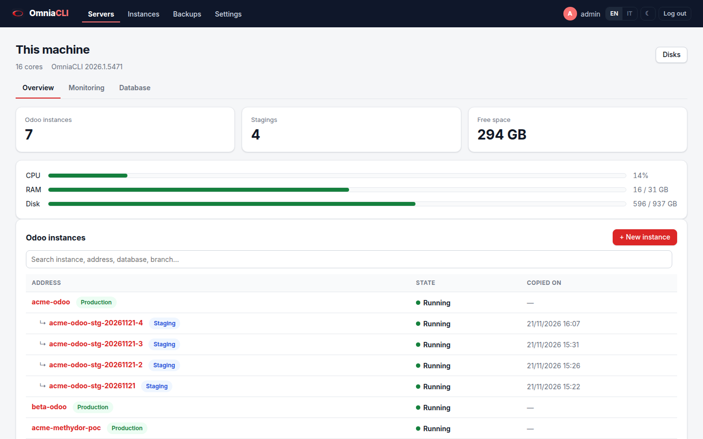

**Monitoring** of a machine: the last hour live, or a point every 5 minutes
over 24 hours, 7 or 14 days (here 24 hours, the history a few hours old).


**Database** of a machine (its admins): each instance's database, its size,
connections, tuning and recovery at a minute; **Propose the values…**
computes the values for the memory the machine has.

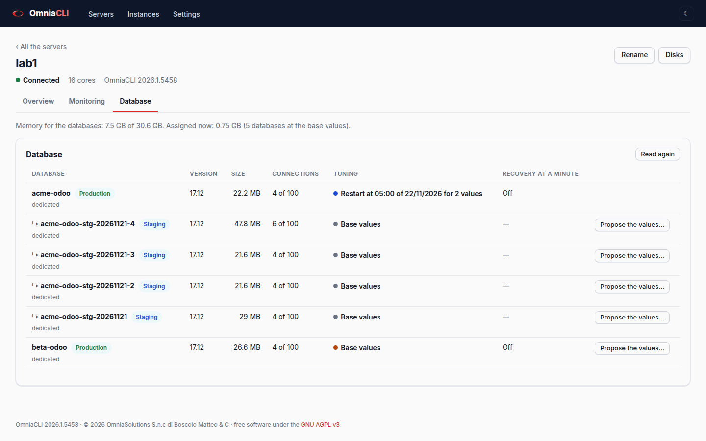


**Instances** and **Backups** of every machine: the stagings under their
production, the productions without a scheduled backup (a filter), each
backup with its machine, its kind and its outcome.


**The map**: the same instances as a diagram, where each thing configured is
(the machines and their links, the workspaces, the names, the databases,
where the backups go) and what moves now (the jobs, a transfer). It reads
only.

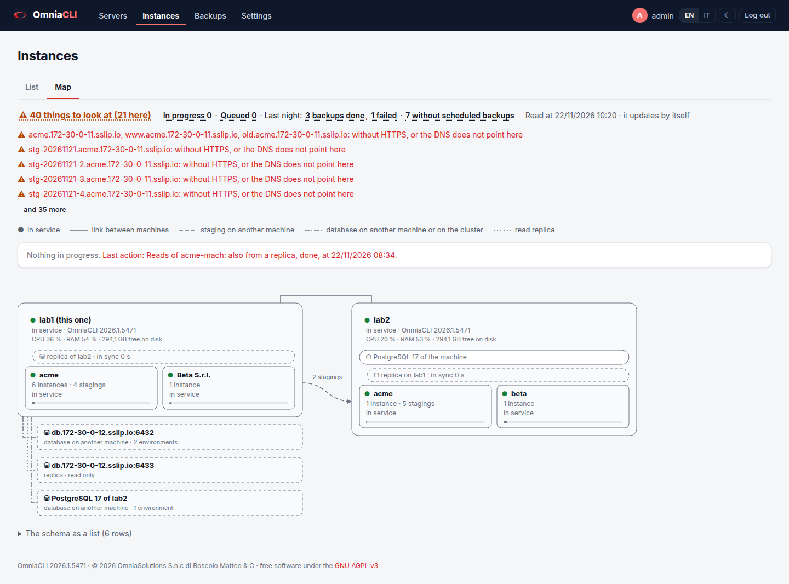

**Disks**: each disk's used space by day, with the dashed forecast up to the
day it is full.


**An instance**: its addresses and state in the head, with Open Odoo, Log in
as…, Update and More; the tabs Environments (production, test and stagings,
also those on another machine), Backups, Log, Monitoring, Modules, Settings.


**New staging**: a copy of production as it is now, on this machine or on a
linked one with the same template; **Rebuild…** makes a staging again with
the data only, or with data and code.

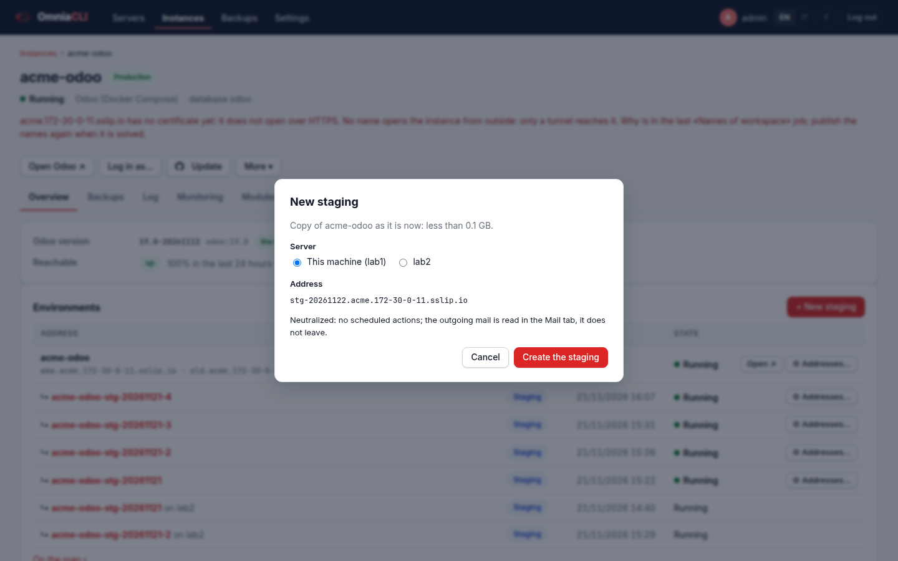


**Mail** of a staging: what its Odoo sent, caught here, by mailbox; **Write
as…** sends it a message as an outside sender, which its Odoo reads as it
reads a real mailbox.

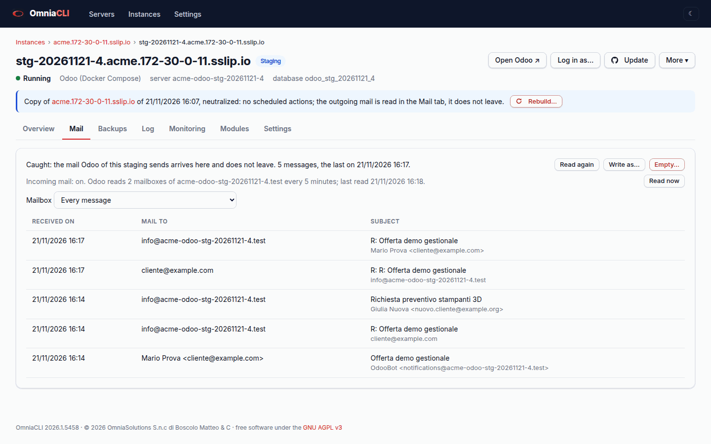


**Addresses…** of an environment: other names and redirects, with where the
DNS of each name points.

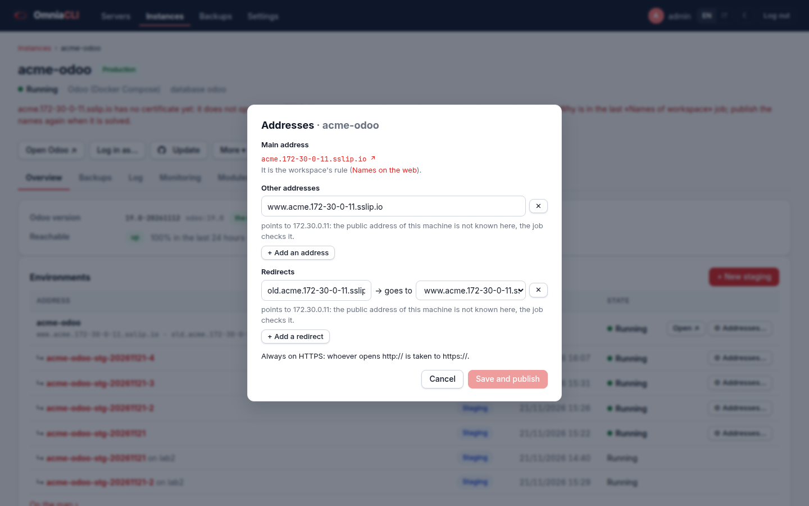

**Modules**: the repositories of the instance and the catalog of the OCA for
its version of Odoo, searched by name or by what a module does.


**Update modules**: the changed modules or chosen ones. The last choices of
modules of the instance come back as buttons (*Recent*). Each module shows the
version installed in the database and the one on disk the update brings
(`19.0.1.2 → 19.0.1.3`); an installed module with a newer version on disk is
red. The versions are read after the list, by the instance's Python with
Odoo's own `adapt_version` and `parse_version`. A Docker Compose instance,
as here, takes the modules typed, or the changed ones when left empty.


**Backup**: what goes in the zip, its weight, and whether its restore fits.

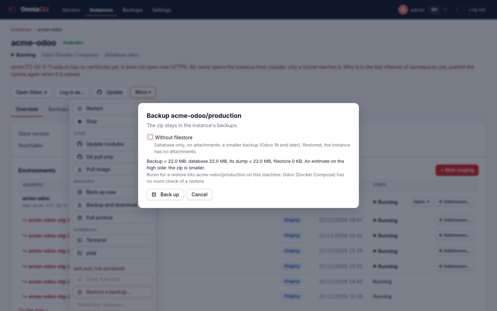

**A question of the page**: every action that cannot be undone asks in the
page's own dialog, its verb on the button (red for what stops or deletes),
Cancel or Esc for no.

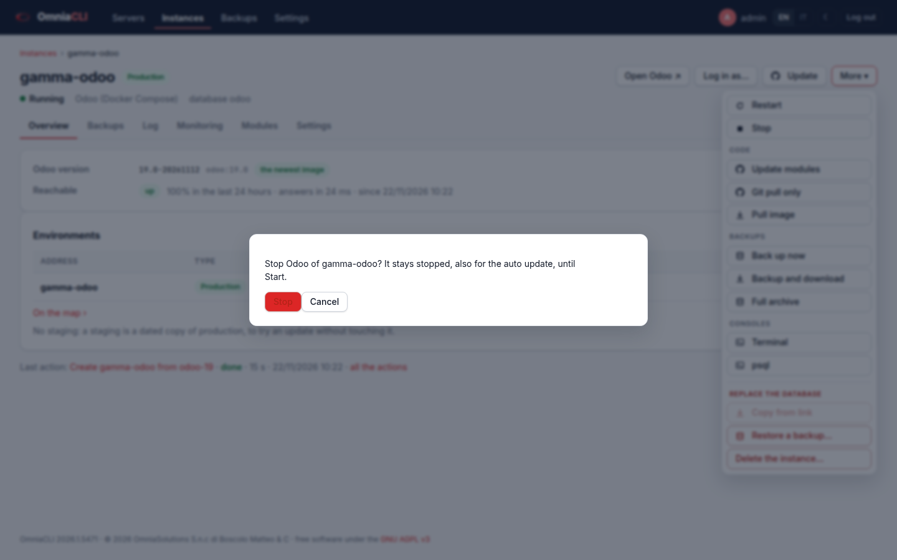

**Copy production to test**: a new backup of production, or one already made.


**Copy from link**: a backup made on a linked instance (a new one or one
already there), transferred here and restored; the job page follows each
step, the transfer with its size, speed and time left.

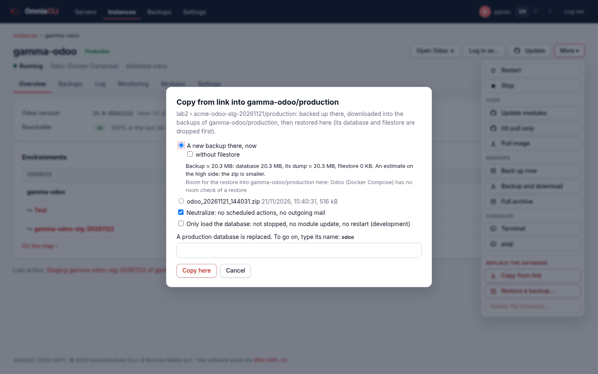

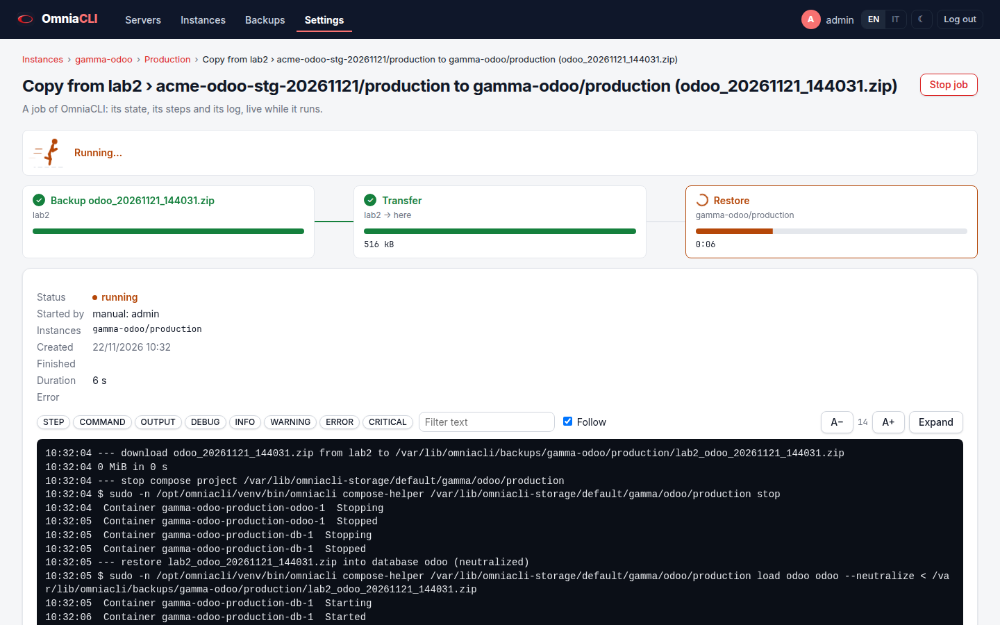

**A job**, and **Settings › Servers by hand**, where servers are added,
discovered, tested and activated.


**A job stopped by an administrator**: a module update that never ended,
stopped with *Stop job*.

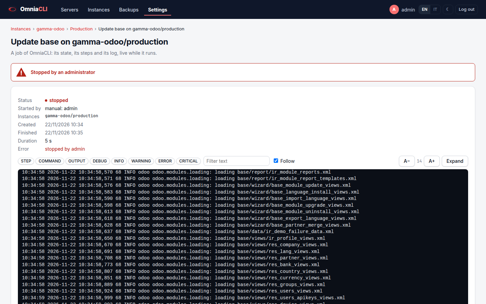

**Access log**: who did what, kept at least a year, its entries chained;
filters and exports for an auditor.


## What it does

| Action | Production | Test | What runs |
|---|---|---|---|
| Git pull | ✓ | ✓ | `git pull --ff-only <remote> <branch>` in every repository, then `git submodule update --init --recursive` in those with submodules. With more than one repository (or a package) a dialog lists them, with the commits each would bring (a `git fetch`), ticked when there are some: **Pull selected** pulls the ticked ones, **Pull all** every one, **Select all** ticks them all |
| Git pull + restart | ✓ | ✓ | pull, `click-odoo-update` (only the changed modules), restart |
| Update modules | ✓ | ✓ | a popup asks: the changed modules (`click-odoo-update`) or chosen ones (`odoo-bin -u … --stop-after-init --workers=0`), and whether to restart after. On a neutralized database, the scheduled actions that were off are off again after every update, also the update of a pull or of a restore: an update switches on those whose XML says `active=True`; one you switched on by hand stays on. The last 5 choices of modules of each instance are offered again; they are kept in the browser (`localStorage`), so each browser has its own |
| Restart | ✓ | ✓ | the instance's systemd or init.d restart, `docker compose up -d` then `restart` of a compose project (a type that runs in one, through the root helper `compose-helper`), or OmniaCLI's own start of `odoo-bin` (see below) |
| Start, Stop | ✓ | ✓ | `systemctl start`/`stop` of a systemd service (each needs its sudoers line, the **Start/Stop permission** check prints them), `docker compose up -d`/`stop` of a compose project (the helper's line), or OmniaCLI's own Odoo; a stopped Odoo stays stopped for the auto update |
| Backup | ✓ | ✓ | `click-odoo-backupdb` → `<backup_dir>/<server>/<role>/<db>_<timestamp>.zip`, database and filestore (the backups are OmniaCLI's own: `<backup_dir>/<server>` and `<server>/<role>` are made mode 700 and every zip there 600, made, downloaded from a link or a relay, or uploaded; a folder or file of another user is left as it is); with **Without filestore** checked, the database only (`--no-filestore`), `<db>_<timestamp>_nofilestore.zip`. With **Without binary columns** checked, the binary fields kept in the database (`bytea` columns: previews and printouts of older PLM databases) are left empty: the dialog lists every one that holds data, the biggest first, with its size, and ticks those of at least **Ticked from (MB)** (10); the dialog always shows the weight of the backup and whether a restore into the same instance fits on this machine (see **Weight and room** below). The dump is made by `omniacli/odoo/binary_dump.py` in the instance's venv: `pg_dump --section` pre-data, data (`--exclude-table-data` of the tables with an emptied column) and post-data on one exported snapshot, the rows of those tables copied with the column `NULL` (`''` where `NOT NULL`), into the same zip (`dump.sql`, `manifest.json`, `filestore/`), `<db>_<timestamp>_nobinaries.zip`, restored as any other; Odoo 10 to 19 (Python 2.7 and 3). The dialog opens with the instance's last choice (`<backup_dir>/<server>/<role>/.backup_choices.json`): a column ticked or left unticked then keeps it, a column new since is ticked by its size; the backups without the dialog (Copy production to test, Copy from link, schedules, MCP) take those ticks. The backup before a merge always has the filestore and every column |
| Backup before an update | ✓ | ✓ | with **Backup before an update** in the instance's settings (on for the production of an instance made by **New instance**): a backup (the last Backup dialog's choices) before a pull that brings commits (Pull and restart, the auto update, a schedule's pull, a repository's **Update…** in the Modules tab), before **Update modules** and **Pull image**; named `pre-update_<file>.zip`, the last 3 kept. A pull that brings nothing makes none. When the backup fails, nothing is pulled or updated |
| Delete a backup | ✓ | ✓ | the Backups tab lists each zip with its kind (automatic, before an update, by hand) and a **Delete** button: an admin's for a production, a developer's for a test; refused while a job works on the instance; in the access log |
| pip requirements | ✓ | ✓ | `<venv_bin>/python -m pip install -r` the `requirements.txt` next to `odoo-bin` and that of every repository having one, in one call |
| pip click-odoo | ✓ | ✓ | `<venv_bin>/python -m pip install click-odoo-contrib`, the scripts OmniaCLI runs in the venv |
| Merge test to production | | ✓ | (the button **Bring to production…**, on the test's page) backup production, merge, push, update modules, restart production |
| Weight and room | ✓ | ✓ | the Backup, Copy production to test and Copy from link dialogs show, for a new backup, its weight (the database on disk less the binary columns left out, its dump: that size plus once more the binary rows kept, which pg_dump writes in hex, the filestore when it is in the backup) and, disk by disk, whether its restore fits on the instance that receives it: the zip in its backup folder, the backup unpacked (Odoo's restore unpacks it first: beside the zip, see **Restore**; with `run_as` in `/var/tmp`), PostgreSQL's data folder (`SHOW data_directory`; not a superuser: `pg_lsclusters` by the port; PostgreSQL on another machine: not checked, and said so) and the filestore, against the room free there plus the database and filestore the restore drops first. The estimates are on the high side (the zip is not counted compressed); the dialogs warn, they do not refuse. Copy from link asks the weight to the OmniaCLI there through the link (an older one, or a puller, tells none) |
| Copy production to test | ✓ → | ✓ | a popup asks which backup of production: a new one (**shared with production** by default, see below; or with the filestore; or without it, test has no attachments) or one already made; then stop test, `click-odoo-restoredb --copy --force --neutralize` into the test database (drops it and its filestore first; `--neutralize` from Odoo 16: no scheduled actions, no outgoing mail), `click-odoo-update`, start test. **Without binary columns** empties, in the new backup, the columns ticked in production's last Backup dialog (none chosen yet: those of at least 10 MB). **Filestore shared with production**: the backup is made without filestore, and after the restore test's filestore (`<data_dir>/filestore/<db>`) is a tree of hard links to production's files, made by the test's venv python as its `run_as` user: no extra disk space, test reads every attachment, and what test writes or deletes does not touch production's files (Odoo never rewrites a filestore file, it only writes new ones and unlinks). Refused, before anything is touched, when an Odoo config sets no `data_dir` or the two filestores are not on the same filesystem, or the test user may not link production's files (`fs.protected_hardlinks`). Refused when production and test run different Odoo versions, and on Odoo 20+ (click-odoo-restoredb refuses it). A systemd test needs its Start/Stop sudoers lines; an init.d one is not stopped, it is restarted at the end |
| Copy from link | ✓ (admin) | ✓ | for an instance with a **Database from link**: a popup asks which backup of that instance of the linked OmniaCLI: a new one, made there now (with or without the filestore; an OmniaCLI there older than 2026.1.12 makes it with the filestore), or one already there; whether to neutralize; whether to set every user's password to `admin` (off by default: **Log in as**, below, opens the copy as any of its users with their passwords kept; when ticked, after the restore `click-odoo` runs `odoo/reset_passwords.py`, which writes the pbkdf2_sha512 hash in SQL, so no password policy refuses it; in `password` from Odoo 12, in `password_crypt` on Odoo 10 and 11 with auth_crypt; refused before anything is touched when the Odoo version is unknown); whether to **only load the database** (off by default, for development: the instance is not stopped, its modules are not updated and it is not restarted; Odoo's drop of the database ends its connections); and for a production its database name, typed. The zip is downloaded into this instance's backups as `<link>_<file>` (through `<file>.part`: a cut download leaves nothing), then restored as above: stop, `click-odoo-restoredb --copy --force [--neutralize]`, the passwords, `click-odoo-update`, start. Refused, before anything is touched, when the backup's `manifest.json` names another Odoo version than the instance's. What comes from the other machine is checked before anything is touched: a file that is no backup fails the job, also in a schedule, with the instance and its database intact |
| Restore | ✓ (admin) | ✓ (admin) | for a type that can restore, an admin who logs in: a popup asks for a zip from this computer (uploaded into the instance's backups through a `.part` file; refused when it is not a zip, or a file of that name is there, or less than 1 GiB would stay free) or one of the instance's backups, with the choices of Copy from link and, for a production, its database name typed. Refused before anything is touched when the zip has no `dump.sql`. Then as Copy from link: stop, `click-odoo-restoredb --copy --force [--neutralize]`, the passwords, `click-odoo-update`, start. Odoo unpacks the zip before loading it: OmniaCLI gives `click-odoo-restoredb` a `TMPDIR` on the disk of the backups, a folder `.restore-…` (mode 700) beside the zip, not `/tmp` on the system's disk; with `run_as`, the private folder in `/var/tmp` where the zip is staged. Removed at the end, failed or not. A zip without `manifest.json` (an Odoo.sh one) is not compared with the instance's Odoo version: the job warns. Not on native Odoo 20 and later (click-odoo-restoredb refuses it). An admin's because a `dump.sql` goes through `psql`, whose `\!` runs commands as the instance's user **A plain SQL dump** (`pg_dump --format=plain`, type `odoo`): the popup also takes one, of any name (`17.11.2026.bck`), told by its head (`-- PostgreSQL database dump`; a custom-format dump or a `pg_dumpall` one is refused), kept in the backups as `<name>.sql` (mode 600), listed with the backups. Its restore replaces only the database, the **filestore stays as it is**: stop, `omniacli/odoo/load_sql.py` in the instance's venv as its `run_as` user (the dump on its standard input, no copy): the database dropped and made again by Odoo's `_create_empty_database`, the dump loaded by `psql` (Odoo's `find_pg_tool` and `exec_pg_environ`: the connection of the Odoo config), with **Neutralize** Odoo's own `neutralize_database` (what `odoo-bin neutralize` runs: from Odoo 16; on an older Odoo the job warns and does not neutralize), then what Odoo's restore of a copy does: a new `database.uuid`, `database.secret`, `database.create_date`, and `web.base.url` set to the instance's address (its domain, else `http://localhost:<port>`); then the passwords, `click-odoo-update`, start. `psql` goes past an SQL error, as Odoo's restore and `psql < dump` do: each error is in the job log and the job warns with their count (a dump of PostgreSQL 16 loaded into 12 fails on `CREATE OR REPLACE VIEW` of three report views, which the update of their modules makes again); the job fails when `psql` itself does. The `\restrict` / `\unrestrict` lines of pg_dump's releases since August 2025 are left out (an older `psql` takes them for an unknown command). A SQL dump names no Odoo version: not compared, the job warns. Not on Odoo 20 and later (not verified). The `docker` type takes zips only |
| Log | ✓ | ✓ | `tail -F` of the Odoo log in the browser, with an "errors only" filter; of a compose instance, `docker compose logs` of its service (see below) |

The two pip buttons are also next to the **Venv bin** field of the server
form (admins), as soon as it is set: they run on the venv, odoo-bin and
repository folders typed there, saved or not, so a draft's venv can be
prepared before Test & activate. The job's log opens in a new tab.

- **Dashboard**: one row per live server, with the CPU of production and
  test over the last 15 minutes. The server's name opens its page, for the
  maintenance. **Open Odoo** opens the instance itself in a new tab, at its
  **Domain name** (server form) or at `http://localhost:<its port>`; the same
  link is next to each environment in Environments.
- **The instance's page**: a head with its address, its state, its type,
  server and database, and the actions of every day (Open Odoo, Log in as…,
  **Update**: a git pull and restart, Start when it is stopped; More for the
  rest: Restart, Stop, Update modules, the backups, the consoles, the
  database replaced or the instance deleted), then five tabs:
  **Environments** (production, its test and its stagings, also those on
  another machine, with **+ New staging**), **Backups** (the list, the
  automatic backups, the copies out, the recovery at a minute), **Log**,
  **Monitoring** (CPU and memory of the last hour, the database's health),
  **Modules** (the repositories, the updates of the code, the catalog of the
  OCA) and **Settings** (the Odoo options, the technical details). A staging
  has **Overview** in place of Environments and, when its mail is caught,
  **Mail**. The tabs a role may not use are not there. *Merge test to
  production* is the test's **Bring to production…**.
- **The page's own dialogs**: every question (Restart?, Stop?, Delete…) is
  asked in a dialog of the page, the action's verb on its button (red for
  what deletes or stops), Cancel and Esc for no; deleting an instance or a
  staging asks its name typed. No page calls the browser's `alert`,
  `confirm` or `prompt` (a test checks every template).
- **Load**: every 5 seconds OmniaCLI samples each live instance. A systemd
  instance is measured on its unit's cgroup (cgroup v2): CPU of the main
  process and every worker, memory as the resident size of its processes. An
  init.d instance is measured on the processes started with `-c <its Odoo
  config>`. CPU is in percent of one core.
- **Test** (server form): runs the same checks on what the form holds, saves
  nothing and leaves the form open, to fix and test again. **Branches** (a
  repository row) reads the remote's branches (`git ls-remote --heads`) and
  turns the Branch cell into a list of them. The page **Settings › Servers by hand** (`/config`)
  has a search field: every word typed, in a server's name, status,
  database, repository names or branches.
- **Discover** (Settings › Servers by hand, admins): for a machine where OmniaCLI is new.
  It finds the Odoo instances there, from the processes running (an
  `odoo-bin`, `odoo` or `openerp-server` started by a python) and from the
  systemd units that start one, stopped ones too. For each it shows what it
  read and fills in the instance:
  - the Odoo config (`-c`) and, from it, the database, the log file and the
    git repositories of the `addons_path`, each with its branch and remote;
  - what the command line sets wins over the config: `-d`, `--logfile`,
    `--http-port`, `--addons-path`;
  - odoo-bin, also when it was started as a bare `odoo-bin` from its
    folder: through the process's working directory, the unit's
    `WorkingDirectory`, or the repositories. It is checked: the file exists
    and `odoo/release.py` next to it gives the Odoo version. Its repository
    is added when the `addons_path` does not name it;
  - the venv's bin folder (the python of the command; a python outside a
    venv is noted);
  - the user it runs as, as `run_as` when it is not OmniaCLI's own;
  - the service: the unit the process runs in, only when that unit's
    `MainPID` is the process (an Odoo started by hand from a shell of
    another service runs inside that service's unit). Started by hand, it is
    noted, with restart type `process` proposed when it runs as OmniaCLI's
    user.

  What it could not find is listed as a note to complete by hand (a config
  OmniaCLI's user cannot read, with the `adduser` that fixes it). Odoo in a
  container, Odoo's gevent server and its workers are skipped; an instance
  OmniaCLI already has is marked. Each one chosen gets a server name and a
  role, and is saved as a **draft**: two with the same name are the
  production and the test of one server. Nothing on the machine is changed.
- **Draft and Test & activate**: a new or cloned server is a draft (no page,
  no actions, no auto update). *Test & activate* runs real checks as the
  OmniaCLI user and makes it live only when no check fails: Odoo config,
  addons path, log file, click-odoo scripts and an `import click_odoo, odoo`
  with the instance's python, the database (connected with the Odoo config's
  credentials: a database that does not exist yet, or an empty one, is only
  a warning, it is **Start** and **Restart** that refuse it until a backup is
  restored), odoo-bin, every repository (branch, no local change, remote
  reachable), the service and `sudo -n -l` for its restart command, separate
  folders and databases for production and test, the backup folder. Saving
  a live server runs the same checks: if they fail nothing is saved and it
  stays live. `omniacli check-config` runs them from the command line.
- **Kind of machine**: `machine: server` or `machine: development` in the
  main configuration, which root writes and the service only reads. Without
  that line a service with `OMNIACLI_USER` is a development machine, any other
  a server; upgrades do not add the line, so an installation upgraded from an
  earlier version without `OMNIACLI_USER` becomes a server and loses Shell and
  Claude until root adds `machine: development`. On a server nobody, admins
  included, opens a shell of OmniaCLI's own user: no **Shell**, no **Claude**,
  and **psql** only where it runs as another user (`run_as`, Docker). The page
  and the WebSocket refuse them too, also through a link: the machine the
  shell would run on decides. The kind is on the Options page and in
  OmniaCLI's log at every start. On a development machine nothing changes.
  Closing the shells does not close what runs as that user by itself, so on a
  server the checks warn (**Isolation**): Odoo with restart type `process` or
  a module update without `run_as` run a module's code as that user, and a
  repository the `run_as` user may write lets it plant a hook or a git option
  that git runs as that user at the next pull. The warning prints the `chown`
  and `chmod`. It reads owner, group and mode of the repository, its git folder,
  `hooks` and `config`: not ACLs, not submodules.
- **Shell** (developers and admins, a button on each instance, development
  machines only): a page with
  a terminal (xterm.js) running a login shell of the user OmniaCLI runs as
  (`omniacli`, or the one of `OMNIACLI_USER`; bash when its own shell is
  `nologin`), in the instance's first repository. It runs on a
  pseudo-terminal joined to the page by a WebSocket, and ends when the page
  closes: its whole session is hung up (SIGHUP, SIGKILL after 3 seconds).
  The shell of a linked instance's server opens through the link, with the
  lower of the link's role and the user's. Every shell opened and closed is
  in the access log, with who and for how long. It is the access of that
  system user, as SSH would give it: give the developer role accordingly.
  **A−** and **A+** change the text size for that page, **Full screen**
  fills the screen with the terminal (Esc leaves it); the size it opens
  with is on the Options page.
  **Files dropped on the terminal** (shell, Claude, psql; up to 100 MiB
  each) are uploaded into `~/.omniacli-drops/<server>/<role>/` in the home
  of that system user, and their paths are typed in the terminal, quoted,
  as a local terminal does: Claude reads a mail (`.eml`) or a spreadsheet
  from there. A file keeps its name (`name-1.ext` when it is taken), the
  files older than 7 days go at the next upload, every upload is in the
  access log. The upload follows the shell's rules: who may open it, where
  it opens, through a link to the linked server. A mail dragged straight
  from a mail program may reach the browser as a link, not as a file: save
  it as `.eml`, then drop that.
- **Options** (admins, `/options`): the options of the whole instance, in
  `options.yaml` next to the servers file (`options_file` in the main
  configuration): the text size every console opens with (8-40 pixels,
  default 14).
- **The head of an instance's Environments tab** (developers and admins):
  the Odoo it runs (Docker: the image's build, and whether Docker Hub has a
  newer image of its tag, with Pull image; a venv: `odoo/release.py`, and
  the repository holding `odoo-bin` with its commits not yet pulled), its
  workers, its database, and each repository with its branch, the commit
  checked out and its subject, and **Update now (N commits)** (a pull of
  that repository, the backup before an update when asked, the changed
  modules updated, a restart) with the page of the differences. Read after
  the page: a `git fetch` of each repository and the registry take a while.
- **Paths and shell commands** (the machine's admins, an instance's
  Environments tab): where the instance lives and the commands of a shell of
  the machine over ssh, each with Copy. Docker Compose: the project, its
  addons and `odoo.conf`, then `docker compose` logs, `odoo shell`, update
  all modules, pip, psql, bash in the container; a venv: the source, the
  config, the python, the log, the data folder, then `odoo-bin shell`, the
  update of all modules and pip as the user Odoo runs as.
- **Consoles**: every log (an instance's, OmniaCLI's own, a job's) and every
  terminal (shell, Claude, psql) is the same widget (`templates/_console.html`)
  with the same bar: A− and A+ for the text size, kept in the browser for
  each kind of console, and Expand, which fills the browser window (Esc
  leaves it in a log; F11 makes the browser full screen). A log also has
  tags, combined: the levels of its records (a traceback goes with its
  record), and for a job its steps, commands and their output; no tag
  chosen shows every line. A text filter and Follow complete it.
- **Tunnels** (every user who logs in, `/tunnels`; the menu names it to
  developers and administrators only): a port of this machine
  that reaches the web interface of an instance of a linked OmniaCLI, for
  when this OmniaCLI reaches it and the browser does not. Every connection
  to the port travels in a WebSocket of its own through the link; the
  other side connects only to that instance's own ports (Odoo: its web
  port, and its gevent port for `/websocket` when it runs workers; before
  Odoo 16 `/longpolling` and `longpolling_port`). The web interface is at
  the root of its own address, as Odoo needs (its pages call root paths:
  they cannot be served under `/links/<name>/`). Options: the address the
  ports listen on (`127.0.0.1` by default: only a browser on this machine
  reaches them; `0.0.0.0` and a firewall rule for a server), the ports
  (`18000-18099`, the first free one is taken) and the hours without
  traffic after which a tunnel closes (4). Who opened a tunnel, or an
  admin, closes it; OmniaCLI stopping closes them all. The port has no
  login of its own: whoever reaches it reaches the instance's login. The
  browser keeps cookies by address, not by port: two tunnels open at once
  share Odoo's session. An admin logging in to Odoo through a tunnel
  makes Odoo set `web.base.url` to the tunnel's address, unless the
  instance has the system parameter `web.base.url.freeze`. Both instances
  need a version with tunnels.
- **Claude** (same roles, development machines only, a button on an instance
  with a **Claude folder** in the server form): the same shell, opened in that folder, that runs
  `claude` first (found by the login shell's `PATH`; Claude Code's installer
  puts it in `~/.local/bin`) and stays open when it ends. Claude Code must be
  installed and logged in for the user OmniaCLI runs as.
- **psql** (same roles, Odoo instances; on a server only with `run_as`, and
  on Docker instances, where it runs as `postgres` in the database's
  container): the same page running `psql` on
  the instance's database, connected as Odoo connects (`db_host`,
  `db_port`, `db_user`, `db_password` of its Odoo config, given in the
  `PG*` environment, not on the command line); it ends when psql ends.
  `psql` must be installed (Debian: `postgresql-client`). It runs as the
  user OmniaCLI runs as, or with `run_as` as that user (`sudo -n -u <user>
  --preserve-env=PG… psql`), so that an Odoo config without `db_host`
  passes PostgreSQL's `peer` login on the local socket as Odoo does. That
  needs a sudoers line for psql, with `SETENV` for the `PG*` variables;
  the **psql** check (a warning) prints it.
- **Auto update**: per instance, every `interval_minutes` within `window`,
  OmniaCLI fetches every repository. When there are new commits it runs
  *git pull + restart* as an `auto` job.
- **Jobs**: every action is a job. Its output, its status and its error are
  shown live in the web page, and the last 500 are kept in `jobs_dir`.
- Only one job runs on an instance at a time; the others wait.
- **Stop job** (admins, on the page of a queued or running job): for a job
  that hangs or loops. The program it runs gets SIGTERM, with its whole
  process group (pip's builds, Odoo's workers), and SIGKILL after 10 seconds.
  The job ends as `stopped`, "stopped by <user>"; the steps after the stopped
  one do not run (a stopped module update is not followed by the restart),
  and what the job did before stays done. The instance is free for the next
  job at once. With `run_as` the SIGKILL reaches only `sudo`: a program of
  that user that ignores SIGTERM keeps running.

### Rules the actions follow

- A pull is **fast-forward only**. A repository on a branch other than the
  configured one, or with uncommitted changes, stops the job: OmniaCLI never
  creates merge commits or throws away local work on a pull.
- Except on a **test instance without auto update**, where someone may be
  working: its uncommitted changes are kept (a warning in the checks, not an
  error), and a pull goes on unless git would have to overwrite them.
  **Merge test to production** still refuses them: what runs on test must be
  a commit.
- The **submodules** of a repository follow it: after a pull, a merge or the
  rollback of a merge, `git submodule update --init --recursive` checks them
  out at the commits the repository records (a submodule left behind counts
  as an uncommitted change). Local changes inside a submodule make git
  refuse: the job stops, the repository itself already pulled, the changes
  kept. Their remotes must be readable by OmniaCLI's user without a prompt.
- **Merge test to production** merges the commit **checked out on the test
  server**, not the tip of the test branch, so production gets exactly what
  was tested. That commit must already be on the remote. Test and production
  repositories are paired by `name`. If any repository conflicts, the merge
  is aborted, every production repository is reset to the commit it had
  before, and nothing is pushed: the conflict is for a person to resolve.
- If a module update fails, the instance is **not** restarted.

## Install from the Debian package

Supported: Debian 11, 12, 13 and Ubuntu 22.04, 24.04 (amd64 or arm64); Ubuntu 20.04 only as a server that already has Odoo (Add a server › a server with Odoo: OmniaCLI alone, on the Python 3.12 the package downloads, since the system's is 3.8). OmniaCLI needs
Python 3.10 or newer: the package uses the system `python3` when it is 3.10+,
otherwise (Debian 11, Python 3.9) a local `python3.10`+ already installed (in
the `PATH` or `/usr/local/bin`, the newest first), otherwise it downloads a
Python 3.12 (python-build-standalone, checked against its sha256) into
`/opt/omniacli/python`.

Every [release](https://github.com/OmniaGit/OmniaCLI/releases) has the
package as `omniacli_<version>_all.deb`, and as `OmniaCLI.deb`, whose link
always gives the latest one.

```bash
sudo apt install ./omniacli_<version>_all.deb
sudo cat /etc/omniacli/initial-admin-password     # password of user admin
```

An upgrade is the same `apt install` of a newer package: the configuration,
the servers, the users, the jobs and the backups stay.

The package:

- creates the system user `omniacli` and runs the service `omniacli` as that
  user, on `127.0.0.1:8090` (change it in `/etc/default/omniacli`);
- runs it as another user when `OMNIACLI_USER` is set in
  `/etc/default/omniacli` (see below);
- builds `/opt/omniacli/venv` at installation with that Python and the
  dependency versions locked for it (`packaging/debian/requirements`).
  **The machine must reach PyPI while installing**, and also `github.com`
  when the Python 3.12 has to be downloaded. After an upgrade or a removal of
  the Python the venv was built on (a distribution upgrade, a local Python
  removed), rebuild it with `sudo dpkg-reconfigure omniacli`;
- creates `/etc/omniacli/omniacli.yaml` once, with a random password for
  `admin`; upgrades never change it;
- keeps the servers file, the jobs and the backups in `/var/lib/omniacli`;
- installs `/etc/sudoers.d/omniacli`, all comments, to be completed;
- on purge, deletes configuration and jobs but keeps the backups.

### First setup on a machine where Odoo already runs

The usual case: Odoo installed as the system user `odoo`, its configs and
logs readable by group `odoo` only, a systemd service per instance. After
`apt install`, as root:

1. **Let OmniaCLI read the Odoo configs and logs.** Add `omniacli` to the
   group `odoo`, but only if that group exists: `adduser` to a missing group
   fails (checked on Debian 11, 12 and Ubuntu 22.04, 24.04). The service gets
   the new group only when it starts again:

   ```bash
   getent group odoo && sudo adduser omniacli odoo
   sudo systemctl restart omniacli
   sudo -u omniacli head -c 1 /etc/odoo/odoo.conf; echo " $?"   # 0: readable
   ```

   Without a group `odoo` (configs owned by another user), give read access
   to each file with an ACL instead (see Configuration cases below).

2. **Let OmniaCLI run the venv's programs as `odoo`** (`run_as: odoo`:
   click-odoo, `odoo-bin -u`, pip, the database checks), in
   `/etc/sudoers.d/omniacli`. Either one line per venv, which is what the
   **Run as** check prints:

   ```
   omniacli ALL=(odoo) NOPASSWD:SETENV: /opt/odoo/venvs/odoo18/bin/
   ```

   or one line for every venv of the machine, including the ones made later:

   ```
   omniacli ALL=(odoo) NOPASSWD:SETENV: ALL
   ```

   The second one gives no more than the first in practice, because the
   venv's `python` runs any code it is given. With either, OmniaCLI acts as
   `odoo`, never as root. A line naming `odoo` can be written before that
   user exists, for example before Odoo is installed: `visudo` accepts it,
   the other sudo rules keep working, and `sudo -u odoo` answers
   `unknown user odoo` until the user is created, then works (checked on
   Debian 11, 12, 13 and Ubuntu 22.04, 24.04, sudo 1.9.5 to 1.9.16).

3. **Let OmniaCLI restart, start and stop each Odoo service**: one exact
   line per service and action, as root. No wildcard: `systemctl restart *`
   would let OmniaCLI restart any service of the machine, `ssh` included.
   The **Restart permission** and **Start/Stop permission** checks print the
   lines missing:

   ```
   omniacli ALL=(root) NOPASSWD: /usr/bin/systemctl --no-ask-password restart odoo-prod
   omniacli ALL=(root) NOPASSWD: /usr/bin/systemctl --no-ask-password start odoo-prod
   omniacli ALL=(root) NOPASSWD: /usr/bin/systemctl --no-ask-password stop odoo-prod
   ```

   Check the file after every change: `sudo visudo -cf /etc/sudoers.d/omniacli`
   (a broken sudoers file can stop every `sudo` of the machine).

4. **Give OmniaCLI the repositories and a git key**: git runs as
   `omniacli`, which must own the repositories and reach their remotes
   without a prompt (see "dubious ownership" and the deploy key under
   Configuration cases below).

5. **Add the servers**: on the web interface, **Servers → Discover** finds
   every Odoo running, and every systemd unit that starts one, and saves
   the chosen ones as drafts. Complete what its notes say, then run
   **Test & activate** on each: its checks say which of the steps above is
   still missing, with the line or the command to add.

### The service as another user (OMNIACLI_USER)

On a development workstation the repositories, the Odoo configs and the logs
are the developer's, often in a folder other users cannot enter: the service
user `omniacli` cannot read them (`cannot read .../odoo.conf: Permission
denied`). Run the whole service as that user instead:

```bash
echo OMNIACLI_USER=devuser | sudo tee -a /etc/default/omniacli
sudo dpkg-reconfigure omniacli
```

Everything OmniaCLI does itself then runs as that user, in group `omniacli`:
git (with that user's git configuration and credentials), reading the
configs and logs, its files in `/var/lib/omniacli` (given to that user, and
kept so by upgrades). The sudoers lines name that user
(`devuser ALL=(root) NOPASSWD: ...`). Not root. Remove the line and run
`dpkg-reconfigure` again to go back to `omniacli`. On a server keep
`omniacli`, with `run_as` for the programs of an Odoo venv: `OMNIACLI_USER`
makes the machine a development one, with no restriction on the shells, unless
the main configuration says `machine: server`.

### Build and test the package

```bash
packaging/debian/build_deb.sh                  # test build -> ARTEFACTS, omniacli_<year>.1.<n>_all.deb
packaging/debian/build_deb.sh --release        # release build of branch <year> -> ARTEFACTS, OmniaCLI.deb
packaging/debian/build_deb.sh --check DIR      # the working tree, into DIR, no tag
packaging/debian/build_deb.sh --ci VERSION DIR # the checked out commit with VERSION, into DIR (the CI)
packaging/debian/test_deb.sh <deb> [image ...] # install and check it in Docker, systemd included
packaging/debian/make_locks.sh                 # regenerate the dependency locks, with the tests
```

The package is built from a commit (`git archive`), never from uncommitted
files, except with `--check`. Its version is `<year>.1.<n>`. The test and
release builds number `n` one above every `omniacli-v<year>.1.*` tag and every
package already in `ARTEFACTS`, and tag the built commit. `ARTEFACTS` (where
the package goes, `dist/` by default) and `PYTHON` (the Python that builds the
wheel, `python3` by default) come from the environment or from
`packaging/debian/build.local.sh`, a file of the build machine that is not
versioned.

### Releases on GitHub

Publishing a GitHub release builds its package
(`.github/workflows/release.yml`):

1. tag the commit to release with its version, `omniacli-v<year>.1.<n>`, and
   publish a release on that tag;
2. the workflow runs the tests, builds the package with
   `build_deb.sh --ci <version>` and attaches `omniacli_<version>_all.deb`
   and `OmniaCLI.deb` to the release;
3. it then installs the package in Debian 12 and Ubuntu 24.04 containers with
   systemd and checks it end to end (`test_deb.sh`). A failure there marks
   the run as failed: the package is already attached, so delete it from the
   release, or publish a fixed release.

## Install by hand

```bash
python3.11 -m venv /opt/omniacli/venv
/opt/omniacli/venv/bin/pip install git+https://github.com/OmniaGit/OmniaCLI.git
```

The `click-odoo-*` scripts import the instance's own `odoo` package. So
`click-odoo-contrib` must be installed **in the venv that runs each Odoo**,
not in OmniaCLI's venv. `venv_bin` in the config points to it.

```bash
/opt/odoo/venvs/odoo18/bin/pip install click-odoo-contrib
```

`click-odoo-update` keeps a hash of every installed module in the database.
On a database it has never seen, it would update every module. So run this
once per database, when you know the modules are up to date:

```bash
/opt/odoo/venvs/odoo18/bin/click-odoo-update -c odoo.conf -d DB --only-compute-hashes
```

## Configure

The configuration has six files and a folder:

- the **main config** (`omniacli.yaml`): the users set by hand, `backup_dir`,
  `jobs_dir`, `servers_file` and, when not in their default place, the paths
  of the files below (`users_file`, `links_file`, `groups_file`,
  `schedules_file`) and of the scripts folder (`scripts_dir`). It is edited by hand and the
  web interface never writes it.
- the **users file** (`users_file`, by default `users.yaml` next to the
  servers file): the users, links and MCP tokens managed from the web
  interface (**Users** page, admins only), written readable by its owner
  only. Every change applies at once: a changed or deleted password stops
  working at the next request.
- the **links file** (`links_file`, by default `links.yaml` next to the
  servers file): the other OmniaCLI instances this one operates (**Links**
  page, admins only), with their tokens in clear, so written readable by its
  owner only.
- the **groups file** (`groups_file`, by default `groups.yaml` next to the
  servers file): the headings of the Dashboard (**Edit groups**, admins).
- the **schedules file** (`schedules_file`, by default `schedules.yaml` next
  to the servers file): the scheduled actions (**Schedules** page, admins;
  see Scheduled actions).
- the **scripts folder** (`scripts_dir`, by default `scripts` next to the
  servers file, `/var/lib/omniacli/scripts` in the package): the Python
  scripts a scheduled action may run, put there by hand.
- the **servers file** (`servers_file`, see `servers.example.yaml`): the
  servers and their instances. It is edited from the web interface
  (**Settings › Servers by hand**: new, edit, clone, delete), so the user running
  OmniaCLI must be able to write it. Every save is validated like the file at
  startup, the previous version is kept as `<file>.bak`, and the auto update
  loops restart with the new settings. Clone copies a server's configuration
  only (no database, no files). A server with a running job cannot be edited or
  deleted.

```bash
cp config.example.yaml omniacli.yaml
omniacli hash-password            # paste the result under auth.users
omniacli check-config -c omniacli.yaml
```

`check-config` checks that every path is readable, that the click-odoo
scripts exist and that every repository is on its configured branch.

### Roles

Every user has a role:

| Role | May |
|---|---|
| `user` | watch: servers, load, logs, jobs, the backup list; and restart, start and stop Odoo |
| `developer` | also act on the servers: pull, update, backup and the download of a backup, pip, the shell, Claude |
| `admin` | everything: also the configuration pages (servers, users, links, schedules) and the merge of test into production |
| `workspace` | none of the above on the machine: the servers of its workspaces only, with its role in each (see Workspaces) |

```yaml
auth:
  users:
    admin: "pbkdf2_sha256$..."                 # a bare hash: an admin
    anna: {password: "pbkdf2_sha256$...", role: developer}
    luca: {password: "pbkdf2_sha256$...", role: user}
```

The pages show only what the role allows, and the server refuses the rest
(403).

The **Users** page adds users, changes their role, sets a new password and
deletes them. The users of the main config are shown there too but are
changed only in the file: they are the way in that a mistake on the page
cannot lock out. Nobody can change their own role or delete themselves, and
the last admin cannot be demoted or deleted. Every user who logs in with a
password changes it from their own page (their name, top right), unless it is
set in the main config.

The **Help** page (menu Help, developers and admins) explains step by step
how to create a link, how to connect an MCP client and every field of the
server form, with example data only.

The **Access log** (Settings › Users › Access log, admins) lists the logins
with date, time and address: a user's login is the login form; a link or an
MCP token, which send their token with every request, log in with their
first request after 30 minutes without requests from the same address.
Logouts are listed, and so is every call to `/mcp`, with its JSON-RPC method
and tool, every shell opened and closed, every **action** of whoever passed
the login (every request that changes something, POST, PUT or DELETE, so a
route added later is logged by itself: the request, its answer and the name,
role, host, server or kind it names, never a password or a token), every
**download** of a backup, every **read** of customer or security data (an
instance's log, its database statistics, the caught mail of a staging and its
mailboxes, the lists of backups and archives, an Odoo config, the users of a
database for Log in as, the access log itself and its exports, OmniaCLI's
log, the git credentials: the same page by the same person from the same
address once in 10 minutes), and the end of every **job** with its outcome.
Each entry has the local time and UTC, who (and on whose behalf, through a
link), the role and the workspace in effect, the address, the method, the
route's template (`/servers/{server}/{role}/restart`), the server, the
environment, the HTTP code and the jobs it started. The reads logged are
listed in one place, `audit.py` (`SENSITIVE_READS`): every other GET route
is listed there as not sensitive, or a test fails, so whoever adds a route
decides. It is kept in `access.jsonl` in the logs folder next to `jobs_dir`
(`/var/lib/omniacli/logs` for the package). The page filters by period,
user, event and text, and exports CSV and JSON. A workspace's admins read
their workspace's entries only (its page, **Access log**): what was done and
read on its instances, by anyone, and the logins of its users and tokens.

Wrong passwords and tokens, and the logins refused for too many failures, need
no login, so they have a file of their own, `access-failed.jsonl`, and cannot
push out the rest: of them at most 10 a minute from an address and 300 from all
addresses are written, the others counted in one entry at the end of the
minute. Past 5 MiB a file moves to `<file>.1`, and so on; a file past the
tenth goes only when its newest entry is older than **audit.retention_days**
(Options, 365 by default; 0: by size only, up to `<file>.10`), so no entry
younger than that is dropped for room. The machine's page and the log's warn
when the disk will not hold the period, and when the clock is not
synchronised (`timedatectl`, else `chronyc`).

**Integrity**: each line carries in `prev` the SHA-256 of the line before, a
chain for each file that goes on across the rotation. **Check the chain**
on the page (`GET /api/access/verify`) or `omniacli verify-access-log -c
/etc/omniacli/omniacli.yaml` (exit 1, with file and line, when it breaks)
show a line changed, taken out or added in the middle; not the last lines
taken out, nor a whole oldest file. These files are written by OmniaCLI's
user, so whoever has a shell as that user, or root, can change them: to keep
them out of reach, send them to another machine. **SIEM** (Options): every
entry, as soon as written, goes to a syslog server in RFC 5424 (UDP, TCP or
TCP with TLS), from a thread with its queue: a SIEM that does not answer
never stops an action, and its failure is logged once. What NIS 2 asks and
how this answers it: [docs/nis2-audit.md](docs/nis2-audit.md) (in Italian;
the retention of a year is to be confirmed against the national rules).

The **Log** page (admins) shows OmniaCLI's own log: the requests it serves,
its calls to the links, its errors, with the follow and errors-only switches
of the instances' log. OmniaCLI writes it to `omniacli.log` in the same logs
folder, besides what it writes to its standard output (the journal): the
package's user `omniacli` may not read the system journal. Past 5 MiB it
moves to `omniacli.log.1`.

### Linked instances

Another OmniaCLI instance (yours, at the customer's) can be let in to operate
this one with a token of its own and a role. Create it on the **Users** page
(the token is shown once), or by hand in `auth.links`:

```bash
omniacli new-link-token omniasolutions --role developer
```

```yaml
auth:
  links:
    omniasolutions: {token: "sha256$...", role: developer}
```

The linking instance sends the token as `Authorization: Bearer <token>`.
It may also send `X-OmniaCLI-Prefix` (the path it serves these pages under,
e.g. `/links/customer`: every link in the pages starts with it) and
`X-OmniaCLI-User` (its user acting through the link: the jobs record
`manual: link omniasolutions (anna)`), and `X-OmniaCLI-Role-Cap` (that
user's role on the linking instance: the link acts with the lower of it and
its own). They are honoured for link tokens only. `GET /api/info` answers
with the version and the caller's role, `GET /api/servers` with the live
servers.

### Operating another instance

On your instance, the **Links** page (admins) adds a link: a name (the
customer's), the other instance's URL, the token it created for you on its
Users page, and a CA file when its certificate is from the customer's own CA.
**Test link** shows its version and the role you get there. Then:

- the Dashboard lists its live servers as `<link> › <server>`, with their
  load, and the filter finds them by link name too. A link that does not
  answer is shown as an error above the list;
- its pages open here under `/links/<link>/`, with a bar saying which
  instance you are on: every action runs there, recorded as
  `manual: link <its name for you> (<your user>)`;
- you act there with the lower of your role here and the link's role there.
  Only users who log in here use links, not tokens;
- an instance here may take its database from an instance there: in the
  server form, **Database from link** names the link, the server there and
  its role. *Copy from link* on the instance's page then backs it up there,
  downloads the zip and restores it here (see the table of actions). It needs
  the developer role there (for the link and for you) and here, the admin
  role for a production here. Stopping the job here does not stop a backup
  already running there. Without a Database from link, or with a link no
  longer on the Links page, the button is shown disabled, and its tooltip
  says what to set.

### Pullers

An OmniaCLI that nobody can reach (a production behind a firewall) can still
be operated through a third OmniaCLI that both sides reach, on a public VPS:
the **relay**. The unreachable one (the **producer**) and the ones that
operate it (the **consumers**) each link out to the relay; nothing connects
to the producer. On the relay a **puller** names the link of the producer
and those of its consumers:


- the **Publications** page (Settings; its tab *Relayed from here*; admins) adds one: a name, the producer and the
  consumers, among the incoming links of the Users page (the role **user**
  is enough: a puller's routes check that the link is in it, and that role
  opens no shell, no backup and no action on the relay's own servers), the
  hours its files and reports are kept (24) and its largest file (10240 MiB).
  Saved in `pullers.yaml` next to the servers file;
- the producer asks for the consumers' commands, holding its request open up
  to 25 seconds until one comes, and leaves with every request its report
  (state, disks, load, the progress of its jobs), which every consumer reads
  from the last one it read. Its backups it uploads, for a consumer to
  download;
- a command not taken by the producer in 10 minutes expires; once taken, it
  is gone from the relay. A file is deleted once a consumer says it has it
  whole, and every file and report after the hours kept; at most 20 commands
  wait and 5 files are kept per puller;
- with a **key** that only the producer and the consumers hold, every
  message and file is encrypted and signed (AES-256-GCM): the relay can
  neither read them nor make one up, nor play a command again. Without a key
  they pass in clear, and the relay is trusted. The page shows only what the
  relay knows: when each side was last seen, the commands waiting and the
  files kept.

On the producer, the **Publications** page publishes an instance (*Published
from here*): the link to the relay (Links page), the puller's name, its key (*New
key* makes one: give the same to the consumers) and the commands it takes,
each with its hours. Saved in `publications.yaml` next to the servers file,
readable by its owner only:

- **backup**, **start**, **stop** and **restart** are off until enabled. A
  command sent outside its hours (`HH:MM-HH:MM`, by the producer's clock,
  may cross midnight; empty: always) is refused at once, the answer saying
  its hours: to run it within them, schedule it on the consumer. Saving
  start, stop or restart without a key warns that whoever controls the
  relay can send them;
- every command runs as a job recorded as `puller <name> (<who asked>)`;
  a consumer may stop a job a command started (`stop-job`), and no other;
- a backup is encrypted with the key before it is uploaded (steps Backup,
  Encrypt, Upload on its job page), and stays here too, as any backup;
- every ask carries a report: the instance's state, whether a job runs, its
  type and its backup's options, the commands exposed and their hours, the
  disks (and their daily history when it changed), the CPU and memory
  samples since the report the relay took last (the sampler keeps an hour:
  a longer gap is lost), and the new log lines, steps and result of the
  jobs the commands started. Whatever the relay did not take goes again
  with the next report. While such a job runs it asks every 2 seconds,
  otherwise every 25;
- the commands already received are kept in `publications/` next to
  `jobs_dir`, so a restart does not let one be played again. The page shows
  when the relay was reached last, or why not.

On a consumer, the **Publications** page operates an instance through a puller (*Operated
from here*): a name, the link to the relay, the puller's name and the key of the
producer's publication (none: in clear). Saved in `connections.yaml` next
to the servers file, readable by its owner only. Then:

- the entries of the top bar (every role) open each connection's page: the
  instance there with its state, disks, CPU and memory (the last hour, day
  or 7 days), the buttons of the commands it exposes, the commands sent with
  the producer's answers, and its jobs with their log. Backup needs the
  developer role, Start, Stop and Restart every role, stopping a job there
  the admin role, as for the same actions here; only users who log in send
  commands. What is shown comes with the reports: some seconds old;
- **Database from link** in a server's form may name a connection
  (`from_link: {puller: <name>}`): *Copy from link* and the scheduled copies
  (`copy: {puller: <name>}`) then ask a new backup there, follow its job,
  download it from the relay, decrypt it, delete it from the relay and
  restore it here (steps Backup, Transfer, Decrypt, Restore). A backup
  already there cannot be chosen: the relay keeps none. Stopping the job
  here asks the producer to stop its backup;
- the reports are read from the last one read, kept in `connections/` next
  to `jobs_dir`: the last state, the producer's last 30 jobs (5000 lines
  each), the last 50 commands sent, and the samples, one file a day, for 7
  days. A report that does not open with the key is refused and said on the
  page, and a copy then fails at once.

Their state is kept in `pullers/` next to `jobs_dir`
(`/var/lib/omniacli/pullers` in the package). A relay behind nginx needs
`client_max_body_size 0;` (or the largest file) and
`proxy_request_buffering off;` in its `location`, or nginx refuses an upload
over 1 MiB; the 25-second requests stay within its read timeout.

The routes, for links in the puller only (a JSON `{"error": ...}` otherwise):

| Who | Route | What |
|---|---|---|
| any | `GET /api/pullers` | the pullers the link is in, and its part |
| any | `GET /api/pullers/<name>` | last contacts, commands waiting and expired, files |
| producer | `POST /api/pullers/<name>/producer?wait=<s>` | body `{"report": <envelope>}`: keeps the report, answers `{"seq", "commands"}` |
| producer | `PUT /api/pullers/<name>/producer/files/<file>` | the body is the file |
| consumer | `POST /api/pullers/<name>/commands` | body `{"command": <envelope>}`: answers `{"qid", "expires"}` |
| consumer | `GET /api/pullers/<name>/reports?since=<seq>&wait=<s>` | the reports after `since`, with `next`, `first` (the oldest kept), `last` and `reset` |
| consumer | `GET /api/pullers/<name>/files/<file>` | the file |
| consumer | `DELETE /api/pullers/<name>/files/<file>` | the consumer has it whole: it goes |

### Groups

Every list of things (the Dashboard's Servers, Workspaces and Linked, and
the Workspaces, Settings › Servers, Users, Links, Publications, Schedules and
Plugins pages) is one list widget (`templates/_list.html`): its search finds
every word typed, in any case, in the browser (`?q=` fills it). Grouping is
an option of the widget, offered by the Dashboard's **Servers** and
**Linked**: **Edit groups** (admins, `/groups`) puts their items under
headings and subheadings, four levels at most, in the order you choose. A
member is a name of the list (`srv`, `cliente`) or a pattern of names
(`acme-*`, `*`, `?` one character); an item shows under the first group
that has it, itself or in a subgroup, then under the first of its subgroups
that has it, the rest under "Others". The search finds an item by its groups
too, and each viewer's folded groups are kept in its browser. A file of an
older OmniaCLI (one list for this instance's and the links' servers) is
read as the groups of both: `srv` and `*` the servers', `customer/*` the
link `customer`; a single server of a link (`customer/srv`) is dropped, the
linked servers being on their own Dashboard now. The groups are this
instance's own: a linked instance's pages do not show them.

The other instance must be reachable from yours: through an HTTPS reverse
proxy, a VPN, or an SSH tunnel (`http://` is accepted for a tunnel or a VPN,
but then the token travels in clear). Both instances need a version with
links (the Test link button says so).

### Links through SSH

A customer's server that shows only SSH (and Odoo) still has its OmniaCLI
reached: give the link an **SSH server** (the **SSH…** button of its row).
OmniaCLI keeps an `ssh -L` open to it while it runs, restarts it when it
drops (after 5 s, then up to 60 s), and sends everything of the link through
it: pages, API, WebSockets, tunnels, copies. The URL is then `http://` as that
server reaches OmniaCLI, `http://127.0.0.1:8090` for the package's default
there; SSH encrypts it. The row shows the tunnel's state and why it is down;
**Test link** says it too.

- **The key**: OmniaCLI has an ed25519 key of its own (**Make the key** on the
  Links page), in `ssh/` next to the links file, readable by OmniaCLI's user
  only.
- **The server's key**: **Fetch host key** reads it; compare its fingerprint
  with `ssh-keygen -lf /etc/ssh/ssh_host_ed25519_key.pub` run on that server
  before saving. ssh accepts only that key, and reads no configuration,
  agent or `known_hosts` of OmniaCLI's user.
- **On the customer's server**, as root: a user for OmniaCLI alone
  (`omniacli-link` by default) and, in its `~/.ssh/authorized_keys`, the line
  the Links page prints, which allows that one forward and nothing else (no
  command, shell or file transfer):

  ```
  restrict,port-forwarding,permitopen="127.0.0.1:8090",command="/bin/false" ssh-ed25519 AAAA… omniacli@host
  ```

  Better also the `Match User` block the page prints, at the end of
  `/etc/ssh/sshd_config` (then `sshd -t && systemctl reload ssh`): the line
  alone still lets the key open a port on that server's loopback that leads
  back to this machine (`ssh -R`); the block refuses it. Both tried on
  OpenSSH 9.2. In the line, `permitlisten="none"` is not accepted there: the
  whole key is refused.
- ssh ends with OmniaCLI, also when OmniaCLI is killed.

### Git credentials

On a machine whose working copies already have their git user (an ssh key,
saved credentials of someone), OmniaCLI can use its own instead: **Settings ›
Git credentials** (`/credentials`, the machine's admins) gives each server, and
each workspace (also on the workspace's page, by its admins), a list of
`host + user + token` (github.com, bitbucket.org, a GitLab). A server's
credential wins over its workspace's for the same host; a host without one is
reached as before, as the machine's git user.

Every git command OmniaCLI runs on a repository of that server (pull, fetch,
merge, push, submodules, the branches of the form, the checks) then gets
`-c credential.helper=` (the machine's helpers off), `-c
credential.helper=store --file=<the server's file>`, and for each host
`-c url.https://<host>/.insteadOf=git@<host>:` and `ssh://git@<host>/`: a
working copy with an ssh remote is reached over https with the token, its
`.git/config` untouched, and no token is written in a repository (so a
container that mounts it never reads it). The credentials are kept in
`credentials.yaml` next to the servers file and the files git reads in
`credentials/`, readable by OmniaCLI's user only; a token is never shown
again (changing a credential with the token left empty keeps it).

### Workspaces

A **workspace** is a customer's closed part of the machine: its servers and
its users. Two classes of users:

| Class | Who | Sees and does |
|---|---|---|
| the machine's | the roles `user`, `developer`, `admin` (Users page) | everything their role allows, as before; workspaces change nothing for them |
| a workspace's | role **`workspace`** (Users page) | only the servers of the workspaces it is a member of, each with **its role there** (`user`, `developer` or `admin`, with the meanings above) |

The machine's admins make the workspaces (**Settings › Workspaces**,
`/workspaces`): name (`a-z 0-9 -`, it becomes part of URLs and folders),
label, domain, storage, limits, servers and members. A server is in one
workspace at most, and so is a domain. Saved in `workspaces.yaml` next to the
servers file (`workspaces_file` in the main configuration); the storages a
workspace may live in are listed by root in the main configuration, each a
name (`a-z 0-9 -`, 32 at most) and its folder:

```yaml
workspaces:
  storage:
    default: /srv/omniacli/default_workspace
    disk2: /media/disk2/omniacli
```

A workspace names its storage, and so does every path of root's (below):
**a new disk changes the folder only**. Stop the storage's workspaces, copy
its folder on the new disk keeping the workspaces' disks sparse
(`rsync -aHS` or `cp -a --sparse=always`), change its folder in
`workspaces.storage`, its name as it is, and restart the machine (or stop
and start the storage's unit): it is bound from its new folder, and the
workspaces, their instances and docker find everything where it was. A list
of folders without names (the format of before) is refused: OmniaCLI starts,
says so on Settings › Workspaces, and no workspace with a storage can be
used until each has a name.

A workspace whose storage is no longer listed there still loads: OmniaCLI
starts, says so in its log and on both workspace pages, and the workspace
cannot be used (no instance is created, a save keeping that storage is
refused) until an admin picks a listed one on Settings › Workspaces or lists
it again.

Without `workspaces.storage` there is one, `default`, in
`/srv/omniacli/default_workspace`, made (root's) by the package when the
workspaces are allowed (`OMNIACLI_WORKSPACES`, below); `storage: {}` is none. A folder holds all the
workspaces placed there: `.disks/<workspace>.img` and `<workspace>/`.

**The storages are bound on a path of root's.** A storage folder must be
root's and written by nobody else, but the folders above it may be anyone's
(a disk of a user, with its other folders). Root acts on a storage only
through `/var/lib/omniacli-storage/<name>` (`config.bound_root`), where its
unit `omniacli-storage-<name>.service` binds it (written by the root helper's
`storage-setup`, which the package runs and every action of the helper does
first), at every boot from the folder `workspaces.storage` names then,
before the workspaces' disks and docker: a bind holds the folder, not its
path, so renaming a folder above the storage changes nothing for root, and
the path of root's cannot be moved. At a boot the path counts again, so the
identity of the folder bound (device and inode) and its path are kept (in
`/var/lib/omniacli-storage/.ids/`): another folder at the same path is not
bound, the path beneath is immutable, and nothing of the workspaces starts on
it (tried: a container restarted by docker fails to create its mount instead
of writing there); a folder changed in the main configuration (root's) is the
new disk, taken and kept. A storage moved on purpose at the same path is
taken again by root by hand: `omniacli workspace-helper storage-reset
<name>`. The units of storages no longer listed (and the mount units of
OmniaCLI 2026.1.36 and before) are taken away by `storage-setup` when nothing
of theirs is mounted. The sudoers lines of the compose helper name the paths
of root's.

**The space of the disks.** A workspace's disk takes room on the real disk
only as it is used, so the room free now is not all there is to give. Next to
`disk_gb` the page shows, for the chosen storage, the real disk's size and
room free, what the workspaces' disks there were promised and what they take,
and what this workspace may have: by default no more than the room free less
what the other workspaces on the same real disk were promised and do not take
yet, so every GB promised is there and a full workspace stops itself only.
**force** lets an admin promise more (two new workspaces of 100 GB taking 20
GB each leave 160 GB free: a third of 100 GB fits now), knowing that the real
disk must get room before they fill it; even forced, a disk is made or grown
only if it fits whole in the room free at that moment (the root helper checks
it), and never smaller than it is. A storage folder on the same real disk as
another counts with it. Read by the root helper's `space` (the images are
root's only): when sudo refuses it, the page says how to allow the helpers
(`OMNIACLI_WORKSPACES=1`, below).

The domain gives the instances their names on the internet (Domains of a
workspace, below); the storage and the limits of disk and instances apply to
the instances created from templates (below), and so do those of CPU and
memory: `cpus` cores and `memory_gb` GB (no swap) for all the workspace's
containers together, one systemd slice `omniacli_<workspace>.slice` written
by the root helper's `limits` when an instance is created and when the
limits change (a job; the containers running take them). A domain may not be under another workspace's
(`shop.acme.it` under `acme.it`): their names would meet.

#### Instances created from templates

The admins of a workspace create its instances on its page (**New
instance**): a name (`a-z 0-9 -`; the server is `<workspace>-<name>`), a
template and the fields it asks. A job then:

1. makes or grows the workspace's **virtual disk**: `<storage>/.disks/<workspace>.img`,
   an ext4 image of the workspace's disk limit (`disk_gb`) that takes room
   on the real disk as it is used, mounted on `<storage>/<workspace>` by a
   systemd mount unit at every boot, with docker started after it (a
   drop-in of `docker.service`); the folder beneath is immutable (`chattr
   +i`), so nothing is written there while the disk is not mounted. A full
   disk stops its workspace only;
2. makes production and test, each a compose project
   `<storage>/<workspace>/<name>/<role>` of root's: the template's
   `compose.yaml`, `.env` (the checked fields, the ports on `127.0.0.1`,
   a database password of its own, the project's name), `config/odoo.conf`
   (the image's addons, `proxy_mode`, `dbfilter` on the instance's database,
   `list_db = False`), the filestore and the database as folders of the
   instance (on its disk), `addons/` of the role for the customer's
   repositories, and `<name>/instance.json` (the template and the database);
3. creates each database (`odoo -i <modules>`, in a container of its own)
   and starts both; a step that fails removes what was made;
4. adds the server, of type `docker`, to the workspace.

The job, and that of **Delete the instance…** (the instance's own page, More; its name is asked), is the workspace's: its users see it on
the Jobs page and its own page also when the creation failed (the server
then leaves the workspace) or after the removal.

**The customer's modules**: on the instance's page, **Modules › Code › Add a
repository** takes an `https://` address (no user or token in it: those are
the workspace's git credentials, on the workspace's page under External
services), a branch and, under Advanced, another branch for test and a name
for its folder. A job clones it, with its submodules and those
credentials, into `production/addons/<name>` and `test/addons/<name>` (folders
of OmniaCLI's user, mounted read only into the containers, so no token and no
`.git` the customer could change), has the root helper's `conf` write each
role's `odoo.conf` again with `/mnt/customer-addons/<name>` in its addons path
(the admin password kept), adds the repository to the server and restarts
both; its modules are then installed from Odoo's Apps. Pull, update and the
merge of test into production then work as for every server. **Delete…** on
its row takes it out of both the same way and deletes the clones. A step that fails puts the
`odoo.conf` back and deletes what was cloned.

**Odoo parameters**: each role of an instance has, on the instance's page (Settings › Odoo options; the test's with the test in view), the
Odoo options its template lets the workspace's admins change, with their
bounds (`odooplm-20`: `workers`, `max_cron_threads`, the `limit_time_*` and
`limit_memory_*`, `limit_request`, `db_maxconn`, the SMTP server and
`email_from`; the defaults are Odoo 20's), and a **debug log** switch
(`log_level = debug`). The machine's admins may set other bounds for a
workspace (**Bounds of the Odoo parameters** on Settings › Workspaces, one
`name min max` per line). Saved, the values are checked (`workers ×
limit_memory_hard` may not exceed the workspace's `memory_gb`: the kernel
would kill Odoo instead of Odoo stopping one request), the root helper's
`conf` writes the role's `odoo.conf` again (what OmniaCLI needs, the
database, the addons, the admin password, is never among them) and keeps
them in `<role>/omniacli.json`, the role is restarted and the workspace's
names published again (with workers the websocket goes to Odoo's 8072). A
password left empty keeps the one saved; with `workers = 0` Odoo does not
apply `limit_time_cpu`. The SMTP password is in `odoo.conf`, which is
readable by everyone on the machine (`0644`).

**Basic and Extended**: the Odoo config tab shows the template's parameters
(**Basic**) or every other option the Odoo of the container knows
(**Extended**: the root helper's `options` runs `odoo/config_options.py`
with its `python3`, in the running service, grouped as Odoo's `--help`
groups them). An empty one keeps Odoo's default; saved, the whole set goes
with the parameters to `conf`, which writes them after them in `odoo.conf`
and keeps them in `omniacli.json` (`extra`). Never set there, greyed: the
options the template's `odoo.conf.in` writes, the parameters (their bounds
stay the machine admins'), the connection, the ports, the folders, the
command line's actions (`write_config.py`'s `LOCKED`, `admin_passwd`,
`without_demo`, the tests, `dev_mode`, `pg_path`, the replica). The debug
switch wins over a `log_level` set there; a secret's value never goes back
to the browser, left empty it keeps the one saved.

A new database has the user **admin** with password **admin**: change it
at the first login. **Remove** on the same page takes down both projects,
deletes their databases, files and folders, then the server.

A template is a folder (`templates/<name>/` in this repository, installed
by the package in `/usr/share/omniacli/templates`, root's): `template.json`
(what it is and the fields it asks, each with its choices or pattern),
`compose.yaml` (only `${...}` of its fields and of what OmniaCLI makes) and
`odoo.conf.in`. Root runs it, so what its `compose.yaml` may hold is a closed
list (`stacktemplates.check_compose`): the services' keys of a list (no
`privileged`, `devices`, `network_mode`, `pid`, `build`,
`env_file`...), no top-level key but `name` and `services`, ports
`127.0.0.1:${VARIABLE}:<port>` only, every service in the workspace's
slice (`cgroup_parent: ${SLICE}`), with `security_opt:
[no-new-privileges:true]`, `cap_drop: [ALL]` and a `pids_limit` up to 4096
(`cap_add` only `CHOWN`, `SETUID`, `SETGID`, `DAC_OVERRIDE`, `FOWNER`, for an
entrypoint that starts as root), `read_only: true` (a `tmpfs` only with its
size: Odoo's `/tmp` is on the workspace's disk, so a backup needs the free space
of its zip there), mounts of the instance's own folders
only (`./…` and `../…`, never out of it), the configuration and the
customer's addons read only, logging `json-file` with `max-size` and
`max-file`. The first template is `odooplm-20` (the DockerOdooPLM image of
Odoo 20, PostgreSQL 17). Its database's superuser is `postgres`, with a
password Odoo does not know, and Odoo connects as `odoo`, without superuser;
the top of the workspace's disk is `0750`, for root and OmniaCLI's group.

The root helper, `omniacli workspace-helper disk|drop|limits|create|remove|web|owncert|firewall|template-install|conf|space|portal`
(`workspacehelper.py`; `portal`: the customers' portal, OmniaCLI's own panel
on a name of the machine for the users of the workspaces, set in Options:
`docs/portale-clienti.md`), takes names only (workspace, instance, template), a
storage of `workspaces.storage` of the main configuration, which only root
writes, a template of the package's folder, and refuses a folder or a
template the caller could change. The databases go through the compose
helper (`init`). With `OMNIACLI_WORKSPACES=1` in `/etc/default/omniacli`
(then `sudo dpkg-reconfigure omniacli`) the package writes their sudoers
lines in `/etc/sudoers.d/omniacli-workspaces`, one for the workspace helper
and one for the compose helper per storage:

```
omniacli ALL=(root) NOPASSWD: /opt/omniacli/venv/bin/omniacli workspace-helper *
omniacli ALL=(root) NOPASSWD: /opt/omniacli/venv/bin/omniacli compose-helper /var/lib/omniacli-storage/default/* *
```

Without it, nothing is granted: give it only where workspaces are wanted,
since root runs what these helpers make.

#### Templates published for download

New templates and new versions come from the download server as the
plugins do (`templatestore.py`), next to the plugins' index:
`omniacli-templates.json` and one archive per template,
`omniacli-template-<name>.tar.gz` (its three files, made by `omniacli
template-pack`, which checks them first), each with its signed manifest,
whose version is the template's. **Settings › Workspaces › Templates**
(the machine's admins) lists the templates here (the package's, the
downloaded ones, the one used) and, with **Look for published templates**,
those published, with their signed version; **Install** runs a job: the
archive downloaded into `templates/<name>/` next to the jobs and checked
against its signed manifest, then the root helper's `template-install`
copies it into a folder of root's, checks it again with
`plugins.public_key` of the main configuration, unpacks its three files
(nothing else is taken), loads it (the compose rules) and puts it in
`/var/lib/omniacli-templates/<name>`, root's. Of a template there and in the
package the **higher version** is used; the instances made before keep their
own files. OmniaConfigurator3's `Setup/release.py` (target `templates`)
publishes them.

#### The network of the workspaces' containers

A workspace's containers reach the internet (pip, git over https, DNS) and
nothing else: not this machine, not the LAN, not the other containers of
the machine. Every project of a workspace has a network of its own, a /24
of one pool (`workspaces.network` in the main configuration,
`10.213.0.0/16` when not set; `SUBNET` in its `.env`, required by the
compose rules as the template's only network), which may not overlap a
network of this machine. The root helper's `firewall` makes two chains for
the pool:

- `OMNIACLI-WS-FWD`, jumped from `DOCKER-USER`: the replies pass, what goes
  to the pool itself is left to docker's rules (which keep its networks
  apart), what goes to a private address (`10/8`, `172.16/12`,
  `192.168/16`, `169.254/16`, `100.64/10`) is dropped;
- `OMNIACLI-WS-IN`, jumped first from `INPUT`: the replies pass (nginx
  reaches Odoo through docker's proxy on `127.0.0.1`, the answer comes in
  from the container), anything else from the pool to this machine is
  dropped;
- `OMNIACLI-WS-MAIL`, jumped from `DOCKER-USER`: the network of a staging
  whose mail is caught (UX-008 §5.3) is refused SMTP (`25`, `465`, `587`,
  `2525`) and IMAP and POP (`110`, `143`, `993`, `995`), a TCP reset, to
  anything outside itself, whatever server its database is given (a mail
  server switched on again, a backup restored without neutralizing): it
  sends no mail and never reads, and so empties, a real mailbox switched on
  in its Odoo; its `mail` service, on `1025` in the same network, and its
  `inbox` are reached. `create` and `remove` make it again from the instances of the
  mounted disks; the projects are kept in `/etc/omniacli/mail-guard.json`
  (root's), which `firewall apply` reads at boot, before the disks.

The first instance turns it on (`firewall on`): the rules, and the unit
`omniacli-workspaces-firewall.service`, which applies them again at every
boot before docker (`firewall apply`). `firewall off` removes both. IPv4
only: the projects' networks have no IPv6.

#### Domains of a workspace

The workspace's domain (set by the machine's admins) gives its instances
their names; the workspace's admins choose the rest on its page (**Names**):

| Name | Goes to |
|---|---|
| `<domain>`, `test.<domain>` | production and test of the **main instance** (none chosen: these names go nowhere) |
| `<instance>.<domain>`, `<instance>.test.<domain>` | production and test of every other instance (the main one answers on the domain only; its own names of before, `<main>.<domain>` and `<main>.test.<domain>`, send to its address with a `301`, so old links keep working) |
| `<sub>.<domain>`, `<sub>.test.<domain>` | a **subdomain**: production and test of the instance it is given to |

A subdomain is one label (`a-z 0-9 -`), never `test` nor an instance's name;
an instance may not be named `test` or as a subdomain. **Save and publish**
runs a job: the root helper's `web` writes the workspace's nginx site,
`/etc/nginx/conf.d/omniacli-<workspace>.conf`, from the names and the ports
it reads itself from the instances on the disk (`.env`); a name another site
of nginx answers on (`nginx -T`: the same name, or a wildcard of it) is
refused; `nginx -t`, or the site before is put back; then nginx is reloaded.
Port 80 answers the challenges of Let's Encrypt (from
`/var/lib/omniacli-acme`) and sends the rest to https; 443 proxies to the
instance on `127.0.0.1` (the headers of `proxy_mode`, `/websocket` upgraded:
to the http port when `workers` is 0, as in the template, to the websocket
port otherwise). Once, the helper adds `/etc/nginx/conf.d/omniacli.conf`
with `server_names_hash_bucket_size 256` (nginx's 64 does not hold these
names), unless the machine's nginx sets it already. The job runs again when
an instance is created or removed and when the domain changes; **Publish
again** after the DNS records are made.

The certificate, one for all the names of the workspace:

- **Let's Encrypt** (the default): `certbot certonly --webroot --cert-name
  omniacli-<workspace>`, renewed by certbot's own timer, nginx reloaded by
  its deploy hook. Every name needs a DNS record pointing to this machine,
  and port 80 must be open to the internet. Until the certificate is there,
  port 80 answers 503 and there is no https. Optional, in the main
  configuration: `workspaces.acme_email`, the account's address (Let's
  Encrypt no longer mails about expiring certificates; without it the
  account has none).
- **The customer's own**: the certificate with its chain and its private key
  (PEM, no passphrase), pasted on the page: they reach the helper's
  `owncert` on its standard input (never as arguments, which `ps` shows),
  which checks with openssl that the key is the certificate's and that it
  has not expired, and keeps them in `/etc/omniacli/certs/<workspace>/`,
  root's only. The names it covers are shown once it is uploaded;
  renewing it is the customer's.

**Other names and redirects of an environment** (UX-008 §6.1): the ⚙
**Addresses…** of each row of Environments on the instance's page (the
workspace's admins) adds names outside the workspace's rule. An **other
address** (`www.customer.com`) is one more name of the environment's server
block; a **redirect** (`customer.com`, to one of the environment's
addresses) is a server block of its own answering `301
https://<address>$request_uri`, from http straight there and from https.
Every other name still goes to https. A name is a host name (no wildcard,
no address), at most 20 for an environment, not a name of the workspace,
not under another workspace's domain, nor taken by another environment or
by another site of nginx (`nginx -T`, read by the helper's `web-names`,
before the save and again in the job). They are kept in the workspaces
file (`aliases`, `redirects`: `{instance: {role: …}}`), follow their
instance when it is renamed, and go with it. The certificate is the
workspace's: an other name goes in once this nginx answers a probe on its
name (a token in the challenges' folder, fetched on `http://<name>/`), so a
name still pointing to the customer's old site does not fail the others;
the dialog shows where each name's DNS points. Odoo does not restart. Not
offered on an instance whose nginx OmniaCLI does not write (a server added
from an existing machine): there the ⚙ is off, with the reason.

A workspace without a domain or without instances has no site, and its
certificate of Let's Encrypt is deleted. nginx, certbot and Docker come with
the second package of every release, `omniacli-workspaces`
(`OmniaCLI-workspaces.deb`), which only depends on them: omniacli itself
does not, so a machine without workspaces never gets them with an upgrade.

```bash
sudo apt install ./OmniaCLI.deb ./OmniaCLI-workspaces.deb
```

Docker and its compose plugin are recommended, not required: `docker.io`
or Docker's own `docker-ce` (already there: kept), and `docker-compose-v2`,
`docker-compose-plugin` or `docker-compose` 2 or newer. Checked on Ubuntu
22.04 and 24.04 and Debian 13; Debian 12 has only docker-compose 1.29, so
there `docker compose` needs Docker's own `docker-ce` and
`docker-compose-plugin`. The package changes no setting: the workspaces are
still allowed with `OMNIACLI_WORKSPACES=1` (below).

A user of workspaces reaches, of a server of its workspaces: the server
page, its log, start, stop, restart, and with its role there pull, update,
backup and its download, the plugin's actions, the merge; its jobs; the
Dashboard with its servers only; its account. **Nothing else**: not the
servers of other workspaces (403), not this machine's load and disks, the
configuration, the links and tunnels, the copy from a link, the schedules,
the plugins, the options, OmniaCLI's log, the help, and **no console** (the
shell, Claude and psql pages are shells of this machine). The check is made
once for every request, before its route (`in_workspaces` in `app.py`): a
user of workspaces reaches only the routes listed in `WORKSPACE_ROUTES`, and
of a plugin's own routes those of an instance; a route added later is closed
to them until it is listed (a test goes through every route).

What a user of workspaces reads names no one else (the access tests of
21/11/2026, `tests/test_portal_access.py`): a name taken by another
customer, for a user or a token, is "not available", not "already exists";
a name of the Addresses dialog under another workspace or another site of
nginx is "not available", without why; in its jobs (lists, pages,
`/api/jobs`) who acted for the machine (one of its users, a link and who
acts through it, a machine's token) is **the provider**, or the name set in
**Options › Customers' portal**, the other machines are "another machine"
and the folders of this machine are `…/<last part>`. The job kept and the
access log are unchanged: the machine's admins read everything. A page a
browser opens and is refused (403, 404) is a page in the site's language
with the way back to the instances; an API's caller keeps its JSON.

The admin of a workspace may also **restore** one of its instance's backups
(Altro › Restore a backup…): one of the backups listed only (uploading a
file stays the machine's admins'), its database name typed, and a backup
of the instance as it is made first, in the same job, so the restore can be
undone; the access log records it. And **Log in as** on its instances,
whose nginx sites (the workspace's) pass the path: it is their Odoo, and
who asked, as whom, goes to the access log. Developers and users of the
workspace do neither.

On its Dashboard, in place of This machine, a user of workspaces sees the
load of each of its workspaces (`/api/workspaces/<name>/load`, its members
only): CPU in cores and memory against the workspace's limits, the traffic
of its projects' networks (received, sent), the last hour sampled every 5 s,
and its disk, used against `disk_gb`. Not the machine's load, nor the room
of the real disk under it: those stay the machine's admins'.

The admins of a workspace manage its users (the workspace's name in the
menu, `/workspaces/<name>`): a user they create is a user of workspaces only,
of theirs; they change the role of its users, the password of a user of
theirs only (a user also of another workspace, or of the machine, gets its
password from the machine's admins), and remove users from it (a user of
that workspace only is deleted). Nobody changes their own role or removes
themselves. Deleting a server takes it out of its workspace, renaming keeps
it there, and a new server is in no workspace, whatever a workspace still
names.

### Backup destinations

Where the automatic backups go out of the machine: **Settings › Backup
destinations** (`/destinations`, the machine's admins) for the machine's,
and **External services › Backup destinations** of a workspace's page for the workspace's
(its admins; its instances may use them, the machine's admins may use the
machine's too). One engine, [rclone](https://rclone.org) (`apt install
rclone`, installed with a new machine), for every kind: SFTP (password or
private key), FTP (FTPES or FTPS), S3 and compatible (Amazon, Wasabi,
Cloudflare R2, MinIO, Scaleway, Backblaze B2...), Google Drive, Dropbox,
OneDrive (a token: the JSON `rclone authorize "drive"` prints on a
computer with a browser), WebDAV (Nextcloud, ownCloud), Azure Blob, Google
Cloud Storage. **Try** reaches it and writes a file there, then removes it.

The settings, passwords and tokens included, are in `destinations.yaml`
next to the servers file (mode 600) and reach rclone in its environment for
one command (a password obscured as rclone wants it), never on its command
line nor in a config file; the page never shows a secret again, left empty
it keeps the saved one. Every copy is **encrypted here** before it leaves,
with the destination's own key (AES-256-GCM in chunks, as the pullers'
files): `<folder>/<server>/<role>/<backup>.zip.ocpf`. **Show the key** (a
line in the access log) gives it, to keep elsewhere: without it the copies
cannot be read on another machine; a new destination may be given the key
of before, to read the copies another OmniaCLI made. The Backups tab of an
instance lists the copies in its destination: **Bring back** downloads one,
decrypts it into the instance's backups, from where it is restored as any
other. A destination in use by an instance's automatic backups is not
deleted.

**Notifications**: *When it fails, tell* of the automatic backups (the
schedule's `notify`: emails and `https://` webhook URLs) is told when a run
fails (a backup, a copy out) or does not start. An email goes through the
SMTP server of **Options** (`mail:` of `options.yaml`, mode 600); a webhook
gets a JSON `{"text": ...}`: Slack's and Teams' incoming webhooks,
Telegram's `https://api.telegram.org/bot<token>/sendMessage?chat_id=<id>`,
ntfy. Only a webhook's host is ever written in a log.

### Instances and Backups of every machine

**Instances** (`/instances`, the menu): the instances of this machine and of
every link, each machine asked on its own, so one that does not answer is a
row of its own saying why and does not hold up the others. Each staging is
right under its production (`↳`), the Odoo version as a badge, the state,
and the automatic backups of each production: the last one, the last one
that did not succeed (red), or *No scheduled backup*; the count of those
without in the head is a filter. **+ New instance** may choose a linked
machine (the machine's admins). A workspace's admins see their own
instances only.

**Backups** (`/backups`, the menu; developers read and download): the
backups of every machine, newest first, 50 a page, each with its kind
(automatic, before an update, by hand), size and outcome (its restore tried
or not), and the automatic runs that did not succeed as rows of their own,
with their job; in the head, tonight's count. The menu of a row: **Download**,
**Restore into a new instance…** (a new staging of its production with the
database of that backup, neutralized, `POST
/api/servers/<server>/stagings/from-backup`; refused for a backup whose
restore failed when tried) and **Delete…**. An OmniaCLI too old to list its
backups is named, not counted.

### The map of the infrastructure

**Instances › Map** (`/instances?view=map`; the choice between *List* and
*Map* is in the address and kept in the browser): the same instances as a
diagram, to see in a glance whether all is fine and where each thing
configured is. No new place in the menu, and no button that acts: the map
reads only, and every node opens the page where things are done
(`docs/ux/UX-009-mappa-infrastruttura.md`). Three schemas, drawn as inline
SVG in the page (no library, no network but the panel's own), in the light
and the dark theme:

- **The machines and their links** (who sees the whole machine, with a link
  at least): a box for this machine and one for each link, with its version,
  its load of now and its free disk, the machine's PostgreSQL cluster when
  there is one, and a chip for each workspace (its instances and, apart,
  its stagings, as the List counts them; the worst of their states; its
  disk). The lines: a link (dashed, with a cross and the reason in the box,
  when it does not answer: the others are drawn all the same; a machine that
  answers with an OmniaCLI older than the map is *to update*, with its link
  drawn as one that works), the stagings made on another machine (from the
  edge of a machine's box to the other's, their count in the gap between
  them), a transfer running now with its percentage, the databases kept on
  another machine and their read replicas, each under the machine that uses
  it.
- **A machine or a workspace**, left to right: the names on the web (each
  with its lock: HTTPS, without HTTPS, DNS not pointing here, as the last
  publication of the names found them; for a workspace published before the
  map kept that, the HTTPS of each name as its nginx site has it), the
  environments (each production
  with its test as a pill, its stagings hung under it, its automatic backup
  of the night, the monitor when it does not answer, a certificate with
  fewer than 14 days), the databases (a dedicated one is an icon, the
  machine's cluster and a database on another machine are nodes with their
  lines) and, under them, where the automatic backups are copied to; each
  node on the right has a lane of its own for its lines, so none runs over
  another or across a node.
- **The path of an instance**, in a panel beside (a full sheet on a phone,
  closed with Esc): browser, names, web server, Odoo, database and replica;
  for a staging that catches its mail, where the mail goes and that it does
  not leave; the automatic backup, the stagings, and the links to its page,
  to Odoo (when it has an address the reader's browser can open: not a port
  of the machine) and to its Mail tab.

Above the schema: the verdict (*All fine*, or the things to look at: a
production stopped, an instance that does not answer, an automatic backup
or a job that failed in the last day, a certificate about to end, a name
without HTTPS, a machine that does not answer), the counts of the jobs and
of the night's backups, each one a filter that lights its nodes (and says
how many of them are in the schema drawn, when not all), the legend
of the signs in the schema (a state is never a colour alone: a sign and a
word), and the jobs running now with their steps, each with how long it
has run by the server's clock (a browser in another time zone reads the
same). Under it, the same facts as a nested list (open on a phone, where
the schema is drawn top to bottom), which also names what the schema folds:
what a screen reader reads.

The page reads `GET /api/map` (`part=now` every 5 seconds: the jobs, what is
busy, the load, the verdict, from memory; the whole every 60 seconds and
when a job starts or ends, one of two seconds too; nothing while the tab is
hidden). A read that fails, or does not come in 15 seconds, leaves the
schema there, dimmed, saying since when and why. The route
puts together what OmniaCLI already knows, without asking PostgreSQL, docker
or the root helper once more: the caught mail of a staging is counted at
most every 5 minutes, the days of a certificate are those of the monitor's
daily check, a workspace's disk is the one recorded that day. Its
parameters: `machine` (`~`: this one, or a link's name), `workspace`,
`focus` (`<machine>/<server>`: the path of that instance too). A link is
asked its own `/api/map` with the caller's role at most and 5 seconds in
all to answer (a link that answers a byte at a time does not hold the map,
nor the lists of Instances and Backups); one that does not, or whose
OmniaCLI has no map yet, is a machine saying so in plain words, and is not
asked again by the reads of every 5 seconds until the next whole one.

Who reads what is decided in the route: a user of workspaces gets its
workspaces only (another one answers 404, as one that does not exist), with
no name of a machine, of a link or of another workspace, the steps of its
jobs "on the server", and its stagings made on another machine under their
production as "on another machine" (named *Staging of dd/mm* when they have
no name on the web: never a port of that machine). Those stagings are asked
to the link by the map itself (`stagings_of`: those only), never with the
customer's name, which so does not reach the link's access log. The lists
of Instances and Backups do not tell a user of workspaces the name of the
machine either. A user (not a developer) has no
backups and no numbers of the monitor; the box of a workspace opens its
page for its admins only. The firewall of the workspaces is not on the map
yet: it cannot be read without being written.

### Stagings, deploy on push, monitoring

**New staging** (Environments of a production, the admins of the machine or
of its workspace): a dialog says the size of the copy (the backup's
estimate), the address it will have (`stg-<yyyymmdd>.<its address>`) and,
for the machine's admins, the machines it may go to: this one, and every
linked one with the same template and the room for it, the others named with
the reason. **Create the staging** makes a backup of the production, an
instance `<instance>-stg-<yyyymmdd>` (`-2`, `-3` on the same day) from the
same template in the same workspace, and loads the backup there,
neutralized; its test stays stopped. On another machine, the backup goes
through the link (`POST /api/stagings/receive` there), the staging is made
there in the workspace of the same name (made when missing) and records
that its production is here: the production's Environments list it with
its machine (asked through the links), and its own page names its
production without a link. The choice is an admin's of the machine, logged
in or acting through a link for a person (the pages of a linked machine,
as an integrator works); a workspace's admin makes it here. Refused when the workspace has all its instances (raise the
limit, or delete a staging), when the room is short there, or when the
template is gone.

**Rebuild…** (a staging's note, the same admins; it replaces Refresh from
production): makes the staging again from its production as it is now, a
new backup loaded and neutralized, its address kept. **Data only** (the
default) keeps the staging's code, to try new code on today's data; **Data
and code** also puts each repository back at the commit the production has
checked out (fetched from the production's own clones, the missing ones
cloned, the extra ones taken away), before the data. The date of the copy
is the rebuild's. Not for a staging whose production is on another machine:
that one is made again from its production's page.

**The mail of a staging**: a staging made from the templates `odoo-18`,
`odoo-19` (2026.1.2 and later) or `odooplm-20` (2026.1.8) has a service
`mail` ([Mailpit](https://mailpit.axllent.org/), MIT, profile
`mail-capture`, no port published) that answers SMTP in its project's
network as `mail` and as `invalid`, the host of the server `odoo neutralize`
puts in the database, so everything its Odoo sends arrives there and goes
nowhere else; the firewall refuses the rest (`OMNIACLI-WS-MAIL`, above). The
**Mail** tab of the staging (every role of the workspace) lists it, newest
first: received on, to, subject and sender; a message opens in a dialog,
its text in a sandboxed frame without scripts, with the names of its
attachments; it is read again every 10 seconds while open, **Empty…** (an
admin's) deletes the messages. *Restore a backup…* into such a staging
neutralizes the database even with Neutralize off, and Settings › Odoo
options shows its SMTP parameters read only. A staging made before has no
tab: its note says *no outgoing mail*.

**Mailboxes and Write as…**: a staging of the templates `odoo-18`,
`odoo-19` (2026.1.3) or `odooplm-20` (2026.1.9) also has a service `inbox`
([GreenMail](https://greenmail-mail-test.github.io/greenmail/), Apache-2.0,
one IMAP mailbox per address, in memory), which Mailpit hands the messages
to an address of the staging's own domain, its name under `.test`
(`acme-odoo-stg-20261121-4.test`: `.test` exists nowhere outside). The tab
then has a **Mailbox** menu (every address of the caught mail, with its
messages: what Odoo sent to `customer@example.com` and what it wrote back)
and:

- **Switch reception on** (developers and admins): `odoo/mail_inbox.py` in
  `odoo shell` puts the staging's domain on every company and its named
  aliases there, one incoming IMAP server for `catchall@` and each alias (at
  most 60) on the `inbox` service, archives every other incoming server (a
  real one would read, and empty, the customer's real mailbox) and every
  outgoing one but the caught `invalid:1025`, and switches on the two mail
  crons only. It refuses a database that is not neutralized. Run again, it
  writes nothing;
- **Read now**: the same, then Odoo's outgoing queue sent and every mailbox
  read at once, not in 5 minutes; it says how many messages came in;
- **Write as…**: a message from an outside sender (a customer, a supplier)
  to an address of the staging (its catchall or an alias), made by the root
  helper (`compose-helper mail-send`, its values checked, at most 10
  recipients) and handed to Mailpit: it stays in the staging, and Odoo
  reads it as it reads a real mailbox (a new lead, a message in a chatter).
  **Reply** on a message writes from its recipient to its `Reply-To`,
  quoted, with `In-Reply-To` and `References`, so Odoo puts it in the
  chatter of its record.

The mailboxes are in memory: a restart of the staging empties those Odoo has
not read yet (the tab keeps its copy).

**Deploy on push** (an instance's Modules tab, *Update at every push* under
Updates of the code; a production's by an admin):
switched on, it gives an address and a secret for the repository's webhook
(GitHub: content type JSON, the secret signs the body, `X-Hub-Signature-256`;
GitLab: the secret as its token, `X-Gitlab-Token`; Bitbucket and a CI:
`X-OmniaCLI-Token`). A push of the branch an instance follows, of one of its
repositories (matched by address, https or ssh), pulls that repository,
updates the changed modules (a backup first when the instance asks it) and
restarts: Git pull and restart of that repository alone. Another branch, a
tag, an unknown repository change nothing; a call without the secret is
refused and written in the access log. The secret is in `deploy-hooks.json`
next to the servers file (mode 600), shown once; **New secret** replaces it.
The address is on the instance's own name (`/.omniacli/hooks/deploy/...`,
which its nginx passes to OmniaCLI: published again after an upgrade) when
it has one, OmniaCLI's otherwise.

**Monitoring** (`monitor.py`): every minute each live instance is asked for
`/web/login` on its own port; it is down after 3 failed checks in a row while
its service says it runs (one stopped on purpose is *stopped*), and told when
it goes down and when it comes back. Each hour the disks of the backups and of
the workspaces' storage are measured (less than 10% free: told once a day),
each day the certificate of each workspace's names is read (ending within 14
days: told once a day). Told: the machine's list (Options › Monitoring) and
the workspace's (its page, **Notices**), emails and webhooks as the scheduled
actions' notices. The head of the Environments tab says whether it answers,
since when, its uptime over the last 24 hours and its answer time; MCP's
`diagnose_instance` too. The last day of checks is kept in `monitor.json`.

**The machine's load over 14 days** (a machine's page, Monitoring; not for
a user of workspaces): every 5 minutes a point of the machine's load, from
the sampler's samples (CPU mean and maximum, memory in use and in all, bytes
received and sent), kept 14 days in `load_history.json` next to the disks'
history (4,032 points, about 250 KB). **Last hour · 24 hours · 7 days · 14
days** (14 by default, kept in the browser): four tiles (CPU with its mean
and its maximum and when, memory now and its maximum, the main disk's free
space and its forecast, the traffic of the period) and a chart for each; a
time OmniaCLI was not running is a gap in the lines, never a zero
(`GET /api/metrics/history?days=1|7|14`). A linked OmniaCLI without the
history keeps the live hour and says so.

### The database: its health, back to a minute

**Monitoring › Database** of an instance (developers; Docker Compose and venv)
reads PostgreSQL's own statistics with fixed queries (`pg-report` of the
compose helper in the database container; `psql` as Odoo connects for a
venv): size, connections, cache hits, the queries running for more than 5
seconds (**Stop** ends one: an admin's on a production, in the access log),
the costliest statements when `pg_stat_statements` is installed, the largest
tables, the indexes never used, the tables read whole (an index may be
missing). MCP's `database_report` gives the same.

**Back to a minute** (point-in-time recovery; a workspace's production, the
Backups tab, its admins): **Switch on** gives the database service a volume
of its own (`data/wal`, a line in its `compose.yaml`; the service made again:
a few seconds without database), switches PostgreSQL's WAL archive on
(`archive_mode`, `archive_command`, `archive_timeout` 300 s: at most 5
minutes of work not archived yet) and makes a first base backup
(`pg_basebackup`); one more each night, the newest 7 kept, the segments older
than the oldest one deleted. **New staging at this minute** makes a staging
beside it whose cluster is the base backup before that minute with the
segments after it replayed up to it (`recovery_target_time`), then promoted;
its database renamed as the staging names it, its roles given the staging's
passwords, the filestore of now linked (Odoo only adds files there), and
neutralized (`odoo neutralize`). Production is never touched; when it fails
the staging's data of before is put back.

### The machine's databases: their tuning

The **Database** tab of a machine's page (the machine's admins only; through
a link, when the OmniaCLI there has it and the link acts there as its
admin) answers whether the databases of the machine are tuned for the
machine they have. It is steps 1 and 2 of the decision on PostgreSQL
([AD-001…AD-007](docs/adr/postgresql-della-macchina.md), accepted in its
mixed form: a cluster of the machine for the new instances, the dedicated
databases of today kept); the cluster of the machine is not built yet.

- **Read** when the tab opens, each database within its own time (one that
  does not answer is a row saying why): a row for each instance's database,
  the stagings under their production, with its PostgreSQL version, size,
  connections, **tuning** (*Base values*: amber on a production; *Tuned on
  …*; *Restart at 05:00 … for 2 values*; *Waiting for a restart* when a
  value was changed elsewhere) and its recovery at a minute. A database of
  the system's PostgreSQL is one row, *Not tuned by OmniaCLI*; one on another
  machine (`db_host`) is named, to be tuned there. A row opens its main
  parameters (now, base, and whether it is valid at once or at the restart,
  from `pg_settings.context`) and any other parameter written in
  `postgresql.auto.conf`. Above them, the memory for the databases: a quarter
  of the machine's by default.
- **Propose the values…** (a dedicated database): seven parameters
  (`effective_cache_size`, `work_mem`, `maintenance_work_mem`,
  `random_page_cost`, then at the restart `shared_buffers`,
  `max_connections`, and `shared_preload_libraries` for the statistics of
  the queries), computed on the memory for the databases, the cores and the
  disk: the productions share that memory, tests and stagings keep their
  base values, and a workspace's memory limit keeps the shared memory under
  a quarter of it. Each value can be changed before **Apply**; those valid
  at once are written at once (`ALTER SYSTEM SET` of those seven only, then
  `pg_reload_conf`), those of the restart **at an hour** (05:00 by
  default) or **now**, written right before the restart: `CHECKPOINT`, a
  fast stop, a start. A database that does not answer within
  3 minutes gets its `postgresql.auto.conf` of before back, byte for byte,
  and starts again; the job says so. The planned restart waits for a job on
  the instance, survives a restart of OmniaCLI and, missed while it was
  stopped, moves to the next day at the same time. **Cancel the restart of
  05:00**, **Restart now…** and **Back to the base values…** (only what
  OmniaCLI wrote) are in the row's details.
- The parameters of the recovery at a minute and of the replication
  (`archive_*`, `restore_command`, `wal_level`, ...) are never shown nor
  written. The record (who tuned, when, what, on which memory) is
  `postgres_tuning.json` next to the jobs; the instance's Settings ›
  Technical details read it, without asking PostgreSQL.

The root helper does the work with fixed SQL (`compose-helper pg-settings`,
`pg-set`, `pg-reset`, `db-restart`, the values checked and given on
standard input).

### A database on another machine

An instance may keep its database on a PostgreSQL of another machine (one the
customer runs, a managed one): in a workspace's **New instance**, the templates
named *database of another machine* (`odoo-18-remote`, `odoo-19-remote`,
`odooplm-20-remote`) ask for its host, port, role, password, database and the
CA of its certificate. Machine admins only. Odoo reaches it over TLS with the
certificate verified (`verify-full`: a template asking for less is refused),
and OmniaCLI only makes the connection: it is checked before anything is made,
its password goes to the root helper on its input (on no command line, in no
job or access log) and stays in the instance's `.env`; when the address is a
private one, the workspaces' firewall lets that project's network reach that
address and port, and nothing else private. The role needs `CREATEDB` (Odoo
makes its database, and the backup check a throwaway one). Backups, restores,
the log, the statistics and the modules work as for the others; the tuning,
the recovery at a minute and a staging are not offered from here, and each page
says why. Removing the instance leaves the database there.

Who runs that database may also give the address of its **read replica**: it
is written in `odoo.conf` (`db_replica_host`, `db_replica_port`), so Odoo (18
and later) reads from the replica and writes to the database, with the same
role, password and CA. Odoo does not move to the replica by itself when the
database is gone. OmniaCLI does not make or keep that replica.

**On the cluster of a linked OmniaCLI** nothing is typed. With one of those
templates, *Where the database is* offers **on the cluster of \<link\>** for
every link of the machine (its admins only, here or through a link for one of
their users), and OmniaCLI does the rest through the link:

- **Before Create** the dialog asks that machine for its clusters and shows
  the **round trip** to it measured now (the median of 7 TCP connections: to
  the database's port once this machine is let in there, to the link's own
  port before), and the address this machine goes out with, the one that
  machine will let in: change it when this machine goes out through another
  one (NAT). Above **1 ms** it warns: Odoo pays about 2.5 round trips for
  each query, so a page of 200 queries waits half a second more for the
  network alone. The first database of another machine makes that cluster
  listen on a port: its container is made again (half a second in the
  measure) and the instances on it lose their connections: each may answer
  an error to its first request or two after that; said and asked before.
- **On that machine**: the cluster listens on a port of the machine (IPv4;
  the first free from 15432: none a system PostgreSQL has) over TLS only, with a
  CA of its own made once and a server certificate for the name this machine
  reaches it by; a role and a database named as an environment of the cluster
  (`<workspace>_<instance>`, no `CREATEDB`, 32 connections), in the cluster's
  own tablespace; one line of `pg_hba.conf`, `hostssl <database>,postgres
  <role> <address>/32 scram-sha-256`; and the firewall (`OMNIACLI-DB-FWD`,
  from `DOCKER-USER`: docker forwards a published port past ufw, which never
  sees it) lets the port be reached from the addresses of the grants only,
  and nothing out of the cluster's network. Never a network, never
  `0.0.0.0/0`.
- **The password never leaves this machine**: it is made here and that
  machine receives its SCRAM-SHA-256 verifier, which PostgreSQL keeps as it
  is. A link over plain HTTP is refused (what it answers, the port and the
  CA, could be changed on the way): HTTPS or SSH.
- **Before anything is made here** the port is reached as Odoo will: TLS,
  the certificate verified against that CA and that name (`verify-full`), the
  role and the database asked. When the address is not the one that machine
  sees, the job says which one it saw, or that nothing answered, and the
  database is given back.
- The pages say **PostgreSQL 17 of \<link\>**: the instance's *Database
  server* row, the machine's Database tab (*Not here*), the map. A user of a
  workspace reads the host only, as of any database of another machine.
- **Removing the instance** asks that machine to drop the database and its
  role and to take the line of `pg_hba.conf` away; its firewall keeps the
  address while another database uses it. When it does not answer, the
  removal ends all the same and its job says what stays there. A machine
  takes back only what it asked for: a name that is on that cluster already
  (an instance of its own, another machine's database, what a removal left)
  is refused at the creation, and nothing of it is written or dropped.
- **On that machine's Database tab**, the cluster's row lists *From other
  machines*: each database with the address it is reached from, the link,
  who asked and when; **Revoke…** (the line of `pg_hba.conf` and the
  connections go, the database stays), **Allow again**, **Drop…**, and
  **Close the port…** when no other machine is let in (the container is made
  again). The grant, the revoke and the drop are in that machine's access log
  with the link's name and the user who asked here.

A backup of such an instance is made as any other (through the network). A
backup is **not restored over it** and not checked beside it from here: Odoo
drops the database and makes it again, and there its role makes none; it is
refused before anything is touched. Restore it into a new instance. Its data
is on the storage of that cluster, without the cap of a workspace's disk.
The recovery at a minute, a staging and the move of an existing instance onto
a linked cluster are not offered.

### Modules from the OCA catalog

The **Modules** tab of an instance of a workspace (developers and admins)
holds its repositories (**Code**: each with its branch and last commit,
**Update…**, **Delete…**, **+ Add a repository**), the **Updates of the
code** (the auto update, deploy on push) and **+ Add modules**: the catalog
of the [OCA](https://odoo-community.org/)'s modules for the instance's
version of Odoo.

- **The catalog** is read with git from github.com, no API and no paid
  service: the repositories from `OCA/repo-maintainer-conf`, a
  `git ls-remote` of each one's branch of that version, and for the changed
  ones only a shallow, sparse clone of their `__manifest__.py` and
  `requirements.txt`, read with `ast.literal_eval`, never run. It is kept in
  `<state>/catalog/oca-<version>.json` with its date, read again every night
  and with **Read the catalog again** (the machine's admins); when
  github.com does not answer, the copy on disk is used.
- **Search** by name or by what a module does (at most 50 rows): each module
  with its summary, technical name, repository and licence, and its state:
  installed, installed in test, in the code, to add.
- **Install…** says what it takes: the repositories to add and the modules
  they bring (resolved through the catalog, dependencies of dependencies
  included), the Python packages; it is refused when a dependency is neither
  in the instance nor in the catalog (an Enterprise module). Then a job: the
  missing repositories added as **Add a repository** does (production and
  test restarted), a backup first for a production, `odoo -i` in the
  running service (the scheduled actions of a neutralized database kept
  off), a restart, the module's state checked. In test by a developer, in
  production by an admin, after a confirmation; a staging's own copy by a
  developer.

An instance outside a workspace has the table of its repositories only.

### Is a backup good

Every backup made here has its **SHA-256** written when it is made, in
`.omniacli-backups.json` of the instance's backups (mode 600). **Verify**
(the Backups tab, developers) reads it again (a file damaged or replaced
since is told) and then **restores it for a try**: the root helper's
`verify` loads the zip, neutralized, into a database of its own
(`omniacli_verify_<random>`) in a container of its own beside the
instance's database, `odoo shell` runs `odoo/verify_check.py` there (the
installed modules, the users, the newest record), and the database and its
filestore are dropped whatever happened: the instance is not touched, the
disk needs the room of one more database for a while. The list shows the
last try of each backup; the automatic backups may try the one made on
**Sunday** (*Every Sunday, also try to restore it*): a backup that does not
restore fails the run, and *When it fails, tell* is told. Docker Compose
instances (a venv's: not yet).

**Full archive** (More › Backups, or the automatic backups' *Full archive,
not the backup alone*): `archive_<backup>.zip` holds the Odoo backup, each
repository's code at the commit checked out (`git archive`: the files, not
the history) with its address (never a user nor a token), branch and
commit, the plugin's files (Docker: `compose.yaml`, `odoo.conf`, the
instance's `omniacli.json` and `instance.json`, `pip freeze --user` of the
container; a venv: its Odoo config and `pip freeze`; never `.env`, root's,
with the database's password), and `manifest.json` with the SHA-256 of every
part. Restore takes the backup inside it; Verify checks every part against
the manifest first.

**New instance from a full archive** (a workspace's page, New instance, the
way From a full archive of its dialog; its admins): an archive sent by the browser (kept in
`<backup_dir>/.archives/<workspace>/`, only an archive of OmniaCLI is
taken) or one in the backups of the workspace's servers. Every part is
checked against the manifest (one that is not: nothing made), then the
instance is made from the archive's template (`instance.json`; it must be
installed here), each repository cloned with the workspace's credentials and
reset to the archive's commit, or, when its address cannot be reached or
no longer has the commit, made from the archive's code as a git repository
of one commit with its address kept; the archive's parameters and other
Odoo options (within this workspace's bounds), the repositories'
`requirements.txt`, and its database restored in production, neutralized
unless *Neutralize* is off (a move: this becomes the instance at work).
The archive's `pip-freeze.txt` stays in it, for reference. An archive
sent by the browser is taken from a user who logs in here; through a link,
**Or copy one from a link** (the machine's admins only: a workspace's
admins do not reach the machine's links) lists the full archives in the
backups of the linked OmniaCLI's servers and copies one among the
workspace's archives (`<link>_archive_...zip`; a zip that is not an archive
is not kept).

### Scheduled actions

The **Schedules** page (admins) runs steps on an instance at the times of a
crontab expression of 5 fields (`0 2 * * *`: every day at 02:00, this
computer's time; the form shows the next runs). Each step is optional, in
this order:

0. **Backup** of the instance, with the checkboxes of its Backup dialog
   (the other choices are the last dialog's), named `scheduled_<file>.zip`,
   then the rotation: of the `scheduled_*.zip` of the instance, the newest of
   each of the last *days* (default 7), *weeks* (4) and *months* (12) are
   kept, the others deleted; the backups made by hand, before an update or
   from a link are not touched. The **Automatic backups** panel of the
   instance's Backups tab (an admin's for a production, a developer's for a
   test, also for the users of a workspace) is the schedule
   `backup.<server>.<role>` with this step: every day at a time; switched off
   it goes (or keeps its other steps). With a **destination** (*Copy also
   to*, below) each backup is then encrypted and copied there, and the same
   rotation deletes the copies there it does not keep.
1. **git pull** of the instance's repositories. Alone it works as the auto
   update: the modules are updated and the instance restarted only when
   something new came. With the copy it does not restart: the restore does.
2. **Copy from link**: a new backup of an instance of a linked OmniaCLI,
   downloaded and restored here as the Copy from link button does, with the
   same choices (without filestore, without binary columns: the ticks of
   the last Backup dialog there, neutralize, passwords set to `admin`,
   only load the database; a schedule saved before the passwords choice
   existed keeps the passwords). With *only load* the instance is neither
   updated nor restarted, after a pull too. *Backups kept here* (default
   3) counts the zips of that link in the instance's backups, the new one
   included: the older ones are deleted before the new backup starts. The
   backups made there are not deleted (OmniaCLI has no route for that).
3. **Python script**: a `.py` file of the scripts folder
   (`/var/lib/omniacli/scripts` in the package, `scripts_dir` in the main
   configuration), put there by hand; the web interface does not upload
   scripts. It runs with the instance's python (Odoo: its venv's, as its
   *Run as* user, so it can import odoo) in its first repository's folder,
   with its arguments and `OMNIACLI_SERVER`, `OMNIACLI_ROLE`,
   `OMNIACLI_REPOSITORIES` (JSON name: path), and for Odoo
   `OMNIACLI_DATABASE` and `OMNIACLI_ODOO_CONFIG`. With *Run as*, sudo gets
   the variables on its command line: the sudoers line needs `SETENV`. An
   exit code other than 0 fails the job.

*Acting as* names the jobs' author and the user the linked OmniaCLI is told
acts there (empty: `omniacli`), with the developer role at most. A run that
finds a job on its instance is skipped; runs missed while OmniaCLI was
stopped are not made up. **Run now** runs the steps at once, enabled or not.
Each schedule keeps the history of its last runs (30 by default). The
schedules live in `schedules.yaml` next to the servers file
(`schedules_file`), the history in `schedule_history.json` next to the jobs.

### Permissions

The user that runs OmniaCLI needs:

- to **own** the repositories (or have them listed in its git
  `safe.directory`): git refuses to work in a repository owned by another
  user ("dubious ownership"). It also needs git credentials for `fetch`/`push`
  that need no prompt (an SSH key without a passphrase, or a credential
  helper). Git is never allowed to ask.
- read access to the Odoo config and log files.
- a database connection: `click-odoo-*` connect with the settings of the
  instance's Odoo config file.
- **or**, with `run_as: <user>` on the instance (the user of the Odoo
  service, usually `odoo`), the right to run the venv's programs as that
  user: `click-odoo-update`, `click-odoo-backupdb`, `odoo-bin -u`, pip and the
  checks then run as `sudo -n -u <user>`, so the database is reached as that
  user (PostgreSQL `peer` login on the socket included), and so are the
  filestore and the venv. git still runs as OmniaCLI's user. The venv's
  folder in sudoers allows its programs, `SETENV` passes `PYTHONPATH` (the
  folder of `odoo-bin`). These programs start in `/`, not in OmniaCLI's own
  folder (`/var/lib/omniacli`, which that user cannot enter). The **Run as**
  check prints the line:

  ```
  omniacli ALL=(odoo) NOPASSWD:SETENV: /opt/odoo/venvs/odoo18/bin/
  omniacli ALL=(odoo) NOPASSWD:SETENV: /usr/bin/psql
  ```

  The second line is for the psql page only (the **psql** check, a warning).

  A backup made or restored as that user passes through a folder in
  `/var/tmp` that only that user can enter (so `/var/tmp` needs the room for
  one more copy of it, and a restore for the backup unpacked there too:
  `TMPDIR` goes past sudo with `SETENV`), and a backup ends up in the backup
  folder owned by OmniaCLI's user, mode 600. Not with restart type `process`: OmniaCLI stops
  its own Odoo with a signal, which it may not send to another user's
  process.
- the right to restart the services without a password. With `sudo: true`
  (the default), the command runs as `sudo -n`. sudoers needs the full path
  that `command -v systemctl` prints on that machine. Example
  `/etc/sudoers.d/omniacli`:

```
omniacli ALL=(root) NOPASSWD: /usr/bin/systemctl --no-ask-password restart odoo-customer-a
omniacli ALL=(root) NOPASSWD: /etc/init.d/odoo-customer-a-test restart
```

  A compose project (restart type `compose`, a type that runs in one: the
  service is the project's folder) needs one line, which the checks print:
  OmniaCLI runs every docker compose command of the project through the
  root helper `omniacli compose-helper <folder> <action>` (below). Without
  sudo, OmniaCLI's user would need group `docker`, which is as good as root
  on that machine.

```
omniacli ALL=(root) NOPASSWD: /opt/omniacli/venv/bin/omniacli compose-helper /srv/odooplm-19 *
```

#### Docker Compose: who may change the project is root

Docker runs as root what a project's files say: whoever may change them may
mount the whole machine into a container (one `compose.override.yaml` is
enough) and is root through every `up -d`. So OmniaCLI never runs docker
itself. The helper (`omniacli/composehelper.py`) takes a fixed list of
actions, runs docker with an environment of its own, and, as root, refuses a
project that the user who called sudo (`SUDO_USER`) could change:

- the project's folder, and every folder above it up to `/`, must not be
  writable by that user: one that may be written may put another folder in
  its place (a sticky one, as `/tmp`, only when the folder is that user's);
  the folder may not be reached through a symbolic link;
- nor the files docker compose reads by itself, `compose.yaml`,
  `compose.yml`, `docker-compose.yaml`, `docker-compose.yml` and their
  `.override.yaml`/`.override.yml`, nor `.env`; none may be a symbolic link;
- `.env` may not set `COMPOSE_FILE`, `COMPOSE_PATH_SEPARATOR` or
  `COMPOSE_PROJECT_DIRECTORY`, which make docker compose read other files.

A file is writable by its owner (who may change its mode) and through the
group or other write bit that applies; ACLs are not read. The **Service**
check makes the same checks as OmniaCLI's user and prints the command that
fixes each problem. Secure a project so:

```bash
sudo chown -R root: /srv/odooplm-19
sudo chmod -R go-w /srv/odooplm-19
```

The folders the project mounts (`./config`, `./addons-extra`...) are not
checked: who writes them controls Odoo inside its container, not the
machine.

#### Docker Compose: the log

An Odoo in a container writes its log to its output, which docker keeps. A
compose instance has no log file: the Log page, the `read_log` tool and the
**Log** check read the output of the service its type names
(`plugin.log_service`; for Odoo, its service) with `docker compose logs
--timestamps`, through the helper (`logs <service> --tail <N>` or `--since
<time>`). The page gets the last 300 lines, then every 2 seconds the lines
written since the time of the last one read (its `pos` is that time in
microseconds, which a JavaScript number keeps exact). How much log there is,
docker decides: with its default driver (`json-file`) and no limit it grows
for ever, and when the container is made again (a changed `.env` or image,
`down`) the lines before are gone; the page keeps the ones it shows and goes
on with the new container's. Limit it in the compose file:

```yaml
services:
  odoo:
    logging:
      options:
        max-size: "50m"
        max-file: "5"
```

#### Docker Compose: what the helper does

`omniacli compose-helper <folder> <action> [arguments]` takes these actions
and nothing else; a service must be one of the project's, a database name
`[A-Za-z0-9_.-]`, a module `[a-z0-9_]`, and they reach the container's shell
as its arguments, never in a script's text:

| Action | Runs |
|---|---|
| `start`, `stop`, `restart`, `state` | `up -d`; `stop`; `up -d` then `restart`; `ps -a --format json` |
| `pull` | `pull`, then `up -d`: the containers made again with the newer images |
| `logs <service> --tail <N>` / `--since <time>` | the service's output, each line with its time (N 1 to 10000, the time UTC) |
| `port <service> <port>` | where the machine publishes the container's port |
| `version <odoo service>` | `odoo --version` |
| `dump <odoo service> <db> [--no-filestore]` | `odoo db dump` into a file of the container, then to the output: to the output itself, Odoo 19 and 20 ignore `--no-filestore` (`odoo/cli/db.py`) |
| `load <odoo service> <db> [--neutralize]` | in a container of its own of the service (`run --rm`, which starts the database it depends on: the service may be stopped), the zip read from the input into a file, `odoo db load --force` |
| `update <odoo service> <db>` | `click-odoo-update`: in a container of its own of the service (`run --rm --no-deps`), OmniaCLI's tools mounted read only; on a neutralized database the crons that were off are off again afterwards |
| `update <odoo service> <db> --modules a,b` | `odoo -u a,b --stop-after-init --no-http` in the service's container, with the same care for the crons |
| `psql <database service> <db>` | `psql` on the caller's terminal (the web shell), as the image's `postgres`, else the container's own user: never root, its `\!` runs commands; a service that only has root is refused |

The zip goes through the helper's input and output: the helper never opens a
file the caller names. The database connection is the one the official
Odoo image's entrypoint makes, from the container's `HOST`, `PORT`, `USER`
and `PASSWORD` (or `PASSWORD_FILE`), with its defaults (`db`, `5432`,
`odoo`, `odoo`), given as `PGHOST`, `PGPORT`, `PGUSER`, `PGPASSWORD`: Odoo
and click-odoo leave them to libpq when the Odoo config sets no `db_host`...,
and a config that sets one still wins. `odoo db` and click-odoo find the
config through `ODOO_RC`, which the image sets.

A command typed in the Odoo container connects too (`odoo shell -d <db>`,
`click-odoo`, `psql`; from `docker compose exec odoo ...` or the Terminal
console): the templates give the Odoo service `PGHOST`, `PGPORT`, `PGUSER`
and `PGPASSWORD` beside the entrypoint's variables (Odoo leaves the
connection to libpq when its config sets no `db_host`), and the Terminal
exports them itself. An instance made before the templates had them gets
them in its `compose.yaml` at its next configuration (Odoo config, Save),
taken at the restart. The image's empty `/mnt/extra-addons` stays mounted (a
volume of the image) but is no addons path any more: Odoo warned of it at
every start.

OmniaCLI's tools are click-odoo-contrib and what it needs (click, click-odoo,
manifestoo-core: pure Python, pinned), in `omniacli-tools` next to the venv,
which only root writes. They are mounted into a container of the image the
instance already runs, so no image has to carry them: a DockerOdooPLM stack
and a plain `odoo` image alike.

### Configuration cases

Problems met putting OmniaCLI on an existing Odoo 18 server (Odoo as the
systemd service of user `odoo`, instances with `run_as: odoo`), each with
what the check or the job said, the cause and the fix. Paths are examples.

**"Odoo config: Permission denied", "Log file … is not readable".** The
checks run as `omniacli`. The Odoo configs were `640 odoo:odoo` and
`/var/log/odoo` was `750 odoo:odoo`: readable files in a folder `omniacli`
cannot enter are not readable either. Both are readable by group `odoo`, so:

```bash
sudo adduser omniacli odoo
sudo -u omniacli head -c 1 /etc/odoo/odoo.conf; echo " $?"   # 0: readable
sudo systemctl restart omniacli     # the service gets the new group only when it starts
```

`omniacli` then reads everything group `odoo` reads. To give it only these
files, use ACLs instead (`setfacl -m u:omniacli:r <config>`,
`setfacl -m u:omniacli:rx /var/log/odoo` and `setfacl -d -m u:omniacli:r
/var/log/odoo` for the files logrotate creates). An Odoo config left `666`
during tests is readable and writable by every user of the machine (its
database password; an `addons_path` that runs their code as `odoo`): put it
back to `640`.

**"fatal: detected dubious ownership in repository".** The repositories
belonged to `odoo` (`755`), and git runs as `omniacli`. `safe.directory` alone
is not enough when `omniacli` cannot write there: the pull would then fail.
Give OmniaCLI the repositories it manages:

```bash
sudo chown -R omniacli:odoo /opt/odoo/repos/customer
sudo -u omniacli -H git -C /opt/odoo/repos/customer status --short
```

Odoo keeps reading the code (the folders stay `755`). From then on pull as
`omniacli` (`sudo -u omniacli -H git …`), not as `odoo` or root. The first
`git status` after the `chown` takes a while on a big repository (git
refreshes its index): it is not stuck. Run every manual git command on these
repositories as `omniacli` too, `git … remote -v` included: root gets the same
"dubious ownership".

**"remote origin branch 18.0 not reachable: could not read Username for
'https://github.com': terminal prompts disabled".** `omniacli` had no git
credentials, and OmniaCLI never lets git ask for them. A deploy key of
`omniacli` on the GitHub repository, then the remote on SSH:

```bash
sudo -u omniacli -H mkdir -p -m 700 /var/lib/omniacli/.ssh
sudo -u omniacli -H ssh-keygen -t ed25519 -N '' -f /var/lib/omniacli/.ssh/id_ed25519
sudo -u omniacli -H sh -c 'ssh-keyscan github.com >> ~/.ssh/known_hosts'
# add the .pub as a deploy key of the repository on GitHub
sudo -u omniacli -H git -C /opt/odoo/repos/customer remote set-url origin git@github.com:<owner>/<repo>.git
sudo -u omniacli -H git -C /opt/odoo/repos/customer ls-remote origin 18.0
```

A read-only key is enough for the checks and the pulls. *Merge test to
production* pushes, so it needs **Allow write access**; where whoever merges
the code brings it to production on GitHub, keep the key read-only and leave
the merge to them (with a read-only key the button's push fails after the
local merge, which then has to be undone by hand). Production and test clones
of the same GitHub repository share one key.

**"test repositories without a production repository of the same name".**
*Merge test to production* pairs repositories by `name`: give the test
repository the name of its production one (`customer` in both); path and
branch stay different.

**A module update fails with `PermissionError: … 'ezdxf.ini'`.** A program run
as `odoo` started in OmniaCLI's folder, `/var/lib/omniacli` (`750`), and a
library (ezdxf, imported by an Odoo module) looks for its ini file in the
current folder. Since 2026.1.11 programs run as another user start in `/`.
On an older version, `sudo chmod 751 /var/lib/omniacli` works around it; put
it back to `750` after the upgrade.

**A repository stays " M lib/three.js" after `git reset --hard`.** That path
is a git submodule (a library inside an Odoo module), never initialised on
the server: a reset does not touch submodules, and the check counts a
submodule off its commit as an uncommitted change. `git submodule update
--init` fixes it. Since 2026.1.11 OmniaCLI does it after every pull and merge
(see [Rules the actions follow](#rules-the-actions-follow)); the submodules'
remotes must be readable by `omniacli` without a prompt.

**"Failed to restart odoo.service: Interactive authentication required".**
The restart ran `systemctl` without `sudo`: the instance's restart had
`sudo: false`. Turn **Use sudo -n** on in the server form, and allow the
commands in sudoers with the full path `command -v systemctl` prints:

```
omniacli ALL=(root) NOPASSWD: /usr/bin/systemctl --no-ask-password restart odoo.service
omniacli ALL=(root) NOPASSWD: /usr/bin/systemctl --no-ask-password start odoo.service
omniacli ALL=(root) NOPASSWD: /usr/bin/systemctl --no-ask-password stop odoo.service
```

`sudo -u omniacli sudo -n -l /usr/bin/systemctl --no-ask-password restart
odoo.service` prints the command when the line matches. The start and stop
lines are for the Start and Stop buttons and *Copy production to test*;
the **Start/Stop permission** check says which are missing.

**`<string>:38: (ERROR/3) Unexpected indentation` in an update job.** These
are docutils messages about a module's badly indented RST description: the
update goes on. When it fails, the job shows where Odoo stopped
(`Error: while parsing …/data/….xml`), the reason (the traceback) is in the
Odoo log, which the **Log** page shows once `omniacli` can read it.

**A link or an MCP client to an OmniaCLI behind a self-signed certificate.**
The linking OmniaCLI verifies it with the link's **CA file**: the server's
certificate itself (with its IP in `subjectAltName`), copied to the linking
machine and readable by `omniacli` there. Claude Code runs on Node, which
does not use that file: start it with
`NODE_EXTRA_CA_CERTS=<that certificate>`.

## Odoo started by OmniaCLI (restart type `process`)

For an Odoo that has no service, OmniaCLI can start it itself:
`<venv_bin>/python <odoo-bin> -c <odoo_config>`, in its own session. Its
output goes to `<jobs_dir>/../logs/<server>_<role>.log` (the logfile of the
Odoo config is overridden), and that file is the instance's log; its pid is
kept next to it (`.pid`).

- Restart stops OmniaCLI's Odoo (SIGTERM to its process group, SIGKILL after
  60 s) and starts it again. It refuses when another process runs with the
  same Odoo config (started from a console, an IDE, a service): OmniaCLI
  never stops a process it did not start.
- Stop stops it, and it stays stopped until Start (the same button as
  Restart): the auto update still pulls and updates its modules, but does
  not start it again. Stop exists only for this type: a service is stopped
  with its own tools.
- Odoo keeps running when OmniaCLI stops, restarts or is upgraded: the
  package's unit has `KillMode=process`, and OmniaCLI finds its Odoo again from
  the pid file.
- Odoo runs as the user of OmniaCLI: that user needs write access to Odoo's
  `data_dir` (filestore, sessions).
- Odoo is not started at boot: a Restart starts it.

## Odoo in Docker Compose (type `docker`)

A server of type **Odoo (Docker Compose)** (`omniacli/docker`, built in) is
an Odoo 18 or later that runs in a compose project: a
[DockerOdooPLM](https://github.com/OmniaGit/DockerOdooPLM) stack or the
official `odoo` image alike. Its restart type is `compose`, the service the
project's folder, and every docker command goes through the root helper
(see *Docker Compose: who may change the project is root* under
Permissions, which also says how to secure the project).

```yaml
servers:
  plm19:
    type: docker
    test:
      database: odooplm
      odoo_service: odoo        # default odoo
      db_service: db            # default db
      http_port: 8069           # where the machine publishes Odoo's 8069
      update_modules: true
      restart: {type: compose, service: /srv/odooplm-19}
      repositories:
        - {name: addons, path: /srv/odooplm-19/addons-extra, branch: 19.0}
```

| What | How |
|---|---|
| Checks | Odoo 18 or later (`odoo --version`), the HTTP port docker publishes, OmniaCLI's tools, the two services; the core's checks of the project and of the sudoers line |
| Git pull + restart | pull, `click-odoo-update` of the changed modules (the tools mounted into a container of its own), restart |
| Update modules | the changed modules, or those named (`odoo -u … --stop-after-init`), and a restart if asked |
| Pull image | `docker compose pull`, then `up -d`: a newer image (a new DockerOdooPLM build) |
| Backup | `odoo db dump`, `<db>_<time>.zip` (`_nofilestore` without filestore: from Odoo 19, Odoo 18 refuses it) |
| Restore | refused for a backup of another Odoo version; stop, `odoo db load --force` (neutralized by default) in a container of its own, update of the changed modules, start |
| Copy production to test | a new backup of production (kept with its backups), stop test, `odoo db load --force --neutralize` into the test database (a new `database.uuid`), update of the changed modules, start test. The dialog asks test's filestore: **shared with production** (the default: the backup without filestore, then the compose helper's `link-filestore` makes test's filestore of hard links to production's files; Odoo 19 and later), **a copy** of production's, or **none**. Refused when production and test run different Odoo versions; a step that fails leaves test stopped |
| Log | `docker compose logs` of the Odoo service |
| psql | `psql` in the database service |

The repositories are the addons folders the project mounts into the
container (`./addons-extra` of DockerOdooPLM): OmniaCLI pulls them on the
machine, and the container sees the new code.

`link-filestore` (compose helper): the source project is checked as the
project is (safe from the caller), Odoo's data folder (`/var/lib/odoo`) of
both must be a folder of this machine (a bind mount, not a named volume),
both of the same user, not root; that user makes the links
(`link_filestore.py check` then `merge`, its text given to Python, so the
user need not reach OmniaCLI's folder), never root: the containers, which
run the customer's code, write in the filestores. Production and test on
one filesystem (a workspace's instance always is: its disk).

Not in it yet: setting every password to admin, discover, the CPU and
memory charts.

OmniaCLI's tools (click-odoo-contrib and what it needs, pure Python, pinned
in `packaging/debian/requirements/tools.txt`) are installed by the package's
postinst into `/opt/omniacli/venv/omniacli-tools`, for the Python of the
images (3.12), whatever the machine's Python. Running from the sources,
install them so:

```bash
<venv>/bin/pip install --no-deps --only-binary=:all: --python-version 3.12 \
    --ignore-requires-python --target <venv>/omniacli-tools \
    -r packaging/debian/requirements/tools.txt
```

`--ignore-requires-python`: an older pip (20.3, Debian 11's) checks a
package's Python against the machine's, not against `--python-version`
(click 8.5 needs 3.10).

## A service installed from a signed Debian package

An instance of any type may be installed from a Debian package published at
a URL, besides or instead of its git repositories: **Package URL**, **Package
name** and **Package public key** in the server form (`package: {url, name,
public_key}` in the servers file). Next to every file it publishes (a .deb,
an installer) the publisher puts its manifest and the manifest's signature:

| File | Holds |
|---|---|
| `<file>.json` | `file`, `version`, `sha256`, `size`, `built`, and `package` for a .deb: what is published, readable without downloading it |
| `<file>.json.sig` | the Ed25519 signature of the exact bytes of the manifest, in base64 |
| `<file>.sha256` | the line `sha256sum` writes, for a check by hand (not signed: the manifest holds the same checksum, signed) |

Every pull (the buttons, the auto update, a schedule's pull, `update_test`)
then:

1. reads the manifest and its signature, and refuses a manifest that does
   not verify with the public key, or that is the manifest of another file
   (one key signs them all); compares its version with the installed one
   (`dpkg-query`): the same means nothing new, an older one is refused (a
   server that offers an old signed package cannot downgrade), both without
   downloading anything;
2. downloads a newer .deb to `/var/lib/omniacli/packages/<server>_<role>.deb`
   (through `.part`) and refuses it unless its sha256 and size are the
   signed ones, its `Package` the instance's name and its `Version` the
   manifest's;
3. installs it with `apt-get install -y -o Dpkg::Options::=--force-confdef -o
   Dpkg::Options::=--force-confold <that file>`, as root through `sudo -n`:
   the configuration files changed on the machine are kept (without these
   options dpkg asks, and with no terminal it fails), the package's
   dependencies are installed; then the restart, as after a git pull.

**A package's own scripts run during the install** (`prerm`, `postinst`),
as root, and OmniaCLI does not control them: many stop and start their
service by themselves. So a service stopped by hand may be running again
after an update (the API server's `api-server` does it: its `prerm` stops and
disables `api`, its `postinst` enables and restarts it), even though OmniaCLI
itself never starts a stopped service again. The confirm of the update
buttons and the server page say it; to keep such a service stopped, turn its
auto update off.

The download server can withhold a package, not make one up nor change its
version: the private key never leaves the machine that builds the package.
The URL is `https://` (`http://` only to this computer). **Test** reads the
signed manifest (it shows the published version), and prints the sudoers
line the install needs:

```
omniacli ALL=(root) NOPASSWD: /usr/bin/apt-get install -y -o Dpkg\:\:Options\:\:\=--force-confdef -o Dpkg\:\:Options\:\:\=--force-confold /var/lib/omniacli/packages/<server>_<role>.deb
```

(`:` and `=` escaped, as sudoers wants them in arguments). OmniaCLI's user
may then install, as root, whatever it writes in that file: it checks the
signature first, so give that user to nobody else.

The key, once, on the build machine (the passphrase is asked, or taken from
`OMNIACLI_KEY_PASSPHRASE`):

```bash
omniacli package-key ~/.config/omniasolutions/package-signing.key   # prints ed25519:<public key>
# a .deb gives its own version and name; any other file needs --version
omniacli package-sign --key ~/.config/omniasolutions/package-signing.key dist/api-server.deb
omniacli package-sign --key ~/.config/omniasolutions/package-signing.key --version 0.2.156 dist/ApiClient.exe
```

Anyone with the public key checks a downloaded file against the manifest
next to it (the file is the original, and its version):

```bash
omniacli package-verify --public-key ed25519:... ApiClient.exe   # with ApiClient.exe.json and .json.sig beside it
```

The public key goes in the instances' form; the private one stays on the
build machine, with a copy offline. A lost private key means a new key and
the new public key on every instance; a stolen one, the same at once.

## Machines

**Servers** (`/machines`, the menu; **+ Add a server** is the machine's
admins') shows every machine as a card (this one and the linked ones: its
state, CPU with its last minutes, memory, disk, instances and stagings,
cores, OmniaCLI's version, read through the link) and prepares a
new server from here, as a hosting panel does: a clean Ubuntu 22.04 or 24.04
or Debian 11, 12 or 13 (amd64 or arm64), given by its address and an SSH user, ends
linked to this OmniaCLI with its workspaces ready, in about 10 to 20
minutes.

1. **On the server, as root, paste the command** the page shows (its
   **Copy** button): it adds OmniaCLI's provisioning key
   (`id_ed25519_provision` in `ssh/` next to the links file, made when the
   page is first opened; another key than the links' one) to
   `~/.ssh/authorized_keys`.
2. **Its address**, then **Add the server**. The rest has its default, under
   **Advanced options**: the name from the address (`erp.acme.it` →
   `erp-acme-it`, `-2` beside one already there), port 22, `root` (another
   user needs `sudo` without a password), the host key accepted on the first
   connection as ssh asks to (or **Fetch host key** there, to compare its
   fingerprint with `ssh-keygen -lf /etc/ssh/ssh_host_ed25519_key.pub` run on
   the server first), the package, the firewall. ssh then accepts no other
   host key, and reads no configuration, agent or `known_hosts` of
   OmniaCLI's user. The key is tried before anything starts: a server that
   does not accept it yet, a user without `sudo`, an address that does not
   answer are said on the form, and no job is made.
3. A job then prepares it: `omniacli/provision.sh` runs there as
   root, its text and its values on bash's input (never on a command line):
   - the system checked (supported, amd64 or arm64, no site of apache), its updates,
     and the security updates every day (unattended-upgrades);
   - nginx, certbot, Docker and its compose plugin (Debian 12 has none of
     its own: there it says so);
   - OmniaCLI from its package (by default the latest release's
     `OmniaCLI.deb`, any https address of an omniacli `.deb`), with
     `OMNIACLI_WORKSPACES=1`;
   - the link back, as **Links through SSH** describes it: a user
     `omniacli-link` whose key may only forward to OmniaCLI (the
     `authorized_keys` line and the `Match User` block, `sshd -t` first),
     and the link's token hash in OmniaCLI's users file there, as admin
     (the token itself is only here);
   - with **Firewall** (on by default), ufw with SSH, 80 and 443 only.

   Every step can run again. Then the link is saved here, through SSH, and
   the job waits for that OmniaCLI to answer through it.

The machine is then a card of **Servers** and on the Dashboard under
**Linked**, and its pages
(Workspaces, its instances) open here through the link. The provisioning
key may be taken out of root's `authorized_keys` there: the link does not
use it.

### A server that already has Odoo

Step 1 of **Add a server** asks what is on it. **Odoo already runs there**
(a hosting panel's server, one installed by hand) changes the job: nothing of
the machine is upgraded, installed beside it or closed, and it takes about
5 minutes. Such a server may also be an Ubuntu 20.04: OmniaCLI alone, on the
Python 3.12 the package downloads (the system's is 3.8); a clean 20.04 is
refused, with what to choose.

1. `provision.sh existing`: `apt-get update` and only what OmniaCLI needs
   (`acl`, `python3-venv`, `curl`), OmniaCLI from its package without the
   workspaces, the link back as above; no nginx, Docker nor firewall.
2. `python -m omniacli.odoo.adopt omniacli`, as root, for every Odoo that
   **Discover** finds there (a process or a systemd unit), changing nothing
   of Odoo:
   - read access for OmniaCLI's user to its Odoo config, its log folder
     (the logs to come too) and its addons, by ACLs: the folders' modes,
     owners and groups stay as they are;
   - click-odoo: a venv of OmniaCLI's own in `/opt/omniacli/odoo-venvs/`,
     named after the python folder Odoo runs from, that sees that python's
     packages (a system python's, Odoo's Debian package, by
     `--system-site-packages`; a venv's by a `.pth` naming its
     site-packages), with click-odoo-contrib there: the instance's python
     and venv are not touched;
   - its sudoers lines in `/etc/sudoers.d/omniacli-instances`, checked by
     `visudo` first: the venv and psql as the user Odoo runs as, restart,
     start and stop of its unit.

   Odoo run as root, in a container or without a unit is said and left out.
3. Through the link, Discover there, each Odoo saved as the production of
   a server named after its database, with no repository (its code stays
   what deployed it: OmniaCLI pulls nothing there) and odoo-bin as found,
   and **Test & activate**: the job says
   which are active and, for the others, the checks that failed (they stay
   drafts there, to complete).

Odoo installed as a package has no `odoo/release.py` next to its
`/usr/bin/odoo`: its version is read from the odoo package of the script's
python (`/usr/lib/python3/dist-packages`), so update, restore and copy know
it. Its code is the package's: OmniaCLI pulls nothing there.

## Log in as

**Log in as…**, next to an instance's address on the server page, opens
Odoo as one of its users, without their password and without a module in
Odoo: the support's way into a customer's instance, and the way into a
copy of production (the copies keep the users' passwords: setting them all
to `admin` is now off by default). A test is a developer's, a production an
admin's, of a user who logs in here (not a token nor a link). Odoo 16 and
later, native (click-odoo in its venv) or in Docker Compose (the helper's
`login`).

1. The dialog lists the instance's active users (internal and portal),
   read by `omniacli/odoo/login_session.py` run in the instance: by
   `click-odoo` as the instance's `run_as`, or by `odoo shell` in the
   running Odoo container, its text given by the root helper (the
   package's file, never the caller's).
2. A click makes that user's session in Odoo's own session store
   (`<data_dir>/sessions`), as Odoo does at a login: its token is made of
   the user's password hash, so a password changed later ends it; nothing
   is written in the database and no password is read in clear or changed.
3. Odoo's session cookie must be set on the instance's own name. OmniaCLI
   answers one path there, `/.omniacli/login`, which the instance's nginx
   passes to OmniaCLI: the new tab opens
   `https://<instance>/.omniacli/login?t=<token>`, OmniaCLI checks the token
   (60 seconds, used once, only on that host: the session id never travels
   in a URL), sets the cookie `session_id` (HttpOnly, Secure) and sends the
   browser to Odoo (`/odoo`, `/web` before Odoo 18).

Who asked, as whom, on which instance and when the link was opened go to
the access log (event `login-as`). Inside Odoo the user acts as themself:
no module marks "X as Y" in the chatter, and the session does not ask the
user's second factor.

The instance needs its **Domain name** over https (server form). The
workspaces' nginx sites pass the path by themselves (to the address of
`/etc/default/omniacli`, 127.0.0.1:8090 unless it says otherwise: publish
the workspace again after a change). Another nginx needs these lines in the
instance's `server` block of port 443:

```nginx
location = /.omniacli/login {
    proxy_pass http://127.0.0.1:8090;
    proxy_set_header Host $host;
    proxy_set_header X-Forwarded-For $proxy_add_x_forwarded_for;
    proxy_set_header X-Forwarded-Proto $scheme;
}
```

Before listing the users, OmniaCLI asks
`https://<instance>/.omniacli/login?probe=1` itself: when the answer is not
its own (the site of a hosting panel passes everything to Odoo), the dialog
says so, and for an admin of the machine offers **Let nginx pass it**: the
root helper (`workspace-helper login-path add <host>`) finds the server
blocks of port 443 for that name in `nginx -T`, keeps each file as
`<file>.omniacli-before`, adds one line to each,
`include /etc/nginx/omniacli-paths.conf;` (the two locations, Log in as and
deploy on push, to OmniaCLI's address), runs `nginx -t` (refused: the files
as before) and reloads. `login-path check <host>` says whether it is there,
`login-path remove <host>` takes the lines away. A panel that writes its
sites again drops the line: the dialog says so again.

On a machine whose sites another program writes (a hosting panel), root
switches the line's keeping on, once:

```
omniacli workspace-helper login-path keep on
```

A timer of root's (`omniacli-login-path.timer`) then runs
`workspace-helper login-path sync all` every minute: the names are those of
the service's instances whose nginx is not a workspace's (it writes them in
`login-hosts.json` next to the servers file, read by root as data: a regular
file, each entry a domain name); every server block of 443 answering one of
them gets the line when it has none: a site the panel wrote again, or a new
instance added to OmniaCLI, has it within a minute; nothing is touched, and
nginx is not reloaded, when the lines are there. `login-path keep off` stops
the timer, `login-path remove all` takes every line of ours away and the
snippet with them (removing the package does both first). A location cannot
be given to a site from outside it (a file in `conf.d` holds whole sites),
which is why the line is in the site. Whether a name passes the path is
asked of this machine's nginx on the loopback under that name first, then of
the public name: a machine behind a NAT may not reach its own public name.

This is a hosting panel's way too: its sites carry a location of their
own that passes its login path to the panel. With OmniaCLI the line passes
it to the OmniaCLI of that server, which makes the session: an OmniaCLI
used as the orchestrator, on a server, works with every server it links to
whose sites pass the path (the workspaces' do by themselves; another nginx
gets the line from **Let nginx pass it**, offered through the link too).

From an OmniaCLI on the user's own machine there is also a way that changes
nothing there: when the link of the other
OmniaCLI would open on a name whose nginx does not pass the path (a hosting
panel's site), this OmniaCLI opens it itself through the link (the name in
its `Host`), keeps the session it hands over, opens a tunnel to the
instance's Odoo (Tunnels, below) and gives the browser its own link on the
tunnel's address (`http://127.0.0.1:<this port>/.omniacli/login?t=…`): the
cookie is set there and reaches the tunnel's port, Odoo opens at
`http://127.0.0.1:<tunnel>/odoo`. Odoo changes `web.base.url` only at a
login with a password, which Log in as does not make. This needs a tunnel
the browser reaches (tunnels on the loopback and OmniaCLI opened at
`localhost`, or tunnels on every address); otherwise the dialog offers the
line in nginx.

**Rename** (an admin, on a linked server's page) changes the name a linked
server has here: its address (`/links/<name>/`), the instances whose
database is copied from it, the publications through it; its open tunnels
close.

On a development machine an instance at `http://localhost:<port>` works
without nginx when OmniaCLI is opened at `localhost` too: a browser keeps
cookies by name, not by port.

## MCP interface

OmniaCLI serves an MCP endpoint at `/mcp` (streamable HTTP) for AI clients.
It needs the `mcp` SDK, so Python 3.10 or newer, which the package always
provides: OmniaCLI installed by hand on Python 3.9 runs without it.

| Tool | What it does |
|---|---|
| `list_servers` | every server, active or draft, with its instances |
| `server_status` | repositories (branch, last commit), Odoo running, CPU and memory, auto update, last jobs |
| `pending_updates` | commits not yet pulled, per repository (`git fetch`) |
| `read_log` | the last lines of an instance's log, optionally only ERROR/CRITICAL with their tracebacks |
| `list_jobs`, `get_job` | the jobs, filtered by server and text, and a job's log |
| `update_test` | git pull + update of the changed modules + restart of the **test** instance |
| `diagnose_instance` | what is wrong with an instance, in one answer: whether it runs, CPU and memory, the ERROR records of its log, its last jobs (a failed one with the end of its log), its last backup and last restore tried |
| `restart_instance`, `start_instance`, `stop_instance` | (developer token) on a test; on a **production** an admin token and `confirm` = the server's name |
| `update_production` | (admin token, `confirm` = the server's name) a backup first, always, then git pull, the changed modules, a restart |
| `list_actions`, `run_action` | the actions of the instance's type (Docker: Pull image, Update modules...; a venv's: pip...), run with their parameters; on a production as above |
| `verify_backup` | a backup checked (SHA-256) and restored for a try in a database of its own, dropped after |
| `full_archive` | the full archive of an instance in its backups (a production's: admin token) |
| `database_report` | (developer token) the health of an instance's database, as Monitoring › Database shows it |
| `stop_job` | stops a running job |
| `list_links`, `linked_tools`, `call_linked` | (a machine's token) the OmniaCLI this one is linked to, and their tools called through the link: one MCP for every machine |
| `backup_test` | a backup (database and filestore) of the **test** instance; `options: {"no_filestore": true}` for the database only, `{"no_binaries": true}` with the binary columns emptied (those ticked in the instance's last Backup dialog, or `"binary_columns": ["table.column", ...]`) |
| `backup` | (admin token) a backup of any instance, **production** too; the same `options` |
| `list_backups` | (admin token) an instance's backups, each with its download path |
| `read_server` | (admin token) a server's whole configuration, active or draft |
| `add_draft_server` | (admin token) a new server, always a **draft**: it goes live only with Test & activate on the web |
| `dev_setup` | what a client needs to rebuild an instance locally: remote URLs (without credentials), branches, commits, `addons_path` as repository folders, Odoo and Python versions, the Odoo config options without secrets nor server paths, and the backups to download |
| `upload_backup` | (admin token) a one-time URL (30 minutes, this token only, the size told, the SHA-256 checked when given) to `PUT` a database from outside: an Odoo backup zip or a plain SQL dump, into a workspace's import area; with `link` this OmniaCLI sends it on to that linked machine and keeps no copy |
| `restore_new_instance` | (admin token) a new instance of a workspace from that file (or `backup_of` a server's backup): the template of its Odoo version (from the dump's module `base`, or its manifest), restored neutralized; first `dry_run` (the default) tells, starting nothing, the modules installed in the database without code in the new instance, grouped by OCA repository of the catalog (`add_repositories` adds them) or not found (a private repository, Odoo Enterprise); refused while modules are missing unless `allow_missing`; `staging_of` makes it a staging of a production (its mail caught). On a linked machine through `call_linked` |

With an admin token `dev_setup`, `backup` and `list_backups` also reach the
draft servers (saved complete), and their backups download with that token;
every other tool works on the active servers only.

Access is by bearer token, never by the users' passwords. Create one per
client on the **Users** page (the token is shown once), or by hand: add its
hash to `auth.tokens`:

```bash
omniacli new-token dev-laptop --role admin
```

```yaml
auth:
  users: ...
  tokens:
    dev-laptop: {token: "sha256$...", role: admin}
```

A token has a role, as a user does: `user` reads, `developer` also acts on
the test instances and downloads backups, `admin` also has the tools marked
admin above and acts on the productions, each time with the server's name in
`confirm` (the assistant gives it once the user has agreed, as the web
interface has it typed). A client sees only the tools of its role. A token
saved without a role (a bare hash, as before roles) is a `developer`.

**One MCP for every machine**: `call_linked` sends a tool call to the
`/mcp` of a linked OmniaCLI through its link (2026.1.5431 or newer there),
with the link's token and who acts (`mcp-<token>`): there it has the link's
role, capped by the token's role here, and the same rules (a production
asks its name in `confirm`). A client is set up once, here.

**A token of a workspace**: **External services › AI assistants** of a
workspace's page (its admins) makes a key, a token bound to it (`workspace:` in the users file): it sees
and reaches that workspace's servers and jobs only, with its role there, and
never the machine's tools (`read_server`, `add_draft_server`, the drafts).
Its pages and REST routes are a user's of the workspace: never the
machine's, nor another customer's backups.

Then, in Claude Code:

```bash
claude mcp add --transport http omniacli https://omniacli.example.com/mcp \
    --header "Authorization: Bearer <token>"
```

A token also opens the pages for reading, which is how a client downloads a
backup (`GET <base URL>/backups/...` with the same header); it can never
POST to them.

## Run

```bash
omniacli serve -c omniacli.yaml --host 127.0.0.1 --port 8090
```

### Login and security

Users log in on the login page; the browser then holds a session cookie
(`HttpOnly`, `SameSite=Strict`, `Secure` over HTTPS) for **8 hours** from the
login, and **Log out** ends it on the server. The server keeps only a hash of
each session, in `sessions.json` next to `jobs_dir` (mode 600), so a restart
does not log anybody out; a changed password or a deleted user ends that
user's sessions at once. After 5 wrong logins within 15 minutes from an
address or for a user name, every further try waits 30 seconds, doubled each
time up to 15 minutes. HTTP Basic is not accepted: scripts and AI clients use
tokens (MCP), other OmniaCLI instances use link tokens.

#### Two-step verification

After the password, the login can ask a code of an authenticator app
(Google Authenticator, Microsoft Authenticator, FreeOTP, Aegis…): TOTP of
RFC 6238, 30 seconds, 6 digits, SHA-1, as the apps expect; a code is taken
from the 30 seconds before to the 30 after, and never twice. NIS 2 (Directive
2022/2555, art. 21(2)(j); d.lgs. 138/2024) asks for multi-factor
authentication where appropriate: a customer's password alone from the
internet is not.

- **Switch on**: Account › Two-step verification › Switch on…: a QR code
  (drawn by OmniaCLI itself, with the `segno` library: no service on the
  network) and the same secret as text; it is on once a code of the app is
  typed. Then 10 **recovery codes** are shown, once, in a dialog of their
  own: each logs in once without the phone. **Switch off** asks a code (of
  the app or a recovery code).
- **Login**: user name and password, then the code (or a recovery code) on
  a page of its own; the session is made only after it. A wrong code counts
  with the failed logins (the same waits); after 5 wrong codes the password
  is asked again.
- **Who must** (Options › Customers' portal › Two-step verification
  required): *users at the portal address* (the default) — whoever logs in
  at the portal's address and the users of the workspaces wherever they log
  in, once the portal has an address (else they could skip it by the
  machine's own address); *everybody*; *nobody*. A user who must and has not
  set it up does it right after the password, before anything else. The
  default changes nothing on a machine without a portal address: the
  internet is where a stolen password is used, the LAN and the links are
  not. `options.yaml`: `portal: {second_factor: portal|everybody|nobody}`.
- **Who has it on**: Settings › Users (the machine's admins) and the Users
  tab of a workspace (its admins) show *two-step on*; **Reset two-step…**
  switches it off for a lost phone, and the user sets it up again (a
  workspace's admins: for the users of that workspace only).
- **Tokens and links** (Bearer) are not affected.
- The secrets and the recovery codes (as salted SHA-256) are in
  `second-factor.json` next to the users file, mode 600; a deleted user's
  goes with it.
- In the access log (event *Two-step verification*): switched on and off,
  recovery codes used (with how many are left), resets and by whom, the
  policy changed; wrong codes are *Failed login* entries ("second step:
  wrong code"); a login says how it passed ("login form, second step: code").

Every page is sent with `X-Frame-Options: DENY` and `Content-Security-Policy:
frame-ancestors 'none'` (no framing by other sites), `X-Content-Type-Options:
nosniff`, `Referrer-Policy: same-origin`, and over HTTPS
`Strict-Transport-Security`. Expose OmniaCLI only through an HTTPS reverse
proxy that keeps the `Host` header: POSTs are accepted only when their
`Origin` matches `Host`, which blocks cross-site requests, and the password
must never travel in clear. The same holds for the WebSocket of the shell,
which the proxy must pass on. Without it the shell page says "refused or
connection lost".

#### nginx

A complete site for nginx: HTTPS on port 8443, open to the LAN only, in
front of OmniaCLI listening on `127.0.0.1:8090` (`omniacli serve --host
127.0.0.1 --port 8090`, as the package runs it). Put the certificate and its
key in `/etc/nginx/omniacli/`, the file in `/etc/nginx/sites-available/`
(linked from `sites-enabled/`) or in `/etc/nginx/conf.d/`, write your own
networks in `allow`, then `nginx -t` and `systemctl reload nginx`.

```nginx
server {
    listen 8443 ssl;
    server_name _;

    ssl_certificate     /etc/nginx/omniacli/omniacli.crt;
    ssl_certificate_key /etc/nginx/omniacli/omniacli.key;

    # the LAN only
    allow 10.11.1.0/24;
    allow 172.20.1.0/24;
    deny  all;

    location / {
        proxy_pass http://127.0.0.1:8090;

        # the WebSockets of the shell, Claude and psql pages and of the tunnels
        proxy_http_version 1.1;
        proxy_set_header Upgrade $http_upgrade;
        proxy_set_header Connection "upgrade";

        # OmniaCLI accepts a POST (and a WebSocket) only when its Origin
        # matches Host: pass the Host the browser sent, port included.
        # Not $host, which drops the port: every POST would be refused
        proxy_set_header Host $http_host;
        proxy_set_header X-Forwarded-For $proxy_add_x_forwarded_for;
        proxy_set_header X-Forwarded-Proto $scheme;

        # backup downloads and the pages of linked instances are streamed;
        # an idle shell stays open up to the read timeout
        proxy_buffering off;
        proxy_read_timeout 3600s;
        proxy_send_timeout 3600s;

        # uploads (restore from a file, files dropped on a terminal): nginx's
        # default stops a body over 1 MiB with 413
        client_max_body_size 0;
        proxy_request_buffering off;
    }
}
```

Each `proxy_read_timeout` once: nginx refuses a directive set twice in the
same `location` ("directive is duplicate"). And `Host` once: two
`proxy_set_header Host` lines send two Host headers, and OmniaCLI answers
400.

The networks in `allow` are those of the clients, not the server's: a PC
outside them gets 403. A client on a VPN arrives with the VPN's address, not
its LAN one: the 403 lines of `/var/log/nginx/access.log` show which.

#### The certificate

On a LAN without a CA of its own, a self-signed certificate, made on the
nginx machine. Its `subjectAltName` lists every name and IP the users type
in the browser (browsers and Python check only that, not the CN): with no
DNS name, the IP alone; with one, `DNS:<name>,IP:<ip>`.

```bash
sudo mkdir -p /etc/nginx/omniacli
cd /etc/nginx/omniacli
sudo openssl req -x509 -newkey rsa:3072 -sha256 -days 3650 -nodes \
  -keyout omniacli.key -out omniacli.crt \
  -subj "/CN=10.11.1.20" \
  -addext "subjectAltName=IP:10.11.1.20" \
  -addext "keyUsage=critical,digitalSignature,keyEncipherment,keyCertSign" \
  -addext "extendedKeyUsage=serverAuth"
sudo chmod 600 omniacli.key
sudo nginx -t && sudo systemctl reload nginx
```

No `-addext basicConstraints=…`: Debian's openssl config already sets
`CA:TRUE`, and a second one makes the certificate invalid ("unable to get
local issuer certificate"). The IP must not change (a static IP or a DHCP
reservation): a new IP or a new name means a new certificate, copied again
to every client. Then:

- browsers: import `omniacli.crt` among the trusted authorities, or accept
  the warning;
- another OmniaCLI linking to this one: `omniacli.crt` as the link's **CA
  file** (see "A link or an MCP client to an OmniaCLI behind a self-signed
  certificate" above);
- Claude Code: `NODE_EXTRA_CA_CERTS=<path>/omniacli.crt`.

With a customer's own CA, its certificate for the server's name or IP takes
the place of `omniacli.crt`, and the clients get the CA's certificate.

Tried with OpenSSL 1.1.1w: `openssl verify -x509_strict -purpose sslserver
-verify_ip <ip>` passes, Python 3.9 accepts it as `cafile`, nginx 1.22 loads
it and `curl --cacert` goes through.

## Develop

```bash
pip install -e '.[test]'
pytest
```

The tests use real git repositories in a temporary folder, and fake
`click-odoo-*` scripts and restart commands.

### Plugins

A type of server (Odoo, and later others) is a plugin: a subclass of
`omniacli.plugin_api.ServicePlugin`, declared by its package as an entry point
of the group `omniacli.plugins`:

```toml
[project.entry-points."omniacli.plugins"]
odoo = "omniacli_odoo:OdooPlugin"
```

`omniacli/plugin_api.py` is the contract and the only module a plugin
imports. The core does what every type shares (the git repositories, the
service, the jobs, the auto update, users and links); the plugin reads its own
settings of an instance, checks it for Test & activate, does what follows a
pull, the backup and the command of a process OmniaCLI starts. A server names
its type in the servers file (`type: odoo`; none is `odoo`). At start every
plugin is checked against the contract (plugin API version, the methods it
must have, its name, its own `self_test`): one that fails is disabled, and
the **Plugins** page (admins) says why. The servers of a type without its
plugin are kept as written, without actions, until it is back.

A plugin may also give:

- **`fields()`**: its settings of an instance, which the server form draws
  (with buttons next to a field that call the plugin's routes: Odoo's
  *Reload* of the Odoo config, its *pip* buttons);
- **`actions()`**: buttons of its own on the server page. The core checks the
  role, runs the action as a job of the instance (or of the whole server) and
  draws a confirm, a dialog of parameters, or a dialog of the plugin's own
  template; they are posted to `/servers/<server>/<role>/x/<plugin>/<action>`;
- **`router(host)`**: a FastAPI router served under `/x/<plugin>/` (login
  needed; `host.needs(role)` for more), with its own templates
  (`templates_dir`, which may extend `base.html`) and static files
  (`static_dir`, at `/x/<plugin>/static/`);
- **`dev_setup()`** and **`mcp_help`**: its part of the MCP tool `dev_setup`
  and of the MCP instructions;
- **`backup_fields()`**: the choices of a backup (Odoo: without filestore,
  without binary columns), given to **`backup()`** as options; a checkbox
  not posted is off, and off is the backup made without any choice. Kinds
  `checkbox`, `text`, `number` and `checklist`; `shown_with` shows a field
  while that checkbox is ticked. A `checklist` takes its rows from
  **`backup_choices(instance, key)`** (`{"rows": [{value, label, size,
  detail}], "total"}`), and `threshold` names the number field (MB) from
  which a row is ticked by default. Only the Backup dialog shows the fields
  that are not checkboxes; it remembers its choice per instance, and the
  backups without a dialog get a checklist the caller does not give from it
  (`plugin_api.backup_into`, which a plugin's own backups call too);
- **`backup_estimate()`** and **`restore_room()`**: the weight of a backup
  before it is made and the folders a restore writes to, for the room
  widget of the dialogs (`templates/_room.html`, `restoreroom.py`);
- **`restore()`** and **`restore_fields()`**: load a backup zip into an
  instance, with the choices asked first (Odoo: neutralize). The core's
  *Copy from link* and *Restore* are offered only for a type that has it.
- **`backup_problem()`**: why a file chosen by a person cannot be restored
  (Odoo: no `dump.sql`), asked before anything is touched.
- **`restores_sql`** (attribute, default `False`): `restore()` also takes a
  plain SQL dump (`pg_dump --format=plain`), whose name in the backups ends
  in `.sql`; the upload and the Restore popup then accept one, told by its
  head (`plugin_api.is_sql_dump` and `sql_dump_problem`, `sqldump.py`).
- **`before_start()`**: called before every start and restart; raise
  `JobFailed` when the instance has nothing to run on (Odoo: no database yet).
- **`script_runner()`** and **`script_env()`**: how a scheduled action runs a
  Python script on an instance (the python, the system user, the
  environment) and the `OMNIACLI_*` variables it adds (Odoo: the venv's
  python as `run_as`, `OMNIACLI_DATABASE`, `OMNIACLI_ODOO_CONFIG`). Without
  them: OmniaCLI's own python, as OmniaCLI's user.
- **`db_shell()`**: the database client of the psql page (the command and
  its environment); without it, no psql button.
- **`tunnel_address()`**: where a tunnel's connection goes, from the path
  of its first request (Odoo: the bus to the gevent port); by default the
  web port on `127.0.0.1`.
- **`discover()`**: the instances of the type found on this machine, for
  the Discover page (`Discovered`: what was read, the instance's mapping,
  the notes); without it, the type finds nothing.

Two plugins are built in: **generic** (git repositories and a systemd or
init.d service, nothing else: what an install without plugins has) and
**Odoo** (`omniacli/odoo`, which imports only `plugin_api`). The core imports
neither: it reaches them through the contract only.

#### Plugins published for download

The **Plugins** page also lists the plugins published for download, and an
admin installs or updates one with a button. The list comes from an index on
the download server, set in the main configuration (which only root writes):

```yaml
plugins:
  index: https://www.omniasolutions.website/download/omniacli-plugins.json
  public_key: "ed25519:..."   # without it nothing can be installed
```

A new installation writes OmniaSolutions' key there
(`ed25519:Xj7pTjyUP/LolfpcvftRbL/DYs7CL9dZ4sug9p5fqfg=`, the key
`Setup/release.py` of OmniaConfigurator3 signs the plugins with). An upgrade
never changes the main configuration: on a machine installed before 2026.1.23,
add the key by hand and restart OmniaCLI (`sudo systemctl restart omniacli`).

- the index (`{"format": 1, "plugins": [{"name", "label", "description",
  "file"}]}`) and each plugin's wheel are believed only with their signed
  manifest (`.json`, `.json.sig`, the format of the signed packages,
  `omniacli/packagesign.py`), checked with `public_key`. The wheel is
  published under a name without version (`file`); its manifest gives its
  version and, as `package`, the wheel's own file name, which pip needs.
  Whoever controls the download server can withhold a plugin, not hand out
  one of his own nor change its version;
- **Install** downloads the wheel into `/var/lib/omniacli/plugins/<name>/`,
  checked, then runs the root helper `omniacli plugin-install <name>` through
  sudo. The helper copies the files into a folder of root's own, checks them
  again with the key it reads itself from `/etc/omniacli/omniacli.yaml`, and
  installs the copy into the venv (`pip --no-deps --no-index`). It takes a
  plugin name only, no other configuration: the user the service runs as
  cannot get into the venv a file the key did not sign. It needs, in
  `/etc/sudoers.d/omniacli` (the page prints it):

  ```
  omniacli ALL=(root) NOPASSWD: /opt/omniacli/venv/bin/omniacli plugin-install *
  ```

- the plugin is loaded when OmniaCLI restarts: **Restart OmniaCLI** on the
  page (when no job runs) makes it exit, and systemd starts it again
  (`Restart=on-failure`);
- every upgrade of the package builds a new venv: postinst then runs
  `omniacli plugin-install --all`, which installs again every plugin kept in
  `/var/lib/omniacli/plugins` (checked again); the purge removes them.

The publisher writes the index and signs the files (a release script, as
the API server's `Setup/release.py`, or `omniacli package-sign --version`):
the wheel, its `.sha256`, `.json` and `.json.sig`, then the index with its
own.

## Acknowledgements

OmniaCLI's work on the Odoo instances rests on
[click-odoo](https://github.com/acsone/click-odoo) and
[click-odoo-contrib](https://github.com/acsone/click-odoo-contrib) by
[ACSONE SA/NV](https://github.com/acsone) and their contributors:
`click-odoo-update` updates the changed modules and `click-odoo-backupdb`
backs up the databases. Without their work this interface would not have
been possible: thank you.

OmniaCLI also builds on [Odoo](https://www.odoo.com), and on FastAPI,
Starlette, Uvicorn, websockets, Jinja, HTTPX, PyYAML, croniter, cryptography,
segno (the QR codes of two-step verification) and the MCP Python SDK.
The terminal of the shell page is [xterm.js](https://github.com/xtermjs/xterm.js)
with its fit addon (MIT, shipped in `omniacli/static`).

## License

Copyright (C) 2026 OmniaSolutions S.n.c di Boscolo Matteo & C.

OmniaCLI is free software: you can redistribute it and/or modify it under
the terms of the GNU Affero General Public License as published by the Free
Software Foundation, either version 3 of the License, or (at your option) any
later version. It is distributed in the hope that it will be useful, but
WITHOUT ANY WARRANTY; without even the implied warranty of MERCHANTABILITY or
FITNESS FOR A PARTICULAR PURPOSE. See the GNU Affero General Public License
in [LICENSE](LICENSE) for more details.

Whoever runs a modified OmniaCLI for users over a network must offer those
users the source code of that version (section 13 of the license).
